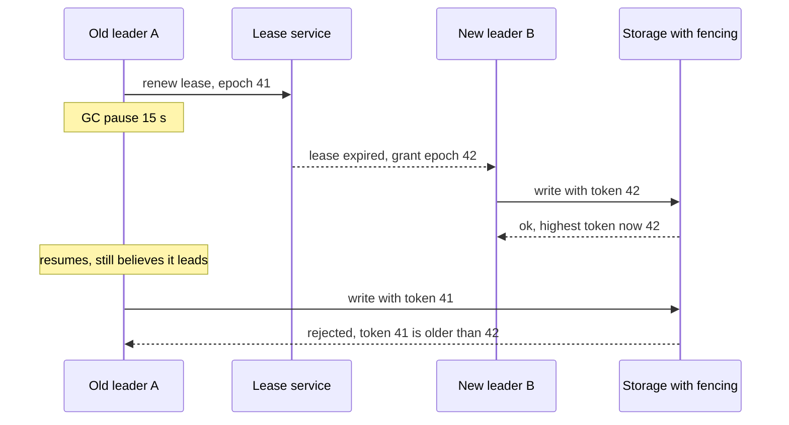

# Split-Brain

> [!abstract] In one sentence
> Split-brain is the state in which two nodes each believe they are the sole leader, primary or lock holder and both act on it, and because no election can prevent an old leader from *thinking* it still leads, the real defence is fencing — making every protected resource reject actions from any leader but the newest.

> [!tip] Deeper treatment in your system-design vault
> `system-design/08 Distributed Systems Theory/Split Brain and Fencing.md` — read it *after* you have written your own explanation below.

**Map:** [[Distributed Systems MOC]] → [[HLD MOC]]

## Definition

**Split-brain** occurs when a system that is supposed to have exactly one active authority — a primary database, a cluster leader, a lock holder, an active node in an active-passive pair — has two or more, each accepting work independently. It is a *safety* violation: the system's state diverges and later cannot be reconciled without discarding someone's writes. **Fencing** is the family of techniques that make a deposed authority harmless: **fencing tokens** (a monotonically increasing epoch that every action carries and every resource checks) and **STONITH** ("shoot the other node in the head" — forcibly powering off or isolating the old node before promoting a new one).

## Problem solved

Any failover design must answer: when the new leader starts, what is the old one doing? The comfortable assumption is "it is dead, that is why we failed over", but failover is triggered by a timeout ([[Failure Detection]]), and a timeout is also what a GC pause, an overloaded node, a stalled disk or a one-way [[Network Partitions|partition]] looks like. In every one of those cases the old leader is alive and will carry on the instant it can. A primary database that keeps accepting writes after a replica was promoted produces two divergent histories; a scheduler that runs the settlement job twice double-posts; a lock holder that resumes after its lease expired corrupts the file another holder is writing. Early high-availability clusters (Pacemaker, Heartbeat) learned this the hard way and standardised STONITH as mandatory; distributed databases learned it through [[Jepsen]] reports. The lesson is that *reducing the probability* of two leaders (good timeouts, quorum election) is necessary but not sufficient; you need the second layer that makes the overlap harmless.

## How it works

1. **How it arises.** Node A holds the leader role with a lease of 10 s. A stalls (stop-the-world GC, VM live migration, swap, a partition from the lease service). The lease expires; node B is elected with epoch 42 and starts working. A resumes: nothing on A knows time passed, its in-memory flag still says `isLeader = true`, and its next write goes out. For a lock the sequence is identical with "lock" for "lease"; for a replicated database it is the primary and a promoted replica.
2. **Layer one: quorum-based election.** Make leadership require a [[Quorums|majority]] vote or a majority-backed lease so two leaders cannot be *elected* for the same term. This prevents two *simultaneous elections* from both succeeding, which is what naive "ping the primary, promote if silent" scripts get wrong when run from several places. It does not prevent the old leader from acting during the overlap ([[Leader Election]], [[Consensus]]).
3. **Layer two: the leader polices itself.** The leader renews its lease on a monotonic clock and stops acting when it cannot confirm the lease is valid, with a margin ([[Clocks and Time]]). This shrinks the overlap but cannot eliminate it: a process cannot run code to stop itself while it is paused, and a write issued just before the pause can land after it.
4. **Layer three: fencing tokens.** The election returns a monotonically increasing number — Raft's term, ZooKeeper's zxid, etcd's lease revision, a database `epoch` column. Every action the leader takes carries it, and every resource that matters checks it: the storage system rejects writes with a token lower than the highest it has seen, the database rejects `UPDATE … WHERE epoch = 41` once 42 has written, the message consumer discards messages with an older epoch. The old leader's actions then fail loudly instead of corrupting state ([[Distributed Locks]]).
5. **Layer four: STONITH and resource-level isolation.** When the resource cannot check tokens (a legacy filesystem, a device, a third-party API), isolate the old node instead: power it off via the hypervisor or cloud API, revoke its credentials, remove it from the load balancer, or at the storage layer use SCSI persistent reservations so only one node can write a volume. Kubernetes' behaviour for StatefulSets reflects this: it will not recreate a pod from a node it has lost contact with until the node is confirmed gone, precisely to avoid two writers on the same volume.
6. **Detection and recovery.** Detect by comparing authorities: two nodes reporting `is_leader=1` in metrics, replicas rejecting replication from a stale primary, fencing rejections in logs, or diverged replication positions. Recovery means choosing one history — usually the fenced-off side's writes since the overlap are extracted for manual review, then discarded — and re-establishing replication from the surviving leader.

```sql
-- Fenced write: the token won at election must still be the newest
UPDATE ledger_runs
SET status = 'POSTED', posted_by_epoch = 42
WHERE run_id = 'settle-2026-10-19'
  AND 42 >= (SELECT max(posted_by_epoch) FROM ledger_runs);
-- rowcount 0 => a newer leader exists; stop immediately, do not retry
```

## Architecture



> [!example]- Excalidraw version — the same diagram as an editable canvas
> ![[Split-Brain.excalidraw]]
> [[Split-Brain.excalidraw|Open in Excalidraw]] — needs the Excalidraw plugin (see [[Plugins to Install]]).


## Use cases

- Any active-passive or primary-replica design where the requirement says "automatic failover" — the design is incomplete until it states how the old primary is fenced ([[Replication]], [[Disaster Recovery]]).
- Singleton jobs with side effects (settlement, payouts, invoice generation): "exactly one instance runs it" must survive a 30 s pause, which means fencing on the side effects.
- Lock-protected resources where the operation is not idempotent: the lock alone is insufficient; the resource must check the token ([[Distributed Locks]]).
- Multi-region active-passive databases where the passive region may be promoted during a partition: the old region must be unable to accept writes once DNS has flipped.
- Shared storage (EBS volumes, NFS, a shared bucket prefix) attached to a single writer at a time.

## Limitations

- Fencing tokens require the *resource* to cooperate: it must store the highest token and reject lower ones. Many resources (third-party APIs, SMTP, SQS, most SaaS) cannot, so you fall back to idempotency keys or STONITH.
- STONITH needs an out-of-band control path (hypervisor, cloud API, IAM revocation) that is itself reachable during the partition — a STONITH that cannot reach the node leaves you with a choice between "promote without fencing" and "stay down".
- Fencing makes the old leader fail; it does not make its *in-flight* side effects un-happen — an email sent, a webhook delivered or a payment captured during the overlap is real ([[Duplicate Message Processing]]).
- In an active-active design there is no "one authority" to split, so the concept does not apply; the conflicts are the normal case and need merge rules ([[Eventual Consistency]]).

## Trade-offs

| You gain | You sacrifice |
|---|---|
| Safety: a deposed leader's actions are rejected, not merely unlikely | Every protected write carries and checks a token, and every resource must support it |
| Confident automatic failover instead of a human on the phone | STONITH and isolation infrastructure that must work during the very partition that triggered it |
| Clear forensics ("epoch 41 was rejected at 10:42:07") | A hard stop for the old leader mid-task, which must then be safe to abandon |
| Freedom to use shorter leases, since overlap is harmless | Residual duplicates for side effects outside the fenced resources |

## Failure modes

- **Dual primary after a pause** — the classic: both accept writes for the overlap window. You notice as replication errors when the old primary tries to ship WAL to a replica that has moved on, or as duplicate side effects; blast radius is every write on the losing side, which must be discarded or manually merged.
- **Fencing bypass** — a code path writes without the token (a batch job, a migration, a direct database connection), so fencing exists but is not enforced. Noticed only after an incident when the postmortem finds the unfenced path; radius depends on what that path touches.
- **STONITH fails during the partition** — the cloud API is unreachable from the side doing the promotion; the automation either promotes anyway (split-brain) or refuses (extended outage). Noticed as a stuck failover; this is why the fencing path needs its own health check and drill.
- **Token store reset** — the fencing counter is kept in a system that was restored from backup or recreated, and epochs restart from 1; old tokens look new. Noticed late, as a leader with a "lower" epoch succeeding; keep the counter in the consensus store, never in application memory.
- **Stuck lease from an unclean shutdown** — the inverse: nobody can take over because the lease has no expiry or an enormous one; not split-brain but the fear of it taken too far. Noticed as a vacant role with a live lease ([[Leader Election]]).

## Performance

Fencing checks cost one comparison per write against a stored maximum: in a database it is a predicate in the `WHERE` clause or a trigger on a small table; in a storage service it is a header compare. Lease renewals and heartbeats are negligible. The measurable cost is in failover time: STONITH adds the time to confirm the old node is off (seconds to a minute for cloud instance operations) before the new leader starts, and conservative lease margins add a few seconds of vacancy. These are deliberately paid; a failover that is 10 s slower and never splits is the right default for anything holding money.

## Scalability

Split-brain risk does not scale with traffic, it scales with the number of singleton roles and the number of pause-prone processes. A fleet with hundreds of leader roles (one per shard, one per job) needs fencing to be a library concern — a token threaded through the storage client automatically — not a per-feature discipline. Per-shard leadership also localises the blast radius: a split on one shard's leader affects one shard's keys. Systems that scale by eliminating singleton roles altogether (idempotent, commutative work claimed from a queue) remove the problem rather than managing it ([[Coordination vs Availability]]).

## Operational impact

Make the authority visible: `is_leader` and `leader_epoch` gauges per instance, an alert when the sum of `is_leader` across a role exceeds one for longer than the expected overlap, and fencing rejections counted as a distinct metric that should normally be zero but non-zero during every failover. Runbooks must cover "we had two primaries for N seconds": how to find the divergent writes (compare replication positions, export the loser's writes since the fork point) and who decides what to do with them. Drill failover with a *paused* leader, not just a killed one; the killed case never exhibits split-brain and gives false confidence ([[Chaos Lab]]).

## Alternatives

- **Idempotent, duplicate-tolerant work** — if both leaders doing the job is harmless (same result, deduplicated by key), you do not need fencing; wins when the work is naturally idempotent ([[Idempotency]]).
- **Consensus-replicated state** — route all authoritative writes through a Raft group so there is no separate leader-plus-resource pair to split; wins for coordination data and small hot state ([[Consensus]]).
- **Manual failover** — the human confirms the old primary is dead or shuts it down before promoting; wins when failovers are rare and the cost of a wrong automatic failover is very high (many teams run their primary database this way for years).
- **Active-active with conflict resolution** — accept concurrent writers by design, with CRDTs or application merge; wins where availability dominates and conflicts are tolerable ([[Eventual Consistency]]).

## Real-world examples

- **Pacemaker and Corosync** clusters require a configured STONITH device and will refuse to run a resource unless fencing is possible, a stance born from years of corrupted shared storage.
- **ZooKeeper** exposes the zxid and session epochs that HBase and Kafka (pre-KRaft) used to fence stale masters and controllers; Kafka's leader epoch in the replication protocol lets replicas reject fetches from a deposed partition leader.
- **Elasticsearch** before version 7 was famous for split-brain when `minimum_master_nodes` was misconfigured; version 7 replaced it with a quorum-based cluster coordination layer specifically to remove the footgun.
- In a stack like yours: a PostgreSQL primary on RDS Multi-AZ is fenced by the platform during failover, but an application-level singleton (an outbox relay, a settlement job) running in three pods is not — its lease (Kubernetes `Lease`, Redis key, database row) needs an epoch that the ledger writes check.

## Practical exercise

1. Build on the [[Leader Election]] exercise: three instances of a worker elect through etcd with a 5 s lease; each appends `epoch, instance, counter` lines to a shared PostgreSQL table.
2. Pause the leader with `docker pause` for 10 s; show the resulting rows with two instances interleaving — the split-brain window — and count the overlapped writes.
3. Add fencing: a `leader_epoch` table with the highest seen epoch, and make the insert conditional on `epoch >= max`. Repeat the pause and show the old leader's inserts failing with rowcount 0; make the worker exit on the first rejection.
4. Implement STONITH: on acquiring the lease, the new leader calls `docker kill` on the previous holder (recorded in etcd) before starting work; measure the added failover time.
5. Record for each setup: overlap writes, failover duration, and what happens when the fencing table is unreachable (decide and document fail-open versus fail-closed).

## Related concepts

### Prerequisites
- [[Leader Election]] — the mechanism whose imperfection produces split-brain
- [[Network Partitions]] — the main cause, together with pauses
- [[Replication]] — primary and promoted replica is the canonical dual-primary case
- [[Failure Detection]] — the false positive that starts a failover with a live leader

### Related
- [[Quorums]] — majority election prevents two simultaneous winners
- [[Consensus]] — terms and epochs as fencing tokens built into the protocol
- [[Clocks and Time]] — why a leader cannot trust its own sense of lease validity
- [[Read Replicas]] — a stale promoted replica is a quieter form of the same divergence
- [[Idempotency]] — the fallback when the resource cannot check tokens

### Builds on this
- [[Distributed Locks]] — the fencing-token argument applied to short-lived mutual exclusion
- [[Disaster Recovery]] — regional failover must fence the old region before the new one takes writes
- [[Distributed Caching]] — Redis Sentinel and Cluster failover rely on epochs to prevent two primaries

### Design problems where it applies
- [[Design a Distributed Key-Value Store]]
- [[Design a Distributed Job Scheduler]]
- [[Design a Payment System]]
- [[Design a Distributed Cache]]

### Projects where it can be implemented
- [[Lock Service with Fencing Tokens]]
- [[Chaos Lab]]
- [[Durable Job Scheduler]]

### Resources
- [[Designing Data-Intensive Applications]] — chapter 8's fencing-token argument is the canonical treatment
- [[Jepsen]] — the published analyses are a catalogue of real split-brain behaviour
- [[Raft Paper]] — terms as built-in fencing
- [[Toxiproxy]] — to create the partitions that cause it

## Personal understanding

> [!question] Explain it without the source
> Write your own explanation here, from memory. Then compare it with the sections above and note what you missed.

### Mastery checklist
- [ ] I can explain it without the original resource
- [ ] I can describe the problem it solves
- [ ] I can compare it with its alternatives
- [ ] I can name its limitations and failure modes
- [ ] I can recognise when it is appropriate in a real system
- [ ] I have applied it in a system design
- [ ] I have validated my assumptions with an experiment or implementation

## Open questions

- [ ] How does RDS Multi-AZ fence the old primary during a failover, and what visible symptoms would an application see from a connection that was mid-transaction on it?
- [ ] For a singleton job whose side effects are SQS messages and partner API calls (resources that cannot check a token), what combination of idempotency keys and epoch-stamped messages gives the equivalent of fencing?
- [ ] What does Redis Sentinel's `config-epoch` actually protect against, and in which partition scenarios can a Sentinel-managed Redis still end up with two writable primaries?
