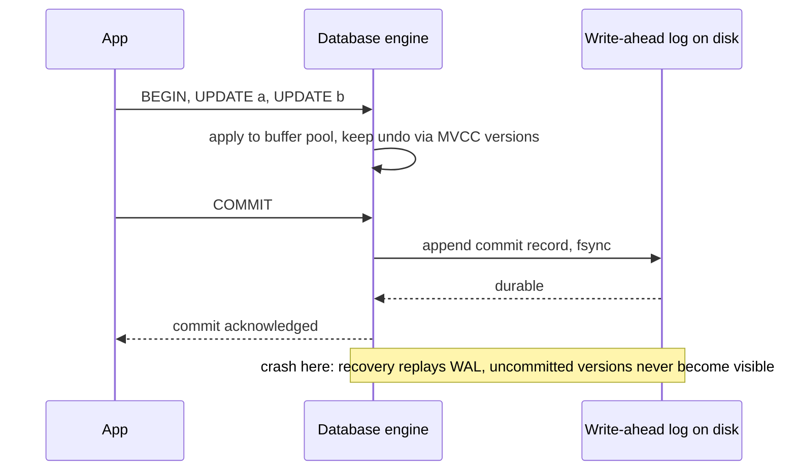

# ACID

> [!abstract] In one sentence
> ACID is the promise that a group of writes either all happen or none do, that they leave your invariants intact, that concurrent transactions cannot see each other's half-done work, and that a commit survives a crash — and the slippery letter is I, because "isolation" ranges from "almost none" to "as if serial" depending on a setting most teams never look at.

> [!tip] Deeper treatment in your system-design vault
> `system-design/05 Relational Databases/ACID Transactions.md` — read it *after* you have written your own explanation below.

**Map:** [[Fundamentals MOC]] → [[HLD MOC]]

## Definition

ACID is the set of safety guarantees a database makes about a [[Transactions|transaction]], a group of reads and writes treated as one unit. **Atomicity**: all of the transaction's writes become visible, or none do; on error or crash the partial work is rolled back. **Consistency**: the transaction moves the database from one valid state to another, where "valid" is defined by the application's invariants and the constraints it declares. **Isolation**: concurrently running transactions do not interfere; at the strongest level the result is as if they ran one after another. **Durability**: once the database acknowledges a commit, the data survives crashes and power loss. The acronym comes from Härder and Reuter (1983); the letters are not equally precise, and the guarantees are only as strong as the configuration behind them.

## Problem solved

Without transactions, every multi-step change is a crash-and-concurrency puzzle the application must solve itself. Transfer money between two accounts as two separate updates and a crash in between leaves money created or destroyed; two concurrent transfers reading the same balance both succeed and the account goes negative; a committed order vanishes because it was in a buffer when the machine lost power. Before ACID databases, application code carried this burden with hand-written logs and careful ordering, and got it wrong constantly. ACID moves the hard cases into the database, where they are solved once, with well-understood machinery, and lets application code be written as if it were the only thing running on a machine that never crashes.

## How it works

**Atomicity — the write-ahead log.** Before modifying data pages, the database appends a record of the change to a sequential log (the WAL in PostgreSQL, the redo log in InnoDB). On commit, the log is forced to disk. If the process crashes, recovery replays the log for committed transactions (redo) and discards or reverses changes from uncommitted ones (undo, or simply never making them visible under MVCC). Atomicity is therefore really *abortability*: the database can always get back to a state where the transaction never happened ([[Relational Database Internals]]).

**Consistency — mostly yours.** The database enforces declared constraints (primary keys, foreign keys, `CHECK`, unique indexes) and nothing else. "Debits equal credits" or "a booking never exceeds capacity" are invariants only the application knows; ACID's C says the database will not break them *if the transaction's logic preserves them and isolation is strong enough*. Treat C as a reminder to declare every invariant you can as a constraint, and to protect the rest with the right isolation level.

**Isolation — the dial.** The SQL standard defines four levels by the anomalies they forbid:

| Level | Dirty read | Non-repeatable read | Phantom | Lost update / write skew |
|---|---|---|---|---|
| Read Uncommitted | possible | possible | possible | possible |
| Read Committed | prevented | possible | possible | possible |
| Repeatable Read / Snapshot | prevented | prevented | mostly prevented | lost update prevented in most engines; write skew possible |
| Serializable | prevented | prevented | prevented | prevented |

Implementations differ: PostgreSQL uses MVCC — readers see a snapshot and never block writers — with Read Committed as the default, Repeatable Read implemented as snapshot isolation, and true Serializable via serializable snapshot isolation, which aborts transactions whose interleaving could not have been serial. MySQL's InnoDB defaults to Repeatable Read with gap locks. Oracle's "Serializable" is in fact snapshot isolation. The practical consequence: at the default level, a read-modify-write of a balance can lose updates unless you lock the row (`SELECT ... FOR UPDATE`), update atomically (`SET balance = balance - 100`), or check a version column ([[Optimistic and Pessimistic Locking]], [[Isolation Levels]]).

```sql
-- Lost update under Read Committed: two sessions run this concurrently, both read 100, both write 50.
BEGIN;
SELECT balance FROM accounts WHERE id = 42;          -- 100
UPDATE accounts SET balance = 50 WHERE id = 42;      -- computed in the app as 100 - 50
COMMIT;

-- Safe variants:
UPDATE accounts SET balance = balance - 50 WHERE id = 42 AND balance >= 50;   -- atomic, checks invariant
SELECT balance FROM accounts WHERE id = 42 FOR UPDATE;                         -- pessimistic lock
UPDATE accounts SET balance = 50, version = 8 WHERE id = 42 AND version = 7;   -- optimistic
```

**Durability — a configuration.** A commit is durable when the WAL record is on stable storage: the database calls `fsync` (PostgreSQL `synchronous_commit = on`, InnoDB `innodb_flush_log_at_trx_commit = 1`). Group commit batches many transactions into one flush to keep this fast. Turn the setting down and a commit is acknowledged before it is on disk — faster, and lost on a crash in the window. A single disk is not durable against disk failure; real durability adds [[Replication]], ideally synchronous, and backups ([[Backups and Restoration]]). There is no absolute durability, only a list of failure modes you have covered.

## Architecture



> [!example]- Excalidraw version — the same diagram as an editable canvas
> ![[ACID.excalidraw]]
> [[ACID.excalidraw|Open in Excalidraw]] — needs the Excalidraw plugin (see [[Plugins to Install]]).


## Use cases

- Any change touching several rows or tables that must stay in step: transfers, order plus order lines, inventory decrement plus reservation.
- Invariants that must hold under concurrency: no negative balances, no double-booked seat, one username per person ([[Design a Ticket Booking System]]).
- Writes that must survive an acknowledgement: a payment marked captured must still be captured after a crash.
- The [[Outbox Pattern]]: a state change and its event row committed atomically.
- Any requirement phrased as "either all of this happens or none of it".

## Limitations

- ACID is per database instance; across services or databases there is no atomicity without [[Distributed Transactions]] or a [[Saga Pattern]].
- Isolation levels are confusing and defaults are weak; most teams run at Read Committed and are exposed to lost updates and write skew without knowing it.
- Serializable isolation costs throughput (aborts and retries, or locks) and requires retry logic in the application.
- Durability at the single-node level does not survive disk or node loss; the fsync is also the slowest part of a commit.
- Long transactions hold snapshots and locks, bloat MVCC storage and block vacuum; ACID encourages keeping transactions short, and some workloads cannot.

## Trade-offs

| You gain | You sacrifice |
|---|---|
| Multi-step changes that are all-or-nothing, even across crashes | WAL writes and fsyncs on the commit path, limiting write throughput |
| Invariants enforced by constraints, not by every caller remembering | Schema rigidity; constraints must be declared and migrated |
| Concurrency without application-level locking, at the chosen level | Isolation anomalies at weaker levels, aborts and retries at the strongest |
| A commit you can trust after acknowledgement | Latency per commit, and the need for replication to extend durability beyond one disk |

## Failure modes

- **Lost update at Read Committed**: two concurrent read-modify-write transactions on the same row; one write silently overwrites the other. Noticed by reconciliation or customer complaints; blast radius is every concurrent update to the same row, which is exactly hot accounts.
- **Write skew at snapshot isolation**: two transactions each check an invariant on a snapshot and each write a different row, and together they break it (two on-call doctors both go off duty). Noticed only by auditing; needs Serializable or explicit locking.
- **Durability turned down for speed**: `synchronous_commit = off` or `innodb_flush_log_at_trx_commit = 2` in production; a crash loses the last fraction of a second of acknowledged commits. Noticed as missing records after an incident, with no error ever logged.
- **Transaction scope wider than intended**: an ORM opens a transaction per request, including external HTTP calls; locks are held for seconds, throughput collapses. Noticed as lock waits correlated with dependency latency.
- **Serialization failures unhandled**: at Serializable, the database aborts a transaction with a serialization error and the application returns 500 instead of retrying. Noticed as error spikes under contention.

## Performance

The commit path is bounded by fsync latency — roughly tens to hundreds of microseconds on NVMe, milliseconds on networked storage, order of magnitude — amortised by group commit so that write throughput can reach thousands to tens of thousands of commits per second on one node. MVCC makes reads cheap and non-blocking at the cost of storing old versions and running vacuum. Stronger isolation costs either lock waits (2PL engines) or abort-and-retry (SSI); both are small when transactions are short and conflicts are rare, and both degrade sharply under hot-row contention.

## Scalability

ACID scales vertically well and horizontally badly: a single node's commit throughput is the ceiling, and atomicity across nodes requires two-phase commit, which blocks on coordinator failure. The usual path is to keep transactions within one shard by choosing the shard key so that the rows a transaction touches live together ([[Sharding]]), and to replace cross-shard transactions with sagas and idempotent steps. Read load scales through replicas, at the cost of isolation and freshness on those reads.

## Operational impact

Operate the settings: isolation level per connection or per transaction (and whether the ORM changes it), `synchronous_commit` and standby configuration, WAL retention and checkpoint tuning. Monitor lock waits, long-running transactions, serialization failure rate and WAL fsync latency. Debugging an isolation bug requires reproducing a specific interleaving, which is hard; the preventive move is to pick the right pattern (atomic `UPDATE`, `FOR UPDATE`, version column) in code review. Backups and restore drills are the durability half of the job.

## Alternatives

- **[[BASE]] / eventual consistency with idempotent operations** — wins when data is partitioned across many nodes and cross-node atomicity would cost too much; the application absorbs the complexity.
- **Single-writer, append-only log** ([[Event Sourcing]]) — atomicity becomes "one append", invariants are checked by a single sequential processor; wins for audit-heavy domains.
- **Sagas with compensation** ([[Saga Pattern]]) — cross-service "transactions" as a sequence of local ACID steps plus undo steps; wins for workflows spanning services.
- **Distributed transactions (2PC, Spanner-style)** — atomicity across nodes at a coordination cost; wins when the business cannot tolerate compensation and the latency is affordable.

## Real-world examples

- PostgreSQL's documentation on transaction isolation is the canonical description of MVCC levels, including the fact that Repeatable Read is snapshot isolation and that Serializable uses SSI with retry on serialization failure ([[PostgreSQL Transaction Isolation Docs]]).
- *Designing Data-Intensive Applications* chapter 7 dissects each letter, shows that the C belongs to the application, and walks through lost updates, write skew and phantoms with concrete examples ([[Designing Data-Intensive Applications]]).
- Stripe's and Brandur's write-ups on idempotency keys show how a transactional database is combined with an idempotency record so a retried request is atomic and exactly-once from the client's view ([[Brandur - Implementing Idempotency Keys]]).
- In a stack like yours: a Spring Boot `@Transactional` service method or a NestJS TypeORM transaction wrapping a ledger entry and a balance update on PostgreSQL. The things to check are the isolation level the pool sets, whether the balance update is written atomically or as read-modify-write, and whether `synchronous_commit` and the standby configuration make the acknowledged commit actually durable.

## Practical exercise

1. Start PostgreSQL in Docker and create an `accounts` table with one row at balance 100.
2. In a small Java or TypeScript program, run two concurrent transactions that each read the balance and write `balance - 50` at Read Committed; observe the final balance of 50 (lost update).
3. Repeat with `UPDATE ... SET balance = balance - 50 WHERE balance >= 50`, then with `SELECT ... FOR UPDATE`, then at `SERIALIZABLE` with retry on error code `40001`; record the final balance and the number of retries for each.
4. Construct a write-skew case (two rows, a constraint that at least one must stay active) at Repeatable Read and show it breaks; show Serializable catches it.
5. Measure commit throughput of a single-row insert loop with `synchronous_commit = on` versus `off`; then `docker kill` the container mid-loop with `off` and count the committed-but-missing rows.
6. Write down which isolation level and durability setting you would choose for a ledger and why.

## Related concepts

### Prerequisites
- [[Transactions]] — the unit ACID describes
- [[Relational Database Internals]] — WAL, buffer pool and MVCC

### Related
- [[Isolation Levels]] — the I letter in full
- [[Optimistic and Pessimistic Locking]] — how to close the lost-update gap
- [[Replication]] — durability beyond one disk
- [[Backups and Restoration]] — durability against everything else
- [[BASE]] — the contrasting philosophy

### Builds on this
- [[Outbox Pattern]] — state change and event in one atomic commit
- [[Distributed Transactions]] — ACID across nodes and its costs
- [[Saga Pattern]] — what you do when you cannot have one transaction
- [[Idempotency]] — combining a transaction with an idempotency record

### Design problems where it applies
- [[Design a Payment System]]
- [[Design a Digital Wallet and Ledger]]
- [[Design a Ticket Booking System]]
- [[Design an Inventory Management System]]

### Projects where it can be implemented
- [[Double-Entry Ledger Service]]
- [[Durable Job Scheduler]]

### Resources
- [[PostgreSQL Transaction Isolation Docs]] — the levels as actually implemented
- [[Designing Data-Intensive Applications]] — chapter 7, the best treatment of the four letters
- [[Brandur - Implementing Idempotency Keys]] — transactions plus idempotency in practice
- [[Database Internals]] — WAL, recovery and concurrency control

## Personal understanding

> [!question] Explain it without the source
> Write your own explanation here, from memory. Then compare it with the sections above and note what you missed.

### Mastery checklist
- [ ] I can explain it without the original resource
- [ ] I can describe the problem it solves
- [ ] I can compare it with its alternatives
- [ ] I can name its limitations and failure modes
- [ ] I can recognise when it is appropriate in a real system
- [ ] I have applied it in a system design
- [ ] I have validated my assumptions with an experiment or implementation

## Open questions

- [ ] What isolation level do our Spring and NestJS connection pools actually set, and which code paths do a read-modify-write that is unsafe at that level?
- [ ] On RDS multi-AZ, what exactly is acknowledged at commit — local fsync, standby receipt or standby flush — and what does that mean for durability on failover?
- [ ] At what contention level does PostgreSQL Serializable become cheaper than row locks for a hot-account ledger, if ever?
