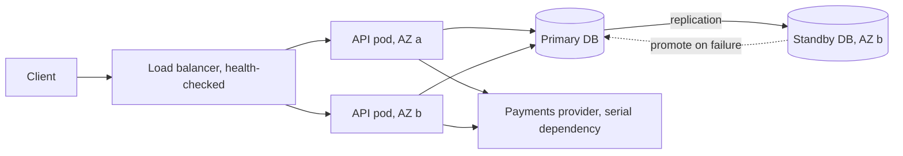

# Availability

> [!abstract] In one sentence
> Availability is the probability that the system answers correctly when asked; the maths of series and parallel composition tells you that every synchronous dependency lowers it and every independent replica raises it, which is why redundancy plus fast failover is the whole game.

> [!tip] Deeper treatment in your system-design vault
> `system-design/01 Foundations/Availability Reliability Durability.md` — read it *after* you have written your own explanation below.

**Map:** [[Fundamentals MOC]] → [[HLD MOC]]

## Definition

Availability is the proportion of time (time-based) or of requests (request-based) during which a service performs its function within its agreed limits. Time-based availability is MTBF / (MTBF + MTTR): how long the system runs between failures, divided by that plus how long repair takes. Request-based availability, the form used in SRE practice, is successful requests / total valid requests over a window, which also captures partial outages. "Successful" includes *timely*: a response that arrives after the client's timeout is an unavailable one. Availability is not [[Reliability]] (doing the right thing) and not durability (not losing data) — a system can be up and wrong, or down and safe.

## Problem solved

Without a number, availability is an argument. "The site is usually up" cannot be budgeted, compared with a competitor's offer, or traded against feature work. Expressing availability as nines, measuring it from the client's point of view and composing it across dependencies turns it into engineering: you can compute that a checkout path calling four 99.9% services synchronously cannot itself exceed 99.6%, that a single-instance database caps the whole product at whatever its reboot time allows, and that the next nine costs more than the last one. It also exposes the real lever: since availability is dominated by MTTR, detecting fast and failing over fast beats trying to prevent every fault.

## How it works

**The nines table** (per year, approximate):

| Availability | Downtime per year | Per month (30 d) |
|---|---|---|
| 99% | ~3.65 days | ~7.3 h |
| 99.9% | ~8.8 h | ~43.8 min |
| 99.95% | ~4.4 h | ~21.9 min |
| 99.99% | ~52.6 min | ~4.4 min |
| 99.999% | ~5.3 min | ~26 s |

At four nines, a single incident that takes 15 minutes to detect and 40 minutes to mitigate has spent the year's budget. Humans cannot be in the loop at five nines; recovery must be automatic.

**Series composition.** If a request needs components A and B both working, availability is A × B (assuming independence). Three synchronous dependencies at 99.9% each give 0.999³ ≈ 99.7%. Every synchronous call you add lowers the ceiling; this is the arithmetic behind [[Synchronous vs Asynchronous Communication]] and [[Graceful Degradation]].

**Parallel composition.** If either of two independent replicas can serve, unavailability is (1 − A)²: two 99% replicas give 99.99%. The assumption of independence is the catch — replicas on the same host, same AZ, same deploy, same bad config, fail together.

**The levers**, in order of impact:

1. **Remove single points of failure**: more than one instance of everything on the request path, in more than one failure domain (AZ).
2. **Detect fast**: [[Health Checks]] and [[Failure Detection]] with tight but not twitchy thresholds; most of MTTR is time-to-notice.
3. **Fail over fast**: [[Load Balancers]] drain unhealthy instances; database [[Replication]] with automatic promotion ([[Leader Election]]); DNS or anycast for whole-region failures.
4. **Degrade instead of failing**: serve stale cache, skip optional dependencies, shed low-priority load.
5. **Reduce blast radius**: [[Bulkheads]], cell-based deployment, progressive rollouts so a bad deploy hits 5% of traffic, not 100%.

```text
checkout = api(99.95%) × auth(99.99%) × payments(99.9%) × db(99.95%)
         ≈ 99.79%  →  about 18 hours of unavailability per year, before any bugs
```

## Architecture



> [!example]- Excalidraw version — the same diagram as an editable canvas
> ![[Availability.excalidraw]]
> [[Availability.excalidraw|Open in Excalidraw]] — needs the Excalidraw plugin (see [[Plugins to Install]]).


## Use cases

- A requirement or contract names a number: "99.95% monthly", "no more than 20 minutes of downtime per quarter" — now every dependency must be budgeted.
- A dependency outside your control (payment provider, SMS gateway) is on the synchronous path — you need queueing, fallbacks or degraded modes to stay above your own target.
- A single-instance component (one database, one scheduler, one broker node) exists on the critical path; its restart time is your availability ceiling.
- Deploys cause brief errors — rolling updates, readiness probes and connection draining are availability work.
- Regulatory or customer-facing SLAs with credits attached, where the gap between promised and measured availability is money.

## Limitations

- Availability says nothing about correctness or data safety; a cache that serves stale balances is "available".
- The independence assumption in the maths is routinely false: shared power, shared deploy pipeline, shared configuration, shared cloud provider, correlated load.
- Each extra nine costs roughly an order of magnitude more (multi-AZ → multi-region → active-active with conflict handling) and the business often cannot use it.
- Measured at the wrong place it lies: server-side 100% while DNS or a CDN edge is failing for a region ([[Monitoring User-Facing Performance]]).
- Over long windows a single large outage dominates; the average hides a bad month.

## Trade-offs

| You gain | You sacrifice |
|---|---|
| A measurable promise you can budget, alert on and sell | Redundant capacity that sits idle most of the year |
| Automatic failover that removes humans from MTTR | Complexity of replication, election and split-brain avoidance |
| Degraded modes that keep revenue flowing through partial outages | Consistency: serving stale or partial data to stay up |
| Smaller blast radius through isolation and progressive rollout | Slower, more ceremonial deploys and more infrastructure to operate |

## Failure modes

- **Correlated failure**: all replicas run the same bad release or config → parallel maths gives 99.99% on paper, reality is 0%. Noticed as a fleet-wide error spike right after a deploy or a config push; blast radius is the whole service.
- **Failover that was never exercised**: the standby exists but promotion takes 20 minutes of manual steps, or the replica is hours behind. Noticed during the incident; blast radius is the full MTTR plus possible data loss ([[Recovery Point Objective]]).
- **Health check lies**: the probe returns 200 while the pod cannot reach the database, so the load balancer keeps sending traffic → partial outage that looks healthy on dashboards. Blast radius: a fraction of users, for as long as nobody looks at client-side errors.
- **Split-brain on failover**: both the old primary and the promoted standby accept writes ([[Split-Brain]]). Noticed late via divergent data; blast radius is every write during the window.
- **Dependency drags you down**: a serial 99.9% dependency has a bad week and your 99.95% promise is gone with no bug on your side. Noticed via dependency error rates; mitigated only by timeouts, fallbacks and asynchrony.

## Performance

Redundancy and failover add little per-request latency on their own; what adds latency is *synchronous replication* needed to make failover lossless (each commit waits for a standby), and health-check traffic at scale. Timeouts are an availability tool with a latency price: a 2-second timeout on a dependency means a 2-second tail for every request during that dependency's outage. Active-active across regions buys availability at the cost of cross-region write latency or conflict resolution ([[PACELC]]).

## Scalability

Availability does not automatically improve with scale; it often worsens, because more components means more things on the serial path. At 10x the fleet, the probability that *something* is failing at any instant approaches 1, so the design must assume partial failure constantly: per-instance health, graceful handling of a missing node, and no operational step that touches every node at once. Cell-based architectures (independent stacks each serving a slice of customers) keep blast radius constant as the fleet grows.

## Operational impact

High. Availability targets drive on-call rotation, paging thresholds ([[Alerting]]), game days and failover drills, and the rule that no deploy goes to 100% at once. You need measurement from the client side (synthetic probes, real user monitoring), an incident process with blameless reviews ([[Production Incident Analysis]]), and an error-budget policy that pauses feature work when the budget burns ([[Error Budgets]]). The most valuable operational investment is reducing time-to-detect.

## Alternatives

- **Accept a lower target and say so** — wins for internal tools, batch systems and anything where an hour of downtime costs less than a second instance.
- **Degrade rather than replicate** — serve cached or read-only data when the write path is down; wins when writes are rare and reads are the business.
- **Asynchronous decoupling** ([[Message Queues]]) — accept the request, process later; wins when the user needs an acknowledgement, not the result, and removes dependencies from the serial path.
- **Buy it** — a managed database with multi-AZ failover gives 99.95–99.99% without owning replication; wins until you need custom failover behaviour or multi-region.

## Real-world examples

- Google's SRE book frames availability as a request-based SLI with an error budget, and argues explicitly that 100% is the wrong target because users cannot tell the difference beyond the availability of their own device and network ([[Site Reliability Engineering (Google)]]).
- Netflix's resilience work (Hystrix, Chaos Monkey) exists because their availability depends on dozens of serial dependencies per request; fallbacks and bulkheads are what keep the product up when one fails ([[Netflix - Fault Tolerance in a High Volume Distributed System]]).
- AWS publishes availability design goals per service and prices multi-AZ RDS as the standard way to buy automatic failover; the published commitments are what customer SLAs are built on top of.
- In a stack like yours: an EKS deployment with pods spread across AZs behind an ALB, RDS multi-AZ with a standby, and a payment provider on the synchronous path. The provider's availability bounds yours; the usual answer is to accept the payment request, persist it, and confirm asynchronously, so a provider blip costs latency instead of availability.

## Practical exercise

1. Run a small API (Spring Boot or NestJS) as two replicas behind nginx with Docker Compose, backed by one PostgreSQL container.
2. Drive steady load with k6 and record the success rate per second.
3. Kill one API replica with `docker kill` and measure the error window until nginx stops routing to it; then tune health-check interval and failure threshold and measure again.
4. Kill the PostgreSQL container and measure the outage; then add a streaming replica and a simple promotion script, and measure MTTR with and without automatic promotion.
5. Compute measured availability for the run as successful / total requests, and compare with the time-based figure — note how a partial outage shows up differently in each.
6. Add a fake third-party dependency with a 5-second hang (Toxiproxy) and observe how your availability drops with and without a 500 ms timeout plus fallback.

## Related concepts

### Prerequisites
- [[Reliability]] — the vocabulary of faults and failures that availability is measured against
- [[Latency]] — timeliness is part of the definition; slow is down

### Related
- [[Fault Tolerance]] — the techniques that produce availability
- [[SLI SLO and SLA]] — how the number is measured, targeted and promised
- [[Health Checks]] — the detection half of MTTR
- [[Replication]] — the redundancy half of the data tier
- [[Graceful Degradation]] — staying up by doing less
- [[Recovery Time Objective]] — the failover speed you commit to

### Builds on this
- [[Error Budgets]] — spending the allowed unavailability deliberately
- [[Disaster Recovery]] — availability across whole-site loss
- [[Circuit Breakers]] — protecting your availability from a dependency's
- [[Leader Election]] — automated promotion that keeps MTTR small

### Design problems where it applies
- [[Design a Payment System]]
- [[Design an IAM Service]]
- [[Design a Distributed Cache]]
- [[Design a Message Queue]]

### Projects where it can be implemented
- [[Chaos Lab]]
- [[Double-Entry Ledger Service]]

### Resources
- [[Site Reliability Engineering (Google)]] — chapters on embracing risk and SLOs
- [[Netflix - Fault Tolerance in a High Volume Distributed System]] — availability through fallbacks
- [[Designing Data-Intensive Applications]] — chapter 1 on reliability and faults

## Personal understanding

> [!question] Explain it without the source
> Write your own explanation here, from memory. Then compare it with the sections above and note what you missed.

### Mastery checklist
- [ ] I can explain it without the original resource
- [ ] I can describe the problem it solves
- [ ] I can compare it with its alternatives
- [ ] I can name its limitations and failure modes
- [ ] I can recognise when it is appropriate in a real system
- [ ] I have applied it in a system design
- [ ] I have validated my assumptions with an experiment or implementation

## Open questions

- [ ] For a request path I own, what is the computed series availability from the published or measured figures of each dependency, and how far is it from the promise we make?
- [ ] How much of our actual downtime over the last year was time-to-detect versus time-to-fix, and which lever would have moved it most?
- [ ] At what point does multi-region active-active cost more in consistency bugs than it buys in availability for a fintech write path?
