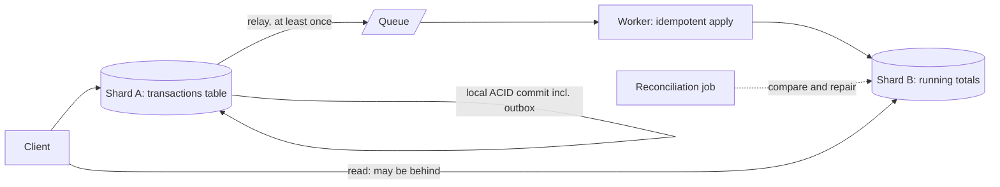

# BASE

> [!abstract] In one sentence
> BASE is the name for what you get when you partition data across nodes and refuse to pay for coordination — the system keeps answering, its state may be stale or in flight, and copies converge later — which buys availability and scale at the price of moving consistency logic from the database into your code.

> [!tip] Deeper treatment in your system-design vault
> `system-design/08 Distributed Systems Theory/Consistency Models.md` — read it *after* you have written your own explanation below.

**Map:** [[Fundamentals MOC]] → [[HLD MOC]]

## Definition

BASE describes the properties of a system designed around availability rather than strong consistency. **Basically Available**: the system responds to every request, even during partial failures, though the response may be stale or partial. **Soft state**: the state of the system may change over time even without new input, because replicas are still propagating updates and reconciling. **Eventually consistent**: if updates stop, all replicas converge to the same value ([[Eventual Consistency]]). The acronym was coined by Brewer's group in the late 1990s as the deliberate opposite of [[ACID]] and popularised by Dan Pritchett's 2008 article arguing that partitioned systems should relax consistency per operation rather than reach for distributed transactions.

## Problem solved

ACID transactions assume one database that can lock rows and force a log to disk; once data is partitioned across many nodes for scale, keeping that promise means two-phase commit on every cross-node write, which blocks on coordinator failure and makes the system unavailable whenever any participant is slow. BASE is the engineering answer to "we cannot afford that": accept that a write to one partition and a related write to another will not be atomic, design each step to be safe on its own, and reconcile. Pritchett's canonical example is a transaction table and a per-user running total on different shards: instead of a distributed transaction, write the transaction row, enqueue an idempotent "update total" message, and let the total catch up. The user sees a balance that is *briefly* behind, and the system never blocks.

## How it works

BASE is a set of design moves rather than a mechanism:

1. **Partition so most operations are local.** Choose shard keys so the common case touches one node ([[Sharding]]). The remaining cross-node updates are the ones BASE is about.
2. **Decompose cross-node updates into local steps plus messages.** Commit the primary change locally, then propagate the dependent change through a durable queue ([[Message Queues]], [[Outbox Pattern]]). The second step happens eventually, at least once.
3. **Make every step idempotent.** Because messages are redelivered and reconciliation reruns, each update must be safe to apply twice — a version check, a unique constraint on the message id, or a naturally idempotent operation ([[Idempotency]]).
4. **Tolerate soft state in the read path.** Readers may see the primary change before the dependent one; the UI and the business rules must allow for it (a "pending" status, a bounded staleness window, no hard decisions on possibly stale derived values).
5. **Reconcile.** A background process compares derived state with source state and repairs drift. Soft state without reconciliation is a slow leak.
6. **Resolve conflicts when two nodes both wrote.** Last-writer-wins, merge functions or CRDTs; the choice is a product decision disguised as a technical one.

**Where the acronym is useful.** It is a checklist for what the application now owns: idempotency, ordering tolerance, reconciliation, conflict resolution, and user interfaces that admit staleness. Asking "which parts of this design are soft state, and who converges them?" catches real bugs.

**Where it is marketing.** "Basically available" has no definition; "soft state" is vague; and most stores labelled BASE still provide strong guarantees at the single-key level — DynamoDB conditional writes, Cassandra lightweight transactions, Redis single-command atomicity. Real systems are neither ACID nor BASE wholesale; they offer specific [[Consistency Models]] per operation. The acronym was built to rhyme with ACID, and reading it as a rigorous alternative misses that ACID's letters describe mechanisms while BASE's describe the absence of them.

```text
Pritchett's example, BASE style:
  shard A:  BEGIN; INSERT INTO transactions(...); INSERT INTO outbox('update_total', user, amount, msg_id); COMMIT;
  relay:    publish outbox rows to a queue (at least once)
  shard B:  on message: UPDATE totals SET amount = amount + ? WHERE user = ? AND NOT EXISTS (applied msg_id);
            INSERT INTO applied(msg_id);   -- idempotency record, same local transaction
```

## Architecture



> [!example]- Excalidraw version — the same diagram as an editable canvas
> ![[BASE.excalidraw]]
> [[BASE.excalidraw|Open in Excalidraw]] — needs the Excalidraw plugin (see [[Plugins to Install]]).


## Use cases

- Data partitioned across nodes or services where cross-partition atomicity would need distributed transactions and the business can tolerate a short lag on derived data.
- Derived or aggregated values — totals, counts, materialised views, search indexes — that can be rebuilt from a source of truth ([[CQRS]]).
- High-write, globally distributed workloads (carts, sessions, telemetry) where availability during partitions matters more than immediate agreement ([[Dynamo Paper]]).
- Workflows across services, where sagas replace transactions and each step is a local commit ([[Saga Pattern]]).
- Any design where the requirement says "eventually" and means it.

## Limitations

- The application inherits the hard parts: idempotency, ordering, conflict resolution, reconciliation, and user-facing staleness — complexity that ACID hid.
- "Eventually" has no bound unless you measure and enforce one; unbounded lag is an outage with no alert.
- Unsuitable where decisions depend on fresh state: balance checks, inventory reservations, uniqueness, authorisation.
- Debugging is harder: the system is correct in the limit and wrong in the moment, and reproducing a race across nodes is slow work.
- The label invites hand-waving ("it's BASE, so it's fine") in design reviews where a precise consistency model should be named.

## Trade-offs

| You gain | You sacrifice |
|---|---|
| Availability through partitions and partial failures | Immediate consistency between related pieces of data |
| Horizontal write scalability without cross-node coordination | Atomicity across partitions; each step must be safe alone |
| Lower latency, since nothing waits on another node | A reconciliation process and the operational burden of running it |
| Freedom to use specialised stores per data type | A single mental model; every path needs its own consistency reasoning |

## Failure modes

- **Reconciliation never built**: derived totals drift from source data for months; discovered when finance asks why the dashboard disagrees with the ledger. Blast radius is every decision made on the derived value.
- **Non-idempotent second step**: a redelivered "update total" message is applied twice; the total is wrong and nothing errored. Noticed by reconciliation, if it exists ([[Duplicate Message Processing]]).
- **Decision on soft state**: a withdrawal is approved against a running balance that has not yet absorbed a previous debit; the account goes negative. Noticed as overdrafts; the fix is to route decisions to the source of truth.
- **Unbounded lag**: the queue between steps backs up during an incident; "eventually" becomes hours, users see yesterday's state, and no alert fires because nothing failed. Noticed by customers; needs a freshness SLI ([[SLI SLO and SLA]]).
- **Conflict rule surprises**: last-writer-wins with clock skew drops the write the user actually made last ([[Clocks and Time]]).

## Performance

BASE designs are fast on the write path — one local commit plus an asynchronous message — and scale throughput with partitions. The cost appears as background work (relays, workers, reconciliation) that consumes capacity continuously, and as read-path complexity when readers must merge or check versions. Latency to *consistency* (how long until the derived state is right) becomes a first-class metric alongside request latency.

## Scalability

This is the point of BASE: with no cross-node coordination, writes scale linearly with partitions and reads with replicas. The limits move to the queue (partition count, consumer throughput) and to the reconciliation job, whose cost grows with data volume unless it is incremental. At 10x, the question is whether the freshness bound still holds when the queue is 10x deeper during an incident.

## Operational impact

You operate the convergence machinery: queue lag, worker errors, dead-letter depth ([[Dead-Letter Queues]]), reconciliation run time and drift counts. Dashboards must show "how far behind is the derived state" per data type, with alerts on the bound. Incident response needs replay and repair tooling; a BASE system without a way to rebuild derived state from the source is one bad deploy away from permanent drift.

## Alternatives

- **[[ACID]] on one node** — wins whenever the data fits and the business needs immediate consistency; most transactional cores should start here.
- **[[Distributed Transactions]]** — atomicity across nodes at coordination cost; wins when compensation is impossible and latency is affordable.
- **Strongly consistent distributed databases** (Spanner-class) — hide the trade behind commit waits; win when the budget allows and the domain demands it.
- **Precise per-operation consistency choice** ([[Consistency Models]], [[PACELC]]) — not an alternative so much as the better vocabulary; BASE is the slogan, the model is the design.

## Real-world examples

- Dan Pritchett's "BASE: An ACID Alternative" (ACM Queue, 2008) is the article that gave the acronym its practical content, using the transaction-and-running-total example and idempotent message processing across shards.
- Amazon's Dynamo is the archetypal BASE store: always writable, replicas reconciled by vector clocks and read repair, conflicts pushed to the application ([[Dynamo Paper]]).
- Cassandra and Riak were designed on the same principles, with tunable consistency letting individual operations move toward the ACID end when needed.
- In a stack like yours: a ledger in PostgreSQL stays ACID, while per-merchant daily totals, notification counters and search projections are BASE — fed through Kafka or SQS by an outbox, applied idempotently, and reconciled nightly against the ledger. The design rule is that no money-moving decision reads the BASE side.

## Practical exercise

1. Run two PostgreSQL containers (shard A with a `transactions` table and an outbox, shard B with a `totals` table) and a Redis or Kafka container, via Docker Compose.
2. Write a small Java or TypeScript service that inserts a transaction and an outbox row in one local commit, a relay that publishes outbox rows, and a worker that applies `update_total` messages to shard B.
3. Load it with k6 and measure the lag between a transaction's commit and its appearance in the total.
4. Make the worker crash after applying but before acknowledging (add a sleep and `kill -9`); observe the double-applied total; then add an `applied(msg_id)` idempotency table in the same transaction and repeat.
5. Stop the worker for two minutes under load, restart it, and record how long convergence takes; set an alert threshold from that number.
6. Write a reconciliation query that compares the sum of transactions per user with the stored total, introduce drift by hand, and verify the job repairs it.

## Related concepts

### Prerequisites
- [[ACID]] — the guarantees BASE gives up, and why
- [[Eventual Consistency]] — the E in detail

### Related
- [[Consistency Models]] — the precise vocabulary that replaces the slogan
- [[CAP Theorem]] — why BASE systems choose availability
- [[Idempotency]] — the property every BASE step must have
- [[Outbox Pattern]] — how the local commit and the message stay in step

### Builds on this
- [[Saga Pattern]] — BASE applied to multi-service workflows
- [[CQRS]] — derived read models as soft state
- [[Event-Driven Architecture]] — systems built from local commits and messages

### Design problems where it applies
- [[Design a Distributed Key-Value Store]]
- [[Design a Social Feed]]
- [[Design an Inventory Management System]]

### Projects where it can be implemented
- [[Mini-KV Store]]
- [[Double-Entry Ledger Service]]

### Resources
- [[Dynamo Paper]] — the BASE store that defined the genre
- [[Designing Data-Intensive Applications]] — chapters 5 and 7 on replication lag and the limits of transactions
- [[Jepsen Consistency Models]] — the precise models behind "eventually consistent"

## Personal understanding

> [!question] Explain it without the source
> Write your own explanation here, from memory. Then compare it with the sections above and note what you missed.

### Mastery checklist
- [ ] I can explain it without the original resource
- [ ] I can describe the problem it solves
- [ ] I can compare it with its alternatives
- [ ] I can name its limitations and failure modes
- [ ] I can recognise when it is appropriate in a real system
- [ ] I have applied it in a system design
- [ ] I have validated my assumptions with an experiment or implementation

## Open questions

- [ ] Which derived values in a system I know are soft state today, and which of them have a reconciliation job and a freshness alert?
- [ ] What is a defensible freshness bound for merchant totals in a payments product, and how would I measure it end to end?
- [ ] Is there any case in a ledger domain where a BASE-style running balance is acceptable for a decision, given a bounded lag and a later correction?
