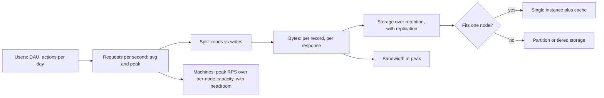

# Back-of-the-Envelope Estimation

> [!abstract] In one sentence
> Napkin math is the habit of converting "lots of users" into requests per second, gigabytes and machine counts with powers of ten and a few remembered constants, accurate to within a factor of a few — enough to tell whether a design needs one database or a sharded fleet, a cache or nothing, before anyone writes code.

> [!tip] Deeper treatment in your system-design vault
> `system-design/01 Foundations/Back of the Envelope Estimation.md` — read it *after* you have written your own explanation below.

**Map:** [[Fundamentals MOC]] → [[HLD MOC]]

## Definition

Back-of-the-envelope estimation is a disciplined approximation: start from a stated quantity (users, events, documents), apply explicit assumptions (activity per user, size per record, read/write ratio, peak factor), and derive the load parameters a design must satisfy — requests per second, storage, bandwidth, memory, node count — rounded to the nearest power of ten or a single significant figure. The goal is not precision but the *order of magnitude*, plus a written trail of assumptions that can be challenged. It is the first step of [[Scalability]] reasoning and the input to [[Capacity Planning]].

## Problem solved

Design conversations without numbers are arguments between intuitions: one engineer "knows" the database will not cope, another "knows" a single instance is fine. Estimation ends the argument in five minutes. It also catches category errors early — the feature that generates a terabyte a day, the fan-out that turns 100 writes into a million, the cache that would need more RAM than exists — and it prevents the opposite error of designing a sharded, multi-region system for 30 requests per second. In interviews it is the expected first move after requirements, because it shows whether the candidate can reason from constraints rather than recite architectures.

## How it works

**1. Memorise a small set of constants.**

| Constant | Value to use |
|---|---|
| Seconds per day | 86,400 ≈ 10^5 (use 10^5 for speed, 8.64 × 10^4 when it matters) |
| Seconds per month | ≈ 2.6 × 10^6; per year ≈ 3.2 × 10^7 |
| Powers of two | 2^10 ≈ 10^3 (KB), 2^20 ≈ 10^6 (MB), 2^30 ≈ 10^9 (GB), 2^40 ≈ 10^12 (TB) |
| Latencies | memory ~100 ns, SSD read ~100 µs, in-DC round trip ~0.5 ms, cross-region ~50–150 ms ([[Latency]]) |
| Typical sizes | a UUID 16 bytes, a timestamp 8 bytes, a short text record ~100 bytes to 1 KB, a JSON API response ~1–10 KB, a photo ~1 MB |
| Rule-of-thumb capacities (order of magnitude) | one node: thousands to tens of thousands of simple requests/s; one PostgreSQL instance: thousands of writes/s; one Kafka partition: thousands to tens of thousands of messages/s |

Treat every capacity figure as order-of-magnitude and workload-dependent; the point is to know whether you are at 10 or 10,000, not 3,000 versus 5,000.

**2. Follow the chain: users → actions → requests → bytes → machines.**

- Daily active users × actions per user per day ÷ 10^5 s = average requests per second.
- Multiply by a **peak factor** (2–5x for most consumer products; more for flash sales) to get peak RPS.
- Apply the **read/write ratio** (10:1 to 100:1 is typical for read-heavy products) to split reads and writes, because they scale differently.
- Writes per second × bytes per record × retention × replication factor = storage. Add index overhead (often comparable to the data).
- Peak RPS × bytes per response = bandwidth.
- Peak RPS ÷ per-node capacity (with 30–50% headroom) = node count.
- For caching, the 80/20 heuristic: caching the hottest 20% of the keyspace catches most reads; daily reads × 20% × record size ≈ cache memory.

**3. Round aggressively and keep units visible.** Write 4 × 10^2, not 384.6. Carry units through every line; most mistakes are KB versus MB or per-day versus per-second.

**4. Sanity-check against known systems.** If the estimate says a chat app needs a million writes per second for ten thousand users, an assumption is wrong.

**5. Present it.** State assumptions first, then the chain, then the conclusions that change the design: "40 writes/s needs no sharding; 3 TB over five years fits one instance; 2,000 reads/s at peak justifies a cache".

```text
URL shortener, worked:
  assumptions: 100M new URLs/month, read:write 10:1, 500 B/record, 5-year retention, peak 5x
  writes/s   = 1e8 / 2.6e6            ≈ 40
  reads/s    = 40 × 10                ≈ 400 avg, ≈ 2,000 peak
  storage    = 1e8 × 12 × 5 × 500 B   = 3e12 B = 3 TB (before indexes and replication)
  bandwidth  = 2,000 × 500 B          = 1 MB/s — negligible
  cache      = 400 × 8.64e4 × 0.2 × 500 B ≈ 3.5 GB for the hot 20% of a day's reads
  verdict: one well-indexed PostgreSQL plus a small Redis; sharding is years away
```

## Architecture



## Use cases

- The opening of any system design, in a review or an interview: requirements become load parameters before the architecture is chosen.
- Deciding whether a component needs to scale out at all — the most common outcome is "no, not for years".
- Sizing concrete resources: cache memory, Kafka partitions, database storage class, connection pools (via Little's Law, [[Throughput]]).
- Estimating cost before building: storage and egress bills follow directly from bytes per second ([[Performance vs Cost Trade-offs]]).
- Validating a vendor's or a colleague's claim ("this will generate 10 TB a day") in a minute.

## Limitations

- Accuracy is a factor of a few at best; the method cannot distinguish a design that needs 3 nodes from one that needs 6 — load testing does that ([[Load Test and Latency Lab]]).
- Per-node capacity figures vary by an order of magnitude with payload size, query complexity and cache hit rate; a wrong constant propagates everywhere.
- Averages hide distributions: a mean of 100 requests per user per day may be 10,000 for the top 1% ([[Hot Keys]]), and peaks may be 50x for event-driven traffic.
- Estimates age; a two-year-old napkin is a liability if nobody re-derives it as the product changes.
- It is easy to look rigorous while being wrong; the assumptions deserve more scrutiny than the arithmetic.

## Trade-offs

| You gain | You sacrifice |
|---|---|
| Decisions grounded in orders of magnitude within minutes | Precision; the answer is a range, not a number |
| Early detection of impossible or absurd designs | Confidence in edge cases, distributions and tail behaviour |
| A written assumption trail others can challenge | Time to maintain it as the product and the constants change |
| A shared language between engineers, product and finance | The temptation to treat the estimate as a measurement |

## Failure modes

- **Unit slip**: a per-day figure used as per-second, or KB read as MB; the design is off by three orders of magnitude. Noticed at review if units are written on every line; otherwise in production.
- **Average instead of peak**: capacity sized for the mean, collapse at the daily peak or the launch spike. Noticed as a recurring outage at the same hour.
- **Forgotten multiplier**: replication factor, index overhead, fan-out per write, or retention; storage estimates that are 3–10x short. Noticed as disk alerts months later.
- **Wrong per-node constant**: assuming 10,000 writes/s per database when the workload's transaction does five indexed inserts and an fsync. Noticed at the first load test, hopefully.
- **Estimate never revisited**: the product pivots, usage per user triples, and the architecture chosen for 40 writes/s is now at 2,000. Noticed when "it was fine before" stops being true.

## Performance

Estimation is where latency budgets are first drawn: count the serial hops on a path, assign each its typical cost from the latency table, and compare with the target. A request that must do a cross-region round trip cannot meet a 50 ms budget; one that touches disk ten times serially cannot meet 10 ms. The same arithmetic gives throughput limits per component and tells you which tier needs a cache or a batch.

## Scalability

Estimate at today's load and at 10x, and note what changes: at 10x, storage crosses the single-instance boundary, or RPS crosses the single-node boundary, or the cache no longer fits in memory. The design should be built for today with a known path to the 10x number, not for 10x from day one ([[Scalability]]). Re-estimate at every major milestone; the cheap part of the method is that it takes minutes.

## Operational impact

An estimate becomes a set of expected values that monitoring can confirm: expected RPS, expected growth in storage per day, expected cache size. Dashboards that show "estimated versus actual" catch drift early and make capacity reviews short ([[Capacity Planning]]). Alert thresholds derived from the estimate (disk at 70% of the five-year projection, pool utilisation at the Little's Law bound) are more meaningful than generic defaults.

## Alternatives

- **Load testing** — measures rather than estimates; wins once there is code to test, and is the only way to get per-node constants for your workload.
- **Detailed capacity models** (queueing models, simulations) — win for large, expensive fleets where a 20% error is millions; overkill for most services.
- **Historical extrapolation** — fit growth curves to real metrics; wins for mature products with years of data.
- **Vendor calculators** (cloud pricing and sizing tools) — win for cost estimates of managed services once the load numbers exist; they still need the napkin as input.

## Real-world examples

- Jeff Dean's "numbers everyone should know" slides and the latency table derived from them are the standard constants for this method and the reason "napkin math" is taught as an engineering skill at large companies ([[Latency Numbers Every Programmer Should Know]]).
- Alex Xu's *System Design Interview* dedicates a chapter to the technique — powers of two, latency numbers, availability numbers — and opens each design with an estimation section ([[System Design Interview (Alex Xu)]]).
- The System Design Primer's "back-of-the-envelope calculations" section packages the same constants for interview preparation ([[System Design Primer (GitHub)]]).
- In a stack like yours: before adding a Kafka topic for payment events, estimate events per second at peak, bytes per event and retention days to size partitions and broker storage; before caching JWT validation keys or merchant configs in Redis, estimate keys × bytes to confirm it fits in memory with headroom; before a ledger migration, estimate rows per day × five years to choose partitioning up front.

## Practical exercise

1. Pick a feature you know well (for example, webhook delivery for merchants) and write the assumptions: merchants, events per merchant per day, payload size, retries, retention.
2. Derive average and peak events per second, storage per year with a replication factor of 3, and outbound bandwidth at peak. Keep every unit explicit.
3. Build a minimal version in Docker Compose (a producer, a queue, a consumer writing to PostgreSQL) and load it with k6 at the estimated peak.
4. Measure per-node capacity for the consumer and the database on your laptop; compare with the constants you assumed and correct them.
5. Re-run the estimate at 10x and identify the first component that would need to change; write the one-paragraph plan for it.
6. Keep the estimate in the vault next to the design and set a reminder to re-derive it in three months.

## Related concepts

### Prerequisites
- [[Latency]] — the latency table is the core constant set
- [[Throughput]] — requests per second and Little's Law
- [[Functional vs Non-Functional Requirements]] — the requirements the estimate converts

### Related
- [[Scalability]] — the estimate decides which scaling moves are needed
- [[Capacity Planning]] — estimation over calendar time with real data
- [[Bottleneck Analysis]] — the estimate predicts which component saturates first
- [[Performance vs Cost Trade-offs]] — bytes and requests become a bill
- [[Translating Product Requirements into Technical Requirements]] — the step before estimation

### Builds on this
- [[Database Scaling]] — the estimate says when the database boundary is crossed
- [[Distributed Caching]] — sized from the hot-set estimate
- [[Topic Partitions]] — partition counts follow from events per second
- [[Horizontal vs Vertical Scaling]] — the estimate picks the lever

### Design problems where it applies
- [[Design a URL Shortener]]
- [[Design a Social Feed]]
- [[Design a Video Streaming Service]]
- [[Design a Logging System]]
- [[Design a Metrics and Monitoring System]]

### Projects where it can be implemented
- [[Load Test and Latency Lab]]
- [[Webhook Relay]]

### Resources
- [[System Design Interview (Alex Xu)]] — the chapter on back-of-the-envelope estimation
- [[Latency Numbers Every Programmer Should Know]] — the constants
- [[System Design Primer (GitHub)]] — the estimation cheat sheet

## Personal understanding

> [!question] Explain it without the source
> Write your own explanation here, from memory. Then compare it with the sections above and note what you missed.

### Mastery checklist
- [ ] I can explain it without the original resource
- [ ] I can describe the problem it solves
- [ ] I can compare it with its alternatives
- [ ] I can name its limitations and failure modes
- [ ] I can recognise when it is appropriate in a real system
- [ ] I have applied it in a system design
- [ ] I have validated my assumptions with an experiment or implementation

## Open questions

- [ ] What are the measured per-node constants for my own stack — requests per second per Spring Boot pod, writes per second on our RDS class, messages per second per Kafka partition — so my estimates use real numbers?
- [ ] How should a peak factor be chosen for fintech traffic, where salary days and sales events create predictable spikes much larger than 3x?
- [ ] Which of my past designs would have changed if I had estimated storage with replication and index overhead included?
