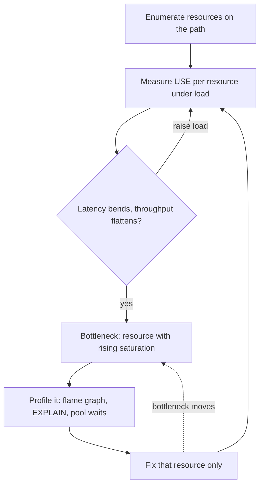

# Bottleneck Analysis

> [!abstract] In one sentence
> Every system has exactly one resource that saturates first, and until you have found it with measurements — utilisation, queue depth and errors per resource under a load test — any optimisation is a guess that most likely speeds up something that was never the limit.

> [!tip] Deeper treatment in your system-design vault
> `system-design/13 Observability/Capacity Planning.md` — read it *after* you have written your own explanation below.

**Map:** [[Fundamentals MOC]] → [[HLD MOC]]

## Definition

A bottleneck is the component or resource with the highest utilisation relative to its capacity on a given path under a given load; it caps the [[Throughput]] of the whole path and is where queueing — and therefore [[Latency]] — appears first. Bottleneck analysis is the method of identifying it: enumerating the resources on the path (CPU, memory, disk I/O, network, database connections, thread pools, locks, downstream services, partitions), measuring each one's utilisation, saturation and errors, driving load until one of them hits its knee, and then using profiling to explain *why* that resource is consumed. The theory of constraints applies: improving a non-bottleneck resource yields nothing; relieving the bottleneck moves it somewhere else.

## Problem solved

Performance work without a diagnosis is folklore: add an index, bump the pool, add pods, rewrite in Go — each sometimes works, which keeps the folklore alive. Teams spend weeks optimising code paths that account for 2% of the limit, or scale out a tier whose requests all queue on a single lock in another tier. Bottleneck analysis replaces this with a loop that converges: measure, find the saturated resource, fix that one thing, re-measure. It also answers the capacity question honestly — "how far can we go before X breaks" — which is what [[Capacity Planning]] needs and what a design review should be able to state.

## How it works

**1. Enumerate the resources on the path.** Not only hardware: for a request through an API to a database, the list is client connections, load balancer, server threads or event loop, CPU, heap and GC, outbound connection pool, database connections, database CPU, buffer pool hit rate, disk IOPS, locks and row contention, replication, and each downstream service with its own list. Each is a potential queue.

**2. Apply the USE method to each.** Brendan Gregg's checklist: for every resource, measure **Utilisation** (fraction of time busy, or of capacity used), **Saturation** (work waiting: run-queue length, pool wait time, queue depth, connection wait) and **Errors** (rejections, timeouts, retries). A resource at high utilisation *with* saturation is the bottleneck; high utilisation without saturation is merely efficient. Saturation is the decisive signal — it is the queue forming.

**3. Load until the knee.** Use an open-loop load generator (k6 `constant-arrival-rate`) and raise the rate in steps while recording throughput, latency percentiles and the USE signals per resource. The bottleneck is the resource whose saturation rises at the same step where latency bends and throughput flattens. Queueing theory says this happens past roughly 70–80% utilisation of that resource, well before it reads 100% ([[Throughput]]).

**4. Explain it with profiling.** Load testing says *which* resource; profiling says *why*. CPU-bound: a flame graph from async-profiler or Java Flight Recorder, `--cpu-prof` or `clinic flame` for Node.js. Database-bound: `pg_stat_statements` for the costliest queries, `EXPLAIN (ANALYZE, BUFFERS)` for the plan, `pg_stat_activity` for lock waits ([[Query Execution and Optimization]]). Pool-bound: pool wait metrics from HikariCP or the pg driver. Network-bound: bytes per second against the link, retransmits, connection setup counts. GC-bound: pause times and allocation rate.

**5. Fix the bottleneck, and only it.** Then return to step 3: a new resource is now the limit, usually at a higher throughput. Stop when the throughput meets the target with headroom, or when the next bottleneck is a business constraint.

**Two laws keep you honest.** Little's Law links the saturation you see to the throughput and latency you measure (items waiting = arrival rate × wait time), so you can compute the expected pool or thread size from the numbers. Amdahl's law says that the serial part of the path caps the gain from parallelising the rest — if a request spends 10 ms of 50 ms in a serialised section, no amount of parallelism makes it faster than 10 ms.

```bash
# USE in five minutes on a Linux host
uptime                       # load average vs core count: CPU saturation
vmstat 1                     # r (run queue), si/so (swapping), wa (I/O wait)
iostat -xz 1                 # %util and await per disk: disk saturation
ss -s; sar -n DEV 1          # sockets, network throughput vs link
# and in PostgreSQL
SELECT wait_event_type, wait_event, count(*) FROM pg_stat_activity GROUP BY 1,2;   -- lock and I/O waits
SELECT query, calls, mean_exec_time FROM pg_stat_statements ORDER BY total_exec_time DESC LIMIT 10;
```

## Architecture



> [!example]- Excalidraw version — the same diagram as an editable canvas
> ![[Bottleneck Analysis.excalidraw]]
> [[Bottleneck Analysis.excalidraw|Open in Excalidraw]] — needs the Excalidraw plugin (see [[Plugins to Install]]).


## Use cases

- Throughput has plateaued or latency climbs under load and the cause is unknown — the first question is which resource is saturated.
- Before scaling anything: confirm the tier you plan to scale is the one that is saturated, or the money is wasted.
- Capacity planning: the knee of the current bottleneck is your capacity; the plan is a list of bottlenecks in the order they will appear.
- A batch job's runtime has grown faster than its data — a stage is now the constraint ([[Throughput]]).
- Post-incident: an outage that "came from nowhere" usually came from a resource nobody had on a dashboard.

## Limitations

- The bottleneck depends on the workload; a different request mix or payload size produces a different answer, so analysis must use representative load.
- Some resources are hard to measure: lock contention inside a library, a downstream's internal queue, kernel-level limits (file descriptors, conntrack tables).
- Load testing in a staging environment with different hardware, data volume or cache state can find the wrong bottleneck.
- Profilers sample; rare but expensive paths (a 2-second GC pause once a minute) can hide in averages and need distribution-aware tooling.
- Fixing the bottleneck can expose a worse one (a faster API tier overwhelms the database), so each fix needs a re-measurement before deploy.

## Trade-offs

| You gain | You sacrifice |
|---|---|
| Optimisation effort spent where it changes the outcome | The time to build a load test and instrument every resource |
| A defensible capacity number and the next three bottlenecks in order | Simplicity: the answer is per path and per workload, not one number |
| Fewer wasted scaling decisions and cloud spend | The comfort of a quick fix; the method often says the fix you wanted is irrelevant |
| Dashboards that show saturation, not just utilisation | Higher metric cardinality and more things to maintain |

## Failure modes

- **Optimising the wrong tier**: weeks spent on application CPU while the database's lock waits set the limit. Noticed when the "fixed" system has the same knee; blast radius is the time and the deploy risk.
- **Hidden pool as the limit**: a client-side HTTP connection pool of 20 caps a service at a few hundred requests per second while CPU sits at 10%. Noticed only if pool wait time is a metric ([[Connection Pooling]]).
- **Utilisation without saturation misread**: a disk at 90% busy with no queue is fine; a team replaces it and nothing changes. Noticed by the unchanged knee.
- **Closed-loop load test**: the generator waits for responses and never pushes the system past the knee; capacity is overestimated and production collapses at a lower rate. Noticed in production.
- **Staging lies**: a smaller dataset fits in the buffer pool, so the staging bottleneck is CPU while production's is disk I/O. Noticed when the fix deployed to production does nothing.

## Performance

The bottleneck sets both the throughput ceiling and the shape of the latency curve: below its knee, latency is flat and equal to the sum of service times; at the knee, queueing on that one resource dominates p99. Everything else on the path contributes service time but not queueing, which is why a profile of the bottleneck resource is worth more than a profile of the whole request. Expect each fix to move the knee, and expect diminishing returns as the next bottleneck is a smaller step up.

## Scalability

Bottleneck analysis is how scaling decisions are ordered: at 10x load the question is which resources saturate, in what sequence, and whether each has a scale-up or scale-out path ([[Scalability]], [[Horizontal vs Vertical Scaling]]). A system is "scalable to 10x" when the first bottleneck at 10x is one you know how to move. Serial resources (a single partition, a global lock, a hot row) are the ones that do not scale and should be found early.

## Operational impact

The method requires that USE signals exist as metrics for every resource: pool wait times, queue depths, lock waits, GC pauses, per-partition lag — many are not exported by default and must be added ([[Metrics]]). Dashboards should put saturation next to utilisation. On-call benefits directly: an incident that starts with "which resource is saturated?" resolves faster than one that starts with "what changed?". Load tests belong in the release process for performance-sensitive paths, with the knee recorded each time.

## Alternatives

- **Guess and check** (add an index, add a replica) — wins when the change is cheap, reversible and the bottleneck is obvious; fails silently otherwise.
- **Profiling alone** — wins for single-process CPU problems; blind to queueing on external resources, which is where most production bottlenecks are.
- **Capacity by extrapolation** (trend lines on utilisation) — wins for steady growth on known bottlenecks; misses the knee and new resources.
- **Over-provision everything** — wins when money is cheaper than engineering time, until the bottleneck is a resource that cannot be bought (a hot row, a single partition).

## Real-world examples

- Brendan Gregg's USE method and its per-resource checklists for Linux are the standard reference for the measurement step, and the basis for most performance runbooks at large operators.
- Amazon's load-shedding write-up describes measuring the point where a server's goodput collapses under offered load and shedding work before that point — bottleneck analysis turned into an operational control ([[AWS Builders Library - Load Shedding]]).
- Google's SRE material on capacity planning starts from load tests that find each service's saturation point and feeds the result into provisioning ([[Site Reliability Engineering (Google)]]).
- In a stack like yours: the typical bottleneck order for a Spring Boot or NestJS service on EKS talking to RDS is the database connection pool, then database CPU or lock waits on hot rows, then Redis if a hot key is involved, with pod CPU rarely first; Kafka consumers bottleneck on per-message database writes and partition count. A load test with pool wait, `pg_stat_activity` waits and consumer lag on one dashboard usually names the limit in minutes.

## Practical exercise

1. Run a NestJS or Spring Boot service with an endpoint that does two PostgreSQL queries and one Redis call, in Docker Compose, with CPU limits on each container.
2. Export USE metrics: pool wait time and active connections, event-loop lag or thread-pool queue, container CPU, PostgreSQL active sessions and wait events, Redis ops per second.
3. Load with k6 in open-loop steps and record throughput, p99 and all USE signals per step; identify the knee and the resource whose saturation rises with it.
4. Profile that resource: a flame graph if CPU, `EXPLAIN (ANALYZE, BUFFERS)` and `pg_stat_statements` if the database, pool metrics if connections.
5. Fix only that resource (add an index, resize the pool, batch the Redis calls) and repeat; record where the knee moved and what is saturated now.
6. Deliberately optimise a non-bottleneck (e.g. make the Redis call faster when the database is the limit) and confirm that the knee does not move.

## Related concepts

### Prerequisites
- [[Throughput]] — the knee and Little's Law
- [[Latency]] — where queueing shows up
- [[Metrics]] — the signals you need per resource

### Related
- [[Capacity Planning]] — the bottleneck's knee is the capacity
- [[Connection Pooling]] — the most common hidden limit
- [[Query Execution and Optimization]] — explaining a database bottleneck
- [[Distributed Tracing]] — finding which hop holds the time in slow requests
- [[Backpressure]] — what to do when the bottleneck is reached

### Builds on this
- [[Scalability]] — scaling decisions ordered by bottleneck
- [[Horizontal vs Vertical Scaling]] — choosing the lever for the saturated resource
- [[Database Scaling]] — the ladder for the usual bottleneck
- [[Performance vs Cost Trade-offs]] — spending only where it moves the limit

### Design problems where it applies
- [[Design a Distributed Cache]]
- [[Design a Message Queue]]
- [[Design a Metrics and Monitoring System]]
- [[Design a Payment System]]

### Projects where it can be implemented
- [[Load Test and Latency Lab]]
- [[Chaos Lab]]

### Resources
- [[AWS Builders Library - Load Shedding]] — measuring the collapse point and acting on it
- [[Site Reliability Engineering (Google)]] — capacity planning from measured saturation
- [[PostgreSQL Indexes Docs]] — the usual fix once the database is named as the limit

## Personal understanding

> [!question] Explain it without the source
> Write your own explanation here, from memory. Then compare it with the sections above and note what you missed.

### Mastery checklist
- [ ] I can explain it without the original resource
- [ ] I can describe the problem it solves
- [ ] I can compare it with its alternatives
- [ ] I can name its limitations and failure modes
- [ ] I can recognise when it is appropriate in a real system
- [ ] I have applied it in a system design
- [ ] I have validated my assumptions with an experiment or implementation

## Open questions

- [ ] For a service I own, which USE signals are missing from its dashboards today — is pool wait time, event-loop lag or lock wait exported at all?
- [ ] What is the measured knee of that service, which resource is it, and what are the next two bottlenecks in order?
- [ ] How do I build a load test whose data volume and cache state are representative enough that the staging bottleneck matches production's?
