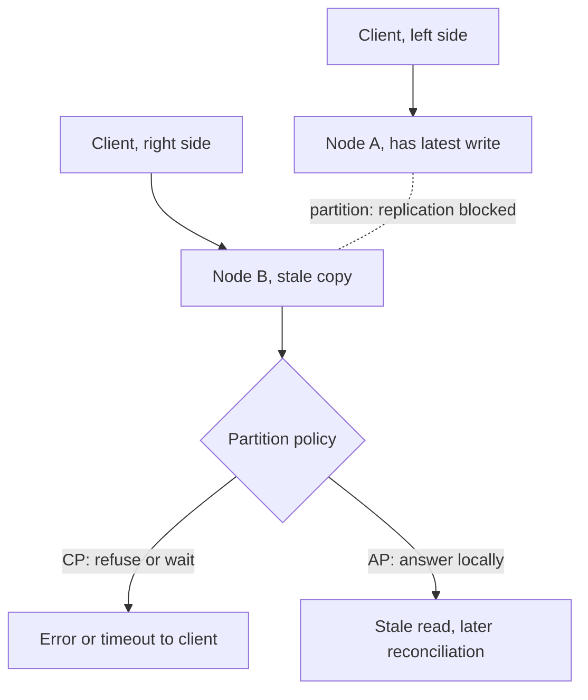

# CAP Theorem

> [!abstract] In one sentence
> CAP is a narrow impossibility result — during a partition, a replicated system cannot be both linearizable and always-responding — whose value is in forcing you to decide, per operation, what happens when replicas cannot talk, and whose danger is the "pick two" slogan that makes it sound like a menu.

> [!tip] Deeper treatment in your system-design vault
> `system-design/08 Distributed Systems Theory/CAP Theorem.md` — read it *after* you have written your own explanation below.

**Map:** [[Fundamentals MOC]] → [[HLD MOC]]

## Definition

The CAP theorem (Brewer's conjecture, 2000; proved by Gilbert and Lynch, 2002) states that a distributed data store cannot simultaneously provide all three of: **Consistency** — every read returns the most recent write, i.e. linearizability, the illusion of a single copy; **Availability** — every request to a non-failed node receives a non-error response, without a guarantee that it contains the latest write; and **Partition tolerance** — the system keeps operating when messages between nodes are lost or delayed. Because partitions in a real network are not optional, the theorem reduces to: *when* a partition occurs, each operation must give up either consistency or availability. Outside a partition, CAP says nothing.

## Problem solved

Before CAP was stated, systems were sold as if replication could be transparent: multiple copies, always consistent, always up. CAP gave a precise reason that this is impossible over an unreliable network, and so forced a design decision that had been left implicit — what does a node do when it cannot reach the others? Refuse (stay consistent, lose availability) or answer from local state (stay available, risk staleness or conflicts)? Making that decision explicit, per data item and per operation, is the real contribution. It is the vocabulary that lets you say "the ledger balance is CP; the product catalogue is AP" and have both be correct.

## How it works

1. **The setup.** Two nodes each hold a copy of a value. A client writes to node A. The network between A and B fails: A cannot replicate to B, and neither can tell whether the other is dead or merely unreachable.
2. **The fork.** A client now reads from B. Either B answers with its (stale) copy — available but not consistent — or B refuses, or waits until the partition heals — consistent but not available. There is no third option; that is the whole proof.
3. **CP behaviour.** The system refuses operations it cannot make consistent. In practice this means a majority side keeps working and the minority side returns errors: ZooKeeper, etcd and Consul refuse writes and linearizable reads on the minority side of a partition; a PostgreSQL cluster with a single primary refuses writes wherever the primary is not. Mechanism: [[Quorums]] and [[Leader Election]] — only a majority can make progress, which prevents [[Split-Brain]].
4. **AP behaviour.** Every reachable node keeps accepting reads and writes. Copies diverge; when the partition heals, conflicts are resolved by last-writer-wins, vector clocks, CRDTs or application merge logic ([[Eventual Consistency]]). Dynamo-style stores with sloppy quorums and hinted handoff are the canonical example ([[Dynamo Paper]]).
5. **Per-operation choice.** Real systems are not uniformly one or the other. Cassandra chooses per query via the consistency level (`ONE` is AP-like, `QUORUM` on both reads and writes gives consistency at the cost of availability on the minority side). DynamoDB offers eventually consistent reads by default and strongly consistent reads on request. MongoDB with majority write concern and primary reads behaves CP; with secondary reads it does not.

**What CAP does not say.** It says nothing about latency, which is the trade you actually pay every day ([[PACELC]]). Its "availability" is not the operational "nines" — a CAP-available system can be slow to the point of uselessness, and a CAP-unavailable system can have excellent uptime because partitions are rare. Its "consistency" is linearizability, not the C in [[ACID]]. "CA" is not a real option for anything that talks over a network; a single-node database is simply not the subject of the theorem.

**Why it is less useful than claimed.** Kleppmann's critique ([[Please Stop Calling Databases CP or AP]]) is that the definitions are so narrow that most systems are neither: a system that is unavailable on the minority side is "CP" even if it is not linearizable; a system that serves stale reads is "AP" even if it fails every write during a partition. The useful questions are finer: which [[Consistency Models|consistency model]] does each operation offer, and what exactly happens on each side of a partition.

## Architecture

> [!example]- Excalidraw version — the same diagram as an editable canvas
> ![[CAP Theorem.excalidraw]]
> [[CAP Theorem.excalidraw|Open in Excalidraw]] — needs the Excalidraw plugin (see [[Plugins to Install]]).

## Use cases

- Any replicated store or multi-region deployment: the requirement must say what happens on the minority side of a partition.
- Data where a stale answer is a bug — balances, inventory at checkout, permission checks, idempotency records — needs CP behaviour on that path ([[Design a Digital Wallet and Ledger]]).
- Data where an answer, any answer, is worth more than a fresh one — feeds, catalogues, presence, counters — can take AP behaviour and reconcile later.
- Coordination primitives: locks, leader election, configuration — always CP, because an AP lock is no lock ([[Distributed Locks]]).
- Design interviews: CAP is the expected vocabulary for the question "what happens when the regions cannot talk".

## Limitations

- It models only the partition case; the everyday latency–consistency trade is outside it.
- Binary labels hide gradations: linearizable vs sequential vs causal on the consistency side, and "refuses writes but serves reads" vs "refuses everything" on the availability side.
- It assumes you can detect that a partition exists; in practice you only see timeouts, so the policy triggers on *suspected* partitions, including false positives.
- It says nothing about correctness after the partition heals — conflict resolution is where AP systems get hard.
- Applying it at system granularity rather than operation granularity leads to wrong conclusions ("our database is AP, so the ledger will be eventually consistent").

## Trade-offs

| You gain | You sacrifice |
|---|---|
| A proof that forces an explicit partition policy | A vocabulary that is easy to misuse as a two-of-three menu |
| CP: no stale reads, no conflicting writes, simple reasoning | CP: the minority side is down for the duration of the partition |
| AP: every node keeps serving through the partition | AP: divergence, conflict resolution and application-level merge logic |
| A way to classify requirements per data item | Nothing about latency, which is the trade you pay without any partition |

## Failure modes

- **Accidental AP on a CP requirement**: reads routed to a replica during a partition return stale balances; a customer spends money twice. Noticed by reconciliation or fraud, not by alerts; blast radius is every stale-read-driven decision.
- **Accidental unavailability**: a CP store configured for linearizable reads on every path makes the whole product fail when one AZ is cut off, though most reads could have tolerated staleness. Noticed as a full outage from a partial network event.
- **False partition detection**: aggressive timeouts make nodes believe a partition exists under load; a CP system fences itself off and an AP system starts diverging, both without any real network failure. Noticed as leader churn or conflict spikes correlated with latency, not with network errors ([[Failure Detection]]).
- **Split-brain in a supposedly CP system**: two leaders because the election did not require a majority; both accept writes. Noticed after healing as conflicting history; blast radius is every write on the losing side.
- **Unresolved conflicts after healing**: an AP store applies last-writer-wins with skewed clocks and silently drops updates ([[Clocks and Time]]). Noticed as lost writes with no error anywhere.

## Performance

CAP itself is not a performance statement, but the mechanisms that implement each side are. CP requires coordination — a quorum round trip per write, often per linearizable read — which costs a network round trip within a region (sub-millisecond to a few milliseconds) or across regions (tens of milliseconds), and reduces throughput to what the leader can coordinate. AP paths answer from local state with no coordination, giving the lowest latency and highest throughput, at the cost of reconciliation work later.

## Scalability

CP systems scale reads by adding replicas only if reads may be stale (which is then not linearizable) or by partitioning the key space so each partition has its own small quorum group; the coordination cost per write does not shrink with cluster size. AP systems scale almost linearly because every node accepts work independently; the cost moves to anti-entropy traffic and conflict handling, which grow with write rate and replica count. Multi-region active-active is the setting where the choice is unavoidable and most expensive to get wrong.

## Operational impact

You must know, and document, the partition behaviour of every store and of every consistency setting you use, because the defaults differ (Cassandra `ONE`, DynamoDB eventually consistent reads, MongoDB read preferences). Monitoring should distinguish "unavailable because we chose CP" from "unavailable because it broke": alert on quorum loss and leader elections. Game days should include an AZ partition, not just node loss, because the behaviour is different. For AP stores, conflict counts and reconciliation lag are first-class metrics.

## Alternatives

- **[[PACELC]]** — extends CAP with the normal-case latency–consistency trade; wins as the everyday design vocabulary.
- **Consistency models as the primary lens** — ask which guarantee each operation needs (linearizable, causal, read-your-writes, eventual) instead of a CP/AP label; wins for anything beyond an interview answer ([[Consistency Models]]).
- **Avoid distribution of the critical data** — a single primary with synchronous standby makes the partition policy trivial (the standby does nothing until promoted); wins for most transactional cores.
- **Partition the problem so partitions do not matter** — keep each user's data in one region and never replicate it synchronously across the partition boundary; wins when data has a natural home.

## Real-world examples

- Google's Spanner is described by Brewer as technically CP (it refuses to serve on the minority side) while achieving availability high enough that users experience it as both — because partitions are rare and the network is engineered to keep them rare ([[Spanner Paper]]).
- Amazon's Dynamo chose availability for the shopping cart: a cart that accepts additions during a partition and merges later is better business than a cart that refuses ([[Dynamo Paper]]).
- ZooKeeper and etcd are the standard CP coordination services: the minority side of a partition cannot elect a leader or serve linearizable reads, which is exactly what you want from a lock service.
- In a stack like yours: PostgreSQL on RDS with a single writer is CP for the ledger — during an AZ partition, only the side with the primary writes; Redis replicas read stale data if you let clients read from them, which is an AP choice to make deliberately, never by default for balances or idempotency keys.

## Practical exercise

1. Start a three-node etcd cluster and a three-node Cassandra (or ScyllaDB) cluster with Docker Compose, plus Toxiproxy or `docker network disconnect` to cut one node off.
2. Write a key to each cluster, then isolate one node from the other two.
3. Against the isolated etcd node, attempt a write and a linearizable read; then a serializable (stale-allowed) read. Record which fail, and how long the timeouts take.
4. Against the isolated Cassandra node, write with consistency level `ONE`, then read the same key from the majority side; observe the divergence. Repeat with `QUORUM` and observe the write fail.
5. Heal the partition and observe how each system reconciles: etcd's log catches the node up; Cassandra's read repair or hinted handoff merges the divergent write.
6. Write down, for each operation you tried, whether it was CP or AP — and note that the same cluster was both.

## Related concepts

### Prerequisites
- [[Replication]] — CAP is about replicas that cannot talk
- [[Network Partitions]] — the P that is never optional
- [[Availability]] — to see how CAP's definition differs from the operational one

### Related
- [[PACELC]] — the extension that covers the normal case
- [[Consistency Models]] — the finer-grained vocabulary CAP lacks
- [[Quorums]] — how CP systems keep a majority working
- [[Eventual Consistency]] — the AP side's guarantee
- [[Split-Brain]] — what a broken CP implementation produces
- [[Coordination vs Availability]] — the general form of the trade

### Builds on this
- [[Distributed Locks]] — always the CP choice
- [[Leader Election]] — majority-based so partitions do not create two leaders
- [[Consensus]] — the machinery that makes CP work
- [[Distributed Transactions]] — CP across multiple partitions

### Design problems where it applies
- [[Design a Distributed Key-Value Store]]
- [[Design a Digital Wallet and Ledger]]
- [[Design an Inventory Management System]]
- [[Design a Distributed Cache]]

### Projects where it can be implemented
- [[Mini-KV Store]]
- [[Lock Service with Fencing Tokens]]

### Resources
- [[Please Stop Calling Databases CP or AP]] — why the labels mislead
- [[PACELC Paper]] — the extension
- [[Designing Data-Intensive Applications]] — chapter 9 on linearizability and the cost of it
- [[Dynamo Paper]] — the AP choice explained by a business case

## Personal understanding

> [!question] Explain it without the source
> Write your own explanation here, from memory. Then compare it with the sections above and note what you missed.

### Mastery checklist
- [ ] I can explain it without the original resource
- [ ] I can describe the problem it solves
- [ ] I can compare it with its alternatives
- [ ] I can name its limitations and failure modes
- [ ] I can recognise when it is appropriate in a real system
- [ ] I have applied it in a system design
- [ ] I have validated my assumptions with an experiment or implementation

## Open questions

- [ ] For each store in a stack I know (PostgreSQL, Redis, Kafka, MongoDB), what exactly happens on the minority side of an AZ partition with the configuration we actually run?
- [ ] Is Kafka with `acks=all` and `min.insync.replicas=2` CP or AP in CAP's sense, and does the answer depend on `unclean.leader.election.enable`?
- [ ] Where in a payments flow would an AP choice be acceptable, and what would the reconciliation look like?
