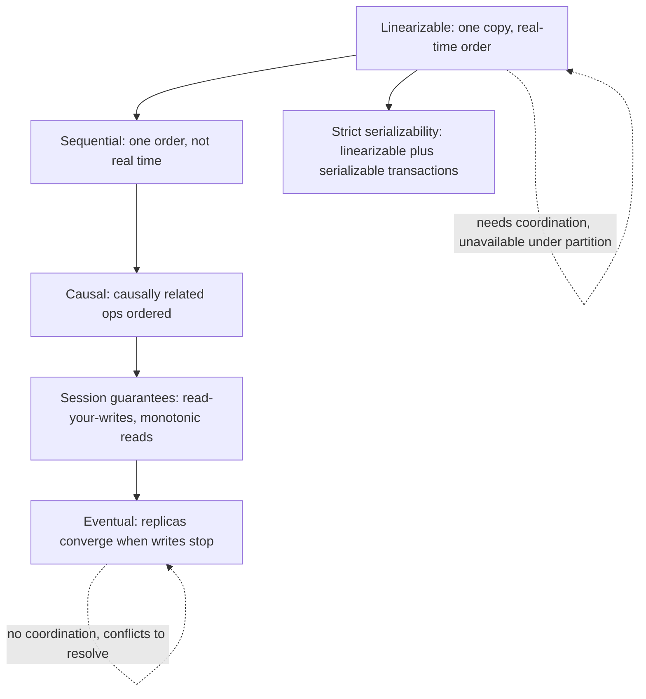

# Consistency Models

> [!abstract] In one sentence
> A consistency model is the promise a replicated store makes about the order in which readers observe writes — linearizable means "as if there were one copy", eventual means "you will agree eventually" — and every step down the spectrum buys latency and availability by letting readers see less than the latest truth.

> [!tip] Deeper treatment in your system-design vault
> `system-design/08 Distributed Systems Theory/Consistency Models.md` — read it *after* you have written your own explanation below.

**Map:** [[Fundamentals MOC]] → [[HLD MOC]]

## Definition

A consistency model is a formal contract between a data store and its clients about which histories of reads and writes are allowed when several copies of the data exist and several clients operate concurrently. Stronger models allow fewer histories and are easier to program against; weaker models allow more and are cheaper to provide. The models form a partial order: **linearizability** at the top, then **sequential** and **causal** consistency, the **session guarantees** (read-your-writes, monotonic reads, monotonic writes, writes-follow-reads), and **eventual consistency** at the bottom. A consistency model is distinct from a transaction [[Isolation Levels|isolation level]]: the first is about replicas and real-time order of single operations, the second about concurrent multi-operation transactions; **strict serializability** is the combination of both.

## Problem solved

Once a value lives in more than one place — a replica, a cache, a client — a read can return something other than the latest write, and the application needs to know exactly how "other" it can be. Without a named model, developers assume the single-copy behaviour of a local variable, and the bugs are subtle: a user does not see the comment they just posted, a balance check passes on a stale replica, two regions accept conflicting updates, an idempotency key is "not found" because the replica lagged. Consistency models give the vocabulary to state what the store guarantees, what the application must handle itself, and what each guarantee costs — so the choice can be made deliberately, per data item, instead of discovered in production.

## How it works

**The spectrum, from strongest to weakest.**

1. **Linearizability.** Every operation appears to take effect instantaneously at some point between its start and its completion, and all clients agree on that single order, which respects real time: once any client has seen a write, every later read anywhere sees it or something newer. This is the "single copy" illusion. It is what [[Distributed Locks]], [[Leader Election]], unique-constraint checks and compare-and-set depend on. Cost: coordination — a leader or a [[Quorums|quorum]] round trip per operation — and unavailability on the minority side of a partition ([[CAP Theorem]]).
2. **Sequential consistency.** All clients see the same total order of operations and each client's own operations appear in program order, but the order need not match real time: a read may lag behind a write that completed earlier on another node, as long as everyone lags in the same order. ZooKeeper reads are the classic example: local replicas serve reads in a consistent order that may be slightly stale; a `sync` call upgrades a read to linearizable.
3. **Causal consistency.** Operations that are causally related (a reply after the message it answers; a read after the write it depends on) are seen in that order by everyone; operations with no causal link may be observed in different orders by different clients. This is the strongest model shown to be achievable while staying available under partitions, which is why it is the target for geo-replicated stores. Implemented with version vectors or dependency tracking ([[Clocks and Time]]); MongoDB offers causally consistent sessions.
4. **Session guarantees** — properties scoped to one client session, cheap to provide and enough for most user-facing cases:
   - **Read-your-writes**: after you write, your own reads see it (route the session to the leader, or to a replica that has caught up to the write's position).
   - **Monotonic reads**: you never see time go backwards between two reads (pin the session to one replica).
   - **Monotonic writes**: your writes are applied in the order you issued them.
   - **Writes-follow-reads**: a write you issue after reading a value is ordered after that value everywhere.
5. **Eventual consistency.** If writes stop, all replicas converge to the same state; in the meantime, any replica may return any earlier value, and concurrent writes need a conflict rule (last-writer-wins, merge functions, CRDTs). This is what asynchronous [[Replication]], caches and Dynamo-style stores give by default ([[Eventual Consistency]]).

**Picking a model per data item.** Ask what a stale or reordered read would cost:

| Data | Wrong read costs | Model |
|---|---|---|
| Account balance at debit time, lock, idempotency key | Money or correctness | Linearizable |
| A user's own profile edit, their own order list | Confusion, support ticket | Read-your-writes plus monotonic reads |
| Comment threads, chat | Replies appearing before their parent | Causal |
| Feeds, counters, product catalogue, metrics | Nothing a refresh does not fix | Eventual |

**Mechanisms behind each level.** Linearizable: single leader with synchronous replication, or consensus ([[Consensus]]), or quorum reads and writes with read repair. Session guarantees: sticky routing, or clients carrying the version of their last write and replicas waiting until they have it. Causal: dependency metadata per write. Eventual: asynchronous replication plus anti-entropy. The weaker the model, the less coordination, the lower the latency, and the more work the application does.

```text
Linearizable read of a balance (PostgreSQL primary, or a quorum read):
  SELECT balance FROM accounts WHERE id = 42;         -- routed to the leader

Read-your-writes on a replica (Postgres: wait for the replica to pass the write's LSN):
  write on primary  -> remember pg_current_wal_lsn()
  read on replica   -> wait until pg_last_wal_replay_lsn() >= remembered LSN, then query
```

## Architecture



> [!example]- Excalidraw version — the same diagram as an editable canvas
> ![[Consistency Models.excalidraw]]
> [[Consistency Models.excalidraw|Open in Excalidraw]] — needs the Excalidraw plugin (see [[Plugins to Install]]).


## Use cases

- Any read served from a replica, cache or secondary region: the requirement must name what the reader may see ([[Read Replicas]], [[Cache Consistency]]).
- Operations that decide something — debit if balance is sufficient, reserve the last seat, claim a username — need linearizable reads or a compare-and-set on the leader.
- User-facing flows where "I just did X and cannot see it" is a bug: read-your-writes is the minimum.
- Conversation-like data (comments, chat, collaborative edits) where ordering of related events matters but global order does not: causal.
- Geo-distributed systems choosing between paying cross-region round trips and accepting weaker models per operation ([[PACELC]]).

## Limitations

- Strong models cost latency and availability; applying linearizability to everything makes the product slow and fragile for no benefit on most reads.
- Weak models push complexity into the application: conflict resolution, version tracking, UI that tolerates staleness.
- Models are per store and per operation, and composition breaks them: a linearizable database behind a cache is an eventually consistent system.
- Vendor terms ("strong consistency", "eventually consistent reads") map loosely to the formal models; you must read the fine print, and [[Jepsen]] reports show that claims and behaviour sometimes differ.
- Linearizability is defined per object; it says nothing about multi-object invariants, which need transactions and isolation on top.

## Trade-offs

| You gain | You sacrifice |
|---|---|
| Linearizable: single-copy reasoning, safe decisions, no conflict handling | A coordination round trip per operation and unavailability under partition |
| Causal: intuitive ordering of related events while staying available | Dependency metadata, larger writes and more complex implementations |
| Session guarantees: users see their own actions, cheaply | Sticky routing or version tracking in clients; guarantees do not extend to other users |
| Eventual: lowest latency, highest availability, trivial scale-out | Stale reads, conflicts, and application logic that must tolerate both |

## Failure modes

- **Stale decision**: a balance or inventory check reads a lagging replica and approves an action it should have refused. Noticed via reconciliation or overdrafts; blast radius is every decision made during the lag window.
- **Lost update under eventual consistency**: concurrent writes resolved by last-writer-wins with skewed clocks silently drop one. Noticed as missing data with no error; blast radius depends on write concurrency ([[Clocks and Time]]).
- **Read-your-writes broken by load balancing**: writes go to the primary, the next read is routed to a replica, the user sees their change vanish and retries, creating duplicates. Noticed as duplicate records and support tickets.
- **Causality violation**: a reply arrives at a replica before the message it answers; a client sees an orphan. Noticed as UI glitches; blast radius is readers of that replica.
- **Assumed linearizability across a cache**: the database is linearizable, the cache is not, and a revoked permission remains honoured for the TTL. Noticed in security review or by an incident ([[Cache Invalidation]]).

## Performance

Linearizable operations cost at least one coordination round trip and are bounded by the leader's or quorum's throughput; within an AZ that is sub-millisecond, across regions tens of milliseconds, and it defines the tail. Causal and session-level guarantees cost metadata and occasional waits (a replica catching up to a client's last write) but no per-operation coordination. Eventual reads run at local speed. The economic argument for weaker models is that the majority of reads in most systems can tolerate staleness and should not pay for coordination.

## Scalability

Weaker models scale further: eventual-consistency replicas can be added without limit for reads, and multi-leader or leaderless writes scale across regions. Linearizable throughput is capped by the coordinating group and scales only by partitioning the key space so that each partition has its own leader or quorum. Causal consistency scales well but its dependency metadata grows with the number of replicas and concurrent writers, which is a known engineering limit.

## Operational impact

Every consistency setting is a production configuration that on-call must understand: replica routing rules, read preferences, consistency levels, `synchronous_commit`. Monitor replication lag as the staleness bound for eventual paths, and leader health and quorum latency for linearizable paths. Incident analysis for "wrong data" bugs starts with "which model did this read actually get"; documenting the model per endpoint saves hours. Testing needs fault injection — partitions and lag — because consistency bugs do not appear under normal conditions.

## Alternatives

- **Avoid replication for the critical data** — one primary, reads from it only; wins for transactional cores until read load forces replicas.
- **Design around staleness** — show "pending" states, use idempotent operations and reconciliation so eventual consistency is safe; wins when the user experience can absorb it.
- **Conflict-free data types (CRDTs)** — make concurrent writes merge deterministically; wins for counters, sets and collaborative editing where the merge semantics are natural.
- **Transactions with strong isolation on one node** — when the question is multi-object invariants rather than replica staleness, isolation levels are the right tool ([[Isolation Levels]]).

## Real-world examples

- Jepsen's consistency-models reference lays out the hierarchy and is the basis for its analyses of real databases, which have repeatedly found gaps between advertised and delivered models ([[Jepsen Consistency Models]]).
- Google's Spanner offers external consistency (strict serializability) across datacenters using TrueTime; it is the existence proof that the strongest model is achievable at scale, at the cost of commit waits and specialised infrastructure ([[Spanner Paper]]).
- Amazon's Dynamo chose eventual consistency with vector clocks and application-level merge for the shopping cart; its successors expose the choice as "eventually consistent" versus "strongly consistent" reads ([[Dynamo Paper]]).
- In a stack like yours: ledger reads that gate a debit go to the PostgreSQL primary (linearizable); "my transactions" lists can be served from a replica with read-your-writes handled by routing a session to the primary for a few seconds after a write; JWT revocation stored in Redis is an eventual-consistency decision with a staleness window equal to the cache TTL — decide whether that window is acceptable for your IAM service.

## Practical exercise

1. Run PostgreSQL with one asynchronous streaming replica in Docker Compose, with Toxiproxy adding 200 ms of latency on the replication link.
2. Write a small Java or TypeScript client that writes a row to the primary and immediately reads it back from the replica; count how often the read misses. This is the eventual model made visible.
3. Implement read-your-writes: after the write, capture `pg_current_wal_lsn()`; before the replica read, poll `pg_last_wal_replay_lsn()` until it has passed. Measure the added wait.
4. Implement monotonic reads by pinning a session to one replica and demonstrate the non-monotonic case by alternating between two replicas with different lag.
5. Run two clients incrementing the same counter concurrently via replicas with last-writer-wins semantics (e.g. in Cassandra at consistency level `ONE`) and count lost updates; then use a counter CRDT or a linearizable `UPDATE ... SET n = n + 1` on the primary and compare.
6. For each experiment, name the consistency model observed and the cost you paid to upgrade it.

## Related concepts

### Prerequisites
- [[Replication]] — multiple copies are why the question exists
- [[CAP Theorem]] — why the strongest model costs availability
- [[Transactions]] — to separate replica consistency from isolation

### Related
- [[Eventual Consistency]] — the weakest useful model, in depth
- [[Isolation Levels]] — the transactional cousin; strict serializability combines both
- [[Quorums]] — the mechanism for linearizable reads and writes without a leader
- [[Clocks and Time]] — why ordering needs more than timestamps
- [[Read Replicas]] — where session guarantees matter day to day
- [[PACELC]] — the cost model for choosing a level

### Builds on this
- [[Distributed Locks]] — need linearizability or they are not locks
- [[Cache Consistency]] — a cache is a replica with a weak model
- [[Consensus]] — how linearizable replicated state is built
- [[Distributed Transactions]] — strong consistency across partitions

### Design problems where it applies
- [[Design a Distributed Key-Value Store]]
- [[Design a Digital Wallet and Ledger]]
- [[Design a Chat System]]
- [[Design a Collaborative Document Editor]]
- [[Design a Ticket Booking System]]

### Projects where it can be implemented
- [[Mini-KV Store]]
- [[Presence and Chat Service]]

### Resources
- [[Jepsen Consistency Models]] — the hierarchy, precisely
- [[Designing Data-Intensive Applications]] — chapters 5 and 9 on replication lag and linearizability
- [[Kleppmann Distributed Systems Lecture Notes]] — the formal background on ordering and causality
- [[Understanding Distributed Systems]] — the practitioner's walk through the models

## Personal understanding

> [!question] Explain it without the source
> Write your own explanation here, from memory. Then compare it with the sections above and note what you missed.

### Mastery checklist
- [ ] I can explain it without the original resource
- [ ] I can describe the problem it solves
- [ ] I can compare it with its alternatives
- [ ] I can name its limitations and failure modes
- [ ] I can recognise when it is appropriate in a real system
- [ ] I have applied it in a system design
- [ ] I have validated my assumptions with an experiment or implementation

## Open questions

- [ ] For each endpoint of a service I own, which consistency model does it actually deliver today, given the replica routing and caches in front of it?
- [ ] What does MongoDB's causally consistent session guarantee across a failover, and how does it compare with PostgreSQL LSN-based read-your-writes?
- [ ] Is there a cheap way to get read-your-writes for a JWT revocation list in Redis without routing every check to a single node?
