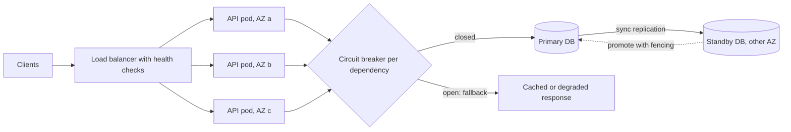

# Fault Tolerance

> [!abstract] In one sentence
> Fault tolerance is what you build so that a broken disk, a dead pod, a slow dependency or a lost AZ shows up as a metric instead of an outage — paid for with spare capacity, replication cost and the complexity of deciding, automatically, who is in charge when something dies.

> [!tip] Deeper treatment in your system-design vault
> `system-design/12 Resilience/Failure Modes in Distributed Systems.md` — read it *after* you have written your own explanation below.

**Map:** [[Fundamentals MOC]] → [[HLD MOC]]

## Definition

A fault-tolerant system continues to provide its service, possibly degraded, when one or more components fail. It is the mechanism side of [[Reliability]] (correctness under faults) and [[Availability]] (answering at all): reliability states the goal, fault tolerance is the toolkit. Tolerance is always *bounded* — "survives the loss of any one node", "survives one AZ", "survives the loss of a minority of replicas" — and the bound is a design decision with a price. A system that claims to tolerate everything has not written down what it tolerates.

## Problem solved

Components fail at a rate proportional to how many you have, and modern systems have many. Without tolerance mechanisms, each fault becomes an outage: one pod OOM-kills and the endpoint is down; one disk dies and the data is gone; one dependency slows to a crawl and every thread in the fleet waits on it. The naive cure — make each component more reliable — has diminishing returns and does nothing for correlated faults. Fault tolerance accepts failure as the normal state of a large system and arranges that the service keeps working through it, which is the only way to reach the availability numbers businesses ask for.

## How it works

Each technique buys tolerance against a specific fault class, at a specific cost:

1. **Redundancy (N+1, N+2).** Run more instances than needed so losing one leaves enough capacity. Stateless tiers behind a [[Load Balancers|load balancer]] get this cheaply; the cost is idle capacity and the need for health checks that remove a bad instance quickly.
2. **Replication.** Keep copies of state on several nodes so a node loss is not a data loss ([[Replication]]). Synchronous replication protects against loss of acknowledged writes at the price of commit latency; asynchronous is cheaper but loses the tail on failover ([[Recovery Point Objective]]).
3. **Failover.** Detect the failure and move traffic or leadership: active–passive (a standby takes over after [[Leader Election]]), or active–active (all nodes serve; a lost node just reduces capacity). The hard part is *agreeing* that the old node is dead without creating two leaders ([[Split-Brain]]) — fencing tokens or quorum-based election are how you avoid it.
4. **Isolation.** Partition the system so a fault in one part cannot spread: separate thread pools and connection pools per dependency ([[Bulkheads]]), per-tenant cells, separate queues per priority. Isolation turns a total failure into a partial one.
5. **Timeouts, retries and breakers.** A slow dependency is the most common fault, and the one that spreads. [[Timeouts and Retries]] bound how long you wait; [[Circuit Breakers]] stop calling a dependency that is failing so your own capacity is not consumed by waiting.
6. **Graceful degradation.** Decide in advance what to drop: serve cached data, disable recommendations, queue the write for later ([[Graceful Degradation]]). This converts "down" into "reduced".
7. **Safe recovery.** Restarts and retries must be safe to repeat: [[Idempotency]] on handlers, replayable logs, reconciliation jobs that repair divergence after the fact.

What *cannot* be tolerated, and must be named: correlated faults that hit every replica (the same bug, the same config, the same expired certificate); corruption that replication faithfully copies; Byzantine behaviour unless you run a Byzantine-fault-tolerant protocol, which almost nobody does outside blockchains; loss of more failure domains than you planned for (two AZs when you designed for one); and faults in the tolerance mechanism itself — the failover script, the breaker configuration, the backup you never restored.

```yaml
# Kubernetes: the three cheapest fault-tolerance settings for a stateless service
replicas: 3
topologySpreadConstraints:          # one AZ down leaves two pods
  - topologyKey: topology.kubernetes.io/zone
    maxSkew: 1
readinessProbe:                     # a sick pod stops receiving traffic
  httpGet: { path: /ready, port: 8080 }
  periodSeconds: 5
  failureThreshold: 2
```

## Architecture



> [!example]- Excalidraw version — the same diagram as an editable canvas
> ![[Fault Tolerance.excalidraw]]
> [[Fault Tolerance.excalidraw|Open in Excalidraw]] — needs the Excalidraw plugin (see [[Plugins to Install]]).


## Use cases

- The requirement names a failure domain to survive: "no single pod, node or AZ failure may cause downtime".
- A dependency is outside your control and known to be flaky — SMS, email, a partner API — so the design needs breakers, queues and fallbacks around it.
- Stateful components are on the critical path (database, broker, cache) and their restart time exceeds the availability budget; replication and automated failover are required.
- One misbehaving tenant or feature must not degrade the others — isolation is the ask.
- The system is operated by few people and must self-heal overnight; manual failover is not an option.

## Limitations

- Every mechanism costs capacity (idle replicas), latency (synchronous replication, health checks) or complexity (election, fencing, breaker tuning) — and complexity is itself a fault source.
- Tolerance to *one* class of fault can amplify another: retries that tolerate transient errors create [[Retry Storms]] during real outages; aggressive failover causes flapping under network jitter.
- Correlated failures defeat redundancy; most large outages are a bad deploy or config, not hardware.
- Fallbacks can hide failures and deliver wrong results for a long time ([[AWS Builders Library - Avoiding Fallback]] argues for preferring simple, predictable behaviour over clever fallback paths that are rarely exercised).
- Untested tolerance is decorative: a standby that was never promoted is a hope, not a mechanism.

## Trade-offs

| You gain | You sacrifice |
|---|---|
| Component failures become routine events, not incidents | Spare capacity that is idle in normal operation |
| Data survives node loss through replication | Commit latency (synchronous) or possible loss on failover (asynchronous) |
| Partial instead of total outages through isolation | More moving parts to configure, deploy and reason about |
| Automatic recovery without a human in the loop | Risk of automated mistakes: split-brain, flapping, retry storms |

## Failure modes

- **Split-brain after failover**: the old primary is slow, not dead; the standby is promoted; both accept writes. Noticed later as divergent data; blast radius is every write during the window. Fencing tokens and quorum-based promotion prevent it.
- **Cascading failure**: a slow dependency exhausts a shared thread pool, unrelated endpoints time out, upstream retries double the load, and the fleet collapses. Noticed as saturation spreading across services; blast radius is everything sharing the pool. Bulkheads and breakers are the fix.
- **Correlated loss**: all replicas on one node pool, one AZ, one bad release. Redundancy on paper, single failure in practice. Noticed when the "impossible" happens; blast radius is total.
- **Failover never tested**: the promotion needs a manual step nobody remembers, or the replica is hours behind. Noticed during the incident; blast radius is the full outage plus data loss.
- **Fallback masks a real failure**: the breaker opens, the fallback serves stale data, nobody pages, and users see wrong balances for hours. Noticed through customer reports; the fallback path needs its own alert.

## Performance

Health checks and heartbeats cost a trickle of requests and CPU; synchronous replication adds a round trip (sub-millisecond within an AZ, a few milliseconds across AZs, tens of milliseconds across regions — order of magnitude) to every commit; breakers and bulkheads add microseconds. The hidden cost is in the worst case: during a dependency outage, every request pays the full timeout until the breaker opens, so timeouts must be tight and breakers must trip fast. Tolerance also changes capacity planning: N+1 means you run at most N/(N+1) of fleet capacity in steady state.

## Scalability

Fault tolerance gets harder and more necessary with scale. At 10x components, something is always failing, so every mechanism must be automatic and must never require touching all nodes at once. Replication fan-out, heartbeat traffic and election participants all grow with node count; the usual answers are hierarchical designs (a small consensus group coordinating a large data plane) and cells that fail independently. Isolation is what keeps blast radius constant as the fleet grows.

## Operational impact

High and ongoing. You operate the redundancy: replica lag, standby health, breaker states, bulkhead saturation all need dashboards and alerts. Failover, restore and degraded modes must be rehearsed (game days, chaos experiments) or they rot. Deploys must respect the tolerance design — rolling updates that keep a majority of replicas up, surge capacity, pod disruption budgets. On-call needs to know which failures are self-healing (watch) and which are not (act). Debugging a system that silently tolerated a fault requires the tolerance to be *visible* in telemetry.

## Alternatives

- **Fail fast and restart** — no redundancy, just quick detection and recovery; wins for internal, non-critical services where minutes of downtime are acceptable and simplicity matters more.
- **Avoid distribution** — one big, well-backed-up machine; wins when the load fits and the restore time is within the budget; fewer mechanisms to get wrong.
- **Managed services** — let the provider own replication and failover (multi-AZ databases, managed brokers); wins when their failure domains match your needs and you do not need custom behaviour.
- **Accept data loss for speed** — asynchronous everything with reconciliation; wins for analytics and telemetry where completeness is not required.

## Real-world examples

- Netflix built Hystrix (breakers, bulkheads, fallbacks) because each page view touched dozens of services and any one of them could take the site down ([[Netflix - Fault Tolerance in a High Volume Distributed System]]).
- Amazon's Builders' Library describes shuffle sharding — assigning each customer to a random small subset of nodes so a poison customer only affects the few who share that subset — as a way to get isolation without a cell per customer ([[AWS Builders Library - Shuffle Sharding]]).
- Kafka tolerates broker loss through partition replicas and in-sync replica sets; `acks=all` plus `min.insync.replicas` is exactly the synchronous-replication trade described above.
- In a stack like yours: EKS with pods spread across AZs and readiness probes, RDS multi-AZ with automatic promotion, Kafka on MSK with replicated partitions, Resilience4j or a NestJS interceptor for breakers around the payment provider, and a queue in front of anything that must not be lost when a downstream is down.

## Practical exercise

1. Build a Docker Compose stack: two API replicas (Spring Boot with Resilience4j, or NestJS), nginx, PostgreSQL with a streaming replica, and Toxiproxy between the API and a fake "payment provider" container.
2. Run a steady k6 load and record error rate and p99.
3. Inject faults one at a time: kill one API replica; add 3 seconds of latency to the provider via Toxiproxy; stop the primary database.
4. For each, measure the user-visible impact without any tolerance mechanism, then add the matching mechanism (health check interval, breaker with a cached fallback, automatic promotion script) and measure again.
5. Combine two faults (provider slow *and* one replica down) and check whether the remaining capacity still meets the load.
6. Record which mechanism bought the most availability per line of configuration.

## Related concepts

### Prerequisites
- [[Reliability]] — the fault/failure vocabulary and the goal
- [[Availability]] — the arithmetic that tolerance mechanisms improve
- [[Replication]] — the basis of tolerating state loss

### Related
- [[Bulkheads]] — isolation so faults stay local
- [[Circuit Breakers]] — stop calling what is broken
- [[Timeouts and Retries]] — bounding the cost of a slow dependency
- [[Graceful Degradation]] — tolerating by doing less
- [[Leader Election]] — deciding who takes over
- [[Split-Brain]] — the failure that bad failover creates

### Builds on this
- [[Disaster Recovery]] — tolerance at the scale of a whole site
- [[Quorums]] — tolerance of a minority of replicas with consistency intact
- [[Consensus]] — agreement that survives node failures
- [[Health Checks]] — the detection that every mechanism depends on

### Design problems where it applies
- [[Design a Distributed Key-Value Store]]
- [[Design a Message Queue]]
- [[Design a Payment System]]
- [[Design a Distributed Job Scheduler]]

### Projects where it can be implemented
- [[Chaos Lab]]
- [[Mini-KV Store]]
- [[Lock Service with Fencing Tokens]]

### Resources
- [[Netflix - Fault Tolerance in a High Volume Distributed System]] — breakers, bulkheads and fallbacks at scale
- [[AWS Builders Library - Avoiding Fallback]] — why fallback paths are dangerous
- [[AWS Builders Library - Shuffle Sharding]] — isolation without a cell per customer
- [[Release It!]] — stability patterns and anti-patterns

## Personal understanding

> [!question] Explain it without the source
> Write your own explanation here, from memory. Then compare it with the sections above and note what you missed.

### Mastery checklist
- [ ] I can explain it without the original resource
- [ ] I can describe the problem it solves
- [ ] I can compare it with its alternatives
- [ ] I can name its limitations and failure modes
- [ ] I can recognise when it is appropriate in a real system
- [ ] I have applied it in a system design
- [ ] I have validated my assumptions with an experiment or implementation

## Open questions

- [ ] For a service I own, what is the written list of faults it tolerates, and what is the first fault that would take it down?
- [ ] When is a fallback path worth having, given the argument that fallbacks are rarely exercised and often wrong?
- [ ] How does Kafka's in-sync replica mechanism compare with PostgreSQL synchronous replication in what it promises after a broker or primary loss?
