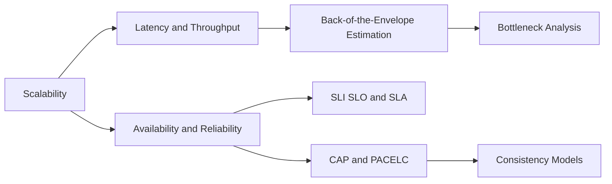

# Fundamentals

> [!abstract] The vocabulary and the physics everything else is built on.
> What *scale*, *latency*, *availability* and *consistency* actually mean, how to put numbers on a design in five minutes, and the handful of theorems (CAP, PACELC) people misquote. Read this first; every other category assumes it.

**Map:** [[HLD MOC]] → this · [[Start Here]] for the reading plan · [[Engineering Dashboard]] for progress

## Start with these

[[Scalability]] → [[Latency]] → [[Throughput]] → [[Availability]] → [[Back-of-the-Envelope Estimation]] → [[CAP Theorem]] → [[Consistency Models]]

## How the ideas connect



## Concepts

### Core — know these cold for SDE-2

- [[Scalability]] — Scalability is the ability to keep performance acceptable as a specific load parameter grows by adding resources
- [[Availability]] — Availability is the fraction of time, or of requests, for which a system gives a correct and timely answer
- [[Fault Tolerance]] — Fault tolerance is the set of techniques — redundancy, replication, isolation, failover and degradation — that let a system keep serving, possibly with reduced function…
- [[Latency]] — Latency is a distribution, not a number: the tail percentiles decide user experience, fan-out amplifies the tail multiplicatively
- [[Throughput]] — Throughput is completed work per unit time; it is tied to latency and concurrency by Little's Law, it is capped by the slowest stage of a pipeline
- [[CAP Theorem]] — CAP says that while a network partition is happening, a replicated system must choose between refusing some requests (consistency) and answering with possibly stale data…
- [[Consistency Models]] — A consistency model is the contract about which values a read may return given the writes that happened
- [[ACID]] — ACID names the four guarantees of a database transaction — all-or-nothing atomicity, application-defined consistency, isolation from concurrent transactions
- [[SLI SLO and SLA]] — An SLI is a measurement of one aspect of service quality as a ratio of good to total events, an SLO is the target that ratio must meet over a window
- [[Horizontal vs Vertical Scaling]] — Vertical scaling buys a bigger machine and keeps the architecture simple until the largest machine or its price runs out
- [[Back-of-the-Envelope Estimation]] — Back-of-the-envelope estimation turns a product requirement into orders of magnitude
- [[Bottleneck Analysis]] — Bottleneck analysis finds the one resource whose saturation limits a system's throughput

### Important — read once, revisit when a design needs it

- [[Reliability]] — Reliability is the property of continuing to do the right thing when hardware, software or people go wrong
- [[PACELC]] — PACELC extends CAP with the trade you pay every day: if there is a Partition choose Availability or Consistency, Else choose Latency or Consistency
- [[Performance vs Cost Trade-offs]] — Cost is a non-functional requirement like latency: a cloud bill scales with compute hours, stored bytes, transferred bytes and request counts

### Vocabulary — skim, link, move on

- [[BASE]] — BASE — Basically Available, Soft state, Eventually consistent — is the design philosophy for partitioned stores that gives up cross-node atomicity and immediate…

## Where it shows up

**Design problems that lean on this category:** [[Design a Social Feed]], [[Design a Distributed Cache]], [[Design a Metrics and Monitoring System]], [[Design a Payment System]], [[Design a Message Queue]], [[Design a Digital Wallet and Ledger]], [[Design a Distributed Key-Value Store]], [[Design an Inventory Management System]]

**Projects that exercise it:** [[Load Test and Latency Lab]], [[Mini-KV Store]], [[Chaos Lab]], [[Double-Entry Ledger Service]], [[Lock Service with Fencing Tokens]], [[Streaming Fraud Rules Engine]]

## Progress in this category

Status and confidence come from each note's properties — update them in the note, the table updates itself (native Bases, no plugin).

```base
filters:
  and:
    - file.hasTag("concept")
    - category == "Fundamentals"
formulas:
  rank: 'if(priority == "high", 1, if(priority == "medium", 2, 3))'
properties:
  file.name:
    displayName: Concept
  formula.rank:
    displayName: "#"
views:
  - type: table
    name: Tracker
    order:
      - file.name
      - priority
      - status
      - confidence
      - last_reviewed
      - next_review
    sort:
      - property: formula.rank
        direction: ASC
      - property: file.name
        direction: ASC
    summaries:
      confidence: Average
```
