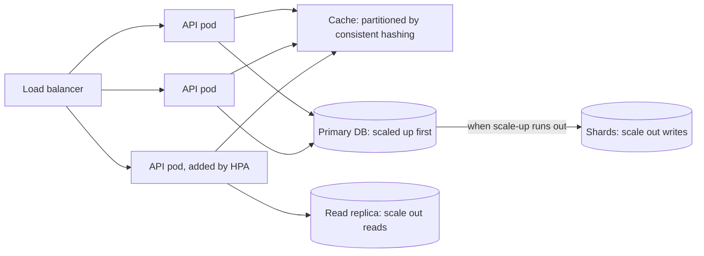

# Horizontal vs Vertical Scaling

> [!abstract] In one sentence
> Scale up when the component is stateful, the load fits in one machine and simplicity matters; scale out when the tier is stateless or the data can be partitioned — and know that the serial fraction of the work, not the number of machines, decides how far scaling out can go.

> [!tip] Deeper treatment in your system-design vault
> `system-design/01 Foundations/Vertical vs Horizontal Scaling.md` — read it *after* you have written your own explanation below.

**Map:** [[Fundamentals MOC]] → [[HLD MOC]]

## Definition

**Vertical scaling (scale up)** increases the capacity of a single node: more CPU cores, memory, faster disks, more network bandwidth. The software is unchanged; the limit is the biggest machine available and its price. **Horizontal scaling (scale out)** increases capacity by adding nodes that share the work, behind a [[Load Balancers|load balancer]] for request traffic or by partitioning data and queues. The software must be built for it: no node may hold state that another node needs, or the state must be partitioned or replicated. The two are not exclusive; most systems scale up their stateful core and scale out their stateless edges.

## Problem solved

A system that can only run on one machine has a hard ceiling and a single point of failure, and the machine gets expensive fast as it grows. A system that can only scale out pays distributed-systems complexity from day one for load it may never see. The decision of which lever to pull, for which tier, and in which order, is the practical heart of [[Scalability]]: it determines cost, operational burden and how far the design will go before it needs to change. Getting it wrong in one direction produces a fragile, overpriced giant; in the other, a fleet of 40 microservices serving 20 requests per second.

## How it works

**Scaling up.** Resize the instance, add memory, move to faster storage. Gains are immediate and linear-ish for memory-bound and I/O-bound workloads; CPU-bound workloads gain only if the software uses the extra cores. Limits: the largest instance (cloud providers offer machines with hundreds of vCPUs and tens of terabytes of RAM, but prices rise steeply at the top of the range); downtime or failover for a resize; a single failure domain; and **Amdahl's law** within the box — a single-threaded component (a GC thread, a lock, the main event loop of Node.js or Redis) gains nothing from more cores.

**Scaling out.** Add nodes and spread the work:

1. **Stateless tiers** (API servers, workers) scale out trivially: a load balancer spreads requests, any node can serve any request. Requirements: no in-memory sessions (put them in Redis or a cookie), no local files, fast startup, health checks. Kubernetes' HorizontalPodAutoscaler makes this a configuration change.
2. **Caches** scale out by partitioning keys across nodes with [[Consistent Hashing]] ([[Distributed Caching]]).
3. **Queues** scale out by partitions; parallelism is bounded by partition count and ordering requirements ([[Topic Partitions]]).
4. **Databases** are the hard case. Reads scale out with [[Read Replicas]] at the cost of staleness; writes scale out only by [[Sharding]], which forces the application to route by key, breaks cross-shard transactions and joins, and is a project rather than a setting. This is why the standard advice is *databases scale up first*: a larger instance with more IOPS and memory postpones sharding by years at a fraction of the engineering cost ([[Database Scaling]]).

**Amdahl's law as the ceiling.** If a fraction *s* of the work is serial (must happen on one node, in one lock, in one partition), the maximum speed-up from *N* nodes is 1 / (s + (1 − s)/N). With 10% serial work, 10 nodes give 5.3x and 100 nodes give 9.2x — never more than 10x. Scaling out is a search for the serial fraction and the engineering to shrink it: shard the hot table, remove the global counter, relax the ordering. Gunther's Universal Scalability Law adds a coherence penalty (nodes talking to each other) that can make throughput *fall* past a certain node count.

**Cost curves.** Vertical cost is a staircase: each step up is a fixed jump, and the top steps are disproportionately expensive and often sold with capacity you do not need. Horizontal cost is roughly linear in nodes, plus a fixed overhead per node (OS, agents, connection pools, idle headroom) and an overhead for coordination (load balancers, service discovery, replication traffic). Scale-out also buys [[Fault Tolerance]] as a side effect — N+1 nodes survive one failure — which scale-up never does.

```text
Amdahl: speedup(N) = 1 / (s + (1 - s) / N)
  s = 5%:   N=10 -> 6.9x    N=100 -> 16.8x   N=inf -> 20x
  s = 20%:  N=10 -> 3.6x    N=100 -> 4.8x    N=inf -> 5x
```

## Architecture



> [!example]- Excalidraw version — the same diagram as an editable canvas
> ![[Horizontal vs Vertical Scaling.excalidraw]]
> [[Horizontal vs Vertical Scaling.excalidraw|Open in Excalidraw]] — needs the Excalidraw plugin (see [[Plugins to Install]]).


## Use cases

- A stateless API or worker tier under growing request load: scale out, with the pool sizes and database capacity rechecked ([[Connection Pooling]]).
- A database at 70% CPU or IOPS with headroom in the instance catalogue: scale up, and plan the next step.
- Read-heavy traffic on a single database: read replicas before sharding.
- Fault-tolerance requirements ("survive one node loss") that scale-up cannot meet regardless of load.
- A single-threaded component (Redis, a Node.js process, a scheduler leader) that is CPU-bound: scaling up does nothing; partition or shard it.

## Limitations

- Scaling out stateless tiers is only as effective as the shared resources behind them; it often just moves the bottleneck to the database or cache.
- Sharding is irreversible in practice and changes the data model: cross-shard joins, transactions and uniqueness become application problems.
- Scaling up has a hard ceiling and leaves a single failure domain; resizing often needs a restart or failover.
- Both add cost in different shapes; neither improves per-request efficiency, which is sometimes the cheaper fix ([[Performance vs Cost Trade-offs]]).
- Horizontal scaling of anything that coordinates (locks, consensus groups) has negative returns past a small size.

## Trade-offs

| You gain | You sacrifice |
|---|---|
| Scale up: unchanged software, strong single-node consistency, simple operations | A hard ceiling, step-function pricing, a single point of failure |
| Scale out: near-linear capacity growth for stateless and partitioned work | Distributed complexity: routing, replication, partial failure, cross-node transactions |
| Scale out: fault tolerance through redundancy as a by-product | Per-node overhead and coordination cost; Amdahl's ceiling from any serial part |
| The freedom to mix: up for state, out for compute | Two kinds of capacity planning and two kinds of failure mode to operate |

## Failure modes

- **Scaled-out tier starves a shared resource**: API pods go from 5 to 50 and open 1,000 database connections; PostgreSQL rejects or thrashes. Noticed as connection errors after a scale-out event; blast radius is everything on that database.
- **Scale-up with no failover**: the one big instance fails; recovery takes the full restore time. Noticed as a long outage; blast radius total ([[Availability]]).
- **Hot shard after scale-out**: the shard key sends 40% of traffic to one shard; the cluster averages 20% utilisation while one node saturates ([[Hot Keys]]). Noticed only by per-shard metrics.
- **Coordination overhead exceeds gains**: adding consumers beyond partition count, or nodes to a lock-heavy service, raises rebalances and contention; throughput drops. Noticed as flat or falling throughput with rising CPU.
- **Autoscaler oscillation**: scale-out triggers on CPU, new pods warm up slowly, latency spikes, more pods are added, then all are removed on the cool-down; the cycle repeats. Noticed as sawtooth replica counts.

## Performance

Scaling up preserves single-node latency (memory access, local calls) and can reduce it (more cache, faster disks). Scaling out adds a network hop for anything shared and tends to raise p99 through fan-out and coordination, while raising throughput. Scaling up a CPU-bound single-threaded process yields nothing; scaling out a tier whose requests queue on a shared lock yields nothing either. Right-sizing per-node resources (CPU-to-memory ratio, pool sizes) matters more than the direction.

## Scalability

Vertical scaling ends at the largest instance; it is a bridge, not a destination, but a long one for most products. Horizontal scaling of stateless tiers extends almost indefinitely, subject to the shared tiers behind them; horizontal scaling of state ends at the serial fraction — the hottest key, the global sequence, the cross-shard transaction. At 10x, the realistic sequence for a transactional system is: scale up the database, add read replicas, cache the heaviest reads, move writes off the hot path with queues, then shard by a key that keeps transactions local.

## Operational impact

Scale-up is low burden: a resize window and a bigger bill. Scale-out adds load balancers, autoscaling policies, service discovery, rolling deployments, per-node health, and dashboards that show distribution across nodes rather than aggregates. Sharded databases add routing logic, rebalancing tooling, per-shard backups and a migration story. On-call must be able to scale any tier quickly and safely, which means pre-tested procedures and limits (max replicas, connection budgets).

## Alternatives

- **Efficiency work** (profiling, caching, better queries, batching) — wins when the system wastes most of its capacity; often buys a 2–10x before any scaling.
- **Load shedding and rate limiting** ([[Rate Limiting]]) — wins when peak demand exceeds any sane capacity and some requests can be refused or delayed.
- **Asynchronous processing** ([[Message Queues]]) — flattens peaks so capacity is sized for the average, not the spike.
- **Managed scale-out services** (DynamoDB, Aurora, managed Kafka) — buy partitioning and replication as a service; win when their data model fits.

## Real-world examples

- Stack Overflow famously ran on a small number of large, carefully tuned servers for years — the scale-up strategy applied with discipline and heavy caching, documented in their public architecture posts.
- Shopify's monolith scales out across many application nodes while its MySQL tier is sharded by shop ("pods" of shops), the textbook combination of stateless scale-out and keyed data partitioning ([[Shopify - Deconstructing the Monolith]]).
- Discord's history of re-platforming message storage as volume grew is a sequence of scale-out decisions forced by the limits of each previous store ([[Discord - How Discord Stores Trillions of Messages]]).
- In a stack like yours: Kubernetes makes scaling out Spring Boot and NestJS pods a one-line change, so the real decisions are on RDS (instance class first, then read replicas, then partitioning), on Redis (a bigger node versus Redis Cluster), and on Kafka (partition count fixed at topic creation, so plan the consumer parallelism ceiling up front).

## Practical exercise

1. Run a CPU-bound endpoint (e.g. password hashing with bcrypt at cost 12) in a NestJS or Spring Boot service with Docker Compose, limited to 1 CPU.
2. Load it with k6 and record throughput and p99; then give the container 4 CPUs (scale up) and repeat — observe whether the runtime uses the cores (Node.js single-threaded versus the JVM thread pool).
3. Return to 1 CPU and run 4 replicas behind nginx (scale out); compare throughput and p99 with the 4-CPU single node.
4. Add a shared PostgreSQL write per request and repeat both; note where throughput stops rising and which resource saturated.
5. Introduce a serial step (a global counter updated under a lock in Redis) and compute the Amdahl ceiling from its measured share; verify against throughput at 2, 4 and 8 replicas.
6. Write down the cost per 1,000 requests for each configuration using list prices for the instance sizes you simulated.

## Related concepts

### Prerequisites
- [[Scalability]] — the goal both levers serve
- [[Throughput]] — the measure that scaling raises
- [[Bottleneck Analysis]] — finding which component to scale

### Related
- [[Load Balancers]] — the mechanism of scaling out request traffic
- [[Sharding]] — scaling out writes
- [[Read Replicas]] — scaling out reads
- [[Connection Pooling]] — the shared-resource math behind scale-out
- [[Performance vs Cost Trade-offs]] — comparing the two cost curves
- [[Fault Tolerance]] — the redundancy scale-out gives for free

### Builds on this
- [[Database Scaling]] — the specific ladder for the hardest tier
- [[Distributed Caching]] — scaling out the cache tier
- [[Consistent Hashing]] — spreading keys across added nodes
- [[Capacity Planning]] — deciding when to pull each lever

### Design problems where it applies
- [[Design a URL Shortener]]
- [[Design a Distributed Cache]]
- [[Design a Social Feed]]
- [[Design a Message Queue]]

### Projects where it can be implemented
- [[Load Test and Latency Lab]]
- [[Mini-KV Store]]

### Resources
- [[Designing Data-Intensive Applications]] — chapter 1 on scaling up versus out, and chapter 6 on partitioning
- [[System Design Primer (GitHub)]] — the catalogue of horizontal scaling techniques
- [[Shopify - Deconstructing the Monolith]] — scale-out of the app tier with sharded state

## Personal understanding

> [!question] Explain it without the source
> Write your own explanation here, from memory. Then compare it with the sections above and note what you missed.

### Mastery checklist
- [ ] I can explain it without the original resource
- [ ] I can describe the problem it solves
- [ ] I can compare it with its alternatives
- [ ] I can name its limitations and failure modes
- [ ] I can recognise when it is appropriate in a real system
- [ ] I have applied it in a system design
- [ ] I have validated my assumptions with an experiment or implementation

## Open questions

- [ ] For a database I know, how many more instance-class steps are available before scale-up runs out, and what is the price ratio between the current step and the last one?
- [ ] What is the serial fraction of a typical request in a service I own (the parts that go through one lock, one partition or one row), and what does Amdahl's law say about adding pods?
- [ ] When does a Node.js service benefit from more vCPUs per pod versus more pods, given its single event loop and the cluster module?
