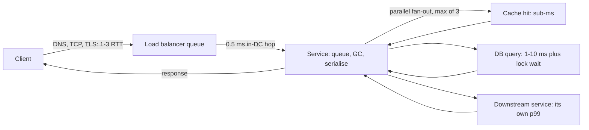

# Latency

> [!abstract] In one sentence
> Latency is how long a request waits for its answer, and because it arrives as a distribution whose tail is multiplied by every fan-out and every serial hop, the engineering question is always "what is the p99 and where does it come from", never "what is the average".

> [!tip] Deeper treatment in your system-design vault
> `system-design/01 Foundations/Latency vs Throughput vs Bandwidth.md` — read it *after* you have written your own explanation below.

**Map:** [[Fundamentals MOC]] → [[HLD MOC]]

## Definition

**Response time** is what the client experiences: the time from sending a request to receiving the response, which is service time plus queueing plus network transfer. **Latency**, strictly, is the time a request spends waiting to be handled; in practice the two words are used interchangeably and the useful distinction is between *service time* (actual work) and *everything else*. Latency is a **distribution**: the same request takes a different time each run because of queueing, cache state, garbage collection, context switches and network jitter. You describe it with percentiles — p50 (median), p95, p99, p99.9 — and you set targets on the high percentiles, because those are the requests that users remember and that time out.

## Problem solved

Averages hide the requests that matter. A service with a 20 ms mean can have a p99 of 2 seconds; the 1% of slow requests are disproportionately the heavy users with the most data, and in a page that makes 30 backend calls, almost every page view hits one of them. Timeouts, retries and SLAs are all defined by the tail, so a design judged on its mean is judged on the wrong thing. Thinking in distributions, and knowing the physical costs behind them, is what lets you predict a system's p99 from its structure before building it, and find the component responsible when it drifts.

## How it works

**Where the time comes from.** The classic order-of-magnitude table (Jeff Dean's "numbers every programmer should know", rounded; treat each as a typical figure that varies with hardware):

| Operation | Typical time |
|---|---|
| L1 cache reference | ~0.5 ns |
| Main memory reference | ~100 ns |
| Compress 1 KB | ~3 µs |
| Send 1 KB over a 1 Gbps link | ~10 µs |
| Random 4 KB read from SSD | ~100–150 µs |
| Read 1 MB sequentially from memory | ~250 µs |
| Round trip within a datacenter | ~500 µs |
| Read 1 MB sequentially from SSD | ~1 ms |
| Disk seek | ~10 ms |
| Round trip across an ocean | ~150 ms |

Three lessons fall out: memory is a thousand times faster than a network hop, so an in-process cache beats a remote one by three orders of magnitude; a single cross-region round trip costs more than a thousand local ones; and anything that touches a spinning disk is in a different league.

**Where it accumulates in a request path.** DNS lookup; TCP handshake plus TLS handshake (one to two round trips, reusable with [[Keep-Alive Connections]] and [[Connection Pooling]]); time in the load balancer queue; time in the service's thread or event-loop queue; serialisation; each downstream call, serial or parallel; database query including lock waits; garbage-collection pauses; the network back. Serial calls add; parallel calls take the *maximum*, which brings in the tail.

**Tail amplification by fan-out.** If a request fans out to *n* servers and each has probability *p* of being slow, the probability the request is slow is 1 − (1 − *p*)ⁿ. With *p* = 1% and *n* = 100, that is 63% — a per-server p99 becomes the aggregate median. This is the central result of [[The Tail at Scale]] and the reason [[Fan-Out]] designs need tail-tolerant techniques:

- **Hedged requests**: send the same request to a second replica after the first has taken longer than, say, the p95, and use whichever answers first; the paper reports a p99.9 reduction from 1,800 ms to 74 ms with about 2% extra load in one benchmark.
- **Tied requests**: enqueue on two servers and cancel the other when one starts.
- **Tight timeouts with fallbacks** ([[Timeouts and Retries]]), partial results instead of waiting for the slowest shard, and keeping the fan-out small in the first place.

**Measuring it honestly.** Record every request's time in a histogram (HdrHistogram or a Prometheus histogram with sensible buckets) and read percentiles from it; never average percentiles across hosts or windows — the p99 of a fleet is not the mean of per-host p99s. Beware *coordinated omission*: a closed-loop load generator that waits for each response under-samples exactly the slow periods; use open-loop (arrival-rate) load in k6 or Gatling. Measure where the user is: a server-side p99 of 30 ms can be a client-side p99 of 300 ms once DNS, TLS and the last mile are included ([[Monitoring User-Facing Performance]]).

## Architecture

> [!example]- Excalidraw version — the same diagram as an editable canvas
> ![[Latency.excalidraw]]
> [[Latency.excalidraw|Open in Excalidraw]] — needs the Excalidraw plugin (see [[Plugins to Install]]).

## Use cases

- A requirement states a percentile: "p99 under 200 ms", "search results in under 100 ms" — the design must account for every hop on the path.
- The request fans out to many shards or services (search, feeds, aggregations) — tail amplification will dominate and needs hedging or partial results.
- Interactive or real-time products where latency is the feature: typing autocomplete, trading, chat, fraud scoring on the payment path ([[Real-Time Systems]]).
- Cross-region traffic is involved — a single round trip can exceed the entire budget, which forces data locality or caching decisions.
- A service's p50 is fine but users complain — a tail problem, usually queueing, GC or a slow dependency.

## Limitations

- Percentiles are only as good as the sampling: too few requests make the p99.9 noise; too coarse histogram buckets make it a guess.
- Optimising latency usually costs throughput or money: more replicas at lower utilisation, hedged requests that double load, memory-resident data.
- Physics sets a floor: cross-continent round trips are tens of milliseconds and no engineering removes them; the only moves are caching, replication closer to the user, or not making the trip.
- Latency targets without a load context are meaningless — every system is fast at 1 request/second.
- Client-perceived latency includes components you do not own (device, ISP, DNS resolver); you can measure them but only partially influence them.

## Trade-offs

| You gain | You sacrifice |
|---|---|
| Predictable user experience by designing for the tail | Capacity: low utilisation and replicas held in reserve to keep queues short |
| Resilience to slow replicas through hedging and timeouts | Extra load from hedged or duplicated requests, and the complexity of cancelling them |
| Fewer round trips through caching, batching and connection reuse | Staleness and memory, plus coupling to cache behaviour |
| Honest numbers from histograms and open-loop load tests | More instrumentation and storage than a mean and a counter |

## Failure modes

- **Queueing explosion near saturation**: utilisation creeps past ~80%, queue wait dominates, p99 climbs from 50 ms to seconds while p50 barely moves. Noticed as the gap between p50 and p99 widening; blast radius is every request, then timeouts and retries make it worse ([[Throughput]]).
- **Tail from a single slow dependency**: one downstream's p99 becomes your p50 through fan-out. Noticed by per-dependency latency histograms; blast radius is every request that touches it.
- **Garbage-collection or compaction pauses**: periodic spikes of hundreds of milliseconds on otherwise fast nodes. Noticed as a sawtooth in p99 aligned with GC logs; blast radius is the requests in flight on that node — hedging to another replica hides it.
- **Connection setup on every request**: pooling misconfigured, TLS handshake per call; p50 doubles with no change in load. Noticed via handshake counts and time-to-first-byte.
- **Retries on slow, not failed, requests**: a client retries at 1 second while the server is still working; load doubles and the tail gets longer ([[Retry Storms]]).

## Performance

Latency *is* the performance metric here; what matters is its relation to utilisation. Below the knee, response time is roughly service time; above it, queueing dominates and grows without bound. Memory access, a cache hit and an in-DC network hop differ by three orders of magnitude each, so the structure of the data path (how many hops, how many of them cross a network, how many are serial) predicts the latency floor before any code is written. Batching reduces per-item latency cost but raises per-request latency; pipelining removes serial round trips.

## Scalability

Latency tends to get worse with scale, not better: more shards means more fan-out and a fatter tail; more services means more serial hops; more data means cache hit rates fall. Holding a p99 at 10x load means capacity planning for utilisation well under 100% ([[Capacity Planning]]), tail-tolerant fan-out, and placing data near its readers (regional replicas, [[CDNs]]). Measure the tail per shard and per dependency; the aggregate p99 will not tell you which one to fix.

## Operational impact

You need histograms, not averages, at every hop: client, edge, service, dependency, database. Alerts belong on percentiles over short windows with burn-rate logic ([[Alerting]]). Debugging tail latency requires [[Distributed Tracing]] to find which span is slow in the slow requests specifically; logs sampled only on slow requests are cheap and invaluable. Load tests must be open-loop and repeated as code changes; a latency regression hidden by a closed-loop generator reaches production.

## Alternatives

- **Optimise throughput and accept a higher tail** — wins for batch and analytical systems where the unit of work is a job, not a request.
- **Make it asynchronous** — acknowledge immediately and deliver the result later ([[Synchronous vs Asynchronous Communication]]); wins when the user needs confirmation, not the result.
- **Move the data to the user** — edge caching, regional replicas, precomputed results; wins when reads dominate and staleness is acceptable.
- **Shrink the fan-out** — denormalise so one lookup replaces ten; wins when the data model can absorb duplication ([[Data Modeling]]).

## Real-world examples

- Google's search and ads systems fan out each query to hundreds of leaf servers; hedged and tied requests, micro-partitions and selective replication exist to keep the tail acceptable at that scale ([[The Tail at Scale]]).
- Amazon's internal convention of expressing latency goals as p99.9 for customer-facing services (described in the Dynamo paper) is why DynamoDB and its predecessors were designed around tail percentiles ([[Dynamo Paper]]).
- The Jeff Dean latency table is reproduced on the "latency numbers every programmer should know" page and is the standard input for back-of-the-envelope design ([[Latency Numbers Every Programmer Should Know]]).
- In a stack like yours: a payment authorisation path that calls the IAM service for the JWT check, Redis for a limit, PostgreSQL for the ledger and an external provider — four serial hops where the provider's tail and the database lock wait dominate; an in-process cache for the token verification keys and a tight provider timeout with an asynchronous confirmation are the usual tail fixes.

## Practical exercise

1. Run a small HTTP service (Spring Boot or NestJS) that calls PostgreSQL and a second "downstream" service, both via Toxiproxy, in Docker Compose.
2. Load it with k6 using an open-loop (`constant-arrival-rate`) executor; export p50, p95, p99 and p99.9 and plot them against arrival rate until the knee.
3. Add 50 ms of latency to the downstream for 5% of requests (Toxiproxy latency toxic with jitter) and observe how far the p99 moves; then make the service call the downstream in a fan-out of 10 parallel requests and observe the tail amplification.
4. Implement hedging: issue a second request after the p95 and take the first response. Measure p99 and total downstream request count.
5. Disable connection pooling and compare p50; re-enable it.
6. Repeat the p99 measurement with a closed-loop k6 executor and note how much the tail is under-reported.

## Related concepts

### Prerequisites
- [[TCP and UDP]] — the round trips underneath every hop
- [[Functional vs Non-Functional Requirements]] — latency targets must be stated as percentiles

### Related
- [[Throughput]] — the other axis; latency explodes as throughput approaches capacity
- [[Fan-Out]] — where tail amplification comes from
- [[Timeouts and Retries]] — bounding the tail and the danger of retrying slowness
- [[Connection Pooling]] — removing handshake round trips from every call
- [[Back-of-the-Envelope Estimation]] — the latency table as design input
- [[Distributed Tracing]] — how you find the slow span

### Builds on this
- [[SLI SLO and SLA]] — latency percentiles as objectives
- [[Multi-Level Caching]] — trading the memory–network gap for staleness
- [[CDNs]] — moving bytes closer to remove round trips
- [[Real-Time Systems]] — designs where latency is the feature
- [[Monitoring User-Facing Performance]] — latency measured where the user is

### Design problems where it applies
- [[Design Search Autocomplete]]
- [[Design a Social Feed]]
- [[Design a Real-Time Fraud Detection Pipeline]]
- [[Design a Distributed Cache]]
- [[Design a Chat System]]

### Projects where it can be implemented
- [[Load Test and Latency Lab]]
- [[Chaos Lab]]

### Resources
- [[The Tail at Scale]] — tail amplification and tail-tolerant techniques
- [[Latency Numbers Every Programmer Should Know]] — the table
- [[Designing Data-Intensive Applications]] — chapter 1 on percentiles and why averages lie
- [[Dynamo Paper]] — p99.9 as the design target

## Personal understanding

> [!question] Explain it without the source
> Write your own explanation here, from memory. Then compare it with the sections above and note what you missed.

### Mastery checklist
- [ ] I can explain it without the original resource
- [ ] I can describe the problem it solves
- [ ] I can compare it with its alternatives
- [ ] I can name its limitations and failure modes
- [ ] I can recognise when it is appropriate in a real system
- [ ] I have applied it in a system design
- [ ] I have validated my assumptions with an experiment or implementation

## Open questions

- [ ] For a request path I own, what is the predicted p99 from the hop count and the latency table, and how far is it from the measured one — and what explains the gap?
- [ ] When does hedging a database read become unsafe or wasteful, and how do you cancel the losing request in Java or Node without leaking a connection?
- [ ] How should latency SLOs be set per endpoint when the fan-out differs by an order of magnitude between endpoints?
