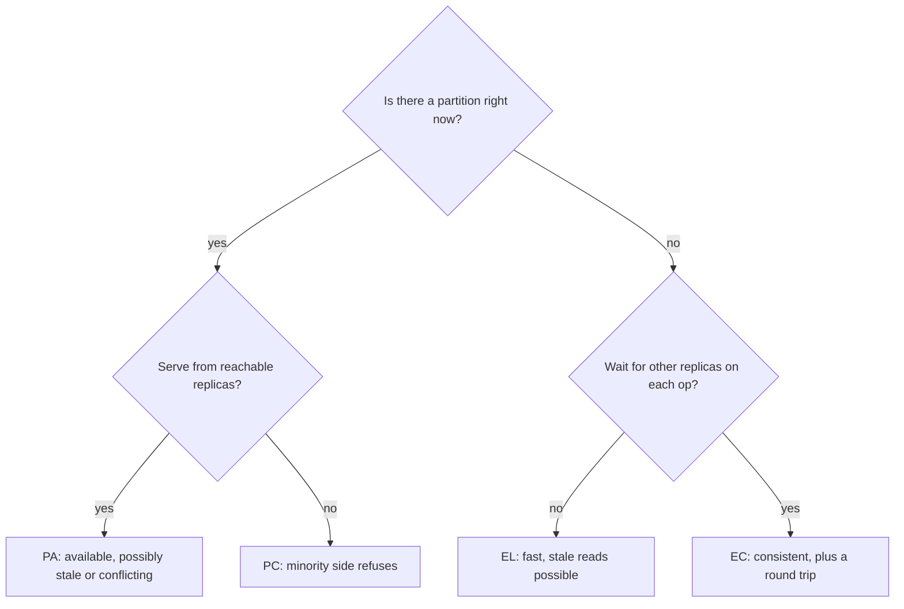

# PACELC

> [!abstract] In one sentence
> PACELC says the consistency bill is paid twice — during a partition as lost availability, and the rest of the time as latency — so a replicated system is classified by both answers (PA/EL, PC/EC and the mixed forms), which describes real databases far better than CP or AP alone.

> [!tip] Deeper treatment in your system-design vault
> `system-design/08 Distributed Systems Theory/PACELC.md` — read it *after* you have written your own explanation below.

**Map:** [[Fundamentals MOC]] → [[HLD MOC]]

## Definition

PACELC (Abadi, 2012) is a two-part classification of replicated systems. **PAC**: if a network Partition occurs, does the system favour Availability or Consistency — the [[CAP Theorem]] question. **ELC**: Else, in normal operation, does it favour low Latency or Consistency? The second half exists because replication to more than one node is only consistent if a write waits for other nodes to acknowledge it, and waiting is latency. A system is labelled with both choices: PA/EL (Dynamo-style), PC/EC (strongly consistent, coordination on every operation), PA/EC or PC/EL for the mixed cases. The choice can be made per operation rather than per system.

## Problem solved

CAP only speaks about partitions, which are rare, and so it misses the trade engineers actually make every day: should a write return as soon as the local replica has it, or after a quorum has it? Should a read be served from the nearest replica, or from the leader? Those decisions are visible in every latency histogram, and CAP has nothing to say about them. Systems were being compared on "CP vs AP" while the practical difference between them — a 1 ms local write versus a 50 ms cross-region quorum — lived in a blind spot. PACELC names the blind spot and gives a vocabulary that matches the configuration knobs real databases expose.

## How it works

**Why the latency–consistency trade exists in the normal case.** Replicate a value to three nodes. A write can return:

1. After the local node has it (asynchronous replication). Fastest; but a read from another replica may not see it, and a crash before replication loses it. This is the **EL** choice.
2. After a majority (two of three) acknowledge ([[Quorums]]). One round trip to the nearest other replica; reads that also use a majority are guaranteed to see the write. This is **EC** at the cost of one network round trip per write — sub-millisecond in a single AZ, a few milliseconds across AZs, tens to over a hundred milliseconds across continents.
3. After all replicas acknowledge. Strongest, slowest, and unavailable the moment any replica is slow — rarely chosen.

The same trade appears on reads: a read from the nearest replica is fast and possibly stale (EL); a read routed to the leader or confirmed by a quorum is consistent and slower (EC). Even inside a single region, "consistent" means waiting for the slowest member of the quorum, which is where tail latency comes from ([[Latency]]).

**Classifying systems** (per Abadi's paper, with the defaults as shipped at the time):

- **PA/EL**: Dynamo, Cassandra, Riak — available under partition, and in normal operation they return from a subset of replicas for speed; consistency is tunable per query upward.
- **PC/EC**: VoltDB/H-Store, Megastore, BigTable/HBase-style systems — they refuse to serve inconsistently under partition and pay coordination on every operation.
- **PA/EC**: MongoDB as analysed in the paper — consistent in normal operation (single primary), but during a partition the old primary may accept writes that are later rolled back.
- **PC/EL**: Yahoo's PNUTS — gives up some consistency for latency in normal operation (per-record timeline consistency from a local replica) but refuses availability under partition.

Google's Spanner is the famous PC/EC case that works hard to make the EC cost small: TrueTime-bounded clocks let it offer external consistency with commit waits in the single-digit milliseconds within a region ([[Spanner Paper]]).

**Per-operation choice.** Cassandra's consistency level, DynamoDB's `ConsistentRead` flag, PostgreSQL's `synchronous_commit` and replica routing, MongoDB's write concern and read preference, Kafka's `acks` — each is an ELC dial. The design skill is to set the dial per data item: EC for balances and locks, EL for feeds and counters.

```text
PostgreSQL:   synchronous_commit = on   -> wait for standby flush (EC, +1 RTT)
              synchronous_commit = local -> local WAL only          (EL, possible loss on failover)
Cassandra:    write QUORUM + read QUORUM -> R + W > N, consistent   (EC)
              write ONE + read ONE        -> fastest, may be stale   (EL)
Kafka:        acks=all, min.insync.replicas=2 -> durable, slower    (EC-like)
              acks=1                            -> leader only       (EL-like)
```

## Architecture



## Use cases

- Choosing replication settings for a database: `synchronous_commit`, write concern, `acks` — every one of these is a PACELC decision and should be justified in those terms.
- Multi-region deployments where the cross-region round trip is tens of milliseconds and the question "which operations need to pay it" decides the architecture.
- Reviewing a design that claims "strong consistency" — ask what it costs per operation in normal operation, not only under partition.
- Choosing a store: a PA/EL store for a product catalogue, a PC/EC one for account balances, and a clear reason for each.
- Explaining to a product owner why "always correct and always fast" has a physical cost that cannot be configured away.

## Limitations

- It is still a coarse classification; "consistency" covers the whole spectrum of [[Consistency Models]] and the label does not say which one.
- Systems change their behaviour with configuration and versions; the paper's classifications describe defaults at one point in time, not what your cluster does.
- It says nothing about durability, which is a separate dial (a write can be consistent among replicas and still lost if none of them fsynced).
- It does not quantify the trade: "EC costs latency" does not say whether it is 1 ms or 100 ms, which depends on topology.
- Like CAP, it assumes partitions are detectable and distinguishable from slowness.

## Trade-offs

| You gain | You sacrifice |
|---|---|
| A vocabulary that matches real configuration knobs | A label that still hides which consistency model you get |
| Explicit accounting for the normal-case cost of consistency | More decisions to make and document, per data item rather than per system |
| EC paths: no stale reads, no lost acknowledged writes | EC paths: a round trip per operation, tail latency from the slowest quorum member |
| EL paths: lowest latency and highest throughput | EL paths: staleness windows, possible loss on failover, reconciliation logic |

## Failure modes

- **EL chosen by default, EC assumed by the code**: a service reads from a replica right after writing to the primary and does not find its own write; the handler treats "not found" as "create" and duplicates the record. Noticed as duplicates with no error; blast radius is every read-after-write path on replicas ([[Read Replicas]]).
- **EC everywhere, latency budget blown**: every read is a quorum read across AZs; the p99 is three times what a single-AZ read would be and the product feels slow. Noticed in latency histograms; the fix is to downgrade the paths that can tolerate staleness.
- **Asynchronous replication plus failover**: acknowledged writes on the old primary never reached the standby; after promotion they are gone. Noticed as customer complaints about vanished actions; blast radius is the replication lag at the moment of failover ([[Recovery Point Objective]]).
- **Quorum size misconfigured**: R + W ≤ N, so "quorum" reads can still miss "quorum" writes. Noticed as rare stale reads that are hard to reproduce.
- **Cross-region EC under load**: the remote region is slow, every write waits for it, and the local region's throughput collapses to the remote's. Noticed as latency correlated with the remote region's health.

## Performance

The ELC half *is* a performance statement: EC costs at least one round trip to the slowest member of the acknowledging set per operation, and throughput is bounded by what a coordinator can push through that wait. Within an AZ the cost is small (sub-millisecond); across AZs it is a few milliseconds; across regions it dominates everything else in the request. EL operations run at local-memory or local-disk speed and set the floor for what is possible. Batching and pipelining amortise the EC round trip across many writes, which is how Kafka keeps `acks=all` fast.

## Scalability

EL systems scale writes almost linearly, because each replica accepts work independently and reconciles later; EC systems scale by partitioning the key space so that each partition's quorum is small and local, since the per-operation coordination cost does not shrink with more nodes. Multi-region scaling is where the ELC choice decides the architecture: either data has a home region (EC locally, EL elsewhere), or every write pays the cross-region round trip, or the system is PA/EL with conflict resolution.

## Operational impact

Each ELC dial is a production setting that must be documented, alerted on and understood by on-call: replication lag for EL paths, quorum health and commit latency for EC paths. Changing a dial changes failure behaviour, not just latency — moving PostgreSQL from `synchronous_commit = on` to `local` trades a few milliseconds for possible loss on failover, and that decision belongs in a runbook. Game days should test both halves: a partition and a slow replica.

## Alternatives

- **[[CAP Theorem]] alone** — wins only as a first-cut interview vocabulary; it hides the everyday trade.
- **Consistency models per operation** — the most precise framing ([[Consistency Models]]); PACELC is the summary, the model is the detail.
- **Harvest and yield** (Fox and Brewer) — describes degradation as partial results rather than binary availability; wins for search-like systems that can return a fraction of the data.
- **Avoiding replication on the hot path** — a single-writer design with synchronous standby in the same AZ keeps the EC cost tiny; wins for most transactional cores until multi-region is required.

## Real-world examples

- Abadi's paper classifies Dynamo, Cassandra and Riak as PA/EL, PNUTS as PC/EL, and MongoDB as PA/EC, and uses the classification to explain why the "CAP" label told engineers so little about those systems' everyday behaviour ([[PACELC Paper]]).
- Spanner is the showcase PC/EC system: it accepts a commit-wait on every transaction so that reads anywhere are externally consistent, and engineers the network and clocks to keep that wait small ([[Spanner Paper]]).
- Cassandra's tunable consistency is PACELC exposed as a per-query parameter; the documentation's advice to use `QUORUM` for both reads and writes when you need consistency is the R + W > N rule.
- In a stack like yours: RDS PostgreSQL multi-AZ replicates synchronously to the standby (EC within the region, a small latency cost on every commit) while read replicas are asynchronous (EL); routing a read-after-write to a replica is the PACELC mistake most likely to appear in a payments service, and the fix is to pin such reads to the primary.

## Practical exercise

1. Run a PostgreSQL primary with one streaming standby in Docker Compose, with Toxiproxy between them.
2. With `synchronous_commit = on` and the standby named in `synchronous_standby_names`, measure insert latency with a small Java or TypeScript loop; then set `synchronous_commit = local` and measure again — that difference is the EC cost.
3. Add 20 ms of latency on the Toxiproxy link and repeat both settings; observe which one is affected.
4. In `local` mode, write 1,000 rows, immediately `docker kill` the primary, promote the standby and count the rows — the missing tail is the EL cost paid on failover.
5. Repeat the write-then-read sequence against the standby and record how often the read misses the write at each setting.
6. Write the PACELC classification of the configuration you would choose for a ledger and for a notification log, with the measured numbers attached.

## Related concepts

### Prerequisites
- [[CAP Theorem]] — the PAC half
- [[Replication]] — where the latency–consistency trade comes from
- [[Latency]] — the cost being traded

### Related
- [[Consistency Models]] — what "C" means in detail
- [[Quorums]] — the mechanism of EC
- [[Coordination vs Availability]] — the general principle
- [[Read Replicas]] — the everyday EL choice
- [[Eventual Consistency]] — what EL paths provide

### Builds on this
- [[Distributed Transactions]] — EC across partitions, with the costs multiplied
- [[Database Scaling]] — choosing replica roles by ELC
- [[Cache Consistency]] — a cache is an EL replica with no reconciliation

### Design problems where it applies
- [[Design a Distributed Key-Value Store]]
- [[Design a Digital Wallet and Ledger]]
- [[Design a Social Feed]]
- [[Design an Inventory Management System]]

### Projects where it can be implemented
- [[Mini-KV Store]]
- [[Double-Entry Ledger Service]]

### Resources
- [[PACELC Paper]] — the original classification
- [[Spanner Paper]] — PC/EC made fast
- [[Dynamo Paper]] — PA/EL by design
- [[Designing Data-Intensive Applications]] — chapter 5 on synchronous versus asynchronous replication

## Personal understanding

> [!question] Explain it without the source
> Write your own explanation here, from memory. Then compare it with the sections above and note what you missed.

### Mastery checklist
- [ ] I can explain it without the original resource
- [ ] I can describe the problem it solves
- [ ] I can compare it with its alternatives
- [ ] I can name its limitations and failure modes
- [ ] I can recognise when it is appropriate in a real system
- [ ] I have applied it in a system design
- [ ] I have validated my assumptions with an experiment or implementation

## Open questions

- [ ] What is the measured EC cost of synchronous commit on RDS multi-AZ in a region I use, and is it large enough to matter for a payment authorisation path?
- [ ] How would I classify Redis with replicas and `WAIT`, and Kafka with `acks=all`, in PACELC terms — and are those labels stable across failover?
- [ ] For a multi-region wallet, which operations could be EL with a bounded staleness window, and what reconciliation would make that safe?
