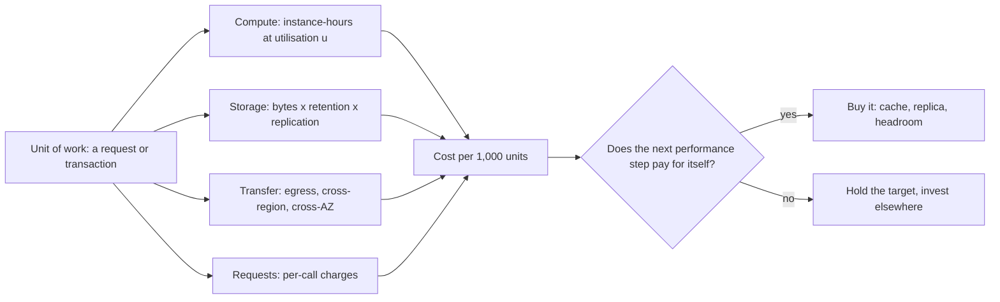

# Performance vs Cost Trade-offs

> [!abstract] In one sentence
> Every performance target has a price shaped by what the bill meters — compute time, stored bytes, egress and requests — and because the returns on headroom, caching and the last 10 ms diminish sharply, cost-aware design means choosing the point on that curve on purpose and measuring cost per unit of work the same way you measure p99.

> [!tip] Deeper treatment in your system-design vault
> `system-design/18 AWS Services/AWS Cost Shape.md` — read it *after* you have written your own explanation below.

**Map:** [[Fundamentals MOC]] → [[HLD MOC]]

## Definition

Treating cost as a first-class non-functional requirement means specifying, alongside [[Latency]] and [[Availability]] targets, what the system may cost per unit of work (per thousand requests, per active user, per gigabyte stored) and designing to that number. The trade-off is that most performance improvements — lower tail latency, more headroom, higher availability, faster storage — are bought with resources whose price rises faster than the benefit; a design is cost-aware when it knows which increments are worth buying. Cost here includes the cloud bill, but also the engineering and operational time that a more complex design consumes.

## Problem solved

Without a cost requirement, performance work has no stopping rule. Teams over-provision for a peak that happens twice a year, keep three replicas of data nobody reads, run a cache tier that saves less than it costs, and shave 10 ms off a p99 that no user can perceive — all defensible individually, together a bill that grows faster than revenue. The opposite failure is a system that is cheap until it collapses at the first spike. Making cost explicit lets both sides argue with numbers: this nine costs this much, this cache saves this much, this autoscaling policy trades this risk for this saving. In fintech the unit economics of a transaction are the business, so a design that does not know its cost per transaction is not finished.

## How it works

**1. Know what the bill scales with.** Cloud pricing has a small number of shapes:

- **Compute** by instance-hour (or vCPU-second for serverless and containers on Fargate): scales with fleet size and time, not with work done — idle capacity costs the same as busy capacity. Reserved and spot pricing discount it for commitment or interruptibility.
- **Storage** by GB-month, plus provisioned IOPS or throughput for block storage, with tiers (hot, infrequent access, archive) that trade retrieval latency for price.
- **Data transfer** by GB: internet egress is the expensive line; cross-region transfer next; cross-AZ transfer is metered per GB in each direction and is the one teams forget; traffic through managed NAT gateways and load balancers carries its own per-GB processing charge.
- **Requests** by count: object storage operations, API gateway calls, function invocations, database read/write units — designs that make many small calls pay per call.
- **Managed service premiums**: a managed database or broker costs more per hour than the raw instance; the difference buys operations time, which is a real cost on the other side of the ledger.

**2. Attribute cost to units of work.** Divide the monthly bill for a service by its requests, transactions or active users; track it like an SLI. Cost per transaction is the number that shows whether an optimisation paid for itself.

**3. Know the shape of diminishing returns.**

- **Headroom**: running at 50% utilisation instead of 70% roughly doubles the compute cost of a tier for a smaller improvement in tail latency; the knee of the queueing curve says where the money stops buying latency ([[Throughput]]).
- **Tail latency**: moving a p99 from 200 ms to 100 ms might need a cache; from 100 ms to 50 ms, an in-process cache and connection tuning; from 50 ms to 20 ms, replicas in every region. Each step costs more and matters less to users.
- **Availability**: each nine costs roughly an order of magnitude more in redundancy and engineering ([[Availability]]).
- **Durability and replication**: replication factor 3 triples storage; cross-region replication adds transfer costs on every write.

**4. Prefer the moves that improve both.** Caching reduces database tier size and latency together ([[Cache-Aside]]); batching cuts per-request charges and raises throughput; compression cuts egress and storage; right-sizing instances to the actual CPU-to-memory ratio; tiered storage for cold data ([[Data Retention and Archival]]); asynchronous processing that sizes workers for the average rather than the peak ([[Message Queues]]).

**5. Over-provisioning versus autoscaling.** Static over-provisioning costs headroom all year but is simple and responds instantly; autoscaling trades that cost for lag (minutes for new pods or instances), the risk of scaling too late during a spike, and the complexity of policies. The usual compromise is a baseline sized for typical peak with autoscaling for the unusual, and queues to absorb what autoscaling cannot reach in time.

```text
Cost per 1,000 requests, worked (illustrative shapes, not prices):
  API tier:    pods × hourly rate ÷ requests per hour  -> falls as utilisation rises, until the knee
  database:    instance-hours + IOPS + storage          -> mostly fixed; cache hit rate is the lever
  egress:      bytes per response × requests × $/GB    -> compression and CDN are the levers
  requests:    object/API/function calls per request   -> batching is the lever
  cross-AZ:    bytes between pods and database in other AZs -> topology-aware routing is the lever
```

## Architecture



> [!example]- Excalidraw version — the same diagram as an editable canvas
> ![[Performance vs Cost Trade-offs.excalidraw]]
> [[Performance vs Cost Trade-offs.excalidraw|Open in Excalidraw]] — needs the Excalidraw plugin (see [[Plugins to Install]]).


## Use cases

- A design review for a service with a measurable unit of work: the question "what does this cost per transaction, and how does the proposed change move it?" should have an answer.
- Choosing between managed and self-run components ([[Build vs Buy Decisions]]): compare the premium against the operations time it replaces.
- Setting latency and availability targets: the next increment has a price, and the product owner should see it before asking for it.
- Autoscaling policy and headroom decisions for a fleet, especially one with a strong daily or seasonal cycle.
- Data retention: logs, events and backups kept "forever" are a storage bill growing linearly with time ([[Data Retention and Archival]]).

## Limitations

- Cost attribution in shared infrastructure (a cluster, a database used by ten services) is approximate; allocation rules can be gamed or ignored.
- Price lists change and differ by provider and region; the shapes are stable, the numbers are not.
- Engineering time is the largest cost in most teams and the hardest to attribute; a design that saves infrastructure spend by doubling complexity is often a net loss.
- Some performance targets are not negotiable (regulatory latency limits, fraud scoring windows) and cost reasoning only chooses the cheapest way to meet them.
- Optimising cost too early produces designs that cannot absorb growth; the cheapest system is often the one that fails at the first spike.

## Trade-offs

| You gain | You sacrifice |
|---|---|
| A stopping rule for performance work, in money | Some latency or headroom that would have been nice to have |
| Unit economics that scale with the business | Instrumentation and allocation work to attribute cost per service |
| Elastic spend through autoscaling and tiered storage | Response lag during spikes and more policy to tune |
| Simpler designs when the expensive increment is declined | The option value of over-provisioned capacity during surprises |

## Failure modes

- **Cross-AZ transfer surprise**: a chatty service tier and its database or Kafka brokers in different AZs; the transfer line quietly becomes a large fraction of the bill. Noticed in the monthly invoice; the fix is topology-aware routing or accepting the cost for availability.
- **Per-request charges at scale**: a design that writes each event as a separate object or calls a per-invocation function per message; cost grows linearly with traffic in a way compute would not. Noticed when traffic grows 10x and the bill grows 10x.
- **Autoscaling too late**: a spike arrives faster than new capacity, requests time out, retries amplify, and the saved headroom costs an outage ([[Retry Storms]]). Noticed as incidents at every predictable peak.
- **Cache that costs more than it saves**: a large Redis tier for a workload with a low hit rate; the database tier was not reduced. Noticed only if hit rate and database utilisation are compared with the cache bill.
- **Unbounded retention**: logs and events stored at hot tier forever; storage becomes the dominant line. Noticed when someone finally asks who reads data older than 30 days.

## Performance

Cost-aware design does not mean slow: the cheapest moves (caching, batching, compression, connection reuse) typically improve latency and throughput as well. What it declines is the expensive tail of the curve — very low utilisation, replicas everywhere, synchronous cross-region durability — where each step buys a smaller improvement for a larger price. The honest comparison is latency *and* cost per request at a given load, side by side.

## Scalability

At 10x traffic, the cost lines scale differently: compute scales with fleet size and can be held down by better utilisation and batching; storage scales with retention and replication; transfer and request charges scale linearly with traffic and are the lines most likely to surprise. A design is cost-scalable when cost per unit of work falls or stays flat as volume grows; one whose cost per unit rises with scale (per-request charges, chatty cross-AZ patterns) needs a change before the growth arrives ([[Scalability]]).

## Operational impact

Cost needs the same treatment as any SLI: dashboards per service with cost per unit of work, budgets with alerts, and tagging discipline so spend is attributable. Capacity reviews should show the price of headroom explicitly ([[Capacity Planning]]). Autoscaling policies and reserved-capacity commitments need owners and periodic review as traffic patterns change. Incident reviews should note cost effects (a retry storm that doubled egress) alongside user impact.

## Alternatives

- **Optimise for time to market first** — ignore cost until there is revenue to protect; wins for early products, provided the design can be made efficient later ([[Prioritizing Reliability Performance Cost and Time to Market]]).
- **Fixed capacity, no autoscaling** — simplest and most predictable; wins for steady workloads and small teams.
- **Serverless pricing** — pay per request with no idle cost; wins for spiky, low-average workloads and loses at sustained high volume where per-request charges exceed instance-hours.
- **Buy the managed service** — pay the premium instead of the operations time; wins when the team is small or the component is not a differentiator ([[Build vs Buy Decisions]]).

## Real-world examples

- The cloud providers' own guidance on cost optimisation — right-sizing, commitment discounts, storage tiering, and watching data transfer — reflects the same bill shapes described above; AWS documents cross-AZ and NAT gateway per-GB charges that are routinely the surprise line in a microservices bill.
- Amazon's load-shedding and avoiding-fallback write-ups argue for predictable capacity and simple behaviour under overload rather than expensive mechanisms that rarely run ([[AWS Builders Library - Load Shedding]]).
- Google's SRE capacity-planning practice sizes fleets from measured saturation with explicit headroom, treating the headroom percentage as a cost decision ([[Site Reliability Engineering (Google)]]).
- In a stack like yours: on EKS the levers are right-sized pod requests, an HPA baseline that covers the daily peak with a queue to absorb bursts, keeping pods and their RDS or MSK endpoints AZ-aligned where the availability design allows it, S3 lifecycle rules for audit archives, and a cost-per-transaction panel next to the latency panel for the payments path.

## Practical exercise

1. Take a small service in Docker Compose (API, PostgreSQL, Redis) and a k6 load profile with a daily cycle (low for 20 minutes, peak for 5, compressed into a short run).
2. Assign list prices from a public cloud price sheet to each container size you simulate; compute cost per 1,000 requests at 30%, 50% and 70% target utilisation by adjusting replica counts, recording p99 at each.
3. Add a Redis cache for the read path; measure the hit rate and recompute the database tier you would need; compute whether the cache pays for itself at the measured hit rate.
4. Simulate autoscaling with a scripted replica change that lags the load by 2 minutes; measure the error rate during the ramp and estimate the cost of the headroom that would have avoided it.
5. Compress responses and measure the drop in bytes out; convert to an egress figure at list price.
6. Write a one-page cost-per-request model for the service with the three levers that move it most.

## Related concepts

### Prerequisites
- [[Latency]] and [[Throughput]] — the performance side of the trade
- [[Back-of-the-Envelope Estimation]] — bytes and requests become a bill

### Related
- [[Capacity Planning]] — headroom as a priced decision
- [[Horizontal vs Vertical Scaling]] — the two cost curves
- [[Prioritizing Reliability Performance Cost and Time to Market]] — the arbitration between the four
- [[Build vs Buy Decisions]] — the managed-service premium versus operations time
- [[Data Retention and Archival]] — storage cost over time
- [[Availability]] — the price of each nine

### Builds on this
- [[Multi-Level Caching]] — the cheapest latency money can buy, when the hit rate is there
- [[Evaluating Architectural Complexity]] — complexity as a cost that does not appear on the invoice
- [[Operational Simplicity]] — fewer components, smaller bill, smaller on-call

### Design problems where it applies
- [[Design a Video Streaming Service]]
- [[Design a Logging System]]
- [[Design File Storage]]
- [[Design a Metrics and Monitoring System]]

### Projects where it can be implemented
- [[Load Test and Latency Lab]]
- [[LLM Gateway]]

### Resources
- [[AWS Builders Library - Load Shedding]] — predictable capacity over expensive mechanisms
- [[Site Reliability Engineering (Google)]] — capacity planning with explicit headroom
- [[Fundamentals of Software Architecture]] — trade-off analysis as the architect's core skill

## Personal understanding

> [!question] Explain it without the source
> Write your own explanation here, from memory. Then compare it with the sections above and note what you missed.

### Mastery checklist
- [ ] I can explain it without the original resource
- [ ] I can describe the problem it solves
- [ ] I can compare it with its alternatives
- [ ] I can name its limitations and failure modes
- [ ] I can recognise when it is appropriate in a real system
- [ ] I have applied it in a system design
- [ ] I have validated my assumptions with an experiment or implementation

## Open questions

- [ ] What is the cost per transaction of a payments path I know, broken into compute, database, transfer and third-party fees, and which line would grow fastest at 10x?
- [ ] How much of our cross-AZ traffic is avoidable with topology-aware routing, and what availability would we give up by aligning pods with their database AZ?
- [ ] At what sustained request rate does a serverless component in our stack become more expensive than a small always-on deployment?
