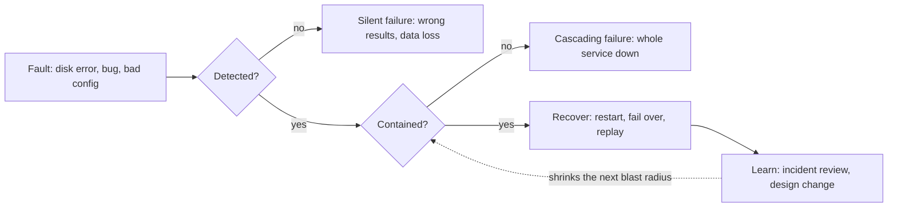

# Reliability

> [!abstract] In one sentence
> A reliable system keeps producing correct results in the presence of faults — components breaking, bugs firing, operators mistyping — and the only way to get there is to assume faults will happen and design so that a fault does not become a failure.

> [!tip] Deeper treatment in your system-design vault
> `system-design/01 Foundations/Availability Reliability Durability.md` — read it *after* you have written your own explanation below.

**Map:** [[Fundamentals MOC]] → [[HLD MOC]]

## Definition

Reliability is the probability that a system performs its intended function correctly, for a given period, under stated conditions — including adverse ones. The key vocabulary is **fault** versus **failure**: a fault is one component deviating from its specification (a disk returning errors, a pod being OOM-killed, a bug corrupting one record); a failure is the system as a whole no longer providing the service users expect. Reliability engineering is the practice of ensuring faults stay faults. It is distinct from [[Availability]] (how often the system answers at all) and from durability (whether committed data survives): a system can be highly available and unreliable if it answers quickly with wrong data.

## Problem solved

Every real system runs on components that fail. In a fleet of 10,000 disks with a mean time to failure of 10 to 50 years, you expect roughly one disk to die every day — a well-known order-of-magnitude from *Designing Data-Intensive Applications*. Software faults are worse because they are correlated: the same bug fires on every replica given the same input, a leap-second or certificate expiry hits everything at once, and a bad config push propagates in seconds. Human error is the leading cause of outages in most studies of internet services. A design that assumes "components are reliable, so the system is reliable" fails on the first bad disk, the first thundering herd, the first fat-fingered deploy. Reliability as a discipline replaces hope with containment.

## How it works

The method is the same whichever fault class you look at: **expect it, detect it, contain it, recover from it, learn from it.**

1. **Enumerate fault classes.** Hardware (disk, memory, network, power, whole AZ). Software (bugs, resource leaks, cascading slowdowns, poison inputs, dependency outages). Human (wrong config, wrong command on the wrong environment, misunderstood runbook). Write them down per component; this is the lightweight version of [[Threat Modeling]] for faults.
2. **Make faults visible.** You cannot contain what you cannot see: [[Health Checks]], [[Failure Detection]], [[Metrics]] on error rates and saturation, and [[Logging]] with enough context to tell a fault from a failure.
3. **Contain the blast radius.** Redundancy so a hardware fault is absorbed ([[Fault Tolerance]]); isolation so a software fault in one tenant or feature does not spread ([[Bulkheads]]); [[Timeouts and Retries]] and [[Circuit Breakers]] so a slow dependency does not consume every thread.
4. **Recover automatically where possible.** Restart crashed processes (Kubernetes does this), fail over databases ([[Replication]]), replay from a durable log. Recovery must be *safe*: retries need [[Idempotency]], failover needs fencing against the old leader.
5. **Reduce human faults structurally.** Staging environments that look like production, canary deploys with fast rollback ([[Deployment and Rollback Strategies]]), configuration validated before apply, operations expressed as code rather than remembered commands, and interfaces that make the wrong action hard.
6. **Test the failure paths.** Unit tests for the happy path do not prove reliability. Inject faults deliberately — kill pods, add latency, return errors from a dependency — and check the system stays correct ([[Testing Strategies]]). Netflix's Chaos Monkey is the canonical example: if a random instance termination can hurt you, better to find out at 2 p.m. on a Tuesday.
7. **Learn.** Blameless [[Production Incident Analysis]] turns each failure into a specific design change; the goal is that the same fault class cannot cause the same failure twice.

The important shift is from *preventing* faults to *surviving* them. Prevention has diminishing returns; survival has compounding ones, because each containment mechanism protects against many fault types at once.

## Architecture

> [!example]- Excalidraw version — the same diagram as an editable canvas
> ![[Reliability.excalidraw]]
> [[Reliability.excalidraw|Open in Excalidraw]] — needs the Excalidraw plugin (see [[Plugins to Install]]).

## Use cases

- The requirement talks about correctness under stress: "no double charge even if the pod restarts mid-request", "no lost events during a broker failover".
- The system moves money or holds records of legal weight ([[Audit Logs]]), where a wrong answer is worse than no answer.
- Operations are frequent and risky: many deploys per day, many hands on configuration — human faults dominate.
- Dependencies are many and uneven: one slow downstream must not take the product down.
- A postmortem says "this had never happened before" — a sign that fault classes were never enumerated.

## Limitations

- Reliability has no single metric; you measure proxies (error rate, correctness checks, incident count) and argue from design. It is harder to put on a dashboard than availability.
- You cannot be reliable against faults you have not imagined; novel failure modes (a new kind of correlated outage) still get through.
- Each containment mechanism adds code and configuration that can itself be wrong — misconfigured retries cause [[Retry Storms]], over-eager breakers cause outages.
- Some faults are not survivable at any price you will pay: simultaneous loss of all replicas, silent corruption replicated everywhere, a bug in the recovery path itself.
- Reliability work is invisible when it succeeds, which makes it easy to under-fund until an incident.

## Trade-offs

| You gain | You sacrifice |
|---|---|
| Faults absorbed without user-visible failure | Redundant capacity, extra components and the code to coordinate them |
| Confidence to change the system often, because failure paths are tested | Slower delivery: canaries, staged rollouts, fault-injection test suites |
| Smaller, shorter incidents and fewer repeats | Engineering time spent on paths that run rarely |
| Correctness guarantees the business can rely on | Simplicity: every "what if this fails" branch is more code to read and keep right |

## Failure modes

- **Correlated software fault**: a release with a bug that fires on a specific input reaches every replica; redundancy does nothing. Noticed as a fleet-wide error spike shortly after deploy; blast radius is everything running that version — the reason for canaries.
- **Silent corruption**: a fault produces wrong data rather than an error, so nothing alerts; a ledger drifts by cents for weeks. Noticed via reconciliation jobs or customer complaints; blast radius is every downstream decision made on bad data.
- **Recovery path is itself broken**: the failover script was never run, the restore from backup takes a day, the replay produces duplicates. Noticed during the incident, when it is most expensive.
- **Cascade through a shared resource**: one slow dependency ties up every worker thread, so unrelated endpoints fail too. Noticed as thread-pool saturation and timeouts across endpoints; blast radius is the whole service rather than one feature.
- **Human fault amplified by automation**: a config change meant for one environment is applied by a pipeline to all of them in seconds. Noticed immediately, everywhere; the fix is validation gates and staged application, not more careful typing.

## Performance

Reliability mechanisms cost a little on every request and a lot on rare ones. Checksums, validation and idempotency lookups add microseconds to milliseconds; synchronous replication adds a network round trip to every commit; timeouts bound the damage of a slow dependency but define the worst-case latency during its outage. The most expensive reliability feature in latency terms is usually synchronous durability (fsync, cross-node acknowledgement), which is why it should be spent on the data that deserves it.

## Scalability

Faults scale with component count. At 10x the machines, "rare" hardware faults become daily events and must be handled without a human; at 10x the deploy rate, human and software faults dominate and the deploy pipeline becomes the main reliability control. Containment has to scale too: per-tenant or per-cell isolation keeps the blast radius of any single fault constant while the fleet grows.

## Operational impact

Reliability is mostly an operational culture: runbooks that are executed in drills, fault injection as a routine (game days), postmortems that produce tracked actions, and configuration under review like code. On-call load is the honest measure — a reliable system pages rarely and for new reasons. Observability must distinguish faults being absorbed (fine, but worth a dashboard) from failures reaching users (page). Upgrades and migrations need reversible steps, because the rollback is the recovery path.

## Alternatives

- **Prevent rather than tolerate** (formal verification, exhaustive testing, hardened hardware) — wins for small, critical kernels such as a consensus library or a cryptographic module, where the surface is bounded.
- **Accept failures and recover manually** — wins for low-stakes internal systems where an hour of wrong behaviour costs less than the engineering to prevent it.
- **Push reliability to a managed provider** — wins when the provider's track record and SLAs beat what you can build; you still own the correctness of your own logic on top.
- **Design for detectability instead of prevention** — reconciliation and audits that find and repair wrong data after the fact; wins when the window of wrongness is tolerable and the fault space is too large to close.

## Real-world examples

- Netflix built Chaos Monkey and the wider Simian Army to terminate instances in production on purpose, forcing every service to survive instance loss as a routine fault rather than an incident ([[Netflix - Fault Tolerance in a High Volume Distributed System]]).
- *Designing Data-Intensive Applications* opens with reliability and the fault/failure distinction, using the disk-failure arithmetic and the observation that configuration errors by operators are a leading cause of outages.
- Google's SRE practice treats postmortems and error budgets as the mechanisms that keep reliability and velocity in balance ([[Site Reliability Engineering (Google)]]).
- In a stack like yours: a payments service on EKS where pods are routinely rescheduled, Kafka consumers are rebalanced and the database fails over occasionally. Reliability there means idempotent handlers keyed on a request id, the [[Outbox Pattern]] for events, reconciliation against the provider, and a deploy pipeline that cannot push a config change to production without a staged apply.

## Practical exercise

1. Take a small service with a `POST /transfer` endpoint writing to PostgreSQL and publishing an event (Spring Boot or NestJS, Docker Compose).
2. Write a fault list for it: pod killed mid-request, database connection dropped, broker unreachable, duplicate client request, wrong config value.
3. Inject each fault: `docker kill` the pod during a load test, cut the database with Toxiproxy for 5 seconds, stop the broker, replay a request with the same id, deploy with a wrong environment variable.
4. For each, record: was it detected (log, metric, alert)? Was the result still correct (no double transfer, no lost event)? How long to recover?
5. Fix the first two incorrect outcomes (typically: add an idempotency key, add an outbox) and rerun.
6. Write a one-page postmortem for the worst case, with a single concrete design change as the action.

## Related concepts

### Prerequisites
- [[Functional vs Non-Functional Requirements]] — reliability is a non-functional requirement that must be stated in terms of fault classes

### Related
- [[Availability]] — the sibling property; up is not the same as right
- [[Fault Tolerance]] — the techniques for turning faults into non-failures
- [[Failure Detection]] — you cannot contain what you cannot see
- [[Idempotency]] — what makes automatic recovery safe
- [[Testing Strategies]] — reliability is proven by testing failure paths
- [[Production Incident Analysis]] — how reliability improves over time

### Builds on this
- [[SLI SLO and SLA]] — correctness SLIs put a number on reliability
- [[Graceful Degradation]] — a reliable system chooses what to drop
- [[Disaster Recovery]] — reliability against whole-site faults
- [[Deployment and Rollback Strategies]] — the main control over human and software faults

### Design problems where it applies
- [[Design a Payment System]]
- [[Design a Digital Wallet and Ledger]]
- [[Design a Distributed Job Scheduler]]
- [[Design a Webhook Delivery System]]

### Projects where it can be implemented
- [[Chaos Lab]]
- [[Double-Entry Ledger Service]]

### Resources
- [[Designing Data-Intensive Applications]] — chapter 1 on faults, failures and the three fault classes
- [[Site Reliability Engineering (Google)]] — postmortem culture and error budgets
- [[Netflix - Fault Tolerance in a High Volume Distributed System]] — reliability through fallbacks and isolation

## Personal understanding

> [!question] Explain it without the source
> Write your own explanation here, from memory. Then compare it with the sections above and note what you missed.

### Mastery checklist
- [ ] I can explain it without the original resource
- [ ] I can describe the problem it solves
- [ ] I can compare it with its alternatives
- [ ] I can name its limitations and failure modes
- [ ] I can recognise when it is appropriate in a real system
- [ ] I have applied it in a system design
- [ ] I have validated my assumptions with an experiment or implementation

## Open questions

- [ ] Of the last ten incidents I have seen, how many were hardware, software or human faults, and which containment mechanism would have stopped the most of them?
- [ ] What is a good correctness SLI for a ledger — reconciliation mismatches per day, or something measurable per request?
- [ ] Where is the line between a recovery path worth automating and one that should stay a reviewed manual runbook?
