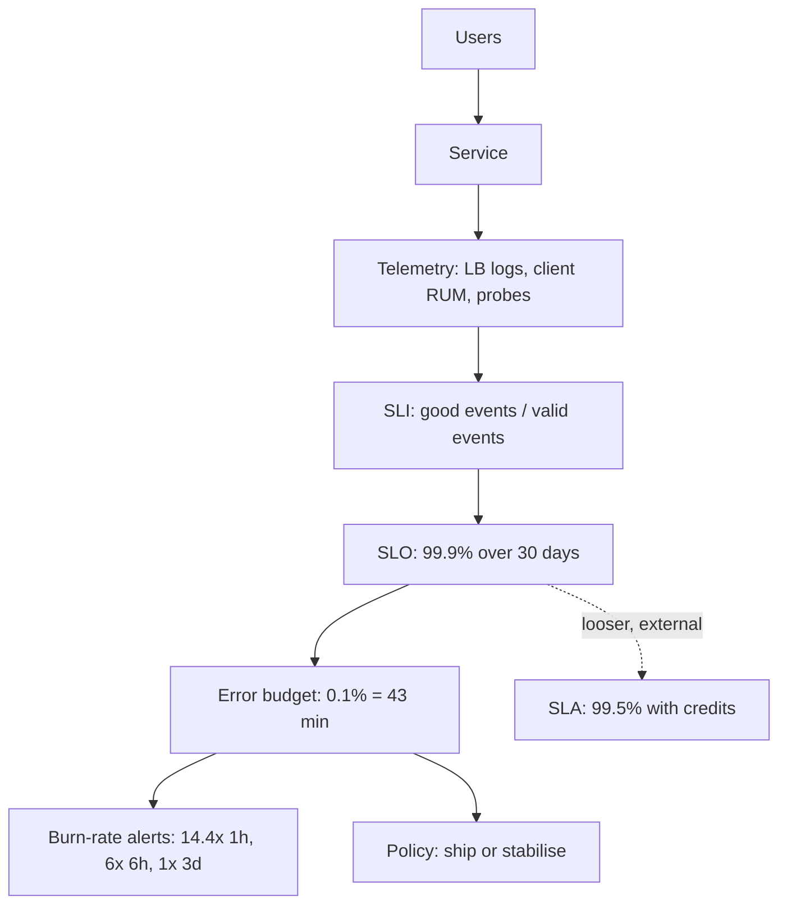

# SLI SLO and SLA

> [!abstract] In one sentence
> SLIs measure what users experience, SLOs say how good that must be over a window, and SLAs attach money to a looser version of the same promise — and the payoff is that "is the service reliable enough?" becomes a number you alert on, budget against and negotiate with.

> [!tip] Deeper treatment in your system-design vault
> `system-design/01 Foundations/SLA SLO SLI and Error Budgets.md` — read it *after* you have written your own explanation below.

**Map:** [[Fundamentals MOC]] → [[HLD MOC]]

## Definition

A **Service Level Indicator (SLI)** is a quantitative measure of one aspect of the service as users experience it, best expressed as *good events / valid events*: the fraction of requests served successfully, the fraction served under 300 ms, the fraction of pipeline records processed within 5 minutes. A **Service Level Objective (SLO)** is a target for an SLI over a window: "99.9% of requests succeed, measured over a rolling 30 days". A **Service Level Agreement (SLA)** is an explicit or implicit contract with consumers that includes consequences — credits, penalties — if objectives are missed; it is normally looser than the internal SLO so that the SLO is breached, and acted on, before the SLA is. The **error budget** is 1 − SLO: the amount of unreliability you are allowed to spend ([[Error Budgets]]).

## Problem solved

Without these three, reliability is argued in adjectives. Engineering says the system is "pretty stable", product says customers are "complaining a lot", and nobody can say whether to ship the risky feature or spend the sprint on resilience. Alerts fire on symptoms that may not matter (CPU at 90%) and miss ones that do (1% of checkouts failing for three hours). Contracts promise "99.99%" that nobody measures the same way as the customer. SLIs make the user's experience measurable, SLOs make "good enough" explicit and shared, error budgets turn the gap into a decision rule, and SLAs put the external promise on a footing the internal numbers can defend.

## How it works

1. **Choose SLIs by what users care about**, not by what is easy to measure. The common shapes:
   - *Request/response services*: **availability** (non-error responses / total), **latency** (responses faster than a threshold / total), **quality** (responses with full content / total, for degraded modes).
   - *Data pipelines*: **freshness** (records processed within X / total), **correctness** (records matching a check / total), **coverage**.
   - *Storage*: **durability** (objects not lost / total), usually a very high number.
   Define the SLI precisely: which requests are "valid" (exclude health checks and malformed input), where it is measured (load balancer logs, client telemetry, synthetic probes), and the threshold ("under 300 ms at the load balancer").
2. **Set the SLO from user tolerance and history.** Look at what the service has delivered; set a target users would notice falling below, not an aspiration. Latency SLOs are percentile-style but expressed as a ratio: "99% of requests under 300 ms" is cleaner than "p99 < 300 ms" because it composes into an error budget. Use a rolling window (28 or 30 days) so the budget resets gradually.
3. **Derive the error budget.** At 99.9% over 30 days, the budget is about 43 minutes of full outage, or an equivalent number of failed requests. The budget is a policy lever: while it remains, ship freely; when it is spent, feature work yields to reliability work.
4. **Alert on burn rate, not on thresholds.** Burn rate is how fast the budget is being consumed relative to the rate that would exhaust it exactly at the window's end. The SRE Workbook's multi-window recipe for a 30-day window: page when 2% of the budget burns in 1 hour (burn rate 14.4) or 5% in 6 hours (burn rate 6); ticket when 10% burns in 3 days (burn rate 1), each paired with a short window (5 min, 30 min, 6 h) so the alert resets when the problem stops. This replaces noisy per-host alerts with alerts that mean "users are being hurt fast enough to matter" ([[Alerting]]).
5. **Set the SLA looser and separately.** If the SLO is 99.9%, an SLA of 99.5% with credits gives room to act before paying. SLAs need their own measurement definition, agreed with the customer, usually monthly.
6. **Review.** Revisit SLOs quarterly: too tight ones page for noise and block delivery; too loose ones let users suffer silently.

```promql
# Availability SLI over 30 days (Prometheus): good / valid
sum(rate(http_requests_total{job="api", code!~"5.."}[30d]))
  / sum(rate(http_requests_total{job="api"}[30d]))

# Fast burn-rate alert for a 99.9% SLO: 14.4x over 1h AND over 5m
(error_ratio_1h > 14.4 * 0.001) and (error_ratio_5m > 14.4 * 0.001)
```

## Architecture



> [!example]- Excalidraw version — the same diagram as an editable canvas
> ![[SLI SLO and SLA.excalidraw]]
> [[SLI SLO and SLA.excalidraw|Open in Excalidraw]] — needs the Excalidraw plugin (see [[Plugins to Install]]).


## Use cases

- Any service with a customer or a dependent team: define at least an availability SLI and a latency SLI before launch, and the SLO before the first incident.
- Deciding between feature work and reliability work — the error budget is the only rule that both product and engineering accept.
- Replacing a noisy alert set: alerts on CPU, pod restarts and queue length become dashboards; pages come from burn rate.
- Contract negotiations: an SLA you cannot measure the way the customer does is a liability.
- Dependencies: when your service calls another, ask for its SLO; your own availability is bounded by it ([[Availability]]).

## Limitations

- SLIs measure what you instrument; a server-side SLI misses DNS, CDN and client failures, and a client-side one includes networks you do not own ([[Monitoring User-Facing Performance]]).
- Aggregate SLIs hide small groups: 99.9% overall can be 50% for one region or one large customer; SLIs per segment are more work and more honest.
- Rolling windows make a single large incident dominate for a month, and 30-day budgets are coarse for a service with millions of requests a minute.
- SLOs for correctness (the right answer, not just an answer) are hard to measure automatically and are often omitted, which is dangerous in finance.
- An SLO nobody enforces is a dashboard; the budget policy needs organisational backing.

## Trade-offs

| You gain | You sacrifice |
|---|---|
| A shared, numeric definition of "reliable enough" | The time to define SLIs precisely and to argue the targets with stakeholders |
| Alerts that fire only when users are hurt at a meaningful rate | Fast detection of small problems that do not burn budget quickly |
| A rule for prioritising reliability versus features | Autonomy to ship whenever you like; the budget can say no |
| An external promise you can defend with your own data | Headroom: the SLA must be looser than the SLO, so you promise less than you deliver |

## Failure modes

- **SLI measured in the wrong place**: the load balancer reports 99.99% while a certificate problem fails every mobile client. Noticed by support tickets; blast radius is every user the probe does not represent.
- **Health checks counted as traffic**: thousands of successful `/health` requests dilute real errors and the SLI stays green through an outage. Noticed when someone computes the SLI without them.
- **Threshold alerting instead of burn rate**: pages at every 1% error blip at night, nobody pages for a 0.5% error rate that quietly burns the month's budget in a week. Noticed in the quarterly review when the SLO was missed with no incident declared.
- **Budget policy ignored**: the budget is exhausted, features ship anyway, the SLA is breached and credits are paid. Noticed by finance.
- **SLO tighter than the architecture can deliver**: four nines promised on a single-AZ database with manual failover; each incident burns a month of budget. Noticed by permanent red dashboards and alert fatigue.

## Performance

Computing SLIs from request logs or metrics costs storage and query time proportional to request volume; histograms with bucketed latency make the latency SLI cheap, while log-based SLIs are precise but expensive at scale. Burn-rate alerts evaluate a handful of ratios per minute, negligible. The real cost is in the instrumentation: every request must carry a status, a latency and a classification of validity, consistently across services.

## Scalability

SLO practice scales by hierarchy: a few user-facing SLOs at the product edge, with per-service SLOs that budget for them, and dependency SLOs negotiated between teams. At 10x services, the discipline that scales is a standard SLI library (one way to count good and valid events) and generated dashboards and alerts per service, rather than hand-built ones. Per-customer or per-region SLIs add cardinality to metrics; keep the segments few and meaningful.

## Operational impact

SLOs reshape on-call: fewer, more meaningful pages; tickets for slow burns; and a weekly look at budget consumption. Incident reviews quantify impact in budget terms, which makes prioritisation of follow-ups concrete ([[Production Incident Analysis]]). SLIs need ownership — a definition document, a dashboard, a recorded query — and periodic validation that the measurement still matches the user's experience after architectural changes (a new CDN, a new gateway).

## Alternatives

- **Threshold alerts on system metrics** (CPU, queue depth, pod restarts) — wins for detecting the *cause* of a problem inside a service; poor at saying whether users are affected.
- **Synthetic monitoring only** — probes from outside with no SLO; wins as a cheap first step for small services, misses real-traffic failure modes.
- **Incident counts and MTTR** as the reliability measure — wins for executive reporting; blind to slow degradation that never becomes an incident.
- **Contractual SLA only** — measured monthly by the customer; wins for nothing except billing, since it detects problems only after they cost money.

## Real-world examples

- Google's SRE book introduced the SLI/SLO/SLA vocabulary and the error-budget policy as the mechanism that balances product velocity against reliability ([[Site Reliability Engineering (Google)]]).
- The SRE Workbook's "Implementing SLOs" and "Alerting on SLOs" chapters give the worked recipes: SLI specifications and implementations, window choice, and the multi-window multi-burn-rate alerts quoted above ([[Google SRE Workbook - Implementing SLOs]]).
- Cloud providers publish SLAs per service (compute, databases, queues) with credit schedules; they are the inputs to the availability arithmetic of anything built on them.
- In a stack like yours: an availability SLI for payment authorisation measured at the ALB (non-5xx and non-timeout / valid requests, excluding health checks), a latency SLI (under 500 ms / total) and a correctness SLI from reconciliation (transactions matching the provider / total), each with a 30-day SLO; burn-rate alerts in Prometheus or CloudWatch; and dependency SLOs agreed with the IAM service, because token validation is on every request's path.

## Practical exercise

1. Run a small API (Spring Boot or NestJS) with Prometheus and Grafana in Docker Compose, exporting a request counter with status labels and a latency histogram.
2. Define two SLIs as recorded rules: availability (non-5xx / all, excluding `/health`) and latency (requests under 300 ms / all).
3. Set SLOs of 99.9% and 99% over a 30-day window and compute the remaining error budget as a Grafana panel.
4. Implement the multi-window burn-rate alerts (14.4x over 1h/5m, 6x over 6h/30m, 1x over 3d/6h) in Alertmanager.
5. Inject a 1% error rate with Toxiproxy for 10 minutes, then a 20% error rate for 2 minutes; observe which alerts fire, how quickly, and how much budget each incident consumed.
6. Add a per-endpoint segment and show that one endpoint can fail entirely while the aggregate SLI stays within objective.

## Related concepts

### Prerequisites
- [[Availability]] — the most common SLI and the nines arithmetic behind it
- [[Latency]] — percentiles, and why latency SLIs are ratios over a threshold
- [[Metrics]] — the instrumentation SLIs are built from

### Related
- [[Error Budgets]] — the policy half of SLOs
- [[Alerting]] — burn-rate alerts as the consumer of SLOs
- [[Monitoring]] — where SLIs are computed and displayed
- [[Monitoring User-Facing Performance]] — measuring where users are
- [[Reliability]] — correctness SLIs put a number on it
- [[Capacity Planning]] — SLOs as the constraint capacity must satisfy

### Builds on this
- [[Production Incident Analysis]] — impact measured in budget
- [[Graceful Degradation]] — quality SLIs for degraded modes
- [[Prioritizing Reliability Performance Cost and Time to Market]] — the budget as the arbitration rule
- [[Deployment and Rollback Strategies]] — canaries judged against SLIs

### Design problems where it applies
- [[Design a Metrics and Monitoring System]]
- [[Design a Payment System]]
- [[Design an API Gateway]]
- [[Design a Notification System]]

### Projects where it can be implemented
- [[Live Ops Dashboard]]
- [[Load Test and Latency Lab]]

### Resources
- [[Google SRE Workbook - Implementing SLOs]] — the practical recipe, including burn-rate alerting
- [[Site Reliability Engineering (Google)]] — the origin of the vocabulary and the error-budget policy
- [[Google SRE Book - Monitoring Distributed Systems]] — the four golden signals that SLIs are usually drawn from

## Personal understanding

> [!question] Explain it without the source
> Write your own explanation here, from memory. Then compare it with the sections above and note what you missed.

### Mastery checklist
- [ ] I can explain it without the original resource
- [ ] I can describe the problem it solves
- [ ] I can compare it with its alternatives
- [ ] I can name its limitations and failure modes
- [ ] I can recognise when it is appropriate in a real system
- [ ] I have applied it in a system design
- [ ] I have validated my assumptions with an experiment or implementation

## Open questions

- [ ] What would a correctness SLI for a ledger look like in practice — reconciliation mismatches per day as a ratio of transactions — and how fast could it be computed?
- [ ] For a service whose traffic is 100 requests per minute, is a 30-day burn-rate alert meaningful, or does low volume need a different window and threshold?
- [ ] How should the SLO of an IAM service that sits on every request path be set relative to the SLOs of the services that depend on it?
