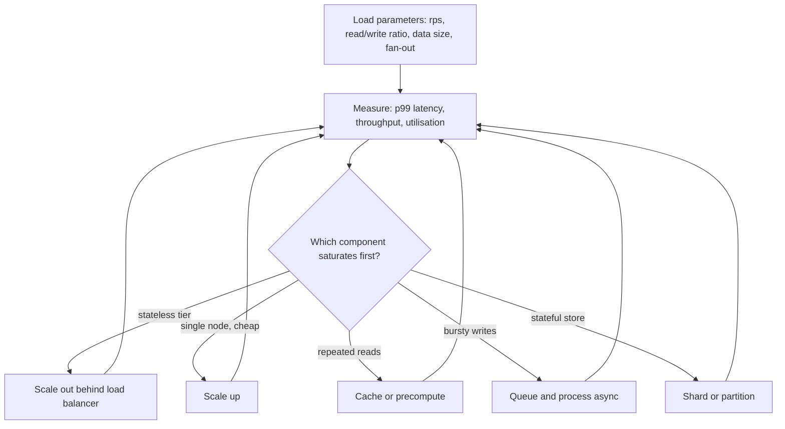

# Scalability

> [!abstract] In one sentence
> A system is scalable with respect to a load parameter when you can keep latency and throughput within target as that parameter grows, by adding resources at a cost that grows roughly in proportion — which means the honest question is never "is it scalable?" but "scalable in *what*, up to *where*, and what breaks first?"

> [!tip] Deeper treatment in your system-design vault
> `system-design/01 Foundations/Scalability.md` — read it *after* you have written your own explanation below.

**Map:** [[Fundamentals MOC]] → [[HLD MOC]]

## Definition

Scalability describes how a system's performance responds when **load** increases. Load is never one number: it is a set of **load parameters** — requests per second, read/write ratio, concurrent connections, data volume, fan-out per write, number of tenants. A system is scalable along one parameter if, as that parameter grows, you have a credible way to keep [[Latency]] and [[Throughput]] inside their targets by adding resources, without redesigning. Because every system has one component that saturates first, scalability is really a statement about the current **bottleneck** and how expensive it is to move.

## Problem solved

Before you reason about scalability explicitly, you discover it the hard way: a design that was fine at 100 requests/second collapses at 5,000 because a single database connection pool, a lock, or an O(n) fan-out was never on anyone's radar. The failure arrives as a cliff rather than a slope — queues build, response time climbs toward timeouts, retries pile on, and the system goes from healthy to down in minutes. Scalability as a discipline exists so that growth is a planned cost ("add two replicas") rather than an incident followed by a rewrite. It also stops the opposite mistake: building for a billion users when the real question is whether the next 10x is affordable.

## How it works

Reasoning about scalability is a loop you can run at a whiteboard:

1. **Describe the load.** Pick the parameters that matter for *this* system. For a feed it is fan-out per post and reads per second; for a ledger it is writes per second and the size of the hot account set. Estimate them with [[Back-of-the-Envelope Estimation]], including a **peak factor** (peak is often several times the daily average).
2. **Describe performance.** For an online system, response time percentiles (p50, p95, p99) at a given throughput; for a batch system, records per second. Decide the target *before* measuring.
3. **Find what saturates first.** Every request path has a component with the highest utilisation under load — the bottleneck ([[Bottleneck Analysis]]). Scalability of the whole is scalability of that part.
4. **Choose how to move it.** The standard moves, roughly in order of cost:
   - **Scale up** the bottleneck (bigger box). Cheap in engineering time, bounded by the largest machine you can buy ([[Horizontal vs Vertical Scaling]]).
   - **Scale out stateless work** behind [[Load Balancers]]: more pods, more workers. Works only if the tier holds no state that others need.
   - **Reduce the work**: caching ([[Cache-Aside]]), batching, precomputation, cheaper serialisation.
   - **Shift the work in time**: queues and asynchronous processing ([[Synchronous vs Asynchronous Communication]]) so peaks are absorbed rather than served.
   - **Partition state**: [[Sharding]] the data so each node owns a slice — the most powerful and most expensive move.
5. **Re-measure.** The bottleneck has now moved somewhere else. Repeat.

Two laws bound what scaling out can do. **Amdahl's law** says that if a fraction *s* of the work is serial, speed-up with *N* workers is at most 1 / (s + (1 − s)/N); with 5% serial work, 100 workers give at most ~17x. The **Universal Scalability Law** (Gunther) adds a coherence term for cross-talk between workers, which is why throughput can actually *fall* when you add nodes to a chatty system: the nodes spend their time agreeing with each other.

Scalability is distinct from **efficiency**: a system can scale linearly and still cost 10x more per request than a tighter design ([[Performance vs Cost Trade-offs]]). Linear scaling at bad unit economics is a bill, not a success.

## Architecture

> [!example]- Excalidraw version — the same diagram as an editable canvas
> ![[Scalability.excalidraw]]
> [[Scalability.excalidraw|Open in Excalidraw]] — needs the Excalidraw plugin (see [[Plugins to Install]]).

## Use cases

- The requirement states growth: "10x users in 18 months", "launch in three new countries", "traffic peaks at 20x the daily average during sales".
- Fan-out is part of the product: one write becomes many reads or many deliveries (feeds, notifications, webhooks) — the load parameter is multiplicative, not additive.
- Data is retained indefinitely: storage and index sizes grow even if request rate is flat, and query latency degrades with them.
- Multi-tenancy where one tenant can be 100x another, so "average load" hides the real distribution ([[Hot Keys]]).
- Any design review where someone says "we will just add more pods": ask which component the extra pods will saturate.

## Limitations

- Scalability work has a cost in complexity that is paid every day, while the load may never arrive; optimising for 100x before product–market fit is a common way to lose a year.
- Some work is inherently serial: a global sequence number, a single-writer ledger account, a total order of events. No amount of scale-out helps; you have to change the requirement or accept the ceiling.
- Scaling out introduces distributed-systems problems you did not have: partial failure, [[Network Partitions]], consistency across nodes, operational surface.
- A scalable architecture with poor efficiency can be *less* able to absorb growth than a tight single node, because the budget runs out first.
- "Scalable" components (managed queues, serverless) move the ceiling to quotas and cost, which are still limits.

## Trade-offs

| You gain | You sacrifice |
|---|---|
| Growth becomes a provisioning decision instead of a redesign | Up-front design effort on partitioning, statelessness and idempotency |
| Headroom for peaks without over-provisioning for the maximum all year | Coordination overhead: more nodes means more cross-talk and more partial failures |
| Independent scaling of tiers (web, workers, cache, database) | A larger operational surface: more things to deploy, monitor and page on |
| Ability to isolate heavy tenants or workloads | Loss of simple guarantees that a single process gave for free (one clock, one lock, one transaction) |

## Failure modes

- **Hidden shared resource**: you scale the API tier from 5 to 50 pods and each opens 20 database connections; PostgreSQL hits its connection limit → errors spike *because* you scaled. Notice via connection-count metrics and `too many connections` errors; blast radius is every service sharing that database ([[Connection Pooling]]).
- **Bottleneck moves silently**: after sharding the database, the message broker becomes the limit, but dashboards still watch the database. Notice via rising consumer lag; blast radius is every async workflow.
- **Hot partition**: load is not uniform; one shard or Kafka partition carries 40% of traffic and saturates while the fleet averages 20% utilisation. Notice via per-partition metrics, not aggregates.
- **Autoscaling lag**: HPA reacts in minutes, the spike takes seconds; the first wave of requests times out and triggers retries ([[Retry Storms]]) that keep the new pods saturated.
- **Coordination collapse**: adding nodes to a lock-heavy or chatty component reduces throughput (the USL coherence term). Notice as throughput that plateaus or drops while CPU stays low.

## Performance

Scalability and raw performance pull in different directions. The techniques that let a tier scale out — statelessness, serialisation at boundaries, network hops to a shared cache or store — each add latency per request. A single well-tuned process can answer in microseconds what a scaled-out design answers in milliseconds. The honest target is "acceptable p99 at the planned load with a known cost per request", not minimum latency. Measure at the knee: throughput grows roughly linearly with load until utilisation of the bottleneck passes ~70–80%, then queueing makes latency climb steeply ([[Throughput]]).

## Scalability

At 10x load, the question is which move you have *already prepared*. Stateless tiers scale out with a configuration change if sessions live elsewhere and startup is fast. Caches scale by adding nodes behind [[Consistent Hashing]]. Databases are the usual ceiling: they scale up first (bigger instance, more IOPS), then with [[Read Replicas]] for read-heavy loads, then by sharding, which is a project rather than a change ([[Database Scaling]]). Queues scale by adding partitions, bounded by ordering requirements. Team scalability is real too: a system that only three people can operate does not scale with the organisation.

## Operational impact

A scalable design shifts work from engineering to operations: capacity planning becomes recurring ([[Capacity Planning]]), load tests must be repeated as the code changes, and dashboards must show per-component utilisation and saturation, not just error rates. On-call needs runbooks for "scale X" that are safe to execute at 3 a.m. Autoscaling policies need tuning and guard rails (max replicas, cooldowns) or they amplify incidents. Debugging gets harder because a request touches more nodes; [[Distributed Tracing]] stops being optional.

## Alternatives

- **Scale up and stay simple** — wins when load is bounded and known; a single large PostgreSQL instance serves most businesses for years.
- **Do less work per request** (caching, denormalisation, cheaper formats) — wins when the load is read-heavy and tolerates staleness; often removes the need to scale out at all.
- **Shed or shape load** ([[Rate Limiting]], [[Backpressure]]) — wins when protecting the system matters more than serving every request at peak.
- **Change the requirement** — relax global ordering, accept eventual consistency, batch instead of real time; the cheapest scaling move is removing a constraint nobody needed.

## Real-world examples

- Twitter's home timeline (as described in *Designing Data-Intensive Applications*) moved from computing timelines at read time to fan-out on write, then to a hybrid where accounts with huge follower counts are merged at read time — the load parameter was followers per user, not requests per second.
- Discord's message storage moved from MongoDB to Cassandra to ScyllaDB as message volume grew, with hot partitions from busy servers as the recurring enemy ([[Discord - How Discord Stores Trillions of Messages]]).
- Google's search and ads fleets scale out across thousands of machines per request, which is exactly why tail latency became their defining problem ([[The Tail at Scale]]).
- In a stack like yours: stateless Spring Boot or NestJS pods on EKS scale out with an HPA in seconds, while RDS PostgreSQL scales up first and needs read replicas or partitioning after that; Kafka partition counts fix the parallelism ceiling for consumers, and Redis is the shared resource most likely to become the hidden bottleneck.

## Practical exercise

1. Write a minimal HTTP service (Spring Boot or NestJS) with one endpoint that reads a row from PostgreSQL; run both with Docker Compose.
2. Load it with k6 at 100, 500, 1,000 and 2,000 virtual users; record throughput and p50/p99 latency at each step and plot them.
3. Identify the knee where p99 starts climbing faster than throughput; check CPU, database connections and pool wait time to name the bottleneck.
4. Scale the service to three replicas behind nginx and repeat. Observe whether the knee moves — and what saturates now (usually the database pool or CPU of the single PostgreSQL container).
5. Add a 60-second cache in Redis for the read and repeat; compute requests per second per CPU core before and after.
6. Write down, for this service, the one-sentence answer to "scalable in what, up to where, and what breaks first".

## Related concepts

### Prerequisites
- [[Latency]] — the performance measure you are trying to hold
- [[Throughput]] — the load measure you are trying to grow
- [[Functional vs Non-Functional Requirements]] — scalability is a non-functional requirement that must be stated with numbers

### Related
- [[Horizontal vs Vertical Scaling]] — the two basic levers
- [[Bottleneck Analysis]] — how you find what limits scale
- [[Back-of-the-Envelope Estimation]] — turning growth into numbers
- [[Load Balancers]] — the mechanism behind scaling out stateless tiers
- [[Performance vs Cost Trade-offs]] — scalability at bad unit economics is a bill
- [[Capacity Planning]] — scalability over calendar time

### Builds on this
- [[Database Scaling]] — the scalability path for the hardest tier
- [[Sharding]] — partitioning state when scale-up runs out
- [[Distributed Caching]] — scaling the read path
- [[Fan-Out]] — multiplicative load parameters
- [[Microservices]] — scaling teams and tiers independently

### Design problems where it applies
- [[Design a Social Feed]]
- [[Design a URL Shortener]]
- [[Design a Distributed Cache]]
- [[Design a Metrics and Monitoring System]]
- [[Design a Notification System]]

### Projects where it can be implemented
- [[Load Test and Latency Lab]]
- [[Mini-KV Store]]

### Resources
- [[Designing Data-Intensive Applications]] — chapter 1, load parameters and the Twitter example
- [[System Design Primer (GitHub)]] — the catalogue of scaling moves
- [[The Tail at Scale]] — what scale-out does to latency

## Personal understanding

> [!question] Explain it without the source
> Write your own explanation here, from memory. Then compare it with the sections above and note what you missed.

### Mastery checklist
- [ ] I can explain it without the original resource
- [ ] I can describe the problem it solves
- [ ] I can compare it with its alternatives
- [ ] I can name its limitations and failure modes
- [ ] I can recognise when it is appropriate in a real system
- [ ] I have applied it in a system design
- [ ] I have validated my assumptions with an experiment or implementation

## Open questions

- [ ] For a service I know well, what are its three real load parameters, and which one would hurt first at 10x?
- [ ] Where does the Universal Scalability Law's coherence penalty actually show up in a Kafka consumer group — rebalances, offset commits, or something else?
- [ ] At what point does scaling an EKS deployment stop being "add replicas" and start requiring a change to the database tier, and can I predict it from connection and IOPS numbers alone?
