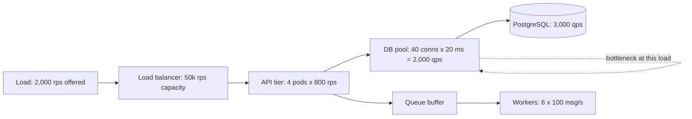

# Throughput

> [!abstract] In one sentence
> Throughput is how much work a system completes per second, bounded by its tightest resource and linked to latency through Little's Law — so the useful number is not the peak you can reach but the rate you can sustain while latency stays flat, which is always some way below saturation.

> [!tip] Deeper treatment in your system-design vault
> `system-design/01 Foundations/Latency vs Throughput vs Bandwidth.md` — read it *after* you have written your own explanation below.

**Map:** [[Fundamentals MOC]] → [[HLD MOC]]

## Definition

Throughput is the number of units of work completed per unit of time: requests per second, messages per second, rows per second, bytes per second. It is distinct from **bandwidth** (the capacity of a link or component — what *could* flow) and from **goodput** (the useful work delivered, after retransmissions, retries and overhead). Throughput, [[Latency]] and concurrency are tied together: **Little's Law** states that for any stable system, the average number of items in the system equals arrival rate × average time in the system (*L* = λ*W*). Throughput is a property of the slowest stage on the path, and it stops growing with load once that stage saturates.

## Problem solved

Without throughput reasoning, capacity is a guess: "we have 10 pods, that should be enough". Throughput thinking answers the questions that actually decide outages — how many requests per second can this tier sustain, how many threads or connections are needed to serve a given rate at a given latency, which stage limits the whole pipeline, and at what load does latency stop being flat. It also exposes the difference between a system that is slow (latency) and one that is full (throughput): the two have different cures, and treating one as the other is how teams add replicas to fix a lock or add caches to fix a queue.

## How it works

**Little's Law in practice.** *L* = λ × *W* turns three unknowns into two:

- A service handling 1,000 requests/second with a mean latency of 50 ms has 50 requests in flight on average. If each request holds a thread, you need ~50 threads *on average* — and more for bursts; if each holds a database connection, the pool must be sized accordingly ([[Connection Pooling]]).
- A fixed pool of 20 connections with 20 ms per query caps throughput at 20 / 0.020 = 1,000 queries/second. No amount of API replicas changes that; the pool is the bottleneck.
- A Kafka consumer group with 12 partitions and 30 ms per message tops out at 12 / 0.030 = 400 messages/second; more consumers than partitions add nothing ([[Consumer Groups]]).

**The knee of the curve.** Model a stage as a single-server queue with utilisation ρ = arrival rate / service rate. For a simple M/M/1 queue, mean response time is service time / (1 − ρ): at 50% utilisation requests take 2x service time, at 80% 5x, at 90% 10x, at 95% 20x. Real systems are not M/M/1 but the shape holds: throughput grows almost linearly with offered load while latency stays flat, then latency bends sharply upward somewhere past ~70–80% utilisation, and finally throughput *drops* as the system spends its time context-switching, retrying and timing out. The sustainable throughput is the rate at the knee, not the peak.

```text
Measured service time S = 10 ms, one worker
  utilisation 50%  →  response ≈ 20 ms
  utilisation 80%  →  response ≈ 50 ms
  utilisation 95%  →  response ≈ 200 ms
Sustainable throughput ≈ 0.7-0.8 × capacity, not 1.0 × capacity
```

**Pipelines.** A request path or a data pipeline is a chain of stages; its throughput equals the throughput of the slowest stage, and work accumulates as queue depth in front of it ([[Bottleneck Analysis]]). Speeding up any other stage changes nothing except how fast the queue in front of the bottleneck grows. Buffers between stages absorb bursts but do not raise throughput; [[Backpressure]] is what keeps the buffers finite.

**Batching and parallelism.** Per-item cost often has a fixed component (a round trip, a syscall, a commit); batching amortises it and can raise throughput by an order of magnitude — Kafka's `linger.ms` and `batch.size`, JDBC batch inserts, multi-get in Redis. Parallelism raises throughput until a shared resource (lock, single partition, single disk) serialises it: Amdahl's law again.

**Measuring it.** Use an open-loop load generator that sets an arrival rate independent of responses (k6 `constant-arrival-rate`), raise the rate in steps, and record throughput, latency percentiles, error rate and utilisation of each resource at each step. The knee is where latency bends; the capacity is where throughput stops growing or errors appear. Closed-loop tools (fixed virtual users) only ever generate what the system can absorb and hide the collapse.

## Architecture



## Use cases

- The requirement is a rate: "ingest 50,000 events per second", "settle 2 million transactions per night in a 4-hour window".
- Sizing pools, threads, partitions and replicas — every one of these is a Little's Law calculation.
- A pipeline has stages with different costs (ingest → enrich → persist → index) and the question is where buffers and parallelism go.
- Latency is fine at low traffic and terrible at peak — a throughput problem wearing a latency costume.
- Batch windows: nightly jobs that used to finish in two hours now take nine; throughput per stage tells you which one grew.

## Limitations

- Throughput numbers are only valid for the workload they were measured with: request mix, payload size and cache hit rate change the service time and therefore the capacity.
- Peak throughput is not usable throughput; running near it buys a few percent of capacity for an unbounded latency tail.
- Little's Law gives averages; bursts and heavy-tailed service times need headroom beyond it.
- Maximising throughput often means batching and queueing, which raises per-item latency — the two goals conflict.
- Measuring throughput at one tier says nothing about the next; the number that matters is end-to-end goodput.

## Trade-offs

| You gain | You sacrifice |
|---|---|
| Capacity you can plan, size and defend with numbers | Load-test infrastructure and the discipline to repeat tests as code changes |
| Higher throughput through batching and pipelining | Per-item latency and more complex error handling for partial batch failures |
| Predictable behaviour by running below the knee | Utilisation: 20–30% of paid capacity is held as headroom |
| Clear identification of the limiting stage | The next bottleneck appears as soon as this one is fixed |

## Failure modes

- **Running past the knee**: utilisation at 95% looks efficient until a small burst doubles latency, timeouts fire, retries add load, and throughput collapses. Noticed as latency rising while throughput plateaus or falls; blast radius is the whole tier and everything upstream of it ([[Retry Storms]]).
- **Pool exhaustion**: a hidden pool (database connections, HTTP client connections, thread pool) caps throughput far below what the CPUs could do. Noticed as low CPU with rising pool wait time; blast radius is every request through the pool.
- **Unbounded buffers**: a queue in front of the bottleneck grows until memory runs out or the lag becomes hours. Noticed as consumer lag or heap growth; blast radius is a crash or an SLA breach on freshness.
- **Serialisation point**: a global lock, a single Kafka partition, a hot row; adding workers raises contention rather than throughput. Noticed as flat throughput with climbing lock wait or partition skew.
- **Closed-loop test lies**: a load test with fixed virtual users reports a comfortable capacity; production traffic arrives at a rate and collapses the system. Noticed in production, too late.

## Performance

Throughput and latency are the two faces of the same curve. Batching, pipelining and connection reuse raise throughput by cutting fixed costs per item, typically at a small latency cost per item. Serialisation format matters (binary formats such as Protobuf move more messages per CPU-second than JSON), as does avoiding per-request allocation that drives garbage collection. Network bandwidth is rarely the limit inside a datacenter for request/response traffic but becomes one for bulk data movement and replication; a 1 MB response at 10,000 requests/second is 80 Gbps.

## Scalability

Throughput scales out cleanly for stateless stages (more pods behind a balancer) and for partitioned stages (more Kafka partitions, more shards) as long as work is evenly distributed; it scales poorly through any shared, serialised resource. At 10x the target rate, the questions are: does the partition count allow it, does the database's write capacity allow it, and does the slowest stage have a scale-out path at all ([[Scalability]], [[Database Scaling]]). Throughput per node also tends to fall as the fleet grows, because of coordination and cross-node traffic.

## Operational impact

Operate on utilisation and saturation per resource, not just request rate: CPU, pool wait, queue depth, consumer lag. Alerts on throughput alone are weak (low throughput may mean low demand); alerts on *saturation* and *latency at a given throughput* are the useful ones. Capacity planning becomes a recurring exercise that re-measures the knee after major changes ([[Capacity Planning]]). On-call needs documented levers: raise pool size, add partitions, add replicas, shed load — and the order in which to pull them.

## Alternatives

- **Optimise latency first** — wins for interactive paths where the unit is a user waiting; throughput follows from Little's Law once latency is low.
- **Shape or shed load** ([[Rate Limiting]], [[Backpressure]]) — wins when demand exceeds supply by design (bursty producers) and losing or delaying some work is better than collapsing.
- **Move work off the hot path** — asynchronous processing turns a throughput problem into a queue-depth problem that can be worked off later ([[Message Queues]]).
- **Reduce the work** — caching, denormalisation, precomputation; wins when the same results are requested repeatedly.

## Real-world examples

- Kafka's design document explains its throughput in terms of sequential I/O, batching and zero-copy transfer; producers trade a few milliseconds of `linger.ms` for an order of magnitude more messages per second ([[Kafka Design Documentation]]).
- Amazon's Builders' Library on load shedding describes the throughput collapse past the knee and the practice of rejecting excess work early so the server keeps completing requests at its sustainable rate ([[AWS Builders Library - Load Shedding]]).
- Google's SRE material on capacity planning treats sustainable throughput at acceptable latency, not peak, as the number to provision against ([[Site Reliability Engineering (Google)]]).
- In a stack like yours: a Kafka consumer group whose throughput is capped by partition count and per-message database round trips; batching the writes and raising the partition count are the two levers, and the HikariCP or pg pool size in each pod must match the rate × latency product or the pool becomes the knee.

## Practical exercise

1. Run a NestJS or Spring Boot service with an endpoint that performs one indexed PostgreSQL query, with a connection pool of 10, in Docker Compose.
2. Load it with k6 `constant-arrival-rate` at 200, 400, 800, 1,200 and 1,600 requests/second for 60 seconds each; record throughput achieved, p50/p99, error rate, CPU and pool wait time.
3. Find the knee and compute the expected cap from Little's Law (pool size / query time). Compare with the measurement.
4. Double the pool and repeat; then switch the endpoint to a batched query (ten rows per call) and measure throughput per CPU-second.
5. Run the same ramp with a closed-loop executor (fixed virtual users) and compare the "capacity" each method reports.
6. Add a queue with one slow worker stage behind the endpoint and watch queue depth grow once arrival exceeds the worker's rate; add workers until it stabilises.

## Related concepts

### Prerequisites
- [[Latency]] — the other axis of the same curve
- [[Functional vs Non-Functional Requirements]] — throughput targets must be stated as rates with a latency condition

### Related
- [[Bottleneck Analysis]] — finding the stage that sets the rate
- [[Connection Pooling]] — the most common hidden throughput cap
- [[Backpressure]] — keeping buffers finite when stages differ in rate
- [[Capacity Planning]] — throughput over calendar time
- [[Consumer Groups]] — parallelism limits in a partitioned log
- [[Rate Limiting]] — shaping offered load to sustainable throughput

### Builds on this
- [[Scalability]] — growing throughput by adding resources
- [[Horizontal vs Vertical Scaling]] — the two ways to raise capacity
- [[Database Scaling]] — the tier whose throughput is hardest to grow
- [[Performance vs Cost Trade-offs]] — throughput per dollar as the real metric

### Design problems where it applies
- [[Design a Message Queue]]
- [[Design a Metrics and Monitoring System]]
- [[Design a Logging System]]
- [[Design a Rate Limiter]]
- [[Design a Real-Time Fraud Detection Pipeline]]

### Projects where it can be implemented
- [[Load Test and Latency Lab]]
- [[Streaming Fraud Rules Engine]]

### Resources
- [[AWS Builders Library - Load Shedding]] — the knee and why you reject work early
- [[Kafka Design Documentation]] — throughput through batching and sequential I/O
- [[Site Reliability Engineering (Google)]] — capacity planning against sustainable throughput
- [[Designing Data-Intensive Applications]] — chapter 1 on describing load and performance

## Personal understanding

> [!question] Explain it without the source
> Write your own explanation here, from memory. Then compare it with the sections above and note what you missed.

### Mastery checklist
- [ ] I can explain it without the original resource
- [ ] I can describe the problem it solves
- [ ] I can compare it with its alternatives
- [ ] I can name its limitations and failure modes
- [ ] I can recognise when it is appropriate in a real system
- [ ] I have applied it in a system design
- [ ] I have validated my assumptions with an experiment or implementation

## Open questions

- [ ] For one service I run, what does Little's Law predict as the database pool size for its peak rate, and how does that compare with what is configured?
- [ ] Where is the knee for a Kafka consumer in my stack — the partition count, the per-message database write, or the commit interval — and how would I show it with a graph?
- [ ] How much headroom below the knee is right for a fintech write path, given that the cost of collapse is much higher than the cost of idle capacity?
