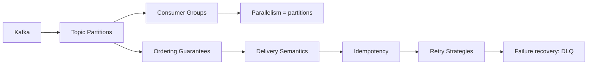
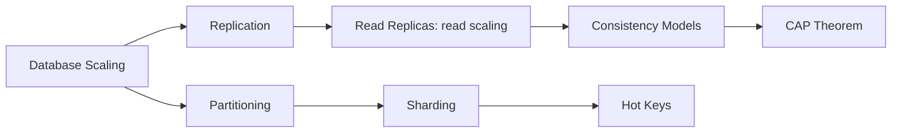
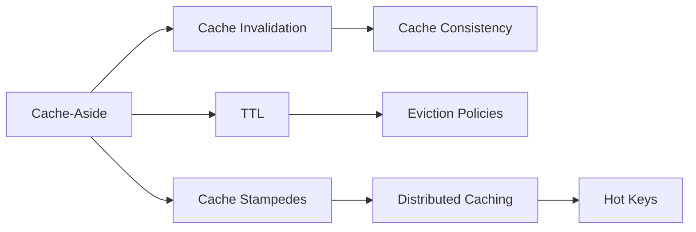
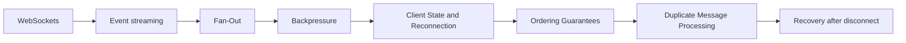

# Knowledge Graph — the chains that connect everything

> [!abstract] How to use this page
> System design concepts are not a list; they are a graph. Each chain below is a path you can walk note by note — every node is a link, and every concept note carries its own *Prerequisites → Related → Builds on this* section so you can keep walking. If you can draw one of these chains from memory and say why each arrow exists, you understand that area.

**Map:** [[HLD MOC]] · [[Start Here]] · [[Engineering Dashboard]]

## Chain 1 — Kafka: from partitions to safe consumers

[[Kafka]] → [[Topic Partitions]] → [[Consumer Groups]] (parallelism is capped by partition count) → [[Ordering Guarantees]] (only within a partition) → [[Delivery Semantics]] (at-least-once in practice) → [[Idempotency]] (the consumer owns correctness) → [[Retry Strategies]] → [[Dead-Letter Queues]] for failure recovery. Apply it in [[Design a Message Queue]] and [[Design a Notification System]]; build it in [[Streaming Fraud Rules Engine]].

## Chain 2 — Database scaling: from one box to many

[[Database Scaling]] → [[Replication]] → [[Read Replicas]] (read scaling, replica lag) → [[Consistency Models]] (what lag costs you) → [[CAP Theorem]] (and [[PACELC]]) → [[Partitioning]] → [[Sharding]] → [[Hot Keys]] (the hotspot problem) → [[Consistent Hashing]]. Apply it in [[Design a URL Shortener]], [[Design a Social Feed]] and [[Design a Distributed Key-Value Store]]; build it in [[Mini-KV Store]].

## Chain 3 — Caching: from a quick win to a correctness problem

[[Cache-Aside]] → [[Cache Invalidation]] → [[Cache Consistency]] (what a cache can and cannot promise) → [[TTL]] → [[Eviction Policies]] → [[Cache Stampedes]] → [[Distributed Caching]] → [[Hot Keys]] → [[Multi-Level Caching]]. Apply it in [[Design a Distributed Cache]] and [[Design a Rate Limiter]]; build it in [[Rate Limiter Library]] and [[LLM Gateway]].

## Chain 4 — Real-time systems: from a socket to a client that survives disconnects

[[Real-Time Systems]] is the hub: [[WebSockets]] → event streaming ([[Pub-Sub]], [[Kafka]]) → [[Fan-Out]] → [[Backpressure]] → [[Client State and Reconnection]] → [[Ordering Guarantees]] → [[Duplicate Message Processing]] → recovery after disconnect (replay from a sequence number). Apply it in [[Design a Chat System]] and [[Design a Metrics and Monitoring System]]; build it in [[Live Ops Dashboard]] and [[Presence and Chat Service]].

## Two chains you will meet at work

**Money moves safely:** [[Idempotency]] → [[Transactions]] → [[Isolation Levels]] → [[Optimistic and Pessimistic Locking]] → [[Outbox Pattern]] → [[Saga Pattern]] → [[Audit Logs]]. Apply in [[Design a Payment System]] and [[Design a Digital Wallet and Ledger]]; build in [[Double-Entry Ledger Service]].

**Nothing falls over at once:** [[Timeouts and Retries]] → [[Retry Storms]] → [[Circuit Breakers]] → [[Bulkheads]] → [[Rate Limiting]] → [[Graceful Degradation]] → [[Health Checks]] → [[Alerting]]. Apply in [[Design an API Gateway]]; build in [[Chaos Lab]].

## Navigating from a concept to a real system

1. Open the concept → *Related concepts* → *Design problems where it applies*.
2. Open the problem → its *Related* section names the concepts it needs and a project that implements it.
3. Open the project → *Relevant HLD concepts* closes the loop, and *Decisions* is where you record what you learned by building.

Obsidian's graph view, filtered with `tag:#concept` and coloured by folder (see [[Workspace Guide]]), shows the same structure as a picture.
