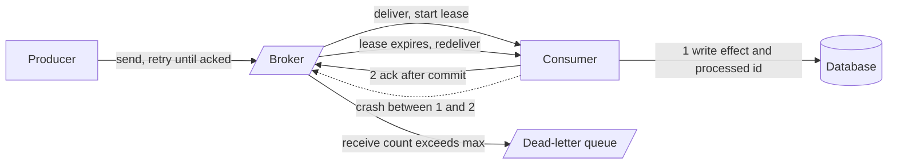

# At-Least-Once Delivery

> [!abstract] In one sentence
> At-least-once is "retry until acked, ack only after the effect is safe": every message survives crashes, timeouts and redeployments, and the price is that some messages arrive twice — which is why it is always paired with idempotent consumers.

> [!tip] Deeper treatment in your system-design vault
> `system-design/09 Messaging and Event-Driven/Delivery Semantics.md` — read it *after* you have written your own explanation below.

**Map:** [[Messaging & Event-Driven Systems MOC]] → [[HLD MOC]]

## Definition

**At-least-once delivery** guarantees that every message is delivered one or more times: a sender retries until it receives an acknowledgement, and a receiver acknowledges only after it has durably processed (or durably stored) the message. Loss is impossible short of exhausting retries; duplication is possible whenever an ack is lost or a receiver fails between finishing the work and acknowledging it. It is the [[Delivery Semantics|delivery guarantee]] of Kafka with `acks=all` and commit-after-process, of SQS with delete-after-process, of RabbitMQ with manual acks, and of Redis Streams with `XACK` after the write.

## Problem solved

The failure that hurts is the silent one: a payment captured but never recorded, a webhook never sent, an order placed and never fulfilled. [[At-Most-Once Delivery]] accepts exactly these losses to avoid duplicates. At-least-once flips the trade: it accepts a visible, bounded nuisance (a duplicate, which a consumer can detect) to eliminate an invisible, unbounded harm (a loss, which nobody can detect). Duplicates can be engineered away with [[Idempotency]]; losses cannot be engineered away after the fact. That asymmetry is why at-least-once is the default for every path with business consequences.

## How it works

1. **Producer retries.** The producer sends and waits for a durable ack (`acks=all`, publisher confirms, SQS 200 response, `XADD` reply). On timeout it resends. Without producer-side dedup the broker may now hold two copies — Kafka's idempotent producer removes this hop's duplicates; SQS standard and Redis Streams do not.
2. **Durable storage.** The broker acks only once the message is replicated to the configured degree (`min.insync.replicas`, quorum queue majority, Redis AOF policy). An ack before durability turns at-least-once into "usually".
3. **Delivery with a lease.** The broker hands the message to a consumer and starts a clock: the SQS **visibility timeout** (30 s default), the Redis Streams **pending entry** with its idle time, RabbitMQ's unacked state on the channel, Kafka's implicit lease — the uncommitted gap between the committed offset and the consumer's position.
4. **Process, then ack.** The consumer performs the side effect — a database write, an API call — and only then acknowledges: `DeleteMessage`, `XACK`, `basic.ack`, `commitSync()`. The ack must be the *last* step.
5. **Redelivery.** If the ack never arrives (crash, timeout, network), the lease expires and the broker delivers again: SQS makes the message visible, Redis leaves it in the PEL for `XAUTOCLAIM`, RabbitMQ requeues on channel close, a new Kafka consumer resumes from the committed offset and re-reads everything after it.
6. **Bounding retries.** A message that fails every time is redelivered forever unless capped: SQS `maxReceiveCount`, RabbitMQ `x-delivery-limit`, PEL delivery counts, or a retry counter in headers, feeding a [[Dead-Letter Queues|dead-letter queue]].
7. **Making it correct.** Each message carries a stable id; the consumer records processed ids (a unique index, `SET NX` with a TTL longer than the maximum redelivery horizon) or makes its write naturally idempotent (upsert, version gate, conditional update).

```ts
// Redis Streams at-least-once consumer: process, record the id, XACK last
const [[, entries]] = await redis.xreadgroup('GROUP', 'ledger', consumerName,
  'COUNT', 50, 'BLOCK', 2000, 'STREAMS', 'payments', '>');
for (const [id, fields] of entries) {
  await db.tx(async (t) => {
    const fresh = await t.insertIgnore('processed_events', { id });   // dedup on the entry id
    if (fresh) await t.applyPayment(parse(fields));
  });
  await redis.xack('payments', 'ledger', id);  // ack only after the transaction committed
}
```

## Architecture



> [!example]- Excalidraw version — the same diagram as an editable canvas
> ![[At-Least-Once Delivery.excalidraw]]
> [[At-Least-Once Delivery.excalidraw|Open in Excalidraw]] — needs the Excalidraw plugin (see [[Plugins to Install]]).


## Use cases

- "This must happen" — payments, ledger postings, order state transitions, audit events, outbound webhooks ([[Design a Payment System]], [[Design a Webhook Delivery System]]).
- "Workers get killed by autoscaling and rolling deploys" — the lease-and-redeliver loop is what makes Kubernetes pod churn safe for background work.
- "The downstream is flaky" — process-then-ack means a failed partner call simply leaves the message for the next attempt ([[Retry Strategies]]).
- "We publish from a database transaction" — the [[Outbox Pattern]] relay is at-least-once by construction.
- "Exactly-once is requested" — the honest implementation is at-least-once transport plus an idempotent consumer, so the requirement is really this plus [[Idempotency]].

## Limitations

- Duplicates are guaranteed to happen eventually, so a non-idempotent consumer is a latent bug, not an edge case.
- The lease must cover the processing time; long jobs need heartbeats (`ChangeMessageVisibility`, periodic `XCLAIM`) or the message is processed concurrently by two workers.
- Dedup state has a window, and redeliveries from a DLQ or a replay can fall outside it.
- Retries plus ordering conflict: a redelivered message is processed after its successors unless the consumer blocks the key ([[Ordering Guarantees]]).
- Under a dependency outage, at-least-once turns into a backlog that must be drained later — "nothing lost" is not "nothing late".

## Trade-offs

| You gain | You sacrifice |
|---|---|
| No silent loss across crashes, timeouts and deploys | Duplicates, and the dedup machinery to absorb them |
| Safe to kill workers at any time | Lease tuning: too short duplicates, too long delays recovery |
| Works on every broker you have — Kafka, SQS, RabbitMQ, Redis | Per-message ordering once retries are in play |
| Backlogs instead of drops during outages | Latency and capacity to drain those backlogs |

## Failure modes

- **Lease shorter than processing** → SQS redelivers while the first worker is still working; both finish; you notice `ApproximateReceiveCount` greater than one on *successful* messages and duplicate side effects; blast radius: every slow message, all the time.
- **Ack before effect by accident** — an ORM that commits lazily, a `commitAsync()` fired before the database write returns, an SQS delete in a `finally` block that runs on exceptions; the path silently becomes at-most-once; notice when something that "cannot be lost" is lost.
- **Poison message without a cap** → infinite redelivery, one worker slot permanently wasted, the message's key blocked forever; notice via a single message with a huge receive count and climbing age ([[Dead-Letter Queues]]).
- **Dedup window expiry** — a message redelivered after the dedup key's TTL is processed again; notice during redrives and replays; blast radius: one duplicate effect per expired key.
- **Redis Streams: unclaimed pending entries** — a consumer dies, its PEL entries have no owner, and nothing redelivers them without an `XAUTOCLAIM` reaper; notice via `XPENDING` idle times; blast radius: those messages are lost in practice until someone notices.

## Performance

Costs one durable ack round trip per message or batch on the producer, one dedup check plus one ack on the consumer. Batch where possible: Kafka commits per batch, SQS deletes in batches of 10, Redis `XACK` takes many ids. The dedup write is usually the dominant consumer cost — a unique-index insert in PostgreSQL is sub-millisecond when the index fits in memory; a Redis `SET NX EX` is a network round trip. Lease length is a latency knob: recovery after a crash takes at least the remaining lease (up to the full visibility timeout), so size it to the p99 processing time, not the maximum.

## Scalability

Workers scale horizontally without coordination — each holds its own leases. Dedup state scales with rate × window; natural idempotency (version-gated upserts) avoids the store entirely and is the preferred design at high volume. At 10x, the stress points are the dedup store's write rate, the broker's in-flight limits (SQS caps in-flight messages per queue), and the size of the backlog an outage can build — plan the drain rate, not just the steady state ([[Capacity Planning]]).

## Operational impact

Make the lease, the retry cap and the dedup window explicit, documented per queue, and alert when processing time approaches the lease. Monitor receive counts (duplicates), age of oldest message (backlog) and DLQ depth. Redis Streams needs a reaper process in every service and `XINFO GROUPS`/`XPENDING` dashboards. Runbooks for redrives and replays must state the expected duplicate behaviour. On-call debugging is tractable because every message has an id and an attempt count — provided they are in the logs.

## Alternatives

- **[[At-Most-Once Delivery]]** — wins for telemetry, presence and TTL-backed signals where loss is cheaper than dedup.
- **Atomic effect-plus-ack** — write the result and the consumer position in one database transaction (or Kafka transactions for Kafka-to-Kafka); wins when the effect lives in a transactional store you control ([[Exactly-Once Semantics]]).
- **Synchronous request with an idempotency key** — wins when the caller needs the answer now; same duplicate story, no broker.
- **Durable execution engines** (Temporal) — win when retries span many steps; they are at-least-once per activity with idempotency expectations made explicit.

## Real-world examples

- SQS documents standard queues as at-least-once and designs the whole consumer contract — visibility timeout, `ChangeMessageVisibility`, `maxReceiveCount` redrive — around it.
- Kafka's consumer documentation describes commit-after-process as the at-least-once pattern and warns about the auto-commit window; Kafka Connect sink connectors are at-least-once unless the sink is idempotent.
- Stripe's webhook delivery is explicitly at-least-once with retries over days, and its docs tell receivers to dedup on the event id — the contract every webhook system copies.
- In a stack like yours: MSK producers with `acks=all`, consumers committing after the PostgreSQL transaction that also inserts the event id; SQS workers deleting after the commit with a visibility timeout above p99 processing and a heartbeat for long jobs; and, on Redis Streams, `XACK` after the commit plus an `XAUTOCLAIM` reaper with an idle threshold above the longest legitimate run. Same discipline, three sets of knobs.

## Practical exercise

1. Run SQS (LocalStack) with a 5 s visibility timeout and a worker that takes 8 s per message; send 100 messages, run 3 workers, and count how many were processed more than once.
2. Add a heartbeat that extends visibility every 3 s; repeat and confirm zero duplicates from lease expiry.
3. Now `kill -9` workers randomly; confirm duplicates return — from crashes between effect and delete — and that a `processed_messages` unique index makes the final state correct.
4. Set `maxReceiveCount=3` with a DLQ and inject a message that always throws; confirm it is quarantined after three attempts and measure how much it delayed others.
5. Port the worker to Redis Streams: reproduce the duplicate with `XREADGROUP`/`XACK`, then recover a killed consumer's entries with `XAUTOCLAIM` and observe the delivery count.

## Related concepts

### Prerequisites
- [[Delivery Semantics]] — the taxonomy and the timeout dilemma
- [[Message Queues]] — leases, acks and redelivery mechanics
- [[Timeouts and Retries]] — retries are where duplicates are born

### Related
- [[Idempotency]] — the consumer-side half of the contract
- [[Duplicate Message Processing]] — what goes wrong without it
- [[Consumer Groups]] — commit timing and rebalance replays in Kafka
- [[Retry Strategies]] — pacing redelivery
- [[Dead-Letter Queues]] — the exit for messages that never succeed
- [[At-Most-Once Delivery]] — the other choice, and when it is right

### Builds on this
- [[Outbox Pattern]] — at-least-once publication from a transaction
- [[Exactly-Once Semantics]] — effectively-once is at-least-once plus dedup
- [[Saga Pattern]] — each step is an at-least-once message
- [[Change Data Capture]] — connectors redeliver after restarts

### Design problems where it applies
- [[Design a Payment System]]
- [[Design a Webhook Delivery System]]
- [[Design a Notification System]]
- [[Design a Distributed Job Scheduler]]
- [[Design an Inventory Management System]]

### Projects where it can be implemented
- [[Webhook Relay]] — retry until the endpoint acknowledges, dedup on their side
- [[Durable Job Scheduler]] — lease, process, then ack
- [[Double-Entry Ledger Service]] — idempotent postings absorb redelivery

### Resources
- [[microservices.io - Transactional Outbox]] — at-least-once publication explained with the relay
- [[Redis Streams Docs]] — pending entries, XACK, XAUTOCLAIM: the Redis implementation of the lease
- [[Kafka Design Documentation]] — consumer position and the at-least-once commit pattern
- [[AWS Builders Library - Idempotent APIs]] — why the receiver must own duplicate handling

## Personal understanding

> [!question] Explain it without the source
> Write your own explanation here, from memory. Then compare it with the sections above and note what you missed.

### Mastery checklist
- [ ] I can explain it without the original resource
- [ ] I can describe the problem it solves
- [ ] I can compare it with its alternatives
- [ ] I can name its limitations and failure modes
- [ ] I can recognise when it is appropriate in a real system
- [ ] I have applied it in a system design
- [ ] I have validated my assumptions with an experiment or implementation

## Open questions

- [ ] What is the right dedup window when messages can be redriven from a DLQ after two weeks — a window that long, a permanent processed-ids table, or natural idempotency only?
- [ ] For a Redis Streams consumer, is it better to run the `XAUTOCLAIM` reaper inside every consumer or as a single leader-elected job, and what happens to duplicates in each design?
- [ ] How do you prove, in a code review, that the ack is truly the last step when an ORM, a connection pool and an async runtime sit between the write and the ack?
