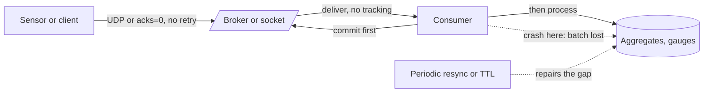

# At-Most-Once Delivery

> [!abstract] In one sentence
> At-most-once means "send it once and never retry, ack it before you act": no duplicates, no dedup state, the lowest latency — and a message lost on any timeout or crash is simply gone, which is acceptable exactly when the next message or a periodic resync makes the loss irrelevant.

> [!tip] Deeper treatment in your system-design vault
> `system-design/09 Messaging and Event-Driven/Delivery Semantics.md` — read it *after* you have written your own explanation below.

**Map:** [[Messaging & Event-Driven Systems MOC]] → [[HLD MOC]]

## Definition

**At-most-once delivery** is the [[Delivery Semantics|delivery guarantee]] in which each message is delivered zero or one times: the sender does not retry after a timeout, and the receiver acknowledges (or the broker forgets) the message *before* the receiver's side effect is durable. Loss is possible on any failure in between; duplication is impossible by construction. It is the semantics of UDP, of Redis Pub/Sub, of a Kafka producer with `acks=0`, of a consumer that commits offsets before processing, and of any "fire and forget" call.

## Problem solved

[[At-Least-Once Delivery]] is the safe default, but it is not free: every consumer needs [[Idempotency]] or a dedup store, every hop needs acks and retries, and retries under overload amplify load ([[Retry Storms]]). For a large class of data the cost is unjustified because a lost message is repaired by the next one — a CPU gauge sampled every ten seconds, a user's "typing…" indicator, a driver location ping, a cache invalidation that a [[TTL]] would catch anyway. At-most-once gives these paths the cheapest possible pipeline and, under overload, a built-in shedding behaviour: dropping is not a failure, it is the design.

## How it works

1. **Producer side.** Send without waiting for durable confirmation: Kafka `acks=0` (the producer considers the record sent as soon as it is written to the socket), UDP datagrams (StatsD, syslog), an HTTP POST with no retry on timeout, Redis `PUBLISH` (returns the number of *currently connected* subscribers; nobody listening means nobody will ever get it).
2. **Broker side.** Either nothing is stored (Redis Pub/Sub, UDP) or it is stored but handed out without tracking: RabbitMQ `autoAck` (`noAck`) consumers, SQS `ReceiveMessage` followed immediately by `DeleteMessage`, Redis Streams `XREADGROUP … NOACK`, which skips the pending entries list entirely.
3. **Consumer side.** Acknowledge first, then act: Kafka with `enable.auto.commit=true` and processing handed to another thread means the offset is committed on the next `poll()` whether or not the work finished — a crash loses in-flight records. Explicitly: `commitSync()` then process.
4. **Bounding the damage.** At-most-once pipelines pair with a **repair mechanism** so loss is temporary: periodic full-state snapshots alongside deltas (presence lists, dashboard state), TTLs on cached data, gauges that are re-sampled, or client-side counters that are aggregated before sending so a lost packet loses a sum, not a count of one.
5. **Shedding on purpose.** A bounded in-memory buffer with drop-oldest or drop-newest on overflow is at-most-once as a [[Backpressure]] strategy: when the consumer cannot keep up, lose the least valuable data rather than slow the producer ([[Graceful Degradation]]).

```java
// explicit at-most-once consumer: commit, then process; a crash in handle() loses the batch
ConsumerRecords<String, Metric> batch = consumer.poll(Duration.ofMillis(200));
consumer.commitSync();                 // ack before work
for (var record : batch) handle(record.value());
```

## Architecture



> [!example]- Excalidraw version — the same diagram as an editable canvas
> ![[At-Most-Once Delivery.excalidraw]]
> [[At-Most-Once Delivery.excalidraw|Open in Excalidraw]] — needs the Excalidraw plugin (see [[Plugins to Install]]).


## Use cases

- "We sample this every N seconds anyway" — metrics, health gauges, GPS pings, heartbeats ([[Design a Metrics and Monitoring System]], [[Design a Ride-Sharing Service]]).
- "A stale value is corrected by the next event or a TTL" — cache invalidation broadcasts with TTL fallback, presence and typing indicators ([[Design a Chat System]]).
- "Under overload we would rather drop than queue" — log shipping with sampling, debug telemetry, non-critical analytics ([[Design a Logging System]]).
- "The receiver cannot tolerate duplicates and cannot dedup cheaply" — counters incremented in place, where a duplicate is worse than a gap.
- "Latency matters more than completeness" — live price ticks or game state where an old update is worthless by the time it would be retried ([[Real-Time Systems]]).

## Limitations

- Loss is unbounded under sustained failure: a crash-looping consumer or a saturated network can lose *most* messages, not a few.
- No audit trail — you cannot answer "did this ever arrive?" after the fact.
- Any message with a monetary, legal or contractual consequence is disqualified, no matter how rare loss seems.
- Repair mechanisms (resync, TTL) add their own cost and latency; "at-most-once plus a full resync every minute" may cost more than at-least-once would have.
- Mixing at-most-once and at-least-once on one topic hides the semantics: the topic's consumers inherit the weaker promise without knowing it.

## Trade-offs

| You gain | You sacrifice |
|---|---|
| Lowest latency: no ack wait, no retry, no dedup lookup | Delivery of any message that hits a failure |
| No dedup state or idempotency keys | Any ability to reason after the fact about what was lost |
| Natural load shedding under overload | Completeness guarantees in dashboards and counts |
| Simplest producer and consumer code | Applicability: only where loss is repaired by the next message |

## Failure modes

- **Silent, correlated loss** — a network blip or broker restart drops a burst of messages at once; you notice as a flat line or a dip in a dashboard, or not at all; blast radius is everything in flight during the blip, across all senders.
- **Crash-loop amplification** — a consumer that commits then crashes on a poison record loses *every* batch it touches while looping; notice via commit rate with no downstream effects.
- **"Best effort" drift into "required"** — a path designed as at-most-once (a notification topic) acquires a consumer that bills on it; loss now has monetary impact; notice when finance asks about gaps.
- **Redis Pub/Sub subscriber disconnect** — every message during the reconnect window is gone, with no indication; notice only via client-side gap detection ([[Client State and Reconnection]]).
- **UDP under load** — kernel socket buffers overflow and the OS drops datagrams; notice via `netstat -su` receive errors, not application logs.

## Performance

The fastest semantics available: a UDP send is microseconds, a Kafka `acks=0` send returns as soon as the batch is buffered, and a consumer does no dedup I/O. Throughput is bounded by the network and by serialisation only. The hidden cost is in repair: periodic snapshots or TTL-driven reloads turn a stream of small deltas into bursts of full state, which can dominate bandwidth if the resync interval is short.

## Scalability

Scales almost perfectly because nothing is tracked per message — no acks, no pending lists, no dedup keys — and overload degrades into loss rather than backlog. The limit is what fraction of loss the use case tolerates at 10x: metrics that lose 1% of samples are fine, counters that lose 1% of increments are wrong. Aggregating client-side (sum per second, then send) keeps loss proportional to time, not to event count, which is the standard way to scale at-most-once telemetry.

## Operational impact

Low to run, high to reason about during incidents, because "we never saw it" has no counter-evidence. Mitigate with sent-versus-received counters at both ends, sequence numbers for gap detection where cheap, and dashboards that show *staleness* (time since last message per source) rather than counts. Document loudly which topics are at-most-once so nobody builds a billing consumer on one. Configuration drift is the main on-call risk: a single consumer switched to commit-before-process changes the semantics of a topic without a deploy diff anyone reads.

## Alternatives

- **[[At-Least-Once Delivery]]** — wins whenever a lost message has a cost that exceeds the dedup machinery; the default for anything transactional.
- **Pull-based collection** (Prometheus scraping, periodic polling of state) — wins for metrics and state sync: the collector decides the rate and a missed scrape is naturally repaired by the next.
- **At-most-once with snapshots** (deltas plus periodic full state) — wins for presence, dashboards and caches: fast path stays cheap, correctness is restored on a schedule.
- **Sampling** — wins for high-volume telemetry where statistical accuracy is enough; decide what to drop deliberately instead of letting the network choose.

## Real-world examples

- StatsD and most metrics agents ship over UDP by design: a lost sample is irrelevant to a 10-second gauge, and UDP avoids head-of-line blocking of the application.
- Redis Pub/Sub is documented as at-most-once and is used that way in Socket.IO's Redis adapter to broadcast events between nodes, with clients expected to resync on reconnect.
- Google's Dapper tracing design sampled aggressively and tolerated loss, trading completeness for negligible overhead — the lineage of modern [[Tracing]] samplers.
- In a stack like yours: pod and service metrics scraped or pushed at-most-once, WebSocket presence and dashboard updates broadcast through Redis Pub/Sub with a periodic full-state push, cache invalidation signals with a short TTL as the safety net — while every payment, ledger and audit event stays on an at-least-once path. The discipline is keeping the two classes on separate topics with separate names.

## Practical exercise

1. Write a producer that emits a counter increment 10,000 times over UDP to a small Node.js or Java collector; add `tc qdisc … netem loss 2%` on the loopback and compare the received total with the sent total.
2. Change the producer to send one aggregated sum per second instead; repeat and compare the error.
3. On Kafka, consume a topic with commit-before-process and `kill -9` the consumer mid-batch; count missing records. Switch to commit-after-process and count duplicates instead.
4. Broadcast 1,000 events over Redis `PUBLISH` to a subscriber that disconnects for two seconds mid-stream; count the loss; add a sequence number and a resync-on-gap and confirm the final state is correct.
5. Record the latency difference between `acks=0` and `acks=all` on the same topic at the same rate.

## Related concepts

### Prerequisites
- [[Delivery Semantics]] — the taxonomy this is one end of
- [[Message Queues]] — acks and what happens without them

### Related
- [[At-Least-Once Delivery]] — the alternative, and the default
- [[Exactly-Once Semantics]] — why dedup is needed on the other path
- [[Pub-Sub]] — fire-and-forget pub-sub is at-most-once by construction
- [[Metrics]] — the canonical at-most-once payload
- [[TCP and UDP]] — UDP is at-most-once at the transport layer
- [[Graceful Degradation]] — dropping as a shedding strategy

### Builds on this
- [[Real-Time Systems]] — fresh beats complete for live state
- [[Monitoring User-Facing Performance]] — client telemetry pipelines tolerate loss
- [[Logging]] — sampled or best-effort log shipping under overload

### Design problems where it applies
- [[Design a Metrics and Monitoring System]]
- [[Design a Logging System]]
- [[Design a Chat System]]
- [[Design a Ride-Sharing Service]]

### Projects where it can be implemented
- [[Live Ops Dashboard]] — fire-and-forget updates with a periodic full-state resync
- [[Presence and Chat Service]] — presence heartbeats and typing indicators

### Resources
- [[Redis Streams Docs]] — NOACK and the contrast with Pub/Sub delivery
- [[Designing Data-Intensive Applications]] — chapter 11 on acknowledgement and the cost of guarantees

## Personal understanding

> [!question] Explain it without the source
> Write your own explanation here, from memory. Then compare it with the sections above and note what you missed.

### Mastery checklist
- [ ] I can explain it without the original resource
- [ ] I can describe the problem it solves
- [ ] I can compare it with its alternatives
- [ ] I can name its limitations and failure modes
- [ ] I can recognise when it is appropriate in a real system
- [ ] I have applied it in a system design
- [ ] I have validated my assumptions with an experiment or implementation

## Open questions

- [ ] For a presence system, what resync interval minimises bandwidth while keeping the maximum staleness after a lost update under a target — and does the answer change with Redis Pub/Sub versus Streams?
- [ ] Is a Kafka consumer with auto-commit and a synchronous handler actually at-least-once, at-most-once, or both depending on where the crash lands?
- [ ] When a metrics pipeline is overloaded, is drop-oldest or drop-newest the better policy for gauges versus counters?
