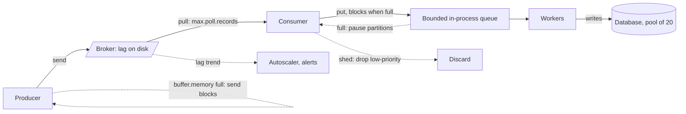

# Backpressure

> [!abstract] In one sentence
> When consumers cannot keep up, something must give — memory, latency, the producer's speed or the data itself — and backpressure is the discipline of choosing which, on purpose, with bounded buffers and a signal that flows upstream, instead of letting the slowest stage decide by crashing.

> [!tip] Deeper treatment in your system-design vault
> `system-design/09 Messaging and Event-Driven/Backpressure and Flow Control.md` — read it *after* you have written your own explanation below.

**Map:** [[Messaging & Event-Driven Systems MOC]] → [[HLD MOC]]

## Definition

**Backpressure** (flow control) is a mechanism by which a downstream stage limits the rate at which an upstream stage sends to it, so that work in flight stays bounded. It appears as **pull** (the consumer asks for the next batch when ready), **credit-based push** (the consumer grants the producer N permits), or **bounded buffers that block** the producer when full. Every system under sustained overload has exactly three outcomes — **buffer** (lag grows), **drop** (shed load) or **slow the source** — and backpressure is the set of techniques for making that choice explicit, bounded and observable rather than implicit and catastrophic.

## Problem solved

Without flow control, a producer that is 10% faster than its consumer fills an unbounded queue at 10% of its rate forever. Little's law makes the consequence precise: items in the system = arrival rate × time in system, so a growing queue is a growing latency — a message enqueued now waits behind everything already there — until memory runs out and the process dies, dropping *all* in-flight work at once. Push-based designs (RPC fan-in, WebSocket broadcast, RabbitMQ without prefetch) hit this first; and overload propagates: downstream timeouts trigger upstream retries ([[Retry Storms]]) and the collapse cascades. Backpressure turns the invisible, unbounded buffer into a visible, bounded one with a policy.

## How it works

1. **Pull.** The consumer controls the rate: [[Kafka]] `poll()` fetches at most `max.poll.records` (500) when the application asks; SQS `ReceiveMessage` returns at most 10; Redis `XREADGROUP COUNT n`. The broker absorbs the difference as **lag** on disk — the broker's retention and disk become the bound, and lag the signal ([[Consumer Groups]]).
2. **Credits.** RabbitMQ `basic.qos(prefetch_count)` caps unacked messages per consumer; the broker pushes only while credit remains. Reactive Streams (`Subscription.request(n)` in Reactor and RxJava, Java 9 `Flow`), Node.js streams (`highWaterMark` with `pipe`), HTTP/2 and gRPC flow-control windows, and TCP's receive window all work the same way — the receiver advertises how much it can take.
3. **Bounded blocking buffers.** A Kafka producer buffers up to `buffer.memory` (32 MB); when full, `send()` blocks for `max.block.ms` (60 s) and then throws — the producer feels the broker's slowness. In-process: `ArrayBlockingQueue.put`, Go channels with capacity. Blocking is backpressure propagated to the caller's thread.
4. **Signals.** Consumer lag per partition, queue depth and age of oldest message (SQS `ApproximateAgeOfOldestMessage`), in-flight count, executor queue length, p99 latency. Alert on *trend* (lag growing for N minutes), not level.
5. **Responses.** Scale consumers (KEDA on lag) up to the partition count; shed deliberately (drop telemetry, defer low-priority work, [[At-Most-Once Delivery]]); degrade (coarser processing); slow producers (block, `429` with `Retry-After`, ingress [[Rate Limiting]]); or buffer in the broker for a burst you know will end.
6. **Broker-side pushback.** RabbitMQ's memory alarm blocks *all* publishers on the node (`connection.blocked`); Kafka quotas throttle a client by delaying responses; SQS throttles API calls; Redis Streams trims with `XADD … MAXLEN ~ N` (drop-oldest) or the producer checks `XLEN` and refuses.
7. **Inside a consumer.** Handing records to a thread pool breaks the pull chain unless the pool's queue is bounded and the consumer calls `pause(partitions)` when it fills and `resume()` when it drains — otherwise lag looks fine while the process heads for OOM or a `max.poll.interval.ms` eviction.

```java
// Kafka consumer feeding a bounded executor: pause fetch when the local queue is full
if (executorQueue.remainingCapacity() < batch.count()) consumer.pause(consumer.assignment());
for (var r : batch) executorQueue.put(r);           // blocks: backpressure to the poll loop
if (executorQueue.size() < lowWatermark) consumer.resume(consumer.assignment());
```

## Architecture



> [!example]- Excalidraw version — the same diagram as an editable canvas
> ![[Backpressure.excalidraw]]
> [[Backpressure.excalidraw|Open in Excalidraw]] — needs the Excalidraw plugin (see [[Plugins to Install]]).


## Use cases

- "Traffic is bursty and the consumer has a fixed-rate dependency" — buffer in the broker, pull at the dependency's pace ([[Design a Payment System]] with a rate-limited processor).
- "Thousands of WebSocket clients, some on slow networks" — per-connection send buffers with limits and drop-or-disconnect policies ([[Design a Chat System]], [[Real-Time Systems]]).
- "Ingest from many agents into a store with finite write capacity" — logs and metrics pipelines shed or sample under overload ([[Design a Logging System]], [[Design a Metrics and Monitoring System]]).
- "The database connection pool is the real limit" — bound consumer concurrency to the pool and let lag absorb the rest.
- "Autoscaling never catches up" — lag-driven scaling plus a ceiling at the partition count, with shedding above it.

## Limitations

- Backpressure moves the problem, it does not remove it: lag in the broker is still latency for the user, and retention is still a cliff.
- Blocking producers couples availability: a slow consumer can stall an API thread that was only trying to publish an event.
- Shedding needs a priority model; without one, the first thing dropped is whatever arrived last.
- Pull-based systems have no backpressure *to the producer* at all — the broker is the buffer, and the producer learns nothing until retention or quotas bite.
- Cross-boundary propagation is weak: there is no standard way for an SQS consumer to tell an upstream HTTP client to slow down except rate limiting at the edge.

## Trade-offs

| You gain | You sacrifice |
|---|---|
| Bounded memory and predictable latency under overload | Throughput headroom: buffers are smaller than "unbounded" |
| An explicit signal (lag, depth) to scale or shed on | Producer latency or errors when blocking propagates |
| Isolation: a slow consumer's backlog stays in the broker | Timeliness of that consumer's work |
| Deliberate degradation instead of crashes | A priority model and the engineering to shed correctly |

## Failure modes

- **Unbounded in-process queue** — a consumer offloads to an executor with an unbounded queue; lag stays low while heap climbs; you notice via GC pauses and an OOM kill that loses everything in flight; blast radius: that pod, repeatedly.
- **Prefetch misconfigured** — RabbitMQ with unlimited prefetch lets one consumer hoard the whole queue (others idle, memory grows); prefetch 1 throttles throughput to one round trip per message; notice via uneven unacked counts.
- **Publisher blocking surprise** — RabbitMQ's memory alarm or a full Kafka `buffer.memory` blocks a request thread that only wanted to emit an audit event; API latency spikes while the broker looks "fine"; notice via `send()` timeouts and `max.block.ms` exceptions.
- **Lag-scaler oscillation** — the autoscaler adds consumers on lag, triggering rebalances that pause consumption, increasing lag, adding more consumers; notice via rebalance rate correlating with scale events.
- **Shedding the wrong thing** — drop-newest on a queue holding payment confirmations because no priority was defined; notice via business complaints; blast radius: whatever arrived during the spike.

## Performance

Properly bounded pipelines run at the throughput of the slowest stage with latency bounded by buffer size ÷ throughput — Little's law again. Prefetch and `max.poll.records` tune the trade between round trips and memory: larger batches raise throughput and worst-case per-message latency together. Pull adds one round trip of latency per fetch, hidden by Kafka's `fetch.max.wait.ms` and SQS long polling. Blocking producers cost thread occupancy; async producers with bounded buffers cost memory. Shedding is the only response that lowers latency *for the work you keep*.

## Scalability

Backpressure is what lets a system scale *gracefully*: at 10x load with bounded buffers you get 10x lag and a clear scaling signal; without them you get a crash at 1.2x. Size buffers from Little's law (expected burst duration × arrival rate) and bound them to memory. Lag-driven consumer scaling stops at the partition count ([[Topic Partitions]]); beyond that, the lever is per-consumer throughput or shedding. At the edge, [[Rate Limiting]] is backpressure applied to clients you cannot otherwise slow.

## Operational impact

Make lag, depth, age-of-oldest and in-flight counts first-class dashboards per consumer, with alerts on trend. Document each pipeline's overload policy — buffer, shed or block, and in what priority order — before the incident. Tune prefetch and poll sizes with load tests, not defaults ([[Load Test and Latency Lab]]). Debugging overload is about finding the stage whose buffer is full ([[Bottleneck Analysis]]); without bounded buffers that stage is hidden inside a heap dump.

## Alternatives

- **Over-provisioning** — wins when load is predictable and the cost of headroom is less than the engineering; it fails on the first unexpected 3x.
- **[[Rate Limiting]] at the ingress** — wins for traffic you can reject cheaply at the edge; it is backpressure to clients expressed as `429`.
- **Load shedding by priority** ([[Graceful Degradation]]) — wins when some work is worth more than other work and you can tell them apart.
- **[[Circuit Breakers]]** — win for a *failing* dependency rather than a slow one; they stop sending rather than slowing down.

## Real-world examples

- TCP's receive window is the oldest widely deployed credit-based flow control; HTTP/2 and gRPC re-implement it per stream, and the Reactive Streams specification (2015) brought the same `request(n)` contract to JVM and JavaScript libraries.
- RabbitMQ's documentation on prefetch and its memory alarm, and Kafka's client quotas, are the broker-level versions; Amazon's Builders' Library essay on load shedding describes shedding by priority at the server as the complement.
- Netflix's and Twitter's stream-processing stacks (Mantis, Heron) made per-stage backpressure a design centre after unbounded buffering caused cascading failures.
- In a stack like yours: Kafka consumers whose worker pools are bounded to the PostgreSQL pool size with pause/resume on the poll loop; SQS workers whose concurrency is the pool size and whose backlog lives safely in SQS; KEDA scaling on lag with a maximum at the partition count; NestJS services using Node stream `highWaterMark` for file and socket work; and, for Redis Streams, `MAXLEN ~` trimming with an alert when the trim point passes any consumer group's last-delivered id — because that trim is silent data loss.

## Practical exercise

1. Build a producer at 1,000 messages/s and a consumer that does 2 ms of CPU and a 10 ms database call per message with an unbounded in-process queue; watch heap and latency until the OOM.
2. Bound the queue at 1,000 and add `pause`/`resume`; observe lag growing in the broker instead, with flat memory and a measurable p99.
3. Add a lag-based autoscaler (a script that adds consumers when lag grows for 30 s); observe rebalance-induced oscillation and fix it with cooperative rebalancing and a cooldown.
4. On RabbitMQ, repeat with prefetch 0, 1 and 50; measure throughput and per-consumer unacked counts.
5. Add a priority field and implement shedding of priority-low messages when lag exceeds a threshold; verify high-priority p99 stays flat under 3x load.

## Related concepts

### Prerequisites
- [[Throughput]] — the rates whose mismatch creates the problem
- [[Latency]] — what grows when buffers do
- [[Message Queues]] — the broker as the bounded buffer
- [[TCP and UDP]] — the canonical flow-control implementation

### Related
- [[Consumer Groups]] — pull and lag in Kafka
- [[Graceful Degradation]] — shedding as a policy
- [[Rate Limiting]] — backpressure at the edge
- [[Retry Storms]] — what happens without it under overload
- [[Bottleneck Analysis]] — finding the full buffer
- [[WebSockets]] — per-connection buffers and slow clients

### Builds on this
- [[Capacity Planning]] — buffers and lag as the capacity model
- [[Real-Time Systems]] — bounded latency requires bounded queues
- [[Bulkheads]] — per-tenant buffers isolate overload
- [[Circuit Breakers]] — stop sending versus slow sending

### Design problems where it applies
- [[Design a Message Queue]]
- [[Design a Logging System]]
- [[Design a Metrics and Monitoring System]]
- [[Design a Chat System]]
- [[Design a Real-Time Fraud Detection Pipeline]]

### Projects where it can be implemented
- [[Live Ops Dashboard]] — slow WebSocket clients and bounded send buffers
- [[Load Test and Latency Lab]] — find the knee where queues start growing
- [[Streaming Fraud Rules Engine]] — lag-driven scaling with bounded in-process queues

### Resources
- [[AWS Builders Library - Load Shedding]] — shedding by priority as the server-side complement
- [[Understanding Distributed Systems]] — the chapter on backpressure and load shedding
- [[Release It!]] — bounded queues and the stability patterns around them
- [[Kafka Design Documentation]] — the push-versus-pull argument and consumer fetch mechanics

## Personal understanding

> [!question] Explain it without the source
> Write your own explanation here, from memory. Then compare it with the sections above and note what you missed.

### Mastery checklist
- [ ] I can explain it without the original resource
- [ ] I can describe the problem it solves
- [ ] I can compare it with its alternatives
- [ ] I can name its limitations and failure modes
- [ ] I can recognise when it is appropriate in a real system
- [ ] I have applied it in a system design
- [ ] I have validated my assumptions with an experiment or implementation

## Open questions

- [ ] How should an HTTP API behave when its event publish to Kafka blocks on `buffer.memory` — fail the request, drop the event, or write to an outbox and let the relay absorb it?
- [ ] What is the right `XADD MAXLEN` policy for a Redis Stream with several consumer groups of very different speeds — trim to the slowest, or trim and alert?
- [ ] Can lag-driven autoscaling ever be stable with eager rebalancing, or is cooperative rebalancing a precondition?
