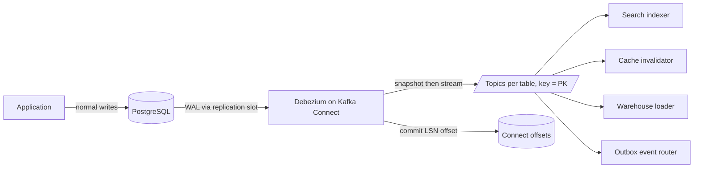

# Change Data Capture

> [!abstract] In one sentence
> CDC reads the write-ahead log the database already keeps for replication and republishes every committed insert, update and delete as an event — so downstream systems see exactly what the database saw, in commit order per row, with no dual write and no polling.

> [!tip] Deeper treatment in your system-design vault
> `system-design/09 Messaging and Event-Driven/Change Data Capture.md` — read it *after* you have written your own explanation below.

**Map:** [[Messaging & Event-Driven Systems MOC]] → [[HLD MOC]]

## Definition

**Change data capture (CDC)** is the extraction of committed row-level changes from a database as a stream of events. **Log-based CDC** — Debezium on PostgreSQL logical decoding, MySQL binlog, MongoDB change streams, SQL Server CDC tables, DynamoDB Streams — tails the database's transaction log rather than querying tables, so it sees every change exactly as committed, including deletes, with low latency and no load on the query path. Each event carries the row's `before` and `after` images, the operation (`c`, `u`, `d`, or `r` for a snapshot read), and source metadata (log position, transaction id, commit timestamp). CDC is the mechanism behind log-based [[Outbox Pattern|outbox]] relays, search indexing, cache invalidation and warehouse replication.

## Problem solved

Keeping a second system in sync with a database used to mean dual writes (write the row, then update the cache or index — and lose one when the process dies between them), periodic polling with `updated_at > ?` (misses deletes, hammers the database, cannot order within a second), or triggers writing to a changes table (adds latency to every transaction and a table to maintain). The transaction log already contains the answer — every committed change, in order, durable — and the database already ships it to replicas ([[Replication]]). CDC reuses that stream for applications. Anything that needs "every change to these tables" gets it without the write path knowing.

## How it works

1. **Enable log access.** PostgreSQL: `wal_level=logical`, a **replication slot** (so the server retains WAL until the connector has read it) and a publication; the built-in `pgoutput` plugin decodes it. MySQL: binlog in `ROW` format, ideally with GTIDs. MongoDB: change streams over the oplog with resume tokens. `REPLICA IDENTITY FULL` on PostgreSQL tables if you want complete `before` images and unchanged TOAST columns on updates (the default identity is the primary key only).
2. **Snapshot, then stream.** The connector takes an initial consistent snapshot — reads each table at a known log position and emits `r` events — then streams from that position so nothing is missed or double-counted. **Incremental snapshots** (Debezium's watermark-based algorithm from Netflix's DBLog) interleave chunked table reads with live streaming so a terabyte table can be snapshotted without pausing capture, and new tables can be added later.
3. **Decode and publish.** Each change becomes an event keyed by the primary key on a topic per table (`server.schema.table`), with the envelope `{before, after, source{lsn or binlog position, txId, ts_ms}, op, ts_ms}`; a delete emits the `d` event followed by a tombstone so a compacted topic drops the key. Single Message Transforms reshape events in flight — `ExtractNewRecordState` flattens to just the row; the **outbox event router** turns an outbox table's rows into domain events.
4. **Track position.** Kafka Connect commits the source offset (LSN, binlog position, resume token) after the events are acknowledged by Kafka; a restart resumes from the last commit and may re-emit events, so CDC is [[At-Least-Once Delivery|at-least-once]] and sinks must be idempotent (upserts by key).
5. **Order.** Per key, events are in commit order; across tables they land on different topics and partitions with no cross-topic ordering ([[Ordering Guarantees]]). Debezium can emit a transaction-metadata topic with begin/end markers and per-table counts so a consumer can reassemble a transaction if it must.
6. **Deploy.** As a Kafka Connect connector (MSK Connect, a Connect cluster), as **Debezium Server** (standalone, with sinks for Kinesis, Pub/Sub, HTTP and Redis Streams), or embedded in an application via the Debezium Engine.

```json
{ "name": "orders-cdc", "config": {
  "connector.class": "io.debezium.connector.postgresql.PostgresConnector",
  "database.hostname": "orders-db", "database.dbname": "orders", "topic.prefix": "orders",
  "plugin.name": "pgoutput", "slot.name": "debezium_orders", "publication.autocreate.mode": "filtered",
  "table.include.list": "public.orders,public.order_items", "snapshot.mode": "initial",
  "transforms": "unwrap", "transforms.unwrap.type": "io.debezium.transforms.ExtractNewRecordState",
  "transforms.unwrap.delete.handling.mode": "rewrite" } }
```

## Architecture



## Use cases

- "The search index / read model / cache must reflect every change, including deletes" — the classic feeds ([[Search Indexing Pipelines]], [[Cache Invalidation]], [[CQRS]]).
- "We need reliable events but cannot change the legacy application" — CDC on its tables, or on an outbox table it can be taught to write ([[Strangler Pattern]]).
- "Replicate operational data to the warehouse with minutes of latency" — CDC to Kafka to the lake instead of nightly dumps ([[Data Warehouses]]).
- "Audit every change to these tables" — before/after images with transaction ids are a complete change history.
- "Migrate a database or split a monolith's schema" — CDC keeps old and new stores in sync during the cutover ([[Versioning and Migrations]]).

## Limitations

- Events mirror the *schema*, not the *intent*: a row update says what changed, not why; as domain events they are leaky and couple consumers to table design ([[Event Schemas]]).
- One replication slot means one reader: PostgreSQL CDC throughput is bounded by a single WAL decoding stream per connector.
- A stuck connector holds the slot, the database retains WAL, and the disk fills — the most common CDC outage; cap it with `max_slot_wal_keep_size` (PostgreSQL 13+) and accept losing the slot.
- Cross-table consistency is not preserved on the consumer side without extra work; a consumer may see the order items before the order.
- Large transactions arrive as bursts; schema changes (DDL) need handling on the connector and in consumers.

## Trade-offs

| You gain | You sacrifice |
|---|---|
| Every committed change, including deletes, with no application changes | Domain meaning: events are rows, not intentions |
| No dual write, no polling load, sub-second latency | A connector, a Connect cluster and a replication slot to operate |
| A durable, replayable change log for new consumers | Database coupling: consumers break on schema changes |
| Snapshot plus stream for bootstrap and backfill | Throughput bounded by a single log reader per database |

## Failure modes

- **Replication slot bloat** — the connector is down for a day, WAL retention grows by the write volume, the primary's disk fills and *the database* goes down; you notice via `pg_replication_slots` lag and disk alerts; blast radius: the whole database, not just CDC.
- **Snapshot of a huge table** blocks streaming for hours with the legacy snapshot mode; notice via connector lag flat at "snapshotting"; use incremental snapshots.
- **Duplicate events after a connector restart** — a sink without upserts double-inserts; notice via sink uniqueness violations or inflated counts.
- **Schema change breaks the pipeline** — a column type change produces events the sink's schema rejects; the connector keeps going, the sink dead-letters everything; notice via sink DLQ rate right after a migration ([[Event Schema Evolution]]).
- **TOAST placeholders** — unchanged large columns arrive as a sentinel value on updates without `REPLICA IDENTITY FULL`; a naive sink overwrites real data with the sentinel; notice via corrupted documents in the index.

## Performance

Log-based CDC adds negligible load to the database — the WAL is written anyway; logical decoding costs some CPU on the primary. End-to-end latency is typically well under a second from commit to Kafka. Throughput per connector is bounded by decoding one log stream — thousands to tens of thousands of row changes per second is a reasonable planning range depending on row size and hardware — which is far below Kafka's ceiling but above most OLTP write rates. Snapshots are I/O bound on the source; incremental snapshots trade speed for not blocking the stream.

## Scalability

Scale by database, not by connector: one connector per database (or per logical shard), topics partitioned by primary key so sinks scale as [[Consumer Groups]]. Sharded databases ([[Sharding]]) mean one connector per shard and a consumer that tolerates the shards being at different positions. At 10x write rate, the single-reader bound becomes real: split tables across connectors where the database allows multiple slots, or move high-volume tables to an [[Outbox Pattern]] with batched rows.

## Operational impact

Moderate to high. Monitor connector status and lag (milliseconds behind source), replication slot retained WAL, snapshot progress, Connect task restarts and the sinks' DLQs. Every schema migration on captured tables is a CDC change: coordinate DDL with connector and sink updates ([[Schema Evolution]]). Backups of Connect offsets and schema history topics matter — losing them means a full re-snapshot. On AWS, MSK Connect runs the connector but you still own the slot, the configuration and the sinks. Debezium Server to Redis Streams is a lighter option when Kafka is not in the picture, with the same slot risks.

## Alternatives

- **[[Outbox Pattern]]** — wins when you want intentional domain events rather than row changes; usually relayed *by* CDC, so the two combine rather than compete.
- **Application-published events** (publish after commit) — win for simplicity at low stakes; lose events on crashes (the dual-write problem).
- **Polling with `updated_at` watermarks** — wins for small, append-mostly tables and tolerant consumers; misses deletes and ordering within a second.
- **Database triggers into a changes table** — win when log access is unavailable (some managed databases); cost write latency and a table to prune.

## Real-world examples

- Debezium (started at Red Hat) is the standard open-source CDC platform, with connectors for PostgreSQL, MySQL, MongoDB, SQL Server, Oracle and others, and the outbox event router built in.
- LinkedIn's Databus (2012) was the first widely described log-based CDC system; Netflix's DBLog paper introduced the watermark-based incremental snapshot that Debezium adopted; WePay's engineering blog documented running Debezium with MySQL and Kafka in production.
- DynamoDB Streams and MongoDB change streams are CDC offered as a first-class database feature.
- In a stack like yours: Debezium on MSK Connect tailing the PostgreSQL outbox table of the payments service (outbox event router) and the raw `accounts` table for cache invalidation and search indexing; `REPLICA IDENTITY FULL` on captured tables; `max_slot_wal_keep_size` set so a dead connector cannot take down the primary; and, for the Redis Streams future, Debezium Server with the Redis sink as the relay — same connector configuration, different destination, which keeps the broker migration from touching the database.

## Practical exercise

1. Docker Compose: PostgreSQL with `wal_level=logical`, Kafka, Kafka Connect with the Debezium PostgreSQL connector.
2. Register the connector above on an `orders` table; insert, update and delete rows; inspect the events including the tombstone and the `source.lsn`.
3. Stop the connector, write 10,000 rows, and watch `pg_replication_slots` retained WAL grow; restart and measure catch-up time; set `max_slot_wal_keep_size` and repeat until the slot is invalidated.
4. Build a sink (a 50-line Java or TypeScript consumer) that upserts into a `search_docs` table; restart the connector mid-stream and prove the upsert absorbs the duplicates.
5. Add an `outbox` table and the outbox event router SMT; compare the resulting domain events with the raw row events and decide which a downstream ledger should consume.

## Related concepts

### Prerequisites
- [[Replication]] — the transaction log and logical replication that CDC reads
- [[Relational Database Internals]] — WAL, LSNs and replica identity
- [[Kafka]] — the usual destination and Connect runtime

### Related
- [[Outbox Pattern]] — CDC as the relay for intentional events
- [[Search Indexing Pipelines]] — the most common sink
- [[Cache Invalidation]] — evict on change, without dual writes
- [[Ordering Guarantees]] — per-key commit order, nothing across tables
- [[Event Schema Evolution]] — DDL changes flow into event schemas
- [[At-Least-Once Delivery]] — connector restarts replay

### Builds on this
- [[Event Sourcing]] — the "database inside out" view of the log
- [[CQRS]] — read models fed from change streams
- [[Data Warehouses]] — near-real-time replication to analytics
- [[Strangler Pattern]] — syncing old and new stores during a migration

### Design problems where it applies
- [[Design Search Autocomplete]]
- [[Design an Inventory Management System]]
- [[Design a Payment System]]
- [[Design a Real-Time Fraud Detection Pipeline]]
- [[Design a RAG Knowledge Assistant]]

### Projects where it can be implemented
- [[Streaming Fraud Rules Engine]] — feed account changes into the feature store
- [[Vault RAG Assistant]] — reindex documents when source notes change
- [[Double-Entry Ledger Service]] — stream postings to a reporting store without dual writes

### Resources
- [[Debezium]] — the connectors, snapshot modes and transforms
- [[Debezium Outbox Event Router Docs]] — CDC as the outbox relay
- [[Turning the Database Inside Out]] — why the log is the integration point
- [[Designing Data-Intensive Applications]] — chapter 11 on change data capture and log compaction

## Personal understanding

> [!question] Explain it without the source
> Write your own explanation here, from memory. Then compare it with the sections above and note what you missed.

### Mastery checklist
- [ ] I can explain it without the original resource
- [ ] I can describe the problem it solves
- [ ] I can compare it with its alternatives
- [ ] I can name its limitations and failure modes
- [ ] I can recognise when it is appropriate in a real system
- [ ] I have applied it in a system design
- [ ] I have validated my assumptions with an experiment or implementation

## Open questions

- [ ] When a consumer needs an order and its items atomically, is reassembling transactions from Debezium's transaction-metadata topic practical, or is an outbox event the only sane answer?
- [ ] How does CDC behave across a PostgreSQL failover on RDS or Aurora — does the replication slot survive, and what does the connector replay or miss?
- [ ] For Debezium Server writing to Redis Streams, what are the delivery semantics when Redis is slow or fails over, and how do they differ from the Kafka Connect path?
