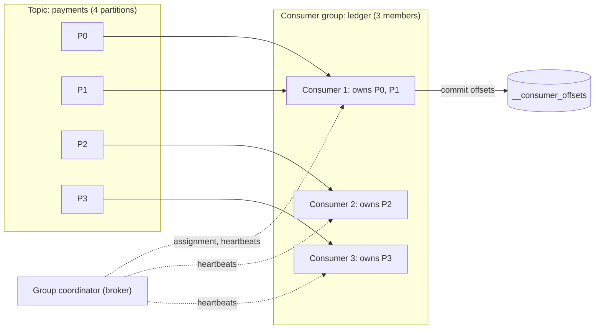

# Consumer Groups

> [!abstract] In one sentence
> A consumer group divides a topic's partitions among its members so that each partition has exactly one reader, tracks the group's progress as committed offsets, and rebalances ownership when members join or die — giving parallelism bounded by the partition count and order preserved within each partition.

> [!tip] Deeper treatment in your system-design vault
> `system-design/09 Messaging and Event-Driven/Consumer Groups and Rebalancing.md` — read it *after* you have written your own explanation below.

**Map:** [[Messaging & Event-Driven Systems MOC]] → [[HLD MOC]]

## Definition

A **consumer group** is a named set of consumers (`group.id`) that jointly consume a topic: the broker assigns each [[Topic Partitions|partition]] to **exactly one** member of the group, every member processes only its partitions, and the group as a whole records one committed offset per partition. Several groups can read the same topic independently, each with its own offsets — that is how a log does [[Pub-Sub]]. Membership changes trigger a **rebalance**, which redistributes partitions. [[Redis]] Streams borrows the name for a related but partition-less mechanism: a group shares one stream's entries among named consumers and tracks unacknowledged entries per consumer.

## Problem solved

A single consumer reading a busy topic is a throughput ceiling and a single point of failure. Letting several consumers read the same partition concurrently destroys ordering and makes "which offset is done" undefined. Competing consumers on a queue solve scaling by letting the broker hand out individual messages, but a log has no per-message state to hand out. The consumer group is the log's answer: make the **partition** the unit of ownership, let the broker-side coordinator assign partitions to members, and recover from member failure by moving partitions — ordering stays intact per partition, throughput scales up to the partition count, and progress is a handful of offsets instead of a per-message ledger.

## How it works

1. **Find the coordinator.** Each consumer hashes `group.id` to one of the 50 `__consumer_offsets` partitions; the broker leading it is the group coordinator.
2. **Join and sync.** Members send `JoinGroup`; the coordinator picks one as **group leader** and gives it everyone's subscriptions. The leader runs the assignor (`partition.assignment.strategy`: Range, RoundRobin, Sticky, CooperativeSticky) and returns the assignment via `SyncGroup`. Assignment is therefore a *client-side* decision in the classic protocol; KIP-848 (generally available in Kafka 4.0, opted into per client with `group.protocol=consumer`) moves it to the broker and drops the group-wide barrier.
3. **Heartbeat and liveness.** A background thread heartbeats every `heartbeat.interval.ms` (3 s). Missing heartbeats for `session.timeout.ms` (45 s) removes the member. Separately, if application code does not call `poll()` within `max.poll.interval.ms` (5 min) the client leaves the group itself — the mechanism that evicts a consumer stuck on a slow batch ([[Failure Detection]]).
4. **Rebalance.** Any join, leave, timeout, subscription change or partition-count change triggers one. **Eager** rebalancing revokes *every* partition from *every* member, then reassigns — a stop-the-world pause proportional to how long members take to commit and rejoin. **Cooperative** (incremental) rebalancing, KIP-429, revokes only the partitions that actually move, in a second round, so unaffected members keep processing.
5. **Static membership.** With `group.instance.id` set (KIP-345), a member that restarts within `session.timeout.ms` gets its old partitions back without a rebalance — essential for rolling deploys of stateful consumers on Kubernetes.
6. **Offsets.** The group's progress is `(topic, partition) → next offset` written to `__consumer_offsets`. `enable.auto.commit=true` commits the previous poll's offsets on the next `poll()` every `auto.commit.interval.ms` (5 s), which is at-least-once only if processing finished before that next poll; manual `commitSync()` after processing is the explicit version ([[At-Least-Once Delivery]]). A new group with no offsets starts from `auto.offset.reset` (`latest` by default). Offsets of an empty group expire after `offsets.retention.minutes` (7 days).
7. **Lag.** Per partition, log end offset minus committed offset; summed per group it is the single most useful consumer health signal ([[Backpressure]]).

```properties
group.id=ledger-projector
group.instance.id=${POD_NAME}
partition.assignment.strategy=org.apache.kafka.clients.consumer.CooperativeStickyAssignor
enable.auto.commit=false
max.poll.records=200
max.poll.interval.ms=300000
```

## Architecture



## Use cases

- "One topic, N worker replicas, and each event must be processed by only one of them" — the default deployment shape for any Kafka consumer service.
- "Two different services need the same stream" — two groups, two independent offsets, zero extra writes ([[Pub-Sub]]).
- "Order per account must hold even though we run 12 replicas" — the one-owner-per-partition rule gives it for free, as long as the key is the account.
- "Scale consumers automatically on backlog" — group lag is the metric a horizontal autoscaler (KEDA's Kafka scaler) reads.
- "Replay last week's events into a new read model" — create a new group, reset its offsets to a timestamp ([[CQRS]]).

## Limitations

- Parallelism is **capped at the partition count**; a 13th consumer on 12 partitions idles, and the only fix is more partitions, which breaks key placement ([[Topic Partitions]]).
- A slow partition slows only its owner — but a slow *message* blocks its whole partition (head-of-line), with no per-message skip.
- Rebalances pause consumption and can duplicate: anything processed but uncommitted when a partition is revoked is reprocessed by the new owner.
- Group state is per topic-partition; a consumer that needs to process by *key* across partitions (joins, aggregations) needs a stream processor with repartitioning.
- Redis Streams groups have no partitions: entries of one stream are spread across consumers in delivery order, so per-key ordering across consumers is *not* preserved unless you shard into multiple streams yourself.

## Trade-offs

| You gain | You sacrifice |
|---|---|
| Horizontal scaling with per-partition order intact | A hard ceiling at the partition count |
| Automatic failover of partitions when a member dies | Rebalance pauses and the duplicates they cause |
| Progress as a few offsets, cheap to store and reset | Per-message state: no selective ack, skip or retry |
| Independent groups on one topic | Shared broker egress and cache pressure between groups |

## Failure modes

- **Rebalance loop** — a batch takes longer than `max.poll.interval.ms`, the member leaves, partitions move, the next owner hits the same slow records and leaves too; you notice via rebalance rate, "Attempt to heartbeat failed since group is rebalancing" logs and lag climbing on every partition; blast radius is the whole group.
- **Stuck partition** behind a poison record or a dependency outage → lag on one partition only, the others healthy; notice via per-partition lag, not group totals; blast radius: every key hashed to that partition.
- **Auto-commit with async processing** → offsets committed for records still in flight; a crash loses them silently; notice only through missing side effects downstream ([[Duplicate Message Processing]] covers the opposite problem).
- **Offset expiry** — a group idle for more than seven days loses its offsets and restarts from `latest`, skipping everything in between; notice when a rarely used consumer "misses" events after a quiet period.
- **Redis Streams: dead consumer with a full PEL** — entries delivered to a crashed consumer are never acked and never redelivered until someone runs `XAUTOCLAIM`; notice via `XPENDING` idle times growing; blast radius: those entries are effectively lost until claimed.

## Performance

Steady-state cost is small: a heartbeat every 3 s and an offset commit per batch. Rebalances are the expensive part — eager rebalances stall all members for the commit-and-rejoin window (typically seconds, worse with slow `onPartitionsRevoked` handlers); cooperative rebalances stall only the moved partitions. Throughput per member is bounded by `max.poll.records` × processing time per record, so a consumer that does 50 ms of synchronous work per record tops out around 20 records/s per partition regardless of broker speed; batching the work or pipelining within a partition is the lever. Reading from the page cache keeps broker-side cost per group low until a lagging group falls out of cache and hits disk.

## Scalability

Scale the group up to the partition count, then scale partitions — which is why topics are usually created with more partitions than today's consumers. At 10x the questions are whether rebalances still complete quickly (hundreds of members with eager rebalancing is a well-known pain; cooperative or KIP-848 protocols fix most of it), whether a single stuck partition is acceptable, and whether a hot key makes one member do most of the work ([[Hot Keys]]). For Redis Streams, scaling past one stream means sharding keys across streams and assigning streams to consumers in your own code — there is no coordinator to do it for you.

## Operational impact

Monitor lag per group *and* per partition, rebalance frequency, and the age of the oldest unacked entry (Redis). Rolling deployments must use static membership or cooperative rebalancing, or every pod restart triggers a stop-the-world pause. Offset resets (`kafka-consumer-groups --reset-offsets`) are a routine on-call tool and a dangerous one: resetting to earliest on a non-idempotent consumer replays side effects. Choosing `group.id` is an API decision — rename it and you start from `auto.offset.reset`. Redis adds `XINFO GROUPS` (pending, lag since 7.0) and the chore of pruning consumers that no longer exist.

## Alternatives

- **Competing consumers on a [[Message Queues|queue]]** — win when per-message ack/retry matters more than ordering; no partitions, no rebalances, no ceiling except broker throughput.
- **SQS FIFO message groups** — approximate "one owner per key" without a consumer group: only one in-flight batch per `MessageGroupId`, workers scale freely.
- **Kafka share groups (KIP-932)** — queue-style per-record acks on a log, early access in 4.x; wins when you want Kafka's retention with worker-pool scaling.
- **Single consumer with an in-process worker pool keyed by partition** — wins for a small topic where one process can keep up and you want fine control over per-key concurrency.

## Real-world examples

- Confluent's KIP-429 write-up on incremental cooperative rebalancing came out of large Kafka Connect and Kafka Streams deployments where eager rebalances of hundreds of tasks took minutes.
- KEDA's Kafka scaler, used widely on Kubernetes, scales consumer deployments on group lag — and caps replicas at the partition count because more would idle.
- Redis Streams consumer groups are the basis of job systems such as those in the Redis documentation's own worker examples and in several Go/Node job libraries that use `XAUTOCLAIM` for recovery.
- In a stack like yours: each consumer service on EKS runs as a Deployment whose replica count never exceeds the topic's partitions, with `group.instance.id` set to the pod name so rolling updates do not rebalance, cooperative assignment, manual commits after the database write, and per-partition lag alerts. On the Redis Streams side, the same service needs a reaper that runs `XAUTOCLAIM` with an idle threshold above the longest legitimate processing time.

## Practical exercise

1. Create a topic with 4 partitions; start 2 consumers in one group (Java or `kafkajs`); log which partitions each owns.
2. Start a third and a fifth consumer; observe the rebalances and the idle member. Compare the pause with `RangeAssignor` versus `CooperativeStickyAssignor`.
3. Add a `Thread.sleep(6 min)` in one handler with `max.poll.interval.ms=5 min`; watch the member get evicted and the records replayed to another member.
4. Set `group.instance.id` per consumer and restart one within 45 s: confirm no rebalance occurred.
5. On Redis, create a group with `XGROUP CREATE`, read with two consumers, kill one mid-batch, and recover its entries with `XAUTOCLAIM`; measure how long they sat in the PEL.

## Related concepts

### Prerequisites
- [[Kafka]] — the log whose partitions are being shared
- [[Topic Partitions]] — the unit of ownership and the parallelism ceiling
- [[Message Queues]] — competing consumers, the queue-side equivalent

### Related
- [[Ordering Guarantees]] — preserved per partition because of single ownership
- [[At-Least-Once Delivery]] — what commit-after-process gives
- [[Backpressure]] — lag as the signal that the group is behind
- [[Duplicate Message Processing]] — the consequence of rebalances
- [[Failure Detection]] — heartbeats, session timeouts and poll intervals
- [[Redis]] — Streams consumer groups and the PEL

### Builds on this
- [[Exactly-Once Semantics]] — transactional offset commits inside Kafka transactions
- [[Fan-Out]] — many groups on one topic
- [[Capacity Planning]] — sizing partitions and members together
- [[Retry Strategies]] — retry topics exist because a group cannot skip a record

### Design problems where it applies
- [[Design a Message Queue]]
- [[Design a Real-Time Fraud Detection Pipeline]]
- [[Design a Notification System]]
- [[Design a Logging System]]

### Projects where it can be implemented
- [[Streaming Fraud Rules Engine]] — partitioned scoring with lag-based scaling
- [[Live Ops Dashboard]] — one group per dashboard service on a shared topic
- [[Chaos Lab]] — kill consumers and measure rebalance pauses and duplicates

### Resources
- [[Kafka Design Documentation]] — consumer position, group coordination and rebalance protocol
- [[Redis Streams Docs]] — consumer groups, XPENDING and XAUTOCLAIM, with the "no partitions" caveat spelled out
- [[Designing Data-Intensive Applications]] — chapter 11, partitioned logs and consumer offsets

## Personal understanding

> [!question] Explain it without the source
> Write your own explanation here, from memory. Then compare it with the sections above and note what you missed.

### Mastery checklist
- [ ] I can explain it without the original resource
- [ ] I can describe the problem it solves
- [ ] I can compare it with its alternatives
- [ ] I can name its limitations and failure modes
- [ ] I can recognise when it is appropriate in a real system
- [ ] I have applied it in a system design
- [ ] I have validated my assumptions with an experiment or implementation

## Open questions

- [ ] Under KIP-848, what exactly happens to a partition whose owner is slow to acknowledge revocation — is there still a window where two members can hold it?
- [ ] How should a Redis Streams consumer group preserve per-account ordering when the account's entries can be handed to different consumers — is sharding by key across streams the only option?
- [ ] For a consumer that processes records in a thread pool, what is the correct offset to commit on partition revocation, and how does the answer differ between eager and cooperative rebalancing?
