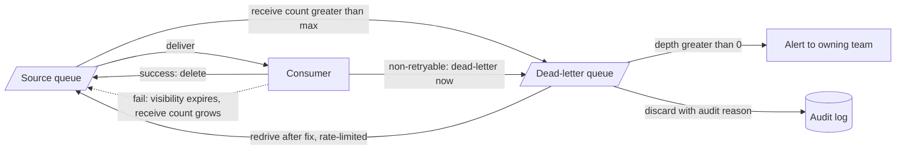

# Dead-Letter Queues

> [!abstract] In one sentence
> A dead-letter queue is where a message goes after it has exhausted its retries or hit a non-retryable error: out of the way of healthy messages, preserved with the why and the where, and waiting for a human or a fixed consumer to redrive it — an unwatched DLQ is just data loss with a delay.

> [!tip] Deeper treatment in your system-design vault
> `system-design/09 Messaging and Event-Driven/Dead Letter Queues and Poison Messages.md` — read it *after* you have written your own explanation below.

**Map:** [[Messaging & Event-Driven Systems MOC]] → [[HLD MOC]]

## Definition

A **dead-letter queue (DLQ)** is a secondary queue or topic that receives messages a consumer could not process after a bounded number of attempts, or that failed with an error classified as permanent. The broker (SQS redrive policy, RabbitMQ dead-letter exchange) or the consumer framework (Kafka Connect, Spring Kafka, a Redis Streams reaper) moves the message along with **failure context** — original location, attempt count, error, timestamps — without altering the payload. A **poison message** is the input that triggers this: one that fails deterministically and would otherwise be retried forever, blocking its partition or wasting a worker slot on every attempt.

## Problem solved

[[At-Least-Once Delivery]] guarantees redelivery until acknowledged. A message that can *never* be processed — malformed JSON, a schema version the consumer does not know, a reference to a deleted account, a bug in the handler — is therefore redelivered forever: on a queue it burns a worker on every visibility cycle, on a log it blocks every message behind it in the partition ([[Ordering Guarantees]]). The two naive escapes are both wrong: dropping it silently loses data, and alerting on every failure drowns on-call. The DLQ is the third option — stop retrying, keep the evidence, move on — and turns "a message is stuck" from an outage into a ticket.

## How it works

1. **Trigger.** Either the attempt cap is reached (SQS `maxReceiveCount`, 1–1000; RabbitMQ quorum queue `x-delivery-limit`; Redis Streams PEL `delivery-count` above a threshold; a retry-topic tier exhausted) or the consumer classifies the error as non-retryable and dead-letters immediately ([[Retry Strategies]]).
2. **Move with context.** SQS moves the original message unchanged; its attributes and `ApproximateReceiveCount` travel with it. RabbitMQ routes it through the queue's `x-dead-letter-exchange` and appends an `x-death` header (count, reason: `rejected`, `expired`, `maxlen`, `delivery_limit`, original queue). Kafka has no native DLQ; Kafka Connect (`errors.tolerance=all`, `errors.deadletterqueue.topic.name`, `errors.deadletterqueue.context.headers.enable=true`) and Spring Kafka's `DeadLetterPublishingRecoverer` publish to a dead-letter topic with headers carrying the original topic, partition, offset, exception class, message and stack trace. For Redis Streams the reaper that runs `XAUTOCLAIM` checks the delivery count and, past the cap, `XADD`s the entry to a dead-letter stream and `XACK`s the original.
3. **Retention.** The DLQ needs *longer* retention than the source. SQS computes retention from the message's original `SentTimestamp`, not the move time — a message that spent three days retrying on a four-day source queue has one day left in the DLQ unless the DLQ's retention is 14 days.
4. **Alert.** `ApproximateNumberOfMessagesVisible` or lag on the DLQ above zero for a few minutes, plus arrival rate and age of oldest, routed to the owning team ([[Alerting]]). A DLQ without an alert is write-only.
5. **Triage.** Group by error class and consumer version; decide per class: fix the consumer and redrive, fix the data and redrive one, or discard with an audited reason. Redrive tooling: SQS "start DLQ redrive" (`StartMessageMoveTask`, with a rate limit), a Kafka DLT consumer that republishes to the original topic, a RabbitMQ shovel, an admin endpoint for Redis streams. Redrives must respect per-key order and go through the same [[Idempotency|idempotent]] handler, because the original attempt may have partially succeeded.
6. **Hygiene.** Keep the payload byte-identical, encrypt the DLQ as you would the source (it holds the same PII), and give the DLQ an owner and a drain SLO.

```json
// SQS redrive policy on the source queue; DLQ retention set to the 14-day maximum
{ "deadLetterTargetArn": "arn:aws:sqs:eu-west-1:123456789012:payments-dlq", "maxReceiveCount": "5" }
```

## Architecture



> [!example]- Excalidraw version — the same diagram as an editable canvas
> ![[Dead-Letter Queues.excalidraw]]
> [[Dead-Letter Queues.excalidraw|Open in Excalidraw]] — needs the Excalidraw plugin (see [[Plugins to Install]]).


## Use cases

- "A single bad message must never stall the stream" — every at-least-once consumer on a partitioned log or a FIFO queue.
- "We need evidence when processing fails" — payments, ledger updates, webhooks: the DLQ is the audit trail of what did not happen ([[Design a Payment System]], [[Design a Webhook Delivery System]]).
- "Schema changes roll out across many consumers" — unknown versions are dead-lettered rather than dropped, and redriven after the consumer upgrade ([[Event Schema Evolution]]).
- "A downstream outage must not create silent loss once retries are exhausted" — the DLQ holds the backlog for a post-incident redrive.
- "Notifications or jobs occasionally reference deleted entities" — classify as permanent, dead-letter, review in batches ([[Design a Notification System]]).

## Limitations

- A DLQ preserves messages, not the business outcome: a dead-lettered `PaymentCaptured` is a payment nobody recorded until someone redrives it.
- It breaks ordering for the affected key: everything after the poison message is processed first; redrive puts it last.
- It is a second queue with its own retention, encryption, cost, access control and ownership — and most teams forget at least one.
- Kafka's lack of a native DLQ means every framework does it differently; headers and redrive tooling are not portable.
- It does nothing for messages that fail *silently* (processed wrongly but acknowledged) — those need reconciliation, not a DLQ.

## Trade-offs

| You gain | You sacrifice |
|---|---|
| Healthy messages keep flowing past a poison one | Per-key ordering for the dead-lettered message |
| Evidence and a redrive path instead of silent loss | A second queue to own, monitor, secure and drain |
| Bounded retries, so outages do not become infinite loops | Timeliness: dead-lettered work waits for a human |
| A clear escalation signal for on-call | The temptation to treat the DLQ as "handled" |

## Failure modes

- **Write-only DLQ** — nobody alerts on it, messages sit until SQS's 14-day retention deletes them; you notice months later during a reconciliation; blast radius: everything that ever failed, permanently.
- **Retention expiry during triage** — the source's retention clock keeps running inside the DLQ (SQS), so messages vanish mid-investigation; notice as counts dropping without redrives.
- **DLQ flood during an outage** — no [[Circuit Breakers|circuit breaker]], so a 20-minute dependency outage dead-letters 200,000 transient failures; the redrive then re-creates the load spike; notice via DLQ arrival rate; blast radius: the dependency, again.
- **Redrive ping-pong** — the consumer is not actually fixed; redriven messages fail again and return within minutes; without a redrive attempt cap the loop runs forever; notice via the same message ids cycling.
- **FIFO group blocked, then reordered** — in SQS FIFO a poison message blocks its message group until dead-lettered, and the redrive delivers it after its successors; notice via version-gate rejections in the consumer ([[Ordering Guarantees]]).

## Performance

Dead-lettering is one extra produce or move per failed message — negligible. The cost shows up in the attempts before it: each poison message costs `maxReceiveCount` × processing time of worker capacity on a queue, or `maxReceiveCount` × backoff of partition latency on a log. Set the cap by error class, not globally: non-retryable errors should hit the DLQ on attempt one. Redrives should be rate-limited to a fraction of normal throughput so a drained DLQ does not become a self-inflicted spike.

## Scalability

The DLQ's write rate is the system's failure rate; in steady state it should be near zero, and a DLQ that scales with traffic indicates a bug or a missing error class. At 10x, the triage process is the bottleneck, not the queue: group by error signature automatically, auto-redrive known-transient classes after the fix is deployed, and reserve humans for new signatures. Keep one DLQ per source queue or topic ([[Bulkheads]]); a shared DLQ mixes owners and ordering.

## Operational impact

Significant and mostly human. Every DLQ needs: an owner, an alert on depth and age, a dashboard by error class, a redrive runbook (who, when, rate, ordering), an audit trail for discards, and retention aligned with the triage SLO. On Kafka, add the dead-letter topic to the schema registry and ACLs and keep its partition count equal to the source's for keyed redrives. Treat DLQ depth as an [[SLI SLO and SLA|SLI]]: "messages older than one hour in a DLQ" is a user-visible failure for most domains.

## Alternatives

- **Skip and log** — drop the poison message with a structured log and metric; wins for at-most-once data (telemetry) where quarantine is not worth a queue ([[At-Most-Once Delivery]]).
- **Park in a database table** — write failed messages to a `failed_messages` table with the error; wins when you want SQL triage and a UI, and lose nothing by leaving the broker.
- **Pause the partition and page** — stop on the first poison message and wake a human; wins for low-volume, order-critical streams (ledger postings) where processing out of order is worse than stopping.
- **Durable workflow engines** — Temporal keeps failed activities and their history in the workflow itself, with retry policies and manual intervention built in.

## Real-world examples

- SQS's redrive policy and DLQ redrive-to-source are first-class API features precisely because AWS saw every customer build them by hand.
- Kafka Connect's dead-letter-queue support with context headers (topic, partition, offset, exception, stack trace) is the standard for connector pipelines; Spring Kafka's `DeadLetterPublishingRecoverer` does the same for application consumers.
- RabbitMQ's `x-death` header and dead-letter exchanges are the broker-level mechanism behind most job frameworks' failed-job views; BullMQ keeps failed jobs in a dedicated state with their stack traces.
- In a stack like yours: a `payments-dlq` per SQS queue with 14-day retention and an age alert; `<topic>.DLT` per Kafka consumer group with original offset and exception headers, consumed by a small admin tool that lists by error class and redrives by key in order; and for Redis Streams a `payments:dlq` stream fed by the `XAUTOCLAIM` reaper when delivery count exceeds five, with the same admin tool reading it. The feature that matters most is the one that is not a queue: the alert and the person on the other end.

## Practical exercise

1. With LocalStack, create `orders` with a redrive policy (`maxReceiveCount=3`) to `orders-dlq`; set source retention to 1 minute and DLQ retention to 2 minutes.
2. Send a message that always throws; confirm it reaches the DLQ after three attempts, then watch it expire from the DLQ on the *source's* schedule.
3. Fix the consumer and redrive with `StartMessageMoveTask`; confirm the idempotent handler treats a partially processed message correctly.
4. On Kafka, configure Spring Kafka's `DeadLetterPublishingRecoverer` (or build the equivalent in `kafkajs`); dead-letter a malformed record; inspect the headers; write a 30-line redrive tool that republishes by key preserving order.
5. On Redis Streams, write the reaper: `XAUTOCLAIM` with a 60 s idle threshold, delivery count from `XPENDING`, move to `dlq` after 5, `XACK`; verify with `XINFO GROUPS`.

## Related concepts

### Prerequisites
- [[Message Queues]] — receive counts, redelivery and routing
- [[Retry Strategies]] — the policy whose end state is the DLQ
- [[At-Least-Once Delivery]] — why messages come back at all

### Related
- [[Alerting]] — a DLQ without an alert does not exist
- [[Idempotency]] — redrives replay possibly-partial work
- [[Ordering Guarantees]] — what dead-lettering and redriving do to order
- [[Event Schema Evolution]] — unknown versions are the most common poison
- [[Monitoring]] — depth, age and arrival rate as standing signals
- [[Production Incident Analysis]] — DLQ contents are evidence

### Builds on this
- [[Saga Pattern]] — a dead-lettered step needs compensation or manual completion
- [[Graceful Degradation]] — quarantining failures keeps the rest of the system healthy
- [[Outbox Pattern]] — poison outbox rows need the same quarantine

### Design problems where it applies
- [[Design a Webhook Delivery System]]
- [[Design a Notification System]]
- [[Design a Payment System]]
- [[Design a Message Queue]]
- [[Design a Distributed Job Scheduler]]

### Projects where it can be implemented
- [[Webhook Relay]] — per-endpoint DLQ with redrive tooling
- [[Personal Notification Hub]] — quarantine undeliverable digests for review
- [[Durable Job Scheduler]] — failed-run history with manual retry

### Resources
- [[BullMQ]] — failed-job state, retries and manual retry as a concrete design
- [[Redis Streams Docs]] — XPENDING delivery counts and XAUTOCLAIM, the building blocks of a Streams DLQ
- [[Release It!]] — stability patterns around failures that must not spread
- [[Designing Data-Intensive Applications]] — chapter 11 on acknowledgement, redelivery and what brokers do with failures

## Personal understanding

> [!question] Explain it without the source
> Write your own explanation here, from memory. Then compare it with the sections above and note what you missed.

### Mastery checklist
- [ ] I can explain it without the original resource
- [ ] I can describe the problem it solves
- [ ] I can compare it with its alternatives
- [ ] I can name its limitations and failure modes
- [ ] I can recognise when it is appropriate in a real system
- [ ] I have applied it in a system design
- [ ] I have validated my assumptions with an experiment or implementation

## Open questions

- [ ] For a ledger consumer, is a DLQ ever acceptable, or must a poison posting stop the partition until resolved — and what does that do to the rest of the accounts in that partition?
- [ ] How should a redrive tool order messages for one key when some of that key's later messages were processed successfully in the meantime?
- [ ] What is the right retention and encryption posture for a DLQ holding payment payloads, given it may outlive the source data's retention policy?
