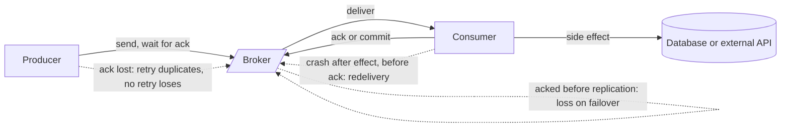

# Delivery Semantics

> [!abstract] In one sentence
> On every hop a sender that times out must either give up (risking loss) or retry (risking a duplicate), so the system as a whole offers at-most-once or at-least-once — and "exactly-once" is something you *construct* on top of at-least-once with idempotent processing, never something the transport gives you.

> [!tip] Deeper treatment in your system-design vault
> `system-design/09 Messaging and Event-Driven/Delivery Semantics.md` — read it *after* you have written your own explanation below.

**Map:** [[Messaging & Event-Driven Systems MOC]] → [[HLD MOC]]

## Definition

**Delivery semantics** classify what a messaging path promises about each message: **[[At-Most-Once Delivery|at-most-once]]** (never duplicated, may be lost), **[[At-Least-Once Delivery|at-least-once]]** (never lost, may be duplicated), and **[[Exactly-Once Semantics|exactly-once / effectively-once]]** (the *effect* of each message happens once, achieved by combining at-least-once transport with deduplication or idempotent processing). The guarantee is a property of a whole path — producer to broker, broker storage, broker to consumer, consumer to its side effects — and the weakest hop wins. "Delivery" and "processing" are different things: a message can be delivered once and processed twice (a consumer crash after the side effect, before the ack) or delivered twice and processed once (dedup).

## Problem solved

Before the vocabulary existed, teams discovered the problem one incident at a time: an email sent twice because a worker crashed after `send()` but before `ack()`; a payment never captured because the producer's `send()` timed out and nobody retried; a counter off by one after a rebalance. Each fix was local and the next outage found the next hop. Delivery semantics give a checklist: for every hop, what happens on timeout — retry or drop? For every consumer, what happens if it sees the same message twice? Answering those two questions for the full path is the design; the names are shorthand for the answers.

## How it works

The path has three places where a timeout forces the loss-versus-duplicate choice:

1. **Producer → broker.** The producer sends and waits for an ack. If the ack is lost, retrying may duplicate (the broker had it) and not retrying may lose (it did not). Kafka's idempotent producer (producer id + per-partition sequence number) lets the broker discard the retry, giving exactly-once *on this hop*; `acks=0` makes it at-most-once; SQS `SendMessage` retried by the SDK can duplicate on a standard queue, and FIFO queues dedup by `MessageDeduplicationId` for 5 minutes; Redis `XADD` retried after a timeout appends twice unless the client supplies an explicit id.
2. **Broker durability.** An acked message can still be lost if the broker acked before replicating: Kafka `acks=1` with a leader crash, Redis with asynchronous replication and failover, RabbitMQ classic queues without persistence. `acks=all` + `min.insync.replicas`, quorum queues, and Redis AOF with `appendfsync always` close the gap at a latency cost ([[Replication]]).
3. **Broker → consumer → effect.** The consumer must do work and then acknowledge. **Ack before work** = at-most-once (a crash after the ack loses the message). **Work before ack** = at-least-once (a crash after the work and before the ack redelivers it). Mechanisms: Kafka offset commit timing, SQS `DeleteMessage` after processing with a visibility timeout covering the work, RabbitMQ manual `basic.ack`, Redis `XACK` after processing with the entry sitting in the pending list meanwhile.
4. **Composition.** The end-to-end guarantee is the weakest hop: an idempotent producer into `acks=all` read by a work-then-ack consumer is at-least-once end to end — and it becomes effectively-once only when the consumer's effect is idempotent ([[Idempotency]]) or the effect and the ack are atomic (write the result and the offset in one database transaction, or use Kafka transactions for Kafka-to-Kafka).

| Hop | At-most-once | At-least-once | Exactly-once on this hop |
|---|---|---|---|
| Kafka producer | `acks=0`, `retries=0` | `acks=all`, retries | `enable.idempotence=true` |
| Kafka consumer | commit before processing | commit after processing | offset + result in one transaction |
| SQS consumer | delete on receive | delete after processing | not available; dedup in consumer |
| Redis Streams consumer | `XREADGROUP … NOACK` | `XACK` after processing | not available; dedup in consumer |

## Architecture

> [!example]- Excalidraw version — the same diagram as an editable canvas
> ![[Delivery Semantics.excalidraw]]
> [[Delivery Semantics.excalidraw|Open in Excalidraw]] — needs the Excalidraw plugin (see [[Plugins to Install]]).

## Use cases

- Any design review of a message path: walk the three hops and name the guarantee at each — if you cannot, the design is not finished.
- "Which messages may we drop?" — telemetry, presence, cache invalidation with a TTL backstop can be at-most-once and save the dedup machinery.
- "Which messages must never be lost?" — payments, ledger postings, audit events, webhooks with a contractual SLA: at-least-once transport plus idempotent effects.
- "Can we just turn on exactly-once?" — only for Kafka-to-Kafka pipelines; anything that touches a database, an email provider or a partner API needs consumer-side idempotency.
- Choosing between brokers: the semantics table above is the honest comparison of [[Kafka]], SQS and [[Redis]] Streams, not the feature lists.

## Limitations

- The taxonomy describes transport, not business correctness: an at-least-once path with a non-idempotent consumer is a bug factory, and an exactly-once Kafka pipeline that then sends an email is at-least-once again.
- Dedup requires state (keys and a window) and the window must exceed the maximum redelivery horizon, which is hard to bound across retries, DLQs and replays.
- "Effectively-once" assumes the side effect can be made idempotent; some cannot (a physical dispatch, a third-party API without idempotency keys) and need compensation instead.
- At-most-once does not mean "rarely lost"; under a crash loop it can mean "mostly lost".
- Guarantees are per hop and per configuration; a single `enable.auto.commit=true` on one consumer silently changes the end-to-end story.

## Trade-offs

| You gain | You sacrifice |
|---|---|
| At-most-once: lowest latency, no dedup state, simplest consumer | Any message can vanish without a trace |
| At-least-once: nothing is lost across crashes and timeouts | Consumers must handle duplicates; dedup state and its window |
| Effectively-once: correct effects with commodity brokers | Idempotency keys in every message and a dedup store or versioned writes |
| Kafka transactions: atomic read-process-write inside Kafka | Scope ends at Kafka's edge; higher latency; more broker state |

## Failure modes

- **Silent loss from ack-before-process** (auto-commit with async handlers, delete-on-receive) → work disappears during a deploy or crash; you notice only when a customer asks why their webhook never came; blast radius is every message in flight at each crash.
- **Duplicate side effects from process-before-ack** without idempotency → double emails, double ledger entries, double partner calls; notice via downstream complaints or reconciliation diffs; blast radius grows with the retry rate ([[Duplicate Message Processing]]).
- **Dedup window shorter than the redelivery horizon** — a message redriven from a DLQ three days later is "new" to the dedup store and is processed again; notice during DLQ redrives, which is the worst time.
- **Broker ack before durability** — `acks=1` leader crash or Redis failover drops acked writes; notice via gaps in sequence numbers downstream or reconciliation against the source database.
- **Producer retries without idempotence** — duplicates that *look* like separate events (different offsets) and may also be reordered; notice via consumer-side dedup hit rates; blast radius: every consumer of the topic.

## Performance

At-most-once is cheapest: no ack wait, no dedup lookup. At-least-once costs one ack round trip per message or batch and, on the consumer, a dedup check — a unique-index insert in the database (sub-millisecond when the index is in memory) or a Redis `SET NX` (sub-millisecond in-network). Kafka's idempotent producer is essentially free; transactions add a coordinator round trip per commit and, with `read_committed`, hold consumers behind open transactions, so batch commits every 100 ms-ish rather than per message. Atomic result-plus-offset writes in a database cost nothing extra if the result write was already a transaction.

## Scalability

Dedup state scales with message rate × window: at 5,000 messages/s and a 24 h window that is ~430 million keys, which rules out an in-memory set and argues for a database unique index with TTL-based cleanup, Redis with expiry, or natural idempotency (versioned writes) that needs no store at all. At 10x, revisit whether every stream still needs at-least-once — pushing telemetry to at-most-once removes most dedup load — and whether the dedup store itself is the new bottleneck.

## Operational impact

Make the guarantee explicit per topic and per consumer in a table that on-call can read: transport setting, ack timing, dedup mechanism and window. Monitor dedup hit rate (a sudden rise means a retry storm or a rebalance loop), producer retry rate, and consumer commit lag. Every DLQ redrive, offset reset and partition reassignment is a delivery-semantics event; runbooks must say what duplicates to expect. Debugging needs the message id and the attempt count in every log line ([[Logging]], [[Distributed Tracing]]).

## Alternatives

- **Synchronous RPC with [[Idempotency]] keys** — wins when the caller needs the result now; the same timeout dilemma applies, just without a broker.
- **Database-as-queue with transactional claim** (`FOR UPDATE SKIP LOCKED`) — wins when the effect lives in the same database and effect-plus-ack atomicity comes free.
- **Durable workflow engines** ([[Saga Pattern]], Temporal) — win when a message is really a multi-step process; they implement at-least-once activity execution with idempotency expectations spelled out.
- **Kafka transactions** — win for pure Kafka-to-Kafka stream processing where read-process-write atomicity is the whole problem.

## Real-world examples

- Kafka's documentation defines its semantics exactly along these hops: producer idempotence for the first, `acks` for the second, offset-commit timing for the third, and transactions for atomic read-process-write.
- SQS documents standard queues as at-least-once with best-effort ordering and FIFO queues as "exactly-once processing" — meaning producer-side dedup within a 5-minute window, with consumers still expected to handle a visibility timeout expiring mid-work.
- Stripe's API exposes idempotency keys precisely because HTTP over the internet is at-least-once once clients retry; the key turns retries into safe replays.
- In a stack like yours: a payments producer with `enable.idempotence=true` and `acks=all` into MSK, consumers that write the result and the offset in one PostgreSQL transaction or carry a dedup table keyed by event id, SQS consumers that delete only after the database commit, and Redis Streams consumers that `XACK` after the write and reap the pending list. The semantics stay the same across all three brokers; only the knob names change — which is the point of learning the taxonomy rather than the products.

## Practical exercise

1. Build a tiny pipeline: producer → broker (Kafka or SQS via LocalStack) → consumer that inserts a row per message and records `message_id`.
2. Run it in three modes: ack-before-work, work-before-ack, and work-before-ack with a unique index on `message_id`. In each mode, `kill -9` the consumer randomly 20 times while 10,000 messages flow.
3. Count rows versus messages sent: expect fewer, more, and exactly 10,000 respectively.
4. Add producer retries by injecting 5% ack loss with Toxiproxy; compare duplicate counts with `enable.idempotence` on and off.
5. Repeat on Redis Streams with `NOACK` versus `XACK`, and with `XADD` retried on timeout; note which hop produced each duplicate.

## Related concepts

### Prerequisites
- [[Message Queues]] — acks, visibility timeouts and redelivery
- [[Timeouts and Retries]] — the timeout dilemma that creates the choice
- [[Network Partitions]] — why an ack can be lost even when the work was done

### Related
- [[At-Most-Once Delivery]] — the loss-tolerant end of the spectrum
- [[At-Least-Once Delivery]] — the default for anything that matters
- [[Exactly-Once Semantics]] — what Kafka transactions do and do not cover
- [[Idempotency]] — how consumers own correctness
- [[Duplicate Message Processing]] — the failure this taxonomy predicts
- [[Consumer Groups]] — commit timing and rebalance replays

### Builds on this
- [[Outbox Pattern]] — at-least-once publication from a database
- [[Retry Strategies]] — retries are the source of duplicates
- [[Dead-Letter Queues]] — what happens after retries are exhausted
- [[Saga Pattern]] — multi-step effects over at-least-once messaging

### Design problems where it applies
- [[Design a Payment System]]
- [[Design a Message Queue]]
- [[Design a Webhook Delivery System]]
- [[Design a Notification System]]
- [[Design a Distributed Job Scheduler]]

### Projects where it can be implemented
- [[Webhook Relay]] — at-least-once delivery with event-id dedup on the receiver
- [[Double-Entry Ledger Service]] — effect and consumed event id in one transaction
- [[Durable Job Scheduler]] — leases and acks for exactly-once job effects

### Resources
- [[Confluent - Exactly-Once Semantics in Kafka]] — the hop-by-hop analysis for Kafka
- [[Redis Streams Docs]] — NOACK, XACK and the pending list as the Redis version of the same choices
- [[Designing Data-Intensive Applications]] — chapter 11 on acknowledgements and redelivery, chapter 12 on end-to-end exactly-once
- [[AWS Builders Library - Idempotent APIs]] — the consumer-owns-correctness argument for request paths

## Personal understanding

> [!question] Explain it without the source
> Write your own explanation here, from memory. Then compare it with the sections above and note what you missed.

### Mastery checklist
- [ ] I can explain it without the original resource
- [ ] I can describe the problem it solves
- [ ] I can compare it with its alternatives
- [ ] I can name its limitations and failure modes
- [ ] I can recognise when it is appropriate in a real system
- [ ] I have applied it in a system design
- [ ] I have validated my assumptions with an experiment or implementation

## Open questions

- [ ] For a consumer that writes to PostgreSQL *and* calls a partner API, which order of effect, dedup record and ack minimises the window of double side effects, and what is left uncovered?
- [ ] What is the actual durability of a Redis Streams entry acknowledged by `XADD` under `appendfsync everysec` with one replica — is it closer to Kafka `acks=1` or `acks=0`?
- [ ] How would you measure the real-world duplicate rate of a production consumer without adding a dedup store first?
