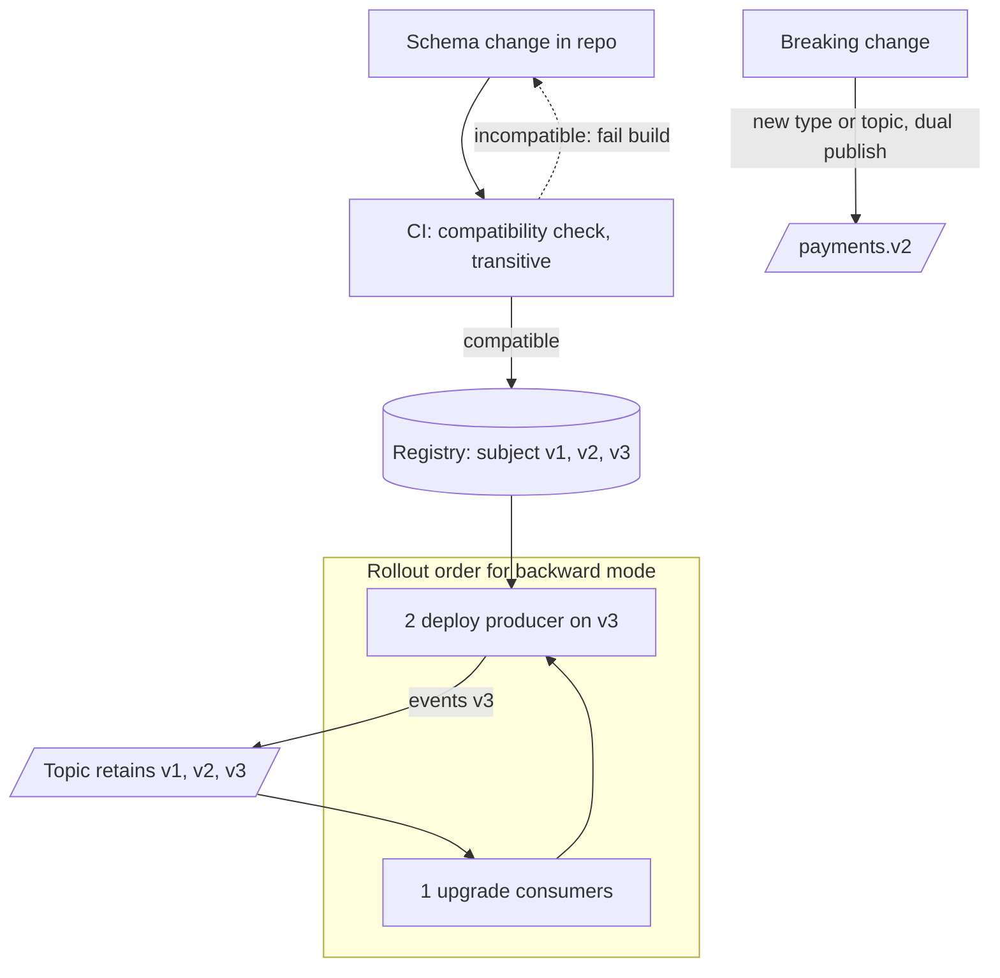

# Event Schema Evolution

> [!abstract] In one sentence
> Because a log keeps days or years of history and consumers deploy on their own schedule, every schema change must be readable across versions in both directions you care about — so you pick a compatibility mode, let a registry reject anything that violates it, upgrade consumers or producers in the order the mode demands, and give truly breaking changes a new name.

> [!tip] Deeper treatment in your system-design vault
> `system-design/09 Messaging and Event-Driven/Event Schema Evolution.md` — read it *after* you have written your own explanation below.

**Map:** [[Messaging & Event-Driven Systems MOC]] → [[HLD MOC]]

## Definition

**Event schema evolution** is the practice of changing an [[Event Schemas|event schema]] without breaking any reader of any retained event. It rests on **compatibility modes** — *backward* (new readers can read old data), *forward* (old readers can read new data), *full* (both), each optionally *transitive* across all prior versions — on **format rules** (Avro defaults, Protobuf field numbers, tolerant JSON readers) that make a change fall into a mode, on a **schema registry** that rejects registrations violating the configured mode, and on **upgrade ordering** derived from the mode. It is the event-stream twin of database [[Schema Evolution]], with the added twist that the "old rows" are immutable and may be replayed years later.

## Problem solved

An event published today is read by consumers deployed today, by consumers deployed next quarter reading retained history, and by consumers deployed last year that nobody has touched. A change that works in the producer's integration tests breaks one of those three. Without rules, teams discover the break in production as deserialisation errors across several services at once, or — worse — as silently wrong values when a renamed field reads as its default. Evolution rules make the question "will this change break a reader?" answerable *before* deployment, mechanically, and give every team the same upgrade playbook ([[Backward Compatibility]], [[Versioning and Migrations]]).

## How it works

1. **Pick the mode per subject.** With **backward** compatibility (Confluent's default) a consumer on the new schema can read everything older: you may delete fields and add fields that have defaults; **consumers upgrade first**. With **forward** compatibility a consumer on the old schema can read new data: you may add fields and delete optional fields; **producers upgrade first**. **Full** allows only adding or removing fields with defaults and permits any upgrade order. Use the **transitive** variants: a log retains many versions, and a replay from a compacted topic can surface the first version ever written, so "compatible with the previous version" is not enough.
2. **Make changes that fit the mode.** *Avro*: add a field only with a default; remove only fields that had defaults; never rename (use aliases); only widen types along the promotion chain (int → long → float → double). *Protobuf*: field numbers are the contract — never reuse or renumber, mark removed numbers `reserved`, add freely, never change a field's type, treat unknown enum values explicitly. *JSON*: keep an open content model (`additionalProperties: true`) and write **tolerant readers** that ignore unknown fields and treat missing ones as defaults — tolerance is what gives JSON forward compatibility at all.
3. **Enforce in the registry and in CI.** The registry rejects an incompatible registration; production producers run with `auto.register.schemas=false` so a schema is registered by the build pipeline after a compatibility check, never by a running service. The check runs against *all* versions of the subject.
4. **Sequence the rollout.** Backward mode: deploy all consumers that must read the new shape, then the producer. Forward mode: producer first, consumers whenever. Treat a change that needs both sides at once as breaking. Use expand/contract: add the new field alongside the old (expand), migrate consumers, stop writing the old field, remove it only after no consumer *and no retained event a consumer must still read* depends on it (contract).
5. **Handle breaking changes by naming, not editing.** A semantic change (amount from major to minor units, a split of one event into two, a type change) is a new event type or version — `PaymentCaptured` → `PaymentCapturedV2` or a new topic `payments.v2`. The producer dual-publishes during a transition window, consumers migrate one by one, the old type is retired. For event-sourced stores, consumers **upcast** old versions to the current shape at read time instead ([[Event Sourcing]]).
6. **Defaults are semantics.** A default of `0` for `feeMinor` says "no fee" for every historical event that predates fees; if that is false, the field cannot have a default and the change is breaking.

```bash
# CI gate: ask the registry whether v2 is compatible with every retained version of the subject
curl -s -X POST -H "Content-Type: application/vnd.schemaregistry.v1+json" \
  --data @PaymentCaptured-v2.json \
  "$REGISTRY/compatibility/subjects/payments-value/versions?verbose=true"
# {"is_compatible": false, "messages": ["READER_FIELD_MISSING_DEFAULT_VALUE: feeMinor"]}
```

## Architecture



## Use cases

- "We need to add a field to an event three teams consume" — the everyday case; pick the mode and follow the order.
- "A consumer must replay a year of history" — transitive compatibility or upcasters are mandatory ([[CQRS]], [[Event Sourcing]]).
- "Finance wants amounts in minor units from now on" — a semantic change: new version, dual publish, migrate ([[Design a Payment System]]).
- "Deserialisation errors appear in the DLQ after a producer deploy" — the signal that evolution is ungoverned ([[Dead-Letter Queues]]).
- "We are moving from Kafka to SQS/Redis Streams and want the same contracts" — a registry-backed schema travels; a shared class library does not.

## Limitations

- Compatibility checks verify *shape*, not meaning: a field reinterpreted (gross versus net) passes every check and corrupts every consumer.
- Full transitive compatibility is restrictive; some changes genuinely require a new version and a migration.
- Registries are infrastructure with their own availability; a consumer seeing a new schema id while the registry is down cannot deserialise.
- JSON's tolerance is only as good as every consumer's reader; one strict deserialiser breaks the promise.
- Topic-per-version migrations double traffic and consumer count during the window and need a retirement date someone enforces.

## Trade-offs

| You gain | You sacrifice |
|---|---|
| Changes verified mechanically before deployment | Flexibility: some natural changes become "breaking" |
| Independent deployment of producers and consumers | A rollout order that teams must actually follow |
| Replayable history across years of versions | Defaults and upcasters that carry semantic debt |
| A registry as the single source of truth for contracts | Another service to run and a governance process |

## Failure modes

- **Mode set to NONE or non-transitive** — a change compatible with v5 but not v2 ships; a consumer replaying history fails on old events; you notice weeks later, during a rebuild; blast radius: every replay.
- **Default that lies** — a new `currency` field defaults to `INR`; historical events from a USD flow are read as INR; notice via reconciliation, not errors; blast radius: every consumer that computed on history.
- **Wrong upgrade order** — producer deploys a backward-compatible change before a consumer that lacks the tolerant reader; the consumer dead-letters every event until redeployed; notice via DLQ arrival rate right after a producer deploy.
- **Protobuf field number reuse** — an old consumer reads a new field's bytes as the old field's type; silent garbage; notice via impossible values.
- **Registry outage during a deploy** — new producers cannot register, consumers cannot fetch unseen ids; notice via serialisation exceptions on fresh pods only.

## Performance

Negligible at runtime: schemas are fetched by id once and cached; compatibility checks run in CI. The costs are in migrations — dual-publishing a high-volume topic doubles broker load for the window, and upcasting old events at read time adds CPU proportional to the age of the history being replayed. Avro and Protobuf keep payloads small across versions; JSON with many optional fields grows with every evolution.

## Scalability

The technical side scales trivially; the organisational side is the limit. Hundreds of subjects with per-subject modes, owners and consumer lists need an event catalogue and automation (CI plugins, compatibility bots). Topic-per-version migrations do not scale past a few concurrent ones — prefer in-place compatible evolution and reserve new versions for genuine semantic breaks. At 10x teams, the rule that works is "full transitive by default, exceptions by review".

## Operational impact

Own the registry (or use a managed one), back it up — losing it means losing the ability to read binary history — and alert on registration failures and on deserialisation errors per consumer and schema id. Keep a runbook per mode for rollout order and rollback (a producer rollback to an older schema is only safe under forward or full compatibility). Add the schema id and version to every consumer error log so DLQ triage can group by version ([[Event Schemas]]). Treat the removal step of expand/contract as a tracked task; it is the step nobody finishes.

## Alternatives

- **Version in the payload with per-version code paths in consumers** — wins for small systems without a registry; scales badly as versions accumulate.
- **Upcasting at read time** — wins for event-sourced aggregates where history is the model; consumers always see the latest shape.
- **New topic per breaking change** — wins when the semantics changed enough that old consumers *should* stop; costs a migration window.
- **Schema-on-read (JSON plus tolerant readers only)** — wins for rapid iteration between two teams; loses once a third team or a replay appears.

## Real-world examples

- Confluent Schema Registry's documented compatibility types (backward, forward, full and their transitive variants) and its default of backward are the vocabulary most teams use, with the same ideas in AWS Glue Schema Registry and Apicurio.
- Protobuf's language guide is explicit that field numbers must never be reused and recommends `reserved`, because the wire format carries numbers, not names.
- Stripe evolves its API and webhook event payloads with dated versions and per-version transformation layers — the HTTP-side pattern that upcasting mirrors.
- In a stack like yours: subjects on MSK set to full transitive, CI running the compatibility endpoint before merge, producers with `auto.register.schemas=false`, a rollout checklist keyed to the mode, and breaking payment changes shipped as `PaymentCapturedV2` with a dual-publish window and a retirement ticket. The same registry serves SQS and Redis Streams payloads if the envelope carries the schema id, which keeps the migration between brokers from becoming a schema migration too.

## Practical exercise

1. Run a local Confluent Schema Registry with Kafka via Docker Compose; register `PaymentCaptured` v1 (Avro) under subject `payments-value` with `BACKWARD_TRANSITIVE`.
2. Attempt to register v2 that adds `feeMinor` without a default — observe the rejection; add a default and observe success.
3. Produce 1,000 v1 events, deploy a consumer on v2, and read them: confirm the default appears. Then produce v2 events to a v1 consumer and see what breaks (and why forward mode would have caught it).
4. Attempt a rename and a type change; watch both fail; implement the rename as add-new-field plus expand/contract across three deploys.
5. Simulate a breaking change by dual-publishing `payments` and `payments.v2` from one producer for ten minutes; migrate a consumer group between them without losing or duplicating events (hint: offsets and idempotency).

## Related concepts

### Prerequisites
- [[Event Schemas]] — what is being evolved
- [[Backward Compatibility]] — the general principle behind the modes
- [[Schema Evolution]] — the database counterpart and the expand/contract pattern

### Related
- [[Versioning and Migrations]] — versioning strategy and dual-write windows
- [[Kafka]] — retention is why history matters
- [[Dead-Letter Queues]] — where incompatible events land
- [[Deployment and Rollback Strategies]] — upgrade order is a deployment constraint
- [[Designing APIs and Contracts]] — contracts and their consumers
- [[Feature Flags]] — gating producer-side changes during a migration

### Builds on this
- [[Event Sourcing]] — upcasting as the long-term evolution strategy
- [[Change Data Capture]] — database schema changes flow into event schemas
- [[Designing Systems for Changing Requirements]] — contracts designed to change
- [[Designing for Extensibility]] — optional fields and open content models

### Design problems where it applies
- [[Design a Payment System]]
- [[Design a Webhook Delivery System]]
- [[Design a Notification System]]
- [[Design a Feature Flag Service]]

### Projects where it can be implemented
- [[Webhook Relay]] — versioned payloads customers upgrade to on their schedule
- [[Streaming Fraud Rules Engine]] — evolving feature events without replaying history
- [[Double-Entry Ledger Service]] — append-only events that must stay readable forever

### Resources
- [[Stripe - Online Migrations at Scale]] — the migration discipline that evolution windows borrow
- [[Stripe - API Versioning]] — versioned contracts with transformation layers
- [[Designing Data-Intensive Applications]] — chapter 4 on schema evolution in Avro, Protobuf and JSON
- [[Kafka Design Documentation]] — retention and compaction, the reason old versions persist

## Personal understanding

> [!question] Explain it without the source
> Write your own explanation here, from memory. Then compare it with the sections above and note what you missed.

### Mastery checklist
- [ ] I can explain it without the original resource
- [ ] I can describe the problem it solves
- [ ] I can compare it with its alternatives
- [ ] I can name its limitations and failure modes
- [ ] I can recognise when it is appropriate in a real system
- [ ] I have applied it in a system design
- [ ] I have validated my assumptions with an experiment or implementation

## Open questions

- [ ] With a compacted topic that retains the first version ever written, is there any safe way to ever "contract" a field, or does the schema only ever grow?
- [ ] For a consumer group migrating from `payments` to `payments.v2` during dual publish, what offset handoff avoids both a gap and a duplicate window without relying on idempotency?
- [ ] Should the schema id travel inside the payload (portable across SQS and Redis Streams) or in broker-native metadata (Kafka's wire format), given both must coexist during a broker migration?
