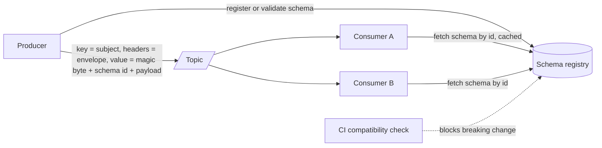

# Event Schemas

> [!abstract] In one sentence
> An event schema is an API with no caller you can talk to: a fact in the past tense, wrapped in an envelope that gives every consumer an id to dedup on, a key to order by, a version to evolve by and a trace to debug with — serialised in a format a registry can police.

> [!tip] Deeper treatment in your system-design vault
> `system-design/09 Messaging and Event-Driven/Event Schema Evolution.md` — read it *after* you have written your own explanation below.

**Map:** [[Messaging & Event-Driven Systems MOC]] → [[HLD MOC]]

## Definition

An **event schema** is the contract that defines an event's structure and meaning: its **type** and semantics (an immutable fact such as `PaymentCaptured`, or a command such as `CapturePayment`), its **envelope** (standard metadata: id, type, source, time, subject, version, correlation and trace context), its **payload** (the domain data, owned by the producer), and its **serialisation** (JSON, Avro, Protobuf) together with the **registry** that stores and validates versions. Unlike a REST contract, an event schema is consumed asynchronously by services the producer cannot enumerate, and by consumers reading history — so it must be readable for as long as the events are retained.

## Problem solved

Early event-driven systems publish whatever object the producer had in hand — often a serialised database row. Consumers couple to internal column names, the first schema change breaks three teams, duplicates cannot be detected because there is no event id, out-of-order events cannot be reconciled because there is no version, incidents cannot be traced across the broker because there is no trace context, and personal data spreads to every consumer's logs. The schema is where those problems are solved *once*: a stable envelope every consumer can rely on, a payload that exposes the domain rather than the storage, and a format a registry can check before a producer ships a breaking change ([[Event Schema Evolution]]).

## How it works

1. **Decide what kind of message it is.** An **event** is a fact that happened, named in the past tense (`OrderPlaced`), owned by the producer, delivered to any number of subscribers with no expectation of a response. A **command** is a request to do something (`ReserveStock`), addressed to one handler that may reject it. A **query** over a queue is request-reply and usually a sign you wanted RPC ([[Synchronous vs Asynchronous Communication]]). Mixing them on one topic muddles ownership and [[Delivery Semantics|delivery expectations]].
2. **Choose fat or thin.** A **fat event** (event-carried state transfer) carries enough state for consumers to act without calling back — strong decoupling, larger payloads, consumers' copies go stale, and more data leaves the producer. A **thin event** (notification) carries ids and type; consumers fetch current state — small and always fresh, but the temporal coupling returns and reads amplify. A common middle: current state of the aggregate plus the list of changed fields.
3. **Standardise the envelope.** Every event carries: `id` (UUID or ULID — the dedup key for [[Idempotency]]), `type` and `specversion`, `source` (producing service), `subject` (aggregate id — also the partition key, so events for one entity stay ordered), `time` (producer UTC timestamp, never the ordering key, see [[Clocks and Time]]), `schemaversion`, `correlationid` and `causationid`, and `traceparent` for [[Distributed Tracing]]. CloudEvents 1.0 mandates `id`, `source`, `specversion` and `type` and is the common vocabulary; in Kafka the envelope lives in record headers, the subject in the key, and the payload in the value.
4. **Design the payload from the domain, not the table.** Expose what the bounded context promises ([[Domain-Driven Design]]): money as integer minor units with a currency, timestamps in one agreed format, enums as strings with a documented unknown-value policy, no internal ids that leak storage decisions, no personal data unless the consumer needs it — and then field-level encryption or tokenisation. Stay under the broker's limit (Kafka's default `message.max.bytes` is 1 MB; SQS historically 256 KB) or use a claim check (a pointer to object storage).
5. **Pick a serialisation.** **JSON**: human-readable, schemaless by default, verbose, floating-point hazards for money. **Avro**: compact binary, the schema is required to read so a registry is mandatory, excellent evolution rules via defaults. **Protobuf**: compact, IDL with numbered fields, unknown fields preserved, shared with gRPC. JSON Schema adds validation to JSON. Confluent's wire format prefixes each message with a magic byte and a 4-byte schema id; the consumer fetches the schema by id and caches it. Subject naming (`TopicNameStrategy` by default, `RecordNameStrategy` for several types per topic) decides how the registry scopes compatibility.
6. **Decide topic granularity with ordering in mind.** If `OrderPlaced` and `OrderCancelled` must be seen in order, they must share a topic and key — one topic per aggregate, several event types; one topic per event type only where cross-type order is irrelevant ([[Ordering Guarantees]], [[Topic Partitions]]).

```json
{
  "specversion": "1.0", "id": "01J9Z3Q6V9K2M4N8P0R1S2T3U4", "type": "com.acme.payments.PaymentCaptured",
  "source": "/payments-service", "subject": "pay_8f31c", "time": "2026-10-19T09:14:33.120Z",
  "schemaversion": 3, "correlationid": "req_7b2e", "traceparent": "00-4bf92f3577b34da6a3ce929d0e0e4736-00f067aa0ba902b7-01",
  "data": { "paymentId": "pay_8f31c", "accountId": "acc_42", "amountMinor": 199900, "currency": "INR", "capturedAt": "2026-10-19T09:14:33.100Z", "version": 7 }
}
```

## Architecture



## Use cases

- "Several teams will consume this" — the moment the first external consumer appears, the event is an API and needs a written schema.
- "We must dedup and reorder" — the envelope's `id`, `subject` and `version` are what idempotent consumers and version gates rely on.
- "We need to trace a payment across six services" — `correlationid` and `traceparent` in every event.
- "Payloads are large or carry PII" — claim checks and field-level encryption are schema decisions ([[Data Ownership and Lifecycle]]).
- "Consumers must read events from last month" — a registry-backed binary format keeps old events readable after the producer has moved on.

## Limitations

- A schema fixes the contract but not the semantics: two teams can agree on the shape of `amountMinor` and disagree on whether it includes fees.
- Fat events leak data and go stale; thin events reintroduce coupling — there is no free choice, only the right one per consumer set.
- Registries add a runtime dependency on the consume path (mitigated by caching) and a governance process that teams resist.
- CloudEvents-style envelopes add bytes to every message; at very high volume the overhead is measurable.
- Schemas do not prevent producers from publishing *wrong* data; validation of content is still the producer's job.

## Trade-offs

| You gain | You sacrifice |
|---|---|
| Consumers that can dedup, order, trace and evolve independently | Envelope overhead on every message |
| Compact, registry-validated binary formats | Human readability and ad-hoc inspection without tooling |
| Fat events: consumers act without calling back | Freshness and data minimisation |
| Domain-shaped payloads decoupled from storage | The effort of an explicit translation layer in the producer |

## Failure modes

- **Row-as-event** — a column rename in the producer's database breaks every consumer; you notice as deserialisation errors across teams after a deploy; blast radius: every subscriber, simultaneously.
- **Missing event id** — duplicates from redelivery cannot be detected; notice via double side effects with no key to dedup on ([[Duplicate Message Processing]]).
- **Floating-point money in JSON** — `19.99` becomes `19.989999…` in a consumer; notice during reconciliation; blast radius: every financial consumer that trusted the number.
- **Event types that need ordering on different topics** — `OrderCancelled` is processed before `OrderPlaced`; notice via impossible state transitions.
- **PII in events, then in every consumer's logs** — a deletion request cannot be honoured; notice during a compliance audit.

## Performance

Avro and Protobuf payloads are typically several times smaller than equivalent JSON, which cuts broker storage, network and consumer CPU; schema lookups are cached so the registry adds latency only on first sight of a schema id. Fat events raise per-message size but remove a read call per consumer; thin events do the opposite — at N consumers, thin events cost N reads per event against the producer's store. Claim checks keep the broker fast and move the bytes to object storage at the cost of a second fetch.

## Scalability

Schemas scale organisationally more than technically: the registry holds thousands of subjects without strain, but the *process* — ownership, review, compatibility rules, an event catalogue — is what keeps 50 teams from breaking each other. Per-aggregate topics with multiple event types keep topic counts manageable as event types grow. At 10x volume, envelope overhead and payload size dominate broker cost, which is when teams move from JSON to a binary format.

## Operational impact

Run and back up the registry (or use a managed one such as AWS Glue Schema Registry), enforce compatibility in CI rather than at runtime (`auto.register.schemas=false` in production), and maintain an event catalogue so producers can find their consumers before changing anything. Every consumer should log the event `id`, `type`, `schemaversion` and `traceparent` on failure; every DLQ triage starts from them ([[Dead-Letter Queues]]). Schema changes become change-management events with a consumer-upgrade order ([[Event Schema Evolution]]).

## Alternatives

- **Shared library of event classes** — wins inside one language and one organisation at small scale; loses when a second language or team appears, because the schema is the compiled artefact.
- **[[Change Data Capture]] events** — win when every row change is the requirement (replication, indexing); lose as domain contracts because they are the schema.
- **Thin notifications plus REST** — win when consumers need fresh, authorised reads and the producer's API is already the contract.
- **GraphQL or OpenAPI as the contract, events as triggers** — wins when the organisation already governs HTTP contracts well and events only say "something changed".

## Real-world examples

- The CloudEvents specification (CNCF) standardises the envelope and has bindings for Kafka, HTTP, AMQP and others; Knative and Azure Event Grid adopt it natively.
- Confluent Schema Registry's wire format and subject-naming strategies are the de facto Kafka conventions; AWS Glue Schema Registry and Apicurio implement compatible ideas.
- Stripe's webhook events (`id`, `type`, `created`, `data.object`, `api_version`) are a well-known example of a stable envelope with a versioned payload consumed by thousands of external integrators.
- In a stack like yours: a `payments` topic per aggregate with `PaymentAuthorised`, `PaymentCaptured`, `PaymentRefunded` as event types, keyed by payment id with account id inside for the ledger; CloudEvents-style headers carrying `id`, `traceparent` and `schemaversion`; Avro or Protobuf schemas in Glue or Confluent registry with compatibility enforced in CI; amounts as integer minor units with currency; and the same envelope reused unchanged on SQS message attributes and Redis Stream fields, so consumers' dedup and tracing code does not change when the broker does.

## Practical exercise

1. Take a real event from one of your services and rewrite it twice: as a fat `PaymentCaptured` with full state, and as a thin notification; list which consumers each would serve without a callback.
2. Define the envelope as a Protobuf or Avro schema; register it in a local Confluent or Apicurio registry with Docker Compose; produce 10,000 events in JSON and in the binary format and compare bytes on disk and consumer CPU.
3. Add `traceparent` propagation from an HTTP request through the producer to a consumer; open the trace in Jaeger and confirm the broker hop appears.
4. Write a consumer that dedups on `id` and version-gates on `data.version`; redeliver and reorder events and prove the projection stays correct.
5. Put a 2 MB payload through Kafka with default limits, watch it fail, and implement a claim check to S3 (LocalStack).

## Related concepts

### Prerequisites
- [[Event-Driven Architecture]] — the style in which events are the integration contract
- [[Designing APIs and Contracts]] — events are contracts with the same obligations
- [[Message Queues]] — the carriers that impose size and metadata constraints

### Related
- [[Event Schema Evolution]] — how the schema changes without breaking readers
- [[Domain-Driven Design]] — payloads shaped by the bounded context
- [[Data Ownership and Lifecycle]] — who owns the data in a fat event, and for how long
- [[Distributed Tracing]] — trace context in the envelope
- [[Topic Partitions]] — subject as the partition key
- [[Idempotency]] — the event id as the dedup key

### Builds on this
- [[Event Sourcing]] — events as the persisted model need the strictest schemas
- [[CQRS]] — projections depend on stable event contracts
- [[Change Data Capture]] — CDC envelopes are a schema with before/after images
- [[Outbox Pattern]] — the outbox row stores the serialised event

### Design problems where it applies
- [[Design a Payment System]]
- [[Design a Webhook Delivery System]]
- [[Design a Notification System]]
- [[Design a Real-Time Fraud Detection Pipeline]]

### Projects where it can be implemented
- [[Webhook Relay]] — a stable, signed envelope customers can rely on
- [[Streaming Fraud Rules Engine]] — Avro or Protobuf transaction events with a registry
- [[Double-Entry Ledger Service]] — posting events with ids and versions

### Resources
- [[Designing Data-Intensive Applications]] — chapter 4 on encoding formats and dataflow through message brokers
- [[Kafka Design Documentation]] — keys, headers and message size constraints
- [[Stripe - API Versioning]] — a stable envelope with versioned payloads at scale
- [[Martin Fowler - Event Sourcing]] — the "event-carried state transfer" distinction

## Personal understanding

> [!question] Explain it without the source
> Write your own explanation here, from memory. Then compare it with the sections above and note what you missed.

### Mastery checklist
- [ ] I can explain it without the original resource
- [ ] I can describe the problem it solves
- [ ] I can compare it with its alternatives
- [ ] I can name its limitations and failure modes
- [ ] I can recognise when it is appropriate in a real system
- [ ] I have applied it in a system design
- [ ] I have validated my assumptions with an experiment or implementation

## Open questions

- [ ] For a ledger consumer that needs the *previous* balance to validate a posting, is a fat event with before/after state acceptable, or does it leak the ledger's responsibility into the producer?
- [ ] How should field-level encryption of PII in Avro payloads interact with schema compatibility checks and with consumers that never need the field?
- [ ] When the same event is carried over Kafka headers, SQS message attributes and Redis Stream fields, what is the minimal envelope mapping that keeps `id`, `subject` and `traceparent` behaviour identical?
