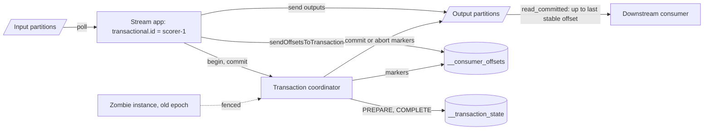

# Exactly-Once Semantics

> [!abstract] In one sentence
> You cannot deliver a message exactly once — a lost ack always forces a retry or a loss — but you can make its *effect* happen exactly once, either by moving the effect and the acknowledgement into one atomic transaction (what Kafka EOS does, only within Kafka) or by making the effect idempotent so retries are harmless.

> [!tip] Deeper treatment in your system-design vault
> `system-design/08 Distributed Systems Theory/Exactly-Once Delivery Is a Lie.md` — read it *after* you have written your own explanation below.

**Map:** [[Messaging & Event-Driven Systems MOC]] → [[HLD MOC]]

## Definition

**Exactly-once semantics (EOS)** means that for every input message, its intended effect — a record appended, a row updated, a balance changed — occurs once, despite retries, crashes and redelivery. It is *not* a transport property: the network can always lose an acknowledgement, so the sender must either retry (possible duplicate delivery) or stop (possible loss). EOS is therefore built on [[At-Least-Once Delivery]] plus one of two mechanisms: **atomicity** between the effect and the consumption record (a transaction covering both), or **idempotency** of the effect (a duplicate changes nothing). "Effectively-once" is the honest name for the second.

## Problem solved

At-least-once leaves every consumer with the same chore: detect and discard duplicates before they turn into double charges, double emails or double increments ([[Duplicate Message Processing]]). For stream processing — read from a topic, update state, write to another topic — the chore is worse, because a crash between the output write and the offset commit re-emits outputs, and downstream dedup would need to understand upstream retries. Kafka's EOS (KIP-98, 0.11) solved that specific loop: make "write outputs, update state changelog, commit input offsets" one atomic unit so a reprocessed input never produces visible duplicate outputs. For everything that leaves the broker's boundary, the problem is solved by idempotent consumers, which is the general tool.

## How it works

**Inside Kafka — two mechanisms.**

1. **Idempotent producer** (`enable.idempotence=true`, default since 3.0). On start the producer obtains a **producer id (PID)**; every batch carries `(PID, epoch, sequence number)` per partition. The broker keeps the last few sequence numbers per PID per partition and silently discards a retried batch it already has, returning the original ack. Scope: one producer session, one partition — a producer restarted without a `transactional.id` gets a new PID, so duplicates across restarts are not caught.
2. **Transactions.** Setting `transactional.id` makes the PID stable across restarts and adds an **epoch**; `initTransactions()` bumps the epoch and **fences zombies** — an old instance's writes are rejected with a stale epoch. A broker-side **transaction coordinator** owns a partition of `__transaction_state`. The flow: `beginTransaction()`, `send()` to any partitions, `sendOffsetsToTransaction()` to include the consumer group's input offsets, `commitTransaction()`. The coordinator writes `PREPARE_COMMIT` to its log, then **control markers** (commit or abort) into every partition the transaction touched, then `COMPLETE_COMMIT`. Consumers with `isolation.level=read_committed` read only up to the **last stable offset** and skip records from aborted transactions. Kafka Streams wraps this as `processing.guarantee=exactly_once_v2` (KIP-447), which fences via consumer-group metadata so one producer per thread suffices.

```java
producer.initTransactions();
while (true) {
  var records = consumer.poll(Duration.ofMillis(100));
  producer.beginTransaction();
  for (var r : records) producer.send(new ProducerRecord<>("scored", r.key(), score(r.value())));
  producer.sendOffsetsToTransaction(currentOffsets(records), consumer.groupMetadata());
  producer.commitTransaction();   // outputs and input offsets become visible together, or not at all
}
```

**Outside Kafka — effectively-once.**

3. **Atomic effect plus position.** Write the business row *and* the consumed message id (or the offset) in one database [[Transactions|transaction]]; on redelivery the id already exists and the write is skipped. This is EOS for any consumer whose effect lives in a transactional store.
4. **Idempotent effects.** Upserts keyed by a natural id, version-gated updates, `SET NX` dedup keys with a TTL longer than the redelivery horizon ([[Idempotency]]).
5. **Producer-side dedup elsewhere.** SQS FIFO "exactly-once processing" deduplicates `MessageDeduplicationId` for **5 minutes** on the send side; the consumer can still receive a message twice if its visibility timeout expires, so it must still be idempotent. Google Pub/Sub's exactly-once option similarly guarantees no redelivery of an acknowledged message within the ack deadline. Redis Streams offers nothing here beyond client-chosen entry ids.

## Architecture



> [!example]- Excalidraw version — the same diagram as an editable canvas
> ![[Exactly-Once Semantics.excalidraw]]
> [[Exactly-Once Semantics.excalidraw|Open in Excalidraw]] — needs the Excalidraw plugin (see [[Plugins to Install]]).


## Use cases

- "Read from Kafka, aggregate or enrich, write to Kafka, and counts must be exact" — fraud features, windowed aggregates, Kafka Streams and Flink jobs ([[Design a Real-Time Fraud Detection Pipeline]]).
- "Atomically write to several topics" — fan a change to two output topics with no window where only one is visible.
- "The effect is a database row we own" — effect-plus-offset in one transaction gives EOS without any broker feature ([[Design a Digital Wallet and Ledger]]).
- "Money moves on this message" — effectively-once via idempotency keys is mandatory, whatever the broker ([[Design a Payment System]]).
- "The business asked for exactly-once" — the answer is always: at-least-once transport, idempotent effects, and the explanation of why.

## Limitations

- Kafka EOS stops at Kafka's edge: an email, a partner API call or a Redis write inside the loop runs once per *attempt*, not per message.
- Transactions cost latency: outputs are invisible to `read_committed` consumers until commit, so commit intervals of tens to hundreds of milliseconds set the floor; per-message commits are prohibitively slow.
- Transactional state is per `transactional.id` and expires after 7 days of inactivity; zombie fencing depends on correct id assignment.
- SQS FIFO's 5-minute dedup window covers producer retries only; a consumer-side duplicate after a visibility expiry is still yours.
- Dedup stores need a window longer than the maximum redelivery horizon, which DLQ redrives and replays can extend to weeks.

## Trade-offs

| You gain | You sacrifice |
|---|---|
| Exact counts and no duplicate outputs inside a Kafka pipeline | Throughput and latency to coordinator round trips and commit batching |
| Atomic multi-partition writes plus offset commit | Simplicity: coordinators, markers, fencing, `read_committed` lag |
| Effectively-once anywhere with idempotent consumers | A dedup store or versioned schema, and discipline in every consumer |
| Zombie fencing for free with transactional ids | Careful id assignment per instance or per input partition |

## Failure modes

- **Side effect inside the transaction loop** — a notification is sent per attempt while the Kafka output is deduplicated; users get two emails and the metrics say exactly-once; you notice via complaints, not dashboards; blast radius: every retried batch.
- **Transaction timeout** (`transaction.timeout.ms`, 60 s) exceeded by slow processing → the coordinator aborts, the app gets `ProducerFencedException` or `InvalidProducerEpoch`, and the batch is reprocessed; a loop forms if the cause persists; notice via abort rate.
- **`read_uncommitted` downstream** (the default) — a consumer reads records from transactions that later abort, seeing phantom data; notice as counts that disagree with `read_committed` readers.
- **Hanging transaction** — a producer crashes mid-transaction and the last stable offset stops advancing until the timeout, so every `read_committed` consumer on the partition stalls; notice via lag rising with no consumer errors.
- **Dedup key collision** — two different messages share an id (a bad key scheme, a replay with regenerated ids) and the second is silently dropped; notice only via reconciliation.

## Performance

The idempotent producer is essentially free. Transactions add a coordinator round trip per commit plus marker writes to each touched partition, so throughput depends on commit batching: committing every 100 ms costs little; committing per record collapses throughput by orders of magnitude. `read_committed` consumers see end-to-end latency equal to the commit interval plus the usual path. Effect-plus-offset in a database costs nothing beyond the transaction you already had; a separate dedup store adds one write per message.

## Scalability

Kafka transactions scale with partitions like everything else, but each transactional producer holds coordinator state and each transaction touches markers in every output partition, so wide fan-out transactions are expensive. EOS v2's one-producer-per-thread model removed the old one-producer-per-input-partition explosion. Consumer-side dedup scales with rate × window; natural idempotency (version gates) scales best because it needs no store. At 10x, measure commit latency and abort rate before anything else.

## Operational impact

Transactions add a coordinator to monitor, `__transaction_state` to size, transaction abort and timeout metrics, and the subtlety that `read_committed` lag can be caused by a *producer* failure. Every Kafka Streams app in EOS mode needs a stable application id and a documented commit interval. For effectively-once consumers the burden is the dedup store's growth and TTL, and the rule — enforced in review — that acks are last and side effects are keyed. The hardest incidents are the ones where "exactly-once" was assumed and a side effect sat outside the boundary; write the boundary down per pipeline.

## Alternatives

- **Plain [[At-Least-Once Delivery]] with idempotent consumers** — wins almost everywhere outside Kafka-to-Kafka processing; simpler and portable across SQS, RabbitMQ and Redis.
- **Effect-plus-offset in one database transaction** — wins when the consumer's store is transactional; no broker features needed.
- **Checkpoint-based engines** (Flink) — win for complex stateful jobs; exactly-once state via snapshots plus transactional or idempotent sinks.
- **Accept duplicates and reconcile** — wins for analytics where a nightly dedup is cheaper than online guarantees.

## Real-world examples

- Confluent's EOS design (KIP-98, KIP-129) and its later KIP-447 revision are the reference implementation, and the Confluent write-up is explicit that the guarantee covers Kafka-to-Kafka processing.
- Flink's checkpointing with two-phase-commit sinks gives exactly-once state consistency for jobs that write to Kafka or other transactional sinks.
- AWS documents SQS FIFO's exactly-once processing as a 5-minute producer-side dedup window and still recommends idempotent consumers.
- In a stack like yours: a Kafka Streams or Flink scoring job on MSK in `exactly_once_v2` for the fraud features; the ledger consumer, which writes to PostgreSQL, using effect-plus-event-id in one transaction rather than Kafka transactions; SQS and Redis Streams consumers relying entirely on idempotency keys and version gates. The word "exactly-once" in a design doc should always be followed by "within which boundary".

## Practical exercise

1. Write a read-process-write job that doubles a counter from `in` to `out`; run it with plain commits and `kill -9` it 20 times during a 100k-record run; count duplicates in `out` with a `read_uncommitted` consumer.
2. Switch to transactions (`transactional.id`, `sendOffsetsToTransaction`, `read_committed`); repeat; confirm zero duplicates and measure the throughput and latency cost at commit intervals of 10 ms, 100 ms and 1 s.
3. Add an HTTP call inside the loop to a local mock; count the calls — observe that they are *not* exactly-once.
4. Replace the HTTP call with a PostgreSQL write that inserts the message id in the same transaction as the effect; confirm effectively-once.
5. On SQS FIFO (LocalStack), send the same `MessageDeduplicationId` twice within 5 minutes and once after; count deliveries, then make a consumer exceed the visibility timeout and observe the duplicate anyway.

## Related concepts

### Prerequisites
- [[At-Least-Once Delivery]] — the transport this is built on
- [[Kafka]] — the broker whose transactions implement it
- [[Idempotency]] — the general mechanism for effectively-once
- [[Transactions]] — atomicity of effect and position

### Related
- [[Delivery Semantics]] — the taxonomy and the impossibility argument
- [[Duplicate Message Processing]] — the failure EOS prevents
- [[Topic Partitions]] — sequence numbers and markers are per partition
- [[Consumer Groups]] — offsets committed inside the transaction
- [[Distributed Transactions]] — why 2PC across brokers and databases is avoided
- [[Network Partitions]] — the source of lost acks

### Builds on this
- [[Event Sourcing]] — exactly-once appends per aggregate
- [[CQRS]] — projections that must count correctly
- [[Saga Pattern]] — steps rely on effectively-once effects

### Design problems where it applies
- [[Design a Payment System]]
- [[Design a Digital Wallet and Ledger]]
- [[Design a Real-Time Fraud Detection Pipeline]]
- [[Design a Message Queue]]

### Projects where it can be implemented
- [[Streaming Fraud Rules Engine]] — Kafka transactions for read-process-write scoring
- [[Double-Entry Ledger Service]] — effectively-once postings via event-id dedup in the ledger transaction

### Resources
- [[Confluent - Exactly-Once Semantics in Kafka]] — the idempotent producer and transactions, from the authors
- [[Kafka Design Documentation]] — message delivery semantics section
- [[Designing Data-Intensive Applications]] — chapter 12 on end-to-end exactly-once and idempotence
- [[Stripe - Idempotency]] — effectively-once at an API boundary

## Personal understanding

> [!question] Explain it without the source
> Write your own explanation here, from memory. Then compare it with the sections above and note what you missed.

### Mastery checklist
- [ ] I can explain it without the original resource
- [ ] I can describe the problem it solves
- [ ] I can compare it with its alternatives
- [ ] I can name its limitations and failure modes
- [ ] I can recognise when it is appropriate in a real system
- [ ] I have applied it in a system design
- [ ] I have validated my assumptions with an experiment or implementation

## Open questions

- [ ] How does a `read_committed` consumer behave during a long-running transaction on a partition it shares with many short ones — does the last stable offset block everything behind it?
- [ ] For a ledger consumer that writes PostgreSQL and emits a Kafka event, is the outbox pattern or a Kafka transaction plus idempotent database write the cleaner way to get effectively-once on both sides?
- [ ] What does "exactly-once" mean for a Redis Streams pipeline once Redis fails over and loses the last second of acknowledged `XADD`s?
