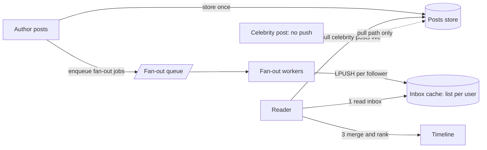

# Fan-Out

> [!abstract] In one sentence
> Fan-out is the one-to-many step — one post to a million timelines, one event to twenty subscribers, one request to a hundred shards — and the design decision is *when* the multiplication happens: at write time (cheap reads, expensive writes, the celebrity problem), at read time (cheap writes, expensive reads), or in the broker (copies versus shared logs).

> [!tip] Deeper treatment in your system-design vault
> `system-design/14 Case Studies/Twitter Timeline Design.md` — read it *after* you have written your own explanation below.

**Map:** [[Messaging & Event-Driven Systems MOC]] → [[HLD MOC]]

## Definition

**Fan-out** is the delivery of a single input to many outputs. **Fan-out on write** (push) materialises each recipient's view when the item is produced — a post is written into every follower's timeline inbox. **Fan-out on read** (pull) computes the view on demand — a timeline is assembled by fetching and merging the recent posts of everyone the reader follows. **Broker fan-out** copies or shares one message across subscriptions ([[Pub-Sub]]: SNS copies into SQS queues; [[Kafka]] shares one log across consumer groups). **Request fan-out** is the synchronous cousin — one request querying many backends — whose cost is [[Latency|tail latency]] rather than storage.

## Problem solved

Pure pull makes writes trivial and reads expensive: a home timeline for someone following 1,000 accounts needs 1,000 fetches and a merge on every refresh, at hundreds of thousands of refreshes per second. Pure push makes reads trivial and writes expensive: a post by an account with 30 million followers is 30 million inbox writes, which at a few thousand posts per second is a write rate no store absorbs calmly. Twitter's numbers as recounted in DDIA — about 4.6k tweets/s average, 12k at peak, 300k timeline reads/s, an average of 75 followers giving roughly 345k inbox writes/s, and a long tail of accounts with tens of millions of followers — are the canonical illustration that neither extreme works and the distribution of recipients decides the design.

## How it works

1. **Fan-out on write.** On publish: persist the item once, look up the recipient list, and enqueue fan-out jobs in batches (say 1,000 recipients per job) to a [[Message Queues|queue]]. Workers append the item id to each recipient's inbox — a [[Redis]] list or sorted set capped at a few hundred entries (`LPUSH` + `LTRIM`), or a wide row keyed by recipient. Reads fetch one inbox and hydrate the items. Optimisations: skip inactive recipients and rebuild their inbox on next login; dedup per `(item, recipient)` so a retried job is harmless ([[Idempotency]]).
2. **Fan-out on read.** On read: fetch the reader's source list, fetch each source's recent items in parallel (bounded concurrency), merge by time or rank, cache the merged page briefly. Cost is proportional to sources per reader and to read rate; latency is governed by the slowest of the parallel fetches.
3. **Hybrid.** Push for sources with few recipients, pull for the few with millions: the reader's inbox holds pushed items, and the read path merges in live fetches from the "celebrity" sources it follows. The threshold is a tunable (follower count, or a cost model of writes versus reads).
4. **Broker fan-out.** SNS → N SQS queues writes N copies, each subscriber isolated with its own backlog and DLQ; Kafka writes once and every consumer group reads the same bytes, so fan-out costs egress, not storage; RabbitMQ fanout exchanges bind one queue per subscriber; Redis Pub/Sub broadcasts in memory without persistence and drops slow subscribers. Application-level fan-out — a worker looping over recipients — needs per-recipient idempotency, partial-failure handling and per-channel rate limits ([[Design a Notification System]]).
5. **Request fan-out and the tail.** A request fanned out to 100 backends, each with a 1% chance of a one-second stall, stalls 63% of the time (`1 − 0.99^100`). Mitigations from [[The Tail at Scale]]: hedged requests after the p95, tied requests, returning partial results, and keeping fan-out width small.
6. **Cost shape.** Write fan-out: `posts/s × avg recipients` writes, storage per recipient, staleness near zero. Read fan-out: `reads/s × avg sources` fetches, no per-recipient storage, freshness guaranteed. Pick by which product is smaller and by how skewed the recipient distribution is ([[Hot Keys]]).

```text
# Redis inbox per recipient: push on write, capped; read is one call
LPUSH timeline:{userId} {postId}
LTRIM timeline:{userId} 0 799
LRANGE timeline:{userId} 0 49
```

## Architecture



## Use cases

- "Each user sees a personalised feed assembled from many sources" — social feeds, activity streams ([[Design a Social Feed]]).
- "One event must reach every device, channel or subscriber" — notifications to push, SMS, email and in-app; events to many services ([[Design a Notification System]], [[Pub-Sub]]).
- "A message to a group chat must reach every member, online or not" — per-member inboxes plus live broadcast ([[Design a Chat System]]).
- "A customer's event must be delivered to each of their registered webhook endpoints" — per-endpoint queues for isolation ([[Design a Webhook Delivery System]]).
- "Connected dashboards must all see every update" — WebSocket broadcast via Redis Pub/Sub, with a resync path ([[Real-Time Systems]]).

## Limitations

- Write fan-out breaks on skewed recipient counts — the celebrity problem — and wastes writes on recipients who never read.
- Read fan-out breaks on skewed source counts and on read-heavy traffic; latency is the slowest fetch.
- Hybrids add two code paths and a merge step whose ordering and ranking must agree.
- Broker copying multiplies storage and cost per subscriber; shared logs concentrate every group on the same partitions.
- Deletes and edits must be fanned out too, or inboxes show retracted items.

## Trade-offs

| You gain | You sacrifice |
|---|---|
| Write fan-out: millisecond reads from one inbox | Write amplification and storage per recipient; the celebrity problem |
| Read fan-out: zero write amplification, always fresh | Expensive, latency-sensitive reads with many parallel fetches |
| Hybrid: both paths scale | Two code paths, a threshold to tune, a merge to get right |
| Broker fan-out: subscriber isolation without application code | Per-copy cost (queues) or shared partition pressure (logs) |

## Failure modes

- **Celebrity post backlog** — one post enqueues millions of inbox writes; the fan-out queue's age climbs and every other author's posts are delayed behind it; you notice via fan-out queue age and "my post is not showing" reports; blast radius: all recipients, for minutes.
- **Partial fan-out** — a worker dies mid-batch; some followers see the post, others never do; notice only via user reports unless jobs are idempotent and retried per batch.
- **Inbox cap eviction** — a heavy reader follows many prolific accounts; items are trimmed before being read; notice via "missing posts" in a specific cohort.
- **Read fan-out tail stall** — one slow shard holds every merged timeline; notice via p99 tracking the worst shard ([[The Tail at Scale]]).
- **Delete not fanned out** — a retracted post lingers in millions of inboxes; notice via moderation escalations.

## Performance

Write fan-out gives reads in one round trip (sub-millisecond in Redis) and makes publish latency the fan-out time — seconds to minutes for large recipient lists, which is why it is asynchronous. Read fan-out gives publish in one write and reads of `sources × fetch latency` in parallel, typically tens of milliseconds for a few hundred sources on a cache, but with a tail dominated by the slowest fetch. Broker fan-out on Kafka is free at write time and costs egress per group; SNS → SQS costs one write per subscriber plus the hop's latency.

## Scalability

Write fan-out scales with `posts × recipients` and needs sharded inbox storage keyed by recipient; its limit is the maximum recipients per item, hence the hybrid. Read fan-out scales with `reads × sources` and needs a fast per-source index; its limit is the maximum sources per reader. At 10x users, both products grow — the distribution's skew decides which blows up first, and the hybrid threshold moves. Broker fan-out scales in subscribers linearly in cost (copies) or in shared partition load (logs); keep partition counts sized for the largest group ([[Topic Partitions]]).

## Operational impact

Monitor fan-out queue depth and age, inbox write rate, per-recipient inbox sizes, and read-path p99 by cohort (heavy followers versus light). Celebrity handling needs an explicit list or threshold that someone owns. Backfills (new feature, inbox corruption) are large batch jobs that must be rate-limited against the cache. For broker fan-out, each subscriber is an operational unit with its own alerts and DLQ. Edits and deletes need their own fan-out path with the same monitoring.

## Alternatives

- **Pure pull with aggressive caching** — wins for small graphs and read patterns that tolerate seconds of staleness.
- **Pure push with capped inboxes** — wins when recipient counts are bounded by design (group chat with member limits, per-tenant notification feeds).
- **Server-side ranking with candidate retrieval** — modern feeds often treat fan-out as candidate generation and let a ranking stage choose; wins when relevance matters more than recency.
- **Broker fan-out instead of application loops** — wins whenever the recipients are services, not users; the broker handles isolation and retries.

## Real-world examples

- Twitter's timeline architecture (Raffi Krikorian's "Timelines at Scale" talk and the DDIA account) is the reference hybrid: push into Redis-backed timelines for most authors, pull at read time for the highest-follower accounts.
- LinkedIn's FollowFeed write-up (2016) went the other way — fan-out on read over per-actor timelines with heavy caching — a reminder that graph shape and read patterns, not fashion, decide the direction.
- Google's "The Tail at Scale" paper formalised request fan-out's latency amplification and the hedged and tied request mitigations used across its services.
- In a stack like yours: notification fan-out to channels via SNS → per-channel SQS queues (isolation per channel, rate limits per provider), event fan-out to services via one MSK topic with a consumer group per service, operational dashboards broadcast over WebSockets through Redis Pub/Sub with a periodic full-state push, and per-customer webhook fan-out with one queue per endpoint. The move to Redis Streams keeps the Kafka-style shared-log fan-out (one stream, many groups) but makes memory the retention bound, so slow subscribers need explicit trimming policy.

## Practical exercise

1. Generate a follow graph for 100k users with a Zipf-distributed follower count (a few accounts with 50k followers); store posts in PostgreSQL and inboxes in Redis lists.
2. Implement fan-out on write with batched jobs on a queue; post from a normal user and from a top account; measure publish-to-visible latency for each and the fan-out queue's age.
3. Implement fan-out on read; load-test timeline reads with k6 at 1,000 rps; measure p50/p99 against the push version.
4. Add the hybrid: push below a 5k-follower threshold, pull above; measure both metrics again and find the threshold that minimises total cost at your read/write ratio.
5. Kill a fan-out worker mid-batch and prove that idempotent, per-batch retries leave no follower without the post.

## Related concepts

### Prerequisites
- [[Pub-Sub]] — broker-level one-to-many
- [[Message Queues]] — fan-out jobs run on queues
- [[Latency]] — tail amplification in request fan-out

### Related
- [[Hot Keys]] — celebrities and skewed distributions
- [[Redis]] — inbox lists and Pub/Sub broadcast
- [[Consumer Groups]] — shared-log fan-out to services
- [[Backpressure]] — fan-out queues under a celebrity post
- [[Cache-Aside]] — hydrating inbox ids into items
- [[Timeouts and Retries]] — hedged requests in request fan-out

### Builds on this
- [[Real-Time Systems]] — broadcast to connected clients
- [[Event-Driven Architecture]] — events fanned out to services
- [[Graceful Degradation]] — partial results under fan-out stalls

### Design problems where it applies
- [[Design a Social Feed]]
- [[Design a Notification System]]
- [[Design a Chat System]]
- [[Design a Webhook Delivery System]]

### Projects where it can be implemented
- [[Live Ops Dashboard]] — broadcast every event to all connected clients
- [[Personal Notification Hub]] — one alert to many channels
- [[Presence and Chat Service]] — room messages to every member, online or not

### Resources
- [[The Tail at Scale]] — request fan-out and latency amplification, with the mitigations
- [[System Design Interview (Alex Xu)]] — the news feed and notification chapters walk through push versus pull
- [[Designing Data-Intensive Applications]] — chapter 1's Twitter example sets up the whole trade-off

## Personal understanding

> [!question] Explain it without the source
> Write your own explanation here, from memory. Then compare it with the sections above and note what you missed.

### Mastery checklist
- [ ] I can explain it without the original resource
- [ ] I can describe the problem it solves
- [ ] I can compare it with its alternatives
- [ ] I can name its limitations and failure modes
- [ ] I can recognise when it is appropriate in a real system
- [ ] I have applied it in a system design
- [ ] I have validated my assumptions with an experiment or implementation

## Open questions

- [ ] How should the hybrid merge order pushed inbox items against pulled celebrity items when the two have different clocks and ranking signals?
- [ ] For a per-endpoint webhook fan-out, at what endpoint count does one SQS queue per endpoint become unmanageable, and what is the next isolation unit?
- [ ] With Redis Streams as the fan-out log for services, what trimming policy protects a slow consumer group without letting memory grow unbounded?
