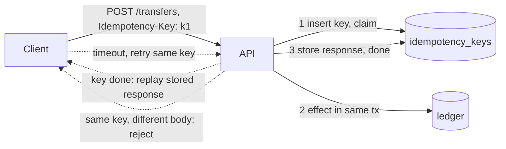

# Idempotency

> [!abstract] In one sentence
> Idempotency makes "do it again" harmless — by writing absolute state instead of deltas, gating on versions, or remembering a key per logical operation — and it is the only reason retries, at-least-once delivery and crash recovery can be safe at all.

> [!tip] Deeper treatment in your system-design vault
> `system-design/08 Distributed Systems Theory/Idempotency.md` — read it *after* you have written your own explanation below.

**Map:** [[Messaging & Event-Driven Systems MOC]] → [[HLD MOC]]

## Definition

An operation is **idempotent** when applying it N times leaves the system in the same state as applying it once: `SET balance = 100` is, `balance += 10` is not; HTTP `PUT` and `DELETE` are defined as idempotent by RFC 9110, `POST` is not. In messaging and APIs the term is extended to **idempotent processing**: a consumer or endpoint that, given a message or request it has already handled, produces no additional effect and (for requests) returns the original response. The mechanism that carries the identity of "the same operation" is an **idempotency key** — a client-chosen id per logical attempt — or the message's own id.

## Problem solved

A caller that times out cannot know whether the callee did the work ([[Timeouts and Retries]]). If it retries, a non-idempotent callee may charge the card twice; if it does not, the payment may never happen. Every [[At-Least-Once Delivery|at-least-once]] path has the same shape — the broker redelivers after a lost ack, a rebalance replays a suffix, a DLQ redrive replays last week. Before idempotency was designed in, teams either suppressed retries (and lost work) or reconciled duplicates by hand after the fact. Idempotency moves the burden to the one place that can actually decide "have I done this?" — the receiver — and makes retrying always the right call.

## How it works

Three strategies, strongest to weakest in generality:

1. **Natural idempotency.** Design the write so repetition is a no-op: absolute values rather than increments (`status = 'PAID'` not `attempts + 1`), upserts keyed by a natural id (`INSERT … ON CONFLICT (order_id) DO UPDATE`), conditional transitions (`UPDATE orders SET status='PAID' WHERE id=? AND status='PENDING'` affects 0 rows the second time), version gates (`WHERE version < :incoming`, see [[Ordering Guarantees]]), and unique constraints that reject duplicates at the database. No extra state, no window — prefer this whenever the domain allows.
2. **Idempotent consumer with a dedup record.** Insert `(consumer, message_id)` into a `processed_messages` table **in the same transaction** as the effect. A redelivery hits the unique index and the transaction is skipped; a crash before commit leaves neither the record nor the effect, so redelivery completes it. When the effect is not transactional with your store (a call to a partner API), the record is written first as a claim with a status, the call is made, and the record is finalised — accepting a small window of "claimed but not done" that a reaper resolves.
3. **Idempotency keys at an API boundary.** The client generates a key (UUID) per logical operation and sends it in a header; the server stores `key → (request fingerprint, status, response)` with a TTL. On a repeat: same key and same fingerprint → return the stored response without re-executing; same key, different payload → reject (Stripe returns an error rather than guess); key in progress → reject with a conflict or wait. The key row is the lock: insert it (unique) *before* doing the work so two concurrent retries cannot both execute. For multi-step operations, record **recovery points** so a retry resumes rather than restarts.

**Windows.** Dedup state must outlive the longest possible redelivery: visibility timeout × retries, DLQ retention plus redrive, replay horizons. A 24-hour key TTL (Stripe's choice) is fine for client retries and wrong for a two-week DLQ; natural idempotency has no window, which is why it is preferred.

```sql
CREATE TABLE idempotency_keys (
  key            text PRIMARY KEY,
  request_hash   text NOT NULL,
  status         text NOT NULL,        -- 'in_progress' | 'done'
  response_code  int,
  response_body  jsonb,
  created_at     timestamptz NOT NULL DEFAULT now()
);
-- claim: succeeds once; a concurrent retry gets a conflict and must wait or return 409
INSERT INTO idempotency_keys (key, request_hash, status) VALUES ($1, $2, 'in_progress');
```

## Architecture



## Use cases

- "The client may retry" — every money-moving or resource-creating endpoint: transfers, orders, provisioning ([[Design a Payment System]], [[Design a Digital Wallet and Ledger]]).
- "Messages can be redelivered" — every at-least-once consumer, every outbox relay, every webhook receiver ([[Design a Webhook Delivery System]]).
- "Jobs may run twice" — schedulers with leases, cron with overlapping runs, workflow activities ([[Design a Distributed Job Scheduler]]).
- "Exactly-once was requested" — effectively-once is at-least-once plus this ([[Exactly-Once Semantics]]).
- "Two instances might both think they are the leader" — idempotent writes plus fencing tokens limit the damage ([[Distributed Locks]]).

## Limitations

- Not every effect can be made idempotent: an SMS, a physical shipment, a third-party call without its own idempotency key. These need the claim-then-finalise pattern and a reconciliation path, not a promise.
- Dedup stores are state with a window, a write per operation and an outage mode (fail open → duplicates; fail closed → unavailability).
- The key must identify a *logical* operation; a client that generates a new key per retry defeats the scheme, and one that reuses a key for a different operation loses a request.
- Responses replayed from the store may be stale relative to later state; that is correct by contract and surprising to callers.
- Idempotency does not give ordering: two different operations retried out of order are still out of order.

## Trade-offs

| You gain | You sacrifice |
|---|---|
| Retries become always-safe, so clients and brokers can be aggressive | A key or dedup record per operation and the storage behind it |
| Crash recovery by simple re-execution | Design effort to find a natural key or absolute write per operation |
| Effectively-once effects on commodity brokers | A window to size, and a behaviour to define when the store is down |
| A clean API contract: "retry with the same key" | Replayed responses that may look stale |

## Failure modes

- **Key and effect not atomic** — the key is marked done before the effect commits (or vice versa); a crash leaves a done key with no effect, so the retry is swallowed and the work is lost; you notice via reconciliation gaps; blast radius: silent, per crash.
- **Concurrent retries without a claim** — two requests with the same key both pass a "seen?" check before either writes; both execute; notice via duplicate ledger rows with the same key; fix by inserting the key first under a unique constraint.
- **Dedup store outage** — a Redis-based `SET NX` check fails; a fail-open consumer processes duplicates during the outage, a fail-closed one stops; notice via dedup error rate; decide the policy per consumer before it happens.
- **Window too short** — a DLQ redrive after the key's TTL re-executes; notice during the redrive — the worst time; blast radius: every redriven message.
- **Key collision across tenants or operations** — keys scoped globally instead of per (tenant, operation) let one client's key shadow another's; notice via "wrong response for my request" reports.

## Performance

Natural idempotency is free. A dedup record is one indexed insert inside a transaction you already pay for — sub-millisecond when the index is cached — and the table grows at message rate, so it needs TTL-based pruning or partitioning by day. A Redis `SET NX EX` is one in-network round trip (well under a millisecond) but is not atomic with a database effect. Idempotency-key stores add a read and a write per request and the stored response body; keep bodies small or store a pointer.

## Scalability

Dedup state is rate × window: 2,000 messages/s with a 7-day window is ~1.2 billion keys, which argues for a database table partitioned by day, a Redis cluster with expiry, or — better — natural idempotency that stores nothing. Key stores partition cleanly by key hash. At 10x, the dedup store becomes a dependency with its own availability budget; define fail-open versus fail-closed per consumer and measure the store's p99.

## Operational impact

Mostly design-review discipline: every new consumer or write endpoint must answer "what is the key, where is the record, is it atomic with the effect, what is the window?". Operationally, monitor dedup hit rate (a spike means a retry storm or a replay), store size and pruning, and in-progress keys older than a threshold (stuck operations). Replays and redrives are safe exactly to the extent the window covers them — document it on the runbook. Debugging is easier than without: the key links every attempt of one operation across logs and traces.

## Alternatives

- **Suppress retries** — never correct for anything that matters; accepts loss to avoid duplicates ([[At-Most-Once Delivery]]).
- **Transactional effect-plus-position** — when the consumer's store is transactional, writing the offset or message id with the effect is idempotency without a separate key store ([[Exactly-Once Semantics]]).
- **Compensation / reconciliation** — detect duplicates after the fact and reverse them ([[Saga Pattern]]); wins when the effect is external and cannot be made idempotent.
- **Kafka transactions** — for Kafka-to-Kafka pipelines, atomic output-plus-offset makes consumer dedup unnecessary inside the boundary.

## Real-world examples

- Stripe's `Idempotency-Key` header stores results for 24 hours, replays the original response, and rejects reuse with a different payload; Brandur Leach's write-up on implementing it with recovery points in PostgreSQL is the standard reference.
- The IETF HTTP API working group's `Idempotency-Key` header draft standardises the same contract for all HTTP APIs.
- AWS APIs use client tokens (EC2 `RunInstances`, many others) for idempotent creation; SQS FIFO's `MessageDeduplicationId` and Kafka's idempotent producer are the same idea at the broker.
- In a stack like yours: a transfers endpoint whose idempotency key is stored on the ledger posting itself (natural key plus unique constraint), consumers of payment events with a `processed_events (consumer, event_id)` table written in the same PostgreSQL transaction as the balance update, and a [[Redis]] `SET NX` dedup only for consumers whose effect is not transactional — with an explicit fail-closed policy for anything touching money.

## Practical exercise

1. Build `POST /transfers` in Spring Boot or NestJS that debits one account and credits another in PostgreSQL. Fire 1,000 requests with k6 through Toxiproxy injecting 10% response drops, with the client retrying on timeout; count transfers versus intended transfers.
2. Add an `Idempotency-Key` header and the key table above with claim-first semantics; repeat and confirm exactly 1,000 transfers and identical replayed responses.
3. Fire the *same* key concurrently from 10 goroutines or workers; confirm one execution and nine conflicts or replays.
4. Move the key check to Redis `SET NX` outside the transaction; `kill -9` the service between the Redis write and the database commit; find the lost transfer.
5. Build an at-least-once consumer with a `processed_events` table; redeliver every message twice and prove the ledger balances still reconcile.

## Related concepts

### Prerequisites
- [[Timeouts and Retries]] — the uncertainty that makes this necessary
- [[Transactions]] — atomicity of key and effect
- [[At-Least-Once Delivery]] — the delivery contract this completes

### Related
- [[Duplicate Message Processing]] — the failure this prevents
- [[Exactly-Once Semantics]] — effectively-once is built on this
- [[Optimistic and Pessimistic Locking]] — version gates are optimistic concurrency
- [[Redis]] — `SET NX EX` as a dedup store and its limits
- [[TTL]] — the window on dedup state
- [[Designing APIs and Contracts]] — the idempotency key as part of the API

### Builds on this
- [[Outbox Pattern]] — relay duplicates are absorbed by idempotent consumers
- [[Saga Pattern]] — every step and compensation must be idempotent
- [[Retry Strategies]] — aggressive retries are only safe with idempotent targets
- [[Dead-Letter Queues]] — redrives rely on it
- [[Distributed Locks]] — fencing tokens make lock-protected writes idempotent under contention

### Design problems where it applies
- [[Design a Payment System]]
- [[Design a Digital Wallet and Ledger]]
- [[Design a Webhook Delivery System]]
- [[Design a Distributed Job Scheduler]]
- [[Design a Ticket Booking System]]

### Projects where it can be implemented
- [[Double-Entry Ledger Service]] — idempotent transfers keyed on the client's key
- [[Webhook Relay]] — per-delivery ids so receivers can dedup
- [[Durable Job Scheduler]] — idempotent job execution under overlapping leases

### Resources
- [[Stripe - Idempotency]] — the API-level contract and why it matters for payments
- [[Brandur - Implementing Idempotency Keys]] — the PostgreSQL implementation with recovery points
- [[AWS Builders Library - Idempotent APIs]] — client tokens and server-side dedup at AWS scale
- [[Temporal Docs on Durable Execution]] — idempotency expectations for retried activities

## Personal understanding

> [!question] Explain it without the source
> Write your own explanation here, from memory. Then compare it with the sections above and note what you missed.

### Mastery checklist
- [ ] I can explain it without the original resource
- [ ] I can describe the problem it solves
- [ ] I can compare it with its alternatives
- [ ] I can name its limitations and failure modes
- [ ] I can recognise when it is appropriate in a real system
- [ ] I have applied it in a system design
- [ ] I have validated my assumptions with an experiment or implementation

## Open questions

- [ ] For an effect that is a partner API call with its own idempotency key, should our key be forwarded as theirs, or mapped — and what happens when their window is shorter than ours?
- [ ] What is the correct response to a retried request whose key is still `in_progress` because the first attempt is slow — block, 409, or 202 with a status URL?
- [ ] Can a dedup table be safely pruned by time when the broker's maximum redelivery horizon is effectively unbounded (replays), or must the key be derived from the effect itself?
