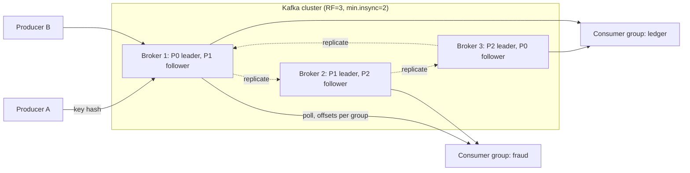

# Kafka

> [!abstract] In one sentence
> Kafka is a distributed commit log — ordered, partitioned, replicated and retained for days — that turns "message delivery" into "reading a file at an offset", which is what makes replay, fan-out to many consumers and very high throughput cheap.

> [!tip] Deeper treatment in your system-design vault
> `system-design/09 Messaging and Event-Driven/Kafka Architecture.md` — read it *after* you have written your own explanation below.

**Map:** [[Messaging & Event-Driven Systems MOC]] → [[HLD MOC]]

## Definition

Kafka is a distributed, append-only **log** split into **topics**, each topic into **partitions**, each partition replicated across **brokers** with one leader. Producers append records (key, value, headers, timestamp) to a partition; every record receives a monotonically increasing **offset**; consumers read by offset at their own pace, and the broker keeps records for a configured **retention** window regardless of whether anyone has read them. The broker tracks no per-message state — only which offset each [[Consumer Groups|consumer group]] has committed — which is the single design decision that most of its properties follow from.

## Problem solved

Before Kafka (LinkedIn, ~2010), moving data between systems meant point-to-point integrations — N producers × M consumers of ad-hoc pipes — plus traditional queues that **deleted** a message once consumed. That model has three structural problems: adding a second reader for the same data means copying the stream, nothing can be replayed after a bug (the data is gone), and brokers that track per-message acknowledgement state struggle past tens of thousands of messages per second. Kafka's answer was to make the broker a dumb, fast, replicated file: readers keep their own position, replay is a `seek`, and throughput is bounded by sequential disk and network, not by bookkeeping.

## How it works

1. **Partitioning.** The producer picks a partition: `murmur2(key) % partitions` when a key is present (so one key always lands on one partition), a sticky per-batch partition when the key is null. Order is guaranteed *within* a partition only ([[Topic Partitions]], [[Ordering Guarantees]]).
2. **Storage.** A partition is a directory of segment files (1 GiB by default) plus offset and time indexes. Writes are sequential appends into the OS page cache; reads to consumers use `sendfile` zero-copy when TLS is off. No random I/O on the hot path.
3. **Replication and ISR.** Each partition has a leader and followers (replication factor 3 is the norm). Followers fetch from the leader; those caught up within `replica.lag.time.max.ms` (30 s by default) form the **in-sync replica set (ISR)**. The **high watermark** is the highest offset replicated to the whole ISR; consumers can only read below it. With `acks=all` the leader acknowledges a write only once every ISR member has it, and `min.insync.replicas=2` refuses writes (`NotEnoughReplicas`) when fewer than two replicas are in sync — durability bought with availability ([[Replication]]). `unclean.leader.election.enable=false` (the default) prefers an offline partition over electing a stale follower and losing acknowledged data.
4. **Consumption.** Consumers **pull** with `poll()`, batching by `fetch.min.bytes`/`fetch.max.wait.ms`. A consumer group divides the partitions among its members; each member commits the next offset to read into the internal `__consumer_offsets` topic. **Lag** = log end offset − committed offset, the one metric that matters most.
5. **Retention.** `cleanup.policy=delete` removes segments older than `retention.ms` (7 days by default) or beyond `retention.bytes`; `cleanup.policy=compact` keeps the latest record per key and deletes tombstones (null values) after `delete.retention.ms` (24 h), which makes a compacted topic a changelog you can rebuild state from. Tiered storage (KIP-405) moves old segments to object storage.
6. **Producer path.** Records are batched per partition (`batch.size`, `linger.ms`), optionally compressed (lz4/zstd), and sent with a per-partition sequence number when `enable.idempotence=true` (the default since 3.0), so broker-side retries never duplicate a record ([[Exactly-Once Semantics]]).
7. **Control plane.** Metadata and controller election used to live in ZooKeeper; since 3.3 **KRaft** (a Raft quorum of controller nodes) is production-ready, and 4.0 removed ZooKeeper entirely.

```properties
# durable producer — the shape of nearly every payments-grade config
acks=all
enable.idempotence=true
max.in.flight.requests.per.connection=5
delivery.timeout.ms=120000
compression.type=lz4
# topic
replication.factor=3
min.insync.replicas=2
retention.ms=604800000
```

## Architecture



> [!example]- Excalidraw version — the same diagram as an editable canvas
> ![[Kafka.excalidraw]]
> [[Kafka.excalidraw|Open in Excalidraw]] — needs the Excalidraw plugin (see [[Plugins to Install]]).


## Use cases

- "Every service must be able to react to order/payment events, and new consumers will keep appearing" — the log's independent offsets give zero-copy [[Fan-Out]] to any number of groups.
- "We must be able to rebuild the read model / reindex search / re-score history" — replay from retention or from a compacted topic ([[CQRS]]).
- Ingestion at hundreds of thousands of events per second: clickstream, logs, metrics, [[Change Data Capture]] from Debezium.
- Stateful stream processing — windowed features for fraud scoring, joins between streams — where Kafka Streams or Flink read and write Kafka with transactional guarantees.
- A durable, ordered audit trail per aggregate (key = account id) that doubles as an [[Event Sourcing]] store.

## Limitations

- No per-message acknowledgement, retry or dead-lettering: one slow or poison record blocks its partition until you build [[Retry Strategies]] and [[Dead-Letter Queues]] yourself.
- Parallelism is capped by the partition count, and partitions cannot be reduced; choosing badly hurts for years.
- Operationally heavy — brokers, disks, controller quorum, partition reassignment, rebalances — even on MSK, which manages hosts but not your topics, partitions or consumers.
- No per-message TTL, priorities or scheduled delivery; no native request-reply.
- Overkill below a few thousand messages per second when nobody needs replay — SQS or Redis Streams is cheaper to run and reason about.

## Trade-offs

| You gain | You sacrifice |
|---|---|
| Retention and replay: the log is the source of truth for days | Disk cost, and "the data is still there" means bugs can be re-run too |
| Independent consumers at zero extra write cost | Per-message semantics (ack, retry, DLQ) that queues give you for free |
| Throughput bounded by sequential I/O and network, not bookkeeping | Latency measured in milliseconds, not microseconds, because of batching |
| Durability tunable per write (`acks`, ISR) | Availability: with `min.insync.replicas` the topic refuses writes during a bad failover |

## Failure modes

- **ISR shrinks below `min.insync.replicas`** (broker down, slow disk) → producers throw `NotEnoughReplicasException`; you notice via `UnderReplicatedPartitions` and `UnderMinIsrPartitionCount`; blast radius is every topic whose partitions have a replica on that broker — all writes to them fail until the ISR recovers.
- **Consumer lag runs away** (slow consumer, undersized group) → events are processed late and, once lag exceeds retention, **silently lost**; notice via `records-lag-max` and per-group lag; blast radius: every downstream decision made on stale data.
- **Rebalance loop** — processing a batch takes longer than `max.poll.interval.ms` (5 min default), the member is evicted, partitions move, the next member times out too; notice via rebalance rate and "member left group" logs; blast radius: the whole group stalls and duplicates.
- **Hot partition** from a skewed key (one large tenant) → one broker and one consumer saturate while the rest idle; notice via per-partition bytes-in skew ([[Hot Keys]]).
- **Disk fills** because retention was set by time only and a producer doubled its rate → the broker halts; notice via disk alerts; blast radius: every partition led by that broker goes through leader election.

## Performance

Sequential writes, page-cache reads and zero-copy let a single broker move hundreds of MB/s; the cluster scales roughly linearly with brokers until network or disk saturates. End-to-end latency is typically single-digit to low tens of milliseconds: `linger.ms` batching on the producer, one leader-to-follower round trip for `acks=all` (an MSK cluster spreads replicas across availability zones, so that round trip is a cross-AZ hop, order of a millisecond), and `fetch.max.wait.ms` on the consumer. Compression trades CPU for 3–5x less network and disk on JSON payloads. Records above the 1 MB default `message.max.bytes` should go through a claim check (pointer to S3), not the broker.

## Scalability

Add partitions for consumer parallelism, add brokers and reassign partitions for storage and network, and the write path never coordinates across partitions. Practical ceilings are partition counts: old ZooKeeper-era guidance was a few thousand partitions per broker and around 200k per cluster, mostly because leader election and metadata propagation were linear in partitions; KRaft raises the cluster ceiling substantially. At 10x load the questions are whether your key distribution still balances, whether retention still fits on disk, and whether consumer groups can grow (they cannot exceed the partition count without idling).

## Operational impact

High. On-call cares about under-replicated partitions, ISR shrink/expand churn, controller health, consumer lag per group, disk headroom versus retention, and rebalance frequency. Upgrades roll broker by broker and rely on replication to keep partitions available. Topic hygiene (partition counts, retention, compaction, ACLs) is a standing responsibility, as is a schema registry and the [[Event Schema Evolution]] rules around it. MSK removes host and ZooKeeper/KRaft management and gives CloudWatch metrics, but every consumer-side problem — lag, rebalances, poison records — is still yours. Cost is always-on broker-hours plus storage, unlike pay-per-request SQS.

## Alternatives

- **[[Message Queues]] (SQS, RabbitMQ)** — win when you need per-message acks, retries, DLQs and delayed delivery, with low ops and no replay requirement.
- **[[Redis]] Streams** — wins at small scale when Redis is already in the stack and the backlog fits in memory; same log-plus-consumer-group model, no partitions, no multi-day durability story.
- **Kinesis** — wins for AWS-native pipelines with modest scale and no cluster to run; pays in shard limits (1 MB/s in, 2 MB/s out per shard) and less control.
- **Pulsar** — wins for multi-tenancy, tiered storage from day one, and queue-plus-log semantics in one system; costs a second storage layer (BookKeeper) to operate.

## Real-world examples

- LinkedIn built Kafka and, by its own 2019 engineering write-up, runs it at trillions of messages per day across thousands of brokers.
- Netflix's Keystone pipeline and Uber's event platform both use Kafka as the ingestion backbone feeding stream processors and the data lake.
- Debezium's connectors and Kafka Connect make Kafka the de-facto sink for change data capture and the relay for the [[Outbox Pattern]].
- In a stack like yours: MSK with replication factor 3 across three AZs, `acks=all` and `min.insync.replicas=2` for anything that touches money, topics keyed by account or payment id so per-account order holds, consumers as EKS deployments whose replica count is tied to the partition count, and Avro or Protobuf schemas in a registry. The RabbitMQ → Kafka move usually buys replay and multi-consumer fan-out; the Kafka → SQS move usually buys per-message retry/DLQ semantics and lower ops — knowing *which* of those a given stream needs is the whole decision.

## Practical exercise

1. Run a three-broker KRaft cluster with Docker Compose; create `payments` with 3 partitions, replication factor 3, `min.insync.replicas=2`.
2. Produce 100k keyed records with `kafka-producer-perf-test` at `acks=1` and again at `acks=all`; record throughput and p99 latency for each.
3. Stop one broker: watch `kafka-topics --describe` show the ISR shrink, confirm producing still works. Stop a second broker: observe `NotEnoughReplicas` errors and reason about why.
4. Start two consumers in one group, then a fourth: observe one sitting idle. Reset the group's offsets to the beginning (`kafka-consumer-groups --reset-offsets --to-earliest`) and watch replay.
5. Set `retention.ms=60000` on a topic, produce, wait two minutes, and confirm the data is gone while the consumer group's committed offset is now out of range (what does `auto.offset.reset` do?).

## Related concepts

### Prerequisites
- [[Message Queues]] — the queue-versus-log distinction is the lens for everything here
- [[Replication]] — leader/follower replication and the ISR are a specific replication design
- [[Synchronous vs Asynchronous Communication]] — why you want a broker in the path at all

### Related
- [[Topic Partitions]] — the unit of parallelism, ordering and placement
- [[Consumer Groups]] — how partitions are shared and rebalanced
- [[Ordering Guarantees]] — what the partition promises and what breaks it
- [[Delivery Semantics]] — where producer retries and offset commits put duplicates and losses
- [[Backpressure]] — pull-based consumption and lag as the signal
- [[Pub-Sub]] — one topic, many groups

### Builds on this
- [[Exactly-Once Semantics]] — idempotent producer and transactions are Kafka features
- [[Change Data Capture]] — Debezium streams database logs into Kafka
- [[Event Sourcing]] — a keyed, compacted topic as the event store
- [[Outbox Pattern]] — the relay publishes into Kafka
- [[Search Indexing Pipelines]] — rebuilding an index from a replayable log

### Design problems where it applies
- [[Design a Message Queue]]
- [[Design a Real-Time Fraud Detection Pipeline]]
- [[Design a Logging System]]
- [[Design a Metrics and Monitoring System]]
- [[Design a Notification System]]

### Projects where it can be implemented
- [[Streaming Fraud Rules Engine]] — the stream processor's input and output
- [[Live Ops Dashboard]] — the event source feeding the WebSocket layer
- [[Chaos Lab]] — kill brokers and watch ISR shrink, leader election and producer errors

### Resources
- [[Kafka Design Documentation]] — the "Design" section explains every choice above from first principles
- [[Designing Data-Intensive Applications]] — chapter 11, log-based message brokers
- [[Confluent - Exactly-Once Semantics in Kafka]] — the producer and transaction internals
- [[Turning the Database Inside Out]] — the log as the centre of the architecture

## Personal understanding

> [!question] Explain it without the source
> Write your own explanation here, from memory. Then compare it with the sections above and note what you missed.

### Mastery checklist
- [ ] I can explain it without the original resource
- [ ] I can describe the problem it solves
- [ ] I can compare it with its alternatives
- [ ] I can name its limitations and failure modes
- [ ] I can recognise when it is appropriate in a real system
- [ ] I have applied it in a system design
- [ ] I have validated my assumptions with an experiment or implementation

## Open questions

- [ ] With `acks=all` and `min.insync.replicas=2` on a 3-AZ MSK cluster, what exactly is lost if an AZ fails *and* the surviving leader had not yet replicated the last batch — and does the producer learn about it?
- [ ] KIP-932 share groups ("queues for Kafka") promise per-record acks on a log: which of the queue-versus-log trade-offs above do they actually remove, and which remain?
- [ ] At what partition count per topic does the producer's per-partition batching start to hurt latency for a low-volume topic?
