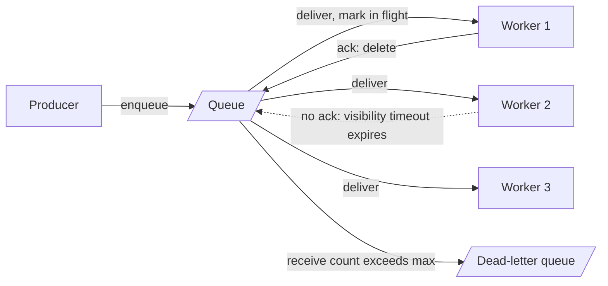

# Message Queues

> [!abstract] In one sentence
> A queue hands each message to exactly one of many competing consumers, tracks it until that consumer acknowledges, redelivers it if the ack never comes, and then forgets it — which buys per-message retry, dead-lettering and effortless worker scaling at the price of replay and multi-reader fan-out.

> [!tip] Deeper treatment in your system-design vault
> `system-design/09 Messaging and Event-Driven/Message Queues vs Event Logs.md` — read it *after* you have written your own explanation below.

**Map:** [[Messaging & Event-Driven Systems MOC]] → [[HLD MOC]]

## Definition

A **message queue** is a broker-managed buffer with **point-to-point** semantics: a producer enqueues a message, exactly one consumer in a pool of **competing consumers** receives it, and the broker holds per-message state (available, in flight, acknowledged, failed) until the consumer **acks** it, after which the message is deleted. If the ack does not arrive within a window — a **visibility timeout** in SQS, a channel close or `nack` in RabbitMQ, an idle pending entry in Redis Streams — the broker **redelivers**. Queues are the right tool when work must be done once by *someone*; logs ([[Kafka]]) are the right tool when data must be seen by *everyone* and possibly again.

## Problem solved

Without a queue, a request that needs slow or unreliable work — sending an email, calling a payment processor, resizing an image — either blocks the caller for the full duration or loses the work when the process dies. Running the work in a background thread trades blocking for loss; writing a `jobs` table and polling it works but couples every worker to the database and reinvents visibility timeouts badly. A queue gives three things in one component: a durable buffer so producers and consumers can fail independently ([[Synchronous vs Asynchronous Communication]]), a dispatch mechanism so N workers share the load without coordinating, and a redelivery contract so a crashed worker's message is not lost.

## How it works

1. **Enqueue.** The producer sends a message (body plus attributes). SQS persists it across several servers before returning; RabbitMQ with **publisher confirms** acks once the message is written to the queue's replicas (quorum queues use Raft); Redis Streams `XADD` returns an entry id after appending to the in-memory stream.
2. **Dispatch.** Consumers either **pull** (SQS `ReceiveMessage` with long polling up to 20 s, Redis `XREADGROUP … BLOCK`) or are **pushed to** (RabbitMQ `basic.consume`, throttled by `basic.qos` prefetch). Each message goes to one consumer; SQS standard queues sample a subset of servers per receive, which is why a single call may return fewer than the 10 requested.
3. **In flight.** The message becomes invisible to other consumers: SQS visibility timeout (30 s default, up to 12 h, extendable with `ChangeMessageVisibility`), RabbitMQ unacked-on-channel, Redis Streams **pending entries list (PEL)** per consumer group with an idle timer and a delivery counter.
4. **Ack or fail.** On success the consumer deletes/acks (`DeleteMessage`, `basic.ack`, `XACK`). On failure it either nacks explicitly or simply lets the timeout expire; the broker redelivers, incrementing a receive count (`ApproximateReceiveCount`, RabbitMQ `x-delivery-count` on quorum queues, PEL `delivery-count`). After `maxReceiveCount` / `x-delivery-limit` the message goes to a [[Dead-Letter Queues|dead-letter queue]].
5. **Ordering.** Standard queues give best-effort order only. SQS FIFO queues order strictly within a `MessageGroupId` and deliver one in-flight batch per group at a time; RabbitMQ preserves order within a queue for a single consumer but not across competing ones ([[Ordering Guarantees]]).
6. **Retention.** Unacked messages live until retention expires (SQS 4 days default, 14 max) — a queue is a buffer, not an archive.

```ts
// SQS competing consumer: long-poll, process, delete, heartbeat long jobs
for (;;) {
  const { Messages = [] } = await sqs.receiveMessage({
    QueueUrl, MaxNumberOfMessages: 10, WaitTimeSeconds: 20, VisibilityTimeout: 60,
  });
  await Promise.all(Messages.map(async (m) => {
    const heartbeat = setInterval(() => sqs.changeMessageVisibility(
      { QueueUrl, ReceiptHandle: m.ReceiptHandle!, VisibilityTimeout: 60 }), 40_000);
    try { await handle(JSON.parse(m.Body!)); await sqs.deleteMessage({ QueueUrl, ReceiptHandle: m.ReceiptHandle! }); }
    finally { clearInterval(heartbeat); }   // on throw: no delete, SQS redelivers after the timeout
  }));
}
```

## Architecture



> [!example]- Excalidraw version — the same diagram as an editable canvas
> ![[Message Queues.excalidraw]]
> [[Message Queues.excalidraw|Open in Excalidraw]] — needs the Excalidraw plugin (see [[Plugins to Install]]).


## Use cases

- "This request kicks off work the user does not need to wait for" — emails, webhooks, PDF generation, image transcoding.
- "Work must be done once, by any available worker, and survive worker crashes" — background jobs, order fulfilment steps, scheduled tasks ([[Design a Distributed Job Scheduler]]).
- "Traffic is spiky and the downstream (a payment provider, a legacy system) has a fixed rate" — the queue absorbs bursts and the consumer drains at the downstream's pace ([[Backpressure]]).
- "Each message needs its own retry schedule and a place to go when it keeps failing" — per-message state is exactly what queues track and logs do not.
- "We need a delayed message" — SQS delay queues (up to 15 min), RabbitMQ TTL + dead-letter exchange chains, BullMQ delayed jobs.

## Limitations

- **No replay.** Once acked, the message is gone; a bug that mis-processed yesterday's payments cannot be fixed by re-reading the queue. Keep the source of truth elsewhere ([[Outbox Pattern]]).
- **One reader per message.** A second team that wants the same events needs its own queue fed by [[Pub-Sub]] fan-out (SNS → SQS, exchange → bindings) — the copy is explicit.
- **Ordering is weak or expensive.** SQS FIFO costs throughput (300 messages/s per API action without batching, far more with batching and high-throughput mode) and serialises each message group.
- **Not a database.** Retention of days, no queries, no indexes; a backlog older than retention is lost silently.
- **Broker-side state is the bottleneck** at very high rates: the broker must persist and track every message, which is why queues top out well below a log's throughput.

## Trade-offs

| You gain | You sacrifice |
|---|---|
| Per-message ack, redelivery, retry count and DLQ for free | Replay and multi-consumer fan-out without copying |
| Trivial horizontal scaling: add a worker, it competes | Ordering across workers; strict order needs FIFO/message groups and costs parallelism |
| Producer/consumer decoupling in time and availability | Visibility into *what happened* to a message once deleted |
| Low operational burden (SQS is serverless; RabbitMQ is a small cluster) | Throughput ceiling and per-request cost at very high volume |

## Failure modes

- **Visibility timeout shorter than processing time** → the same message is handed to a second worker while the first is still working; both complete; you notice as duplicate side effects and `ApproximateReceiveCount` > 1 on successful messages; blast radius is every non-idempotent consumer ([[Duplicate Message Processing]]).
- **Backlog grows past retention** (consumer down for a long weekend on a 4-day queue) → messages age out and vanish; notice via `ApproximateAgeOfOldestMessage` climbing toward retention; blast radius: silently dropped work.
- **Poison message** that throws on every attempt → with no DLQ it is redelivered forever and starves one worker slot each time; notice via a message with a huge receive count; with a DLQ, the message is quarantined but someone must look ([[Dead-Letter Queues]]).
- **RabbitMQ memory alarm** — the broker's memory high watermark trips and it **blocks all publishers** on the cluster, so a slow consumer on one queue stalls unrelated producers; notice via `connection.blocked` notifications and the management UI.
- **Lost acks across a network blip** → the broker never sees the ack, redelivers; harmless only if consumers are idempotent.

## Performance

Enqueue and receive are small network round trips: single-digit milliseconds in-region for SQS, sub-millisecond for RabbitMQ or Redis on the same network. Long polling removes the empty-receive tax; batching (10 per SQS call, prefetch in RabbitMQ) amortises round trips. SQS standard scales to "nearly unlimited" throughput by sharding internally; RabbitMQ quorum queues handle tens of thousands of messages per second per queue before disk and Raft replication dominate; Redis Streams is bounded by a single core per stream key and by memory. Message size limits force a claim-check pattern (store the payload in S3, enqueue the pointer) for anything large — SQS historically capped bodies at 256 KB and raised the ceiling to 1 MB in 2025.

## Scalability

Consumers scale linearly until the broker's per-queue throughput or the downstream dependency saturates; SQS's in-flight limit (roughly 120,000 messages for standard queues, 20,000 for FIFO) caps how many workers can hold messages at once. Partition the work across several queues when one becomes hot, or by tenant for isolation ([[Bulkheads]]). At 10x, SQS mostly just bills more; RabbitMQ needs more nodes and careful queue placement; Redis Streams needs you to shard across stream keys yourself.

## Operational impact

Low for SQS: nothing to patch, CloudWatch gives age-of-oldest, visible and not-visible counts, and cost is per million requests (order of $0.40 for standard, slightly more for FIFO). Moderate for RabbitMQ: a cluster to upgrade, quorum queue replicas to place, memory and disk alarms to watch, and the deprecation of classic mirrored queues to migrate from. Debugging is per message — you can inspect a stuck one — but you cannot answer "what did we process yesterday?" from the broker; keep that in your own tables or an [[Audit Logs|audit log]].

## Alternatives

- **[[Kafka]] (log)** — wins when several consumers need the same stream, when replay matters, or above tens of thousands of messages per second; loses on per-message retry/DLQ ergonomics.
- **[[Redis]] Streams** — wins when Redis is already there and the backlog is small; consumer groups, PEL and `XAUTOCLAIM` reproduce queue semantics closely, but durability is Redis's (async replication, AOF fsync policy).
- **Database table as a queue** (`SELECT … FOR UPDATE SKIP LOCKED`) — wins when the work must be transactional with your own data and volume is modest; loses on polling cost and operational coupling.
- **Durable workflow engines (Temporal)** — win when the "message" is really a multi-step process with timers and compensation ([[Saga Pattern]]).

## Real-world examples

- AWS's own reference pattern is SNS → SQS → Lambda/ECS consumers with redrive policies — essentially every serverless backend uses it.
- RabbitMQ underpins Celery (Python) and MassTransit (.NET) job systems; BullMQ does the same for Node.js on Redis lists and sorted sets.
- Shopify runs its background jobs on Redis-backed Sidekiq queues and has written publicly about making every job idempotent and interruptible (its open-source job-iteration library) so that redelivery and restarts are safe.
- In a stack like yours: the Kafka → SQS move typically happened where teams wanted per-message retries and DLQs without building retry topics; the planned move to Redis Streams keeps the competing-consumer model (`XREADGROUP`/`XACK`/PEL) but makes *you* responsible for claiming stale entries with `XAUTOCLAIM`, capping the stream with `MAXLEN`, and accepting Redis's durability — which for a ledger means the queue cannot be the system of record.

## Practical exercise

1. Start LocalStack (SQS) or RabbitMQ and Redis with Docker Compose.
2. Write a NestJS or Spring Boot worker that processes a message in 5 s while the visibility timeout is 2 s; run two workers and count how many times each message is processed.
3. Fix it two ways: extend the timeout with a heartbeat, then make the handler idempotent with a `processed_messages` table — compare the failure behaviour when a worker is `kill -9`'d mid-message.
4. Add a redrive policy with `maxReceiveCount=3` and a poison message; confirm it lands in the DLQ and measure how long the main queue was slowed.
5. Repeat step 2 on Redis Streams with `XREADGROUP`; use `XPENDING` to see the stuck entry and `XAUTOCLAIM` to reassign it.

## Related concepts

### Prerequisites
- [[Synchronous vs Asynchronous Communication]] — why a buffer belongs between caller and worker
- [[Throughput]] — queues exist to decouple producer and consumer rates
- [[Latency]] — what deferring work does and does not improve

### Related
- [[Kafka]] — the log, the other half of the most important distinction in messaging
- [[Pub-Sub]] — how one event feeds many queues
- [[At-Least-Once Delivery]] — the guarantee that ack-after-process gives
- [[Dead-Letter Queues]] — where repeatedly failing messages go
- [[Retry Strategies]] — how redelivery should be paced
- [[Redis]] — Streams as a queue, and BullMQ

### Builds on this
- [[Consumer Groups]] — competing consumers formalised for logs and streams
- [[Backpressure]] — queue depth and age as the flow-control signal
- [[Outbox Pattern]] — reliably getting the message *into* the queue
- [[Event-Driven Architecture]] — queues as the plumbing between services
- [[Fan-Out]] — one event copied into many queues

### Design problems where it applies
- [[Design a Message Queue]]
- [[Design a Notification System]]
- [[Design a Webhook Delivery System]]
- [[Design a Distributed Job Scheduler]]
- [[Design a Video Streaming Service]]

### Projects where it can be implemented
- [[Webhook Relay]] — a queue per endpoint with visibility-timeout retries
- [[Personal Notification Hub]] — digest jobs on a queue with dedup
- [[Durable Job Scheduler]] — compare a database-backed queue with a broker-backed one

### Resources
- [[Redis Streams Docs]] — consumer groups, PEL, XAUTOCLAIM: queue semantics on Redis
- [[BullMQ]] — a production job queue's design on Redis, including retries and delays
- [[Designing Data-Intensive Applications]] — chapter 11 contrasts message brokers with log-based ones
- [[Kafka Design Documentation]] — read the "push vs pull" and consumer position sections for the other side

## Personal understanding

> [!question] Explain it without the source
> Write your own explanation here, from memory. Then compare it with the sections above and note what you missed.

### Mastery checklist
- [ ] I can explain it without the original resource
- [ ] I can describe the problem it solves
- [ ] I can compare it with its alternatives
- [ ] I can name its limitations and failure modes
- [ ] I can recognise when it is appropriate in a real system
- [ ] I have applied it in a system design
- [ ] I have validated my assumptions with an experiment or implementation

## Open questions

- [ ] SQS FIFO claims "exactly-once processing" — what precisely is deduplicated, over what window, and what still reaches a consumer twice?
- [ ] When a Redis primary fails over with AOF `appendfsync everysec`, how many acknowledged `XADD`s can be lost, and how does that compare with RabbitMQ quorum queues?
- [ ] For a job that legitimately takes an hour, is a 12-hour visibility timeout better or worse than a 60 s timeout with a heartbeat?
