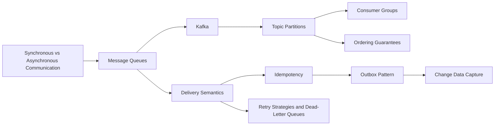

# Messaging & Event-Driven Systems

> [!abstract] Your deepest area at work: queues, logs, delivery guarantees and the patterns that make async safe.
> Start with the queue-vs-log distinction, then delivery semantics and idempotency (the two ideas that prevent double charges), then Kafka mechanics, then the reliability patterns (outbox, DLQ, backpressure, retries).

**Map:** [[HLD MOC]] → this · [[Start Here]] for the reading plan · [[Engineering Dashboard]] for progress

## Start with these

[[Message Queues]] → [[Kafka]] → [[Delivery Semantics]] → [[At-Least-Once Delivery]] → [[Idempotency]] → [[Outbox Pattern]] → [[Consumer Groups]] → [[Dead-Letter Queues]]

## How the ideas connect



## Concepts

### Core — know these cold for SDE-2

- [[Kafka]] — Kafka is a partitioned, replicated, append-only log that retains records by time rather than by consumption
- [[Message Queues]] — A message queue is a point-to-point buffer where competing consumers take messages, acknowledge them after processing
- [[Pub-Sub]] — Publish-subscribe decouples a producer from an unknown number of independent subscribers by routing one published event through a topic to every subscription, each…
- [[Consumer Groups]] — A consumer group is a set of processes that share the partitions of a topic
- [[Topic Partitions]] — A partition is the unit of ordering, parallelism and placement in a log
- [[Ordering Guarantees]] — Messaging systems promise order only per key within one partition or message group, never globally
- [[Delivery Semantics]] — Delivery semantics describe whether a message can be lost, duplicated or neither on each hop
- [[At-Least-Once Delivery]] — At-least-once delivery retries until acknowledged and acknowledges only after the work is durable
- [[Exactly-Once Semantics]] — Exactly-once delivery over an unreliable network is impossible, but exactly-once effects are achievable
- [[Idempotency]] — An idempotent operation produces the same final state whether it runs once or many times
- [[Retry Strategies]] — A retry strategy decides which failures to retry, how many times, how far apart, where the message waits meanwhile and what happens when attempts run out
- [[Dead-Letter Queues]] — A dead-letter queue quarantines messages that keep failing so they stop blocking healthy work and are preserved with their failure context for triage and redrive
- [[Backpressure]] — Backpressure is how a slow stage tells a fast one to slow down
- [[Outbox Pattern]] — Write the event into an outbox table inside the same database transaction as the state change, then relay it to the broker
- [[Synchronous vs Asynchronous Communication]] — Synchronous calls couple the caller to the callee's availability and latency in exchange for an immediate answer

### Important — read once, revisit when a design needs it

- [[At-Most-Once Delivery]] — At-most-once delivery acknowledges or forgets a message before its effect is secured
- [[Event Schemas]] — An event schema is the published contract of an event — its meaning as a fact or command, the envelope of ids, timestamps and versions every consumer relies on, the…
- [[Event Schema Evolution]] — Event schema evolution is changing an event's contract while old events are still retained and old consumers still run
- [[Change Data Capture]] — Change data capture turns a database's own replication log into an ordered stream of row-level change events
- [[Fan-Out]] — Fan-out is delivering one event or item to many recipients — precomputed at write time, assembled at read time, or copied by a broker — and the choice sets the cost shape

### Also part of this area

Event schemas evolve like database schemas: [[Schema Evolution]]

## Where it shows up

**Design problems that lean on this category:** [[Design a Notification System]], [[Design a Webhook Delivery System]], [[Design a Payment System]], [[Design a Message Queue]], [[Design a Real-Time Fraud Detection Pipeline]], [[Design a Distributed Job Scheduler]], [[Design a Chat System]], [[Design a Logging System]]

**Projects that exercise it:** [[Webhook Relay]], [[Double-Entry Ledger Service]], [[Streaming Fraud Rules Engine]], [[Live Ops Dashboard]], [[Durable Job Scheduler]], [[Chaos Lab]]

## Progress in this category

Status and confidence come from each note's properties — update them in the note, the table updates itself (native Bases, no plugin).

```base
filters:
  and:
    - file.hasTag("concept")
    - category == "Messaging & Event-Driven Systems"
formulas:
  rank: 'if(priority == "high", 1, if(priority == "medium", 2, 3))'
properties:
  file.name:
    displayName: Concept
  formula.rank:
    displayName: "#"
views:
  - type: table
    name: Tracker
    order:
      - file.name
      - priority
      - status
      - confidence
      - last_reviewed
      - next_review
    sort:
      - property: formula.rank
        direction: ASC
      - property: file.name
        direction: ASC
    summaries:
      confidence: Average
```
