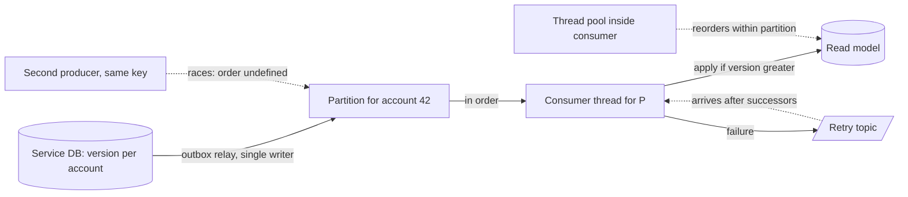

# Ordering Guarantees

> [!abstract] In one sentence
> Order is a property you can only afford per key — one partition, one producer, one consumer thread at a time — and even that is quietly broken by retries, thread pools, rebalances and repartitioning, so a consumer that needs order must verify it with sequence numbers rather than trust the broker.

> [!tip] Deeper treatment in your system-design vault
> `system-design/09 Messaging and Event-Driven/Message Ordering.md` — read it *after* you have written your own explanation below.

**Map:** [[Messaging & Event-Driven Systems MOC]] → [[HLD MOC]]

## Definition

An **ordering guarantee** states which pairs of messages a consumer will observe in the same relative order the producer sent them. **Global (total) order** covers every message in a topic; **per-key (partial) order** covers only messages sharing a key — in [[Kafka]] a partition, in SQS FIFO a `MessageGroupId`, in [[Redis]] Streams a single stream read by one consumer. **No guarantee** (SQS standard, Redis Pub/Sub across reconnects, any parallel consumer) means messages may arrive in any order. Ordering is distinct from [[Delivery Semantics]]: a system can deliver every message exactly once and still reorder, or preserve order and duplicate.

## Problem solved

Many state changes are only meaningful in sequence: `AccountCredited` then `AccountDebited` is a valid overdraft check, the reverse is a rejected payment; `OrderCancelled` applied before `OrderPlaced` leaves an order alive. A total order over all events would make every consumer trivially correct — and would require a single writer and a single reader, which is a throughput ceiling of one machine and a coordination problem Lamport showed has no free solution. The practical resolution is to identify the *entity* whose history must be sequential, order only within it, and make consumers tolerate everything else. Ordering guarantees are the vocabulary for stating exactly how much order you bought and where it stops.

## How it works

1. **The producer side.** Order within a partition is the order the leader appended. A single producer with `enable.idempotence=true` keeps up to five in-flight batches ordered via sequence numbers; without idempotence, a failed batch retried after a later successful one reorders — the first classic break. Two producer instances writing the same key race on the network, so "one key, one writer" is the real rule: derive the sequence from the database transaction (a `version` column, or the [[Outbox Pattern]] row id) and let a single relay publish in that order.
2. **The broker.** Kafka preserves per-partition order; SQS FIFO per message group (and hands out only one in-flight batch per group); RabbitMQ per queue for a single consumer, but a requeued message can be consumed by another consumer first; Redis Streams by entry id, with `XREADGROUP` delivering in order to *whichever* consumer asks.
3. **The consumer side.** One partition per consumer gives order only if processing is sequential; a thread pool, async handlers or batched database writes reorder within the partition. Key-based executors (hash the key to a worker thread) keep order per key while using many threads — the Confluent Parallel Consumer does exactly this.
4. **Retries.** Retrying a failed message later — retry topics, SQS visibility expiry, Redis `XAUTOCLAIM` — moves it *after* its successors. Keeping order means retrying in place and blocking the key (or partition); giving up order means the consumer must cope ([[Retry Strategies]]).
5. **Rebalances and redelivery** replay a suffix of the partition; they duplicate rather than reorder, which [[Idempotency]] handles.
6. **Repartitioning** changes `hash(key) % N`, so a key's new records land in a different partition than its old ones and two consumers process them concurrently ([[Topic Partitions]]).
7. **Repair.** Carry a per-key monotonic **sequence number** in every event. The consumer either (a) rejects stale updates — `UPDATE … WHERE version < :incoming` — so order no longer matters for state, (b) keeps a small **reordering buffer** per key, applying events only when the next expected sequence arrives and alarming on a gap after a timeout, or (c) uses versioned, event-carried state so each event is self-sufficient.

```sql
-- version-gated apply: an out-of-order or duplicate event becomes a no-op
UPDATE account_projection
SET balance_minor = :balance, version = :version, updated_at = now()
WHERE account_id = :id AND version < :version;
```

## Architecture



> [!example]- Excalidraw version — the same diagram as an editable canvas
> ![[Ordering Guarantees.excalidraw]]
> [[Ordering Guarantees.excalidraw|Open in Excalidraw]] — needs the Excalidraw plugin (see [[Plugins to Install]]).


## Use cases

- "Balance, status or inventory must never go backwards" — key by the entity, carry versions, gate on version.
- "Replaying history must reproduce the same state" — [[Event Sourcing]] requires strict per-aggregate order and a sequence per aggregate.
- "Chat messages in a room must appear in send order" — per-room key, single consumer per room, sequence numbers for client-side gap detection ([[Design a Chat System]]).
- "CDC must apply row changes in commit order" — one partition per table key or a serialised apply path ([[Change Data Capture]]).
- "Saga steps must not run the compensation before the action" — per-saga key plus explicit state machine, not broker order ([[Saga Pattern]]).

## Limitations

- Per-key order says nothing about causality *across* keys: `PaymentCaptured` for order 7 can reach a consumer before `OrderPlaced` for order 7 if they travel through different topics; the consumer must park and retry.
- Order plus retries plus throughput is a pick-two: in-place retries hold the partition; retry topics drop order; parallelism drops order unless keyed.
- Strict order costs money — SQS FIFO throughput limits, a single consumer per partition, head-of-line blocking on every slow message.
- Timestamps are not an order: producer clocks drift, and broker `CreateTime` is set by the producer ([[Clocks and Time]]).
- Global order across partitions requires either one partition or an external sequencer, both of which are single points of throughput.

## Trade-offs

| You gain | You sacrifice |
|---|---|
| Simple consumer logic when per-key order holds | Throughput: one key, one in-flight message at a time |
| Deterministic replay for event-sourced state | Freedom to retry out of band; failures block the key |
| Fewer "impossible state" bugs | Parallelism inside a partition without keyed executors |
| Version-gated writes make reordering harmless | Events must carry a version; the producer owns a sequence |

## Failure modes

- **Interleaved producers** — two pods both publish `AccountUpdated` for the same account from different request paths; the read model flips between stale and fresh; you notice as non-monotonic versions in the consumer's logs; blast radius: wrong balances until the next full event.
- **Retry topic reversal** — a transient failure sends `OrderPlaced` to the retry topic, `OrderCancelled` is applied first, then `OrderPlaced` resurrects the order; notice via state-machine violations; blast radius: one entity per occurrence, but silent.
- **Partition increase** on a keyed topic → for a window of minutes to hours, a key's events are processed by two consumers in parallel; notice later via inconsistent projections.
- **Consumer thread pool** introduced for throughput → per-partition order silently gone; notice only if events carry sequence numbers and the consumer checks them.
- **SQS FIFO head-of-line** — a poison message in a message group blocks every later message in that group until it is deleted or dead-lettered; notice via `ApproximateAgeOfOldestMessage` on an otherwise healthy queue.

## Performance

Order is paid for in concurrency. A strictly ordered key processes one message at a time, so its throughput is `1 / processing latency` — 20 messages/s at 50 ms each — regardless of broker speed; aggregate throughput then depends on how many keys are active concurrently. Keyed executors recover most parallelism when keys are many and traffic is spread. Reordering buffers add memory per key and latency equal to the wait for the missing sequence, bounded by a timeout. Version-gated writes are the cheapest option: one comparison per write and no buffering, at the cost of needing fat enough events to apply out of order.

## Scalability

Per-key ordering scales with the number of keys, not the number of messages: a million accounts spread over 100 partitions scale fine; one account doing 10,000 updates per second does not, and no partition count helps ([[Hot Keys]]). At 10x, check whether the key is still well distributed and whether any single key's rate exceeds what one sequential consumer can handle; if so, redefine the ordering boundary (per account-day, per sub-ledger) or move to version-based reconciliation.

## Operational impact

Ordering bugs are the worst kind: rare, silent and only visible as wrong data. Mitigate operationally by making every event carry `(key, sequence)` and having consumers emit a metric for "out-of-order" and "gap" counts; alert on non-zero. Document, per topic, the ordering key and the guarantee, and treat partition increases and consumer parallelism changes as ordering-affecting changes needing review. Replays and DLQ redrives must be done per key in sequence order, which most tooling does not do by default.

## Alternatives

- **No ordering, commutative operations** — wins whenever operations can be made order-independent (sets, counters with idempotent increments, CRDT-style merges); the cheapest and most scalable option.
- **Version-gated last-writer-wins** — wins when the latest state is all that matters; loses history and intermediate transitions.
- **Single global sequencer** (one partition, a database sequence, a log with a single writer) — wins for low-volume, high-stakes streams such as ledger postings per shard.
- **Causal metadata** (causation id, vector clocks) — wins when consumers can defer events whose causes have not arrived; costs complexity and bounded buffering ([[Consistency Models]]).

## Real-world examples

- Kafka's own documentation states the guarantee precisely: order within a partition for a single producer, with the idempotent producer preserving it across retries up to five in-flight requests.
- SQS FIFO's message-group design is AWS's explicit answer to "order per entity without global order", with the documented consequence that a stuck message blocks its group.
- Event-sourced systems (Axon, EventStoreDB) expose per-aggregate sequence numbers and reject writes at the wrong expected version — ordering enforced at the write side, not trusted from transport.
- In a stack like yours: ledger postings keyed by account with a per-account `version` from the database, published through an outbox relay (one writer), consumed by a projector that gates on version and alarms on gaps. During the Kafka → SQS period the same events over a standard queue needed the version gate to survive best-effort ordering; on Redis Streams, a group with several consumers reorders across consumers, so either shard streams by account or rely on the version gate.

## Practical exercise

1. Produce events for 100 keys, each with a strictly increasing `seq`, into a 3-partition topic from two producer instances in parallel; the consumer logs any `seq` that is not `last + 1` per key — count the violations.
2. Fix the producer side (single writer via an outbox table) and repeat; violations should drop to zero.
3. Add a 4-thread pool inside the consumer; watch violations return. Replace it with a keyed executor (hash key → thread) and confirm order per key with 4x throughput.
4. Introduce a retry topic for a simulated transient failure on every 50th message; measure how many successors overtake it.
5. Implement the version-gated `UPDATE` and show that the final state is correct in every configuration above, even where the sequence check fired.

## Related concepts

### Prerequisites
- [[Topic Partitions]] — the boundary within which order is promised
- [[Message Queues]] — FIFO and standard queues, visibility and requeue
- [[Delivery Semantics]] — ordering is independent of duplicates and loss

### Related
- [[Consumer Groups]] — single ownership keeps order; rebalances replay
- [[Retry Strategies]] — the main thing that trades order away
- [[Idempotency]] — handles the duplicates that rebalances cause
- [[Clocks and Time]] — why timestamps are not sequence numbers
- [[Consistency Models]] — causal and sequential consistency as the formal vocabulary
- [[Dead-Letter Queues]] — redrive must respect order per key

### Builds on this
- [[Event Sourcing]] — strict per-aggregate order is the storage contract
- [[Exactly-Once Semantics]] — sequence numbers in the idempotent producer
- [[Saga Pattern]] — step order enforced by state, not transport
- [[CQRS]] — projections gated by version
- [[Change Data Capture]] — commit order per key through the pipeline

### Design problems where it applies
- [[Design a Chat System]]
- [[Design a Digital Wallet and Ledger]]
- [[Design a Payment System]]
- [[Design a Collaborative Document Editor]]
- [[Design a Message Queue]]

### Projects where it can be implemented
- [[Live Ops Dashboard]] — sequence numbers for client-side gap detection
- [[Double-Entry Ledger Service]] — per-account posting order with version gates
- [[Presence and Chat Service]] — per-room message order across devices

### Resources
- [[Designing Data-Intensive Applications]] — chapter 9 on ordering guarantees, chapter 11 on log ordering
- [[Kafka Design Documentation]] — the "Guarantees" section and the producer ordering semantics
- [[Kleppmann Distributed Systems Lecture Notes]] — happens-before, logical clocks and broadcast ordering

## Personal understanding

> [!question] Explain it without the source
> Write your own explanation here, from memory. Then compare it with the sections above and note what you missed.

### Mastery checklist
- [ ] I can explain it without the original resource
- [ ] I can describe the problem it solves
- [ ] I can compare it with its alternatives
- [ ] I can name its limitations and failure modes
- [ ] I can recognise when it is appropriate in a real system
- [ ] I have applied it in a system design
- [ ] I have validated my assumptions with an experiment or implementation

## Open questions

- [ ] If an outbox relay runs as two instances with `SKIP LOCKED`, can two rows for the same aggregate be published out of order, and what is the cheapest fix that keeps relay redundancy?
- [ ] For cross-topic causality (order placed in one topic, payment captured in another), is a consumer-side park-and-retry buffer better than merging both into one keyed topic?
- [ ] How long should a reordering buffer wait for a missing sequence before declaring a gap, given rebalances can delay a partition by minutes?
