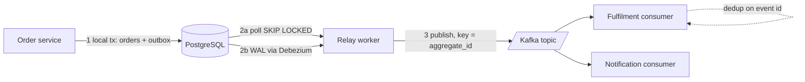

# Outbox Pattern

> [!abstract] In one sentence
> The outbox pattern makes "update my database **and** publish an event" atomic by writing the event to a table in the same transaction, and letting a separate relay publish it — turning an impossible dual write into one commit plus an at-least-once delivery.

> [!tip] Deeper treatment in your system-design vault
> `system-design/09 Messaging and Event-Driven/The Outbox Pattern.md` — read it *after* you have written your own explanation below.

**Map:** [[Messaging & Event-Driven Systems MOC]] → [[HLD MOC]]

## Definition

A **transactional outbox** is a database table that stores messages to be published. A service that changes state writes both the state change and the corresponding message row inside **one local transaction**. A separate **relay** (a poller or a [[Change Data Capture]] connector) reads committed outbox rows and publishes them to the broker, marking or deleting them once the broker acknowledges. The broker never sees an event for a transaction that rolled back, and no committed transaction can lose its event.

## Problem solved

The naive version — commit to the database, then call `producer.send()` — is a **dual write** to two systems that cannot share a transaction. Every ordering fails somewhere:

- Commit first, then publish: the process crashes, the broker times out, or the pod is evicted between the two steps → the state changed but downstream never hears about it. The order exists, the fulfilment service never starts.
- Publish first, then commit: the commit fails → downstream reacts to a change that never happened. A `PaymentCaptured` event for a payment that rolled back.
- Wrap both in a distributed transaction (XA): brokers and databases rarely support it well, and [[Distributed Transactions]] block on coordinator failure.

In a stack like yours — services on Kubernetes that get rescheduled, Kafka or SQS as the bus, money-moving state in PostgreSQL or MongoDB — the crash-between-two-writes window is small but it is hit every week at scale, and the missing events are silent.

## How it works

1. **Write path.** In the transaction that inserts or updates business rows, also `INSERT INTO outbox (id, aggregate_type, aggregate_id, event_type, payload, created_at)`. The `id` is a UUID generated by the service; it becomes the message key for deduplication downstream.
2. **Commit.** Either both rows are durable or neither is. This is the only place atomicity is needed, and the local database already provides it.
3. **Relay.** One of two mechanisms moves rows to the broker:
   - **Polling publisher:** a background worker runs `SELECT … FROM outbox WHERE published_at IS NULL ORDER BY created_at LIMIT 100 FOR UPDATE SKIP LOCKED`, publishes each row, then marks it published (or deletes it). `SKIP LOCKED` lets several relay instances run without double-publishing *most* of the time.
   - **Log-based CDC:** Debezium tails the database's write-ahead log, sees the committed outbox insert, and emits it to Kafka. No polling load on the database, lower latency, and the outbox table can be truncated aggressively (Debezium's outbox event router even supports delete-after-insert).
4. **Delivery guarantee.** The relay can crash after publishing and before marking the row, so it will publish again on restart: the pattern is **[[At-Least-Once Delivery]]**. Consumers must be idempotent, keyed on the outbox `id` ([[Idempotency]], [[Duplicate Message Processing]]).
5. **Ordering.** Rows carry `aggregate_id`; the relay uses it as the partition key so events for one aggregate stay in order on one partition ([[Ordering Guarantees]], [[Topic Partitions]]).

```sql
BEGIN;
UPDATE orders SET status = 'PAID' WHERE id = 42;
INSERT INTO outbox (id, aggregate_type, aggregate_id, event_type, payload)
VALUES ('6f1c…', 'order', '42', 'OrderPaid', '{"orderId":42,"amount":1999}');
COMMIT;
```

## Architecture



## Use cases

- Any state change that must be observed by another service: order placed, payment captured, KYC approved, balance updated. If the requirement says "when X happens, Y must eventually happen", you need this or [[Change Data Capture]].
- Replacing a chain of synchronous calls with events during a monolith split ([[Strangler Pattern]], [[Event-Driven Architecture]]).
- Emitting audit or ledger events that must never be missing ([[Audit Logs]]).
- The first step of every choreographed [[Saga Pattern]]: each local step commits its own outbox row.

## Limitations

- It solves *publishing*, not *reacting*: consumers still need idempotency, retries and dead-letter handling.
- The outbox table grows with write throughput; without cleanup or CDC it becomes the hottest table in the database.
- Polling relays add latency (poll interval) and database load; CDC relays add an operational component (Debezium, Kafka Connect) and require log access to the database.
- Not a fit for stores without multi-row transactions, or where the state and the event live in different databases.
- It does not give you exactly-once; it gives you "never lost, sometimes duplicated".

## Trade-offs

| You gain | You sacrifice |
|---|---|
| Atomic state change + event publication with only local transactions | An extra table, an extra component (relay), and an extra hop of latency |
| At-least-once delivery that survives crashes and broker outages | Consumers must be idempotent; ordering is per aggregate, not global |
| Decoupling from broker availability on the write path | Database write amplification (one extra insert per business transaction) |
| Replayability — the outbox is a durable log of what you meant to publish | Housekeeping: retention, cleanup jobs, monitoring of relay lag |

## Failure modes

- **Relay stalls** (crash, lock contention, Debezium connector down): events pile up unpublished. You notice as outbox depth or relay lag rising while the service looks healthy — alert on `oldest unpublished row age`.
- **Duplicate publication** after a relay crash between publish and mark: downstream double-processes unless keyed on the event id. Blast radius: whatever the non-idempotent consumer does twice (sends two emails, posts two ledger entries).
- **Poison row** (payload that fails serialisation): a naive relay retries it forever and blocks everything behind it. Need a per-row retry cap and a [[Dead-Letter Queues]] path.
- **Outbox bloat**: millions of published rows never deleted → slow polls, bloated indexes, vacuum pressure in PostgreSQL.
- **Ordering break** when several relay instances pick rows for the same aggregate concurrently and publish out of order; fix by partitioning relay work by `aggregate_id` or using a single relay per shard.

## Performance

One extra indexed insert per transaction (small), plus relay cost: a polling relay issues a query every interval; a CDC relay reads the WAL continuously. End-to-end event latency is typically tens of milliseconds with CDC and roughly the poll interval with polling. Throughput is bounded by the database's write capacity and the broker's, whichever is lower — the outbox is never the bottleneck, but the table's index on `(published_at, created_at)` can be if cleanup lags.

## Scalability

Scales with the database: because the outbox is sharded exactly as the business data is, it follows the same [[Sharding]] path. Relay parallelism comes from partitioning relay work by aggregate or shard. At very high write rates (tens of thousands of events per second per database) polling becomes expensive and CDC is the standard answer.

## Operational impact

Moderate. You must deploy and monitor the relay (lag, errors, DLQ depth), run a cleanup job or configure CDC delete-after-publish, and own the Debezium/Kafka Connect connector if you use CDC — including its own failure modes (connector restarts, snapshotting, schema changes). Debugging is easier than the dual-write world: the outbox row tells you exactly what was intended and whether it was published.

## Alternatives

- **[[Change Data Capture]] on the business tables themselves** — no outbox table, but events become a reflection of your schema (leaky) rather than intentional domain events; wins when you need every change, e.g. cache invalidation or search indexing.
- **[[Event Sourcing]]** — the events *are* the state, so there is no dual write at all; wins when auditability and replay are core requirements, costs a different data model.
- **Listen-to-yourself / publish-then-apply** — publish first, consume your own event to update state; wins for simple services, but the write path now depends on the broker.
- **Distributed transactions (XA/2PC)** — only if both ends support it well; rarely worth it ([[Distributed Transactions]]).

## Real-world examples

- Debezium's documentation ships an **Outbox Event Router** precisely because this pattern is the standard way Kafka users bridge databases and events.
- Chris Richardson's microservices.io catalogues it as *Transactional outbox*, paired with *Polling publisher* and *Transaction log tailing*.
- In a stack like yours: an orders or payments service on EKS writing to RDS/Aurora PostgreSQL, Debezium on MSK Connect relaying to Kafka — or, with SQS, a polling relay inside the service. During the move to Redis Streams the outbox stays identical; only the relay's publish call changes, which is one of the pattern's quiet benefits.

## Practical exercise

1. Spin up PostgreSQL and Kafka (or Redpanda) with Docker Compose.
2. Write a small Spring Boot or NestJS service with a `POST /orders` endpoint that updates an `orders` table and inserts an outbox row in one transaction.
3. Implement a polling relay with `FOR UPDATE SKIP LOCKED`; run two relay instances.
4. Kill the relay with `kill -9` between publish and mark (add a sleep) and observe the duplicate on the consumer; then add dedup by event id.
5. Measure: relay lag under 1,000 writes/second, outbox table size without cleanup after ten minutes, p99 latency added to `POST /orders`.
6. Stretch: replace the poller with Debezium and compare latency and database CPU.

## Related concepts

### Prerequisites
- [[Transactions]] — the whole pattern rests on local atomicity
- [[Message Queues]] and [[Kafka]] — what the relay publishes into
- [[Synchronous vs Asynchronous Communication]] — why you want an event here at all

### Related
- [[Change Data Capture]] — the other half of the relay story
- [[At-Least-Once Delivery]] — the guarantee you actually get
- [[Idempotency]] and [[Duplicate Message Processing]] — what the consumer must do about it
- [[Ordering Guarantees]] — partition by aggregate id
- [[Dead-Letter Queues]] — where poison rows go

### Builds on this
- [[Saga Pattern]] — every saga step publishes through an outbox
- [[Event-Driven Architecture]] — reliable publication is the foundation
- [[CQRS]] — projections are fed by outbox events
- [[Search Indexing Pipelines]] — feeding the search index without dual writes

### Design problems where it applies
- [[Design a Payment System]]
- [[Design a Digital Wallet and Ledger]]
- [[Design an Inventory Management System]]
- [[Design a Webhook Delivery System]]
- [[Design a Notification System]]

### Projects where it can be implemented
- [[Webhook Relay]]
- [[Double-Entry Ledger Service]]
- [[Durable Job Scheduler]]

### Resources
- [[microservices.io - Transactional Outbox]]
- [[Debezium Outbox Event Router Docs]]
- [[Designing Data-Intensive Applications]] — chapter 11 on the dual-write problem
- [[Stripe - Idempotency]] — the consumer side of the bargain

## Personal understanding

> [!question] Explain it without the source
> Write your own explanation here, from memory. Then compare it with the sections above and note what you missed.

### Mastery checklist
- [ ] I can explain it without the original resource
- [ ] I can describe the problem it solves
- [ ] I can compare it with its alternatives
- [ ] I can name its limitations and failure modes
- [ ] I can recognise when it is appropriate in a real system
- [ ] I have applied it in a system design
- [ ] I have validated my assumptions with an experiment or implementation

## Open questions

- [ ] With MongoDB (no multi-document transaction by default on a standalone), does the outbox still work, and what does a change-stream-based relay change?
- [ ] How should an outbox behave for events that must *not* be published if a later step in the same request fails (compensation vs transaction boundary)?
- [ ] What is the right retention for published outbox rows when you also want replay for a new consumer?
