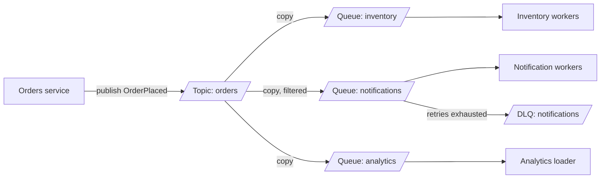

# Pub-Sub

> [!abstract] In one sentence
> Pub-sub lets a producer publish one event to a topic without knowing who listens, and gives every subscriber its own independent copy, position and failure handling — which is how a system grows new consumers without touching the producer.

> [!tip] Deeper treatment in your system-design vault
> `system-design/09 Messaging and Event-Driven/SQS and SNS.md` — read it *after* you have written your own explanation below.

**Map:** [[Messaging & Event-Driven Systems MOC]] → [[HLD MOC]]

## Definition

**Publish-subscribe** is a messaging topology in which producers publish to a named **topic** and the broker delivers each message to every **subscription** attached to that topic. Subscriptions are independent: each has its own backlog (a queue, or an offset into a log), its own consumers and its own retry and dead-letter policy. The producer addresses the *topic*, never a recipient, so adding or removing subscribers is a configuration change rather than a code change. Pub-sub can be **durable** (the subscription stores messages until acknowledged — SNS → SQS, Kafka consumer groups, Redis Streams groups) or **fire-and-forget** (delivered only to subscribers connected at that instant — Redis `PUBLISH`/`SUBSCRIBE`).

## Problem solved

A service that must notify others of a state change starts by calling them: `orders` calls `inventory`, then `notifications`, then `analytics`. Every new interested party is a code change in `orders`, every callee outage becomes `orders`' outage, and the call list is a hidden dependency graph nobody owns ([[Synchronous vs Asynchronous Communication]]). Point-to-point [[Message Queues]] fix the availability coupling but not the fan-out: one queue delivers each message to one consumer, so three interested teams need three copies that the producer must enqueue itself. Pub-sub moves the copying into the broker, where it is cheap, declarative and invisible to the producer.

## How it works

1. **Topic and subscriptions.** The producer publishes `OrderPlaced` to topic `orders`. The broker holds a list of subscriptions. In SNS each subscription is an endpoint (SQS queue, Lambda, HTTP, email) with an optional **filter policy** on attributes or payload. In [[Kafka]] each subscriber is a [[Consumer Groups|consumer group]] with its own committed offsets on the same partitions. In RabbitMQ a `fanout` or `topic` exchange is bound to one queue per subscriber. In Redis Streams several consumer groups read one stream, each with its own last-delivered id.
2. **Copy or share.** Queue-based pub-sub (SNS → SQS) **copies** the message into every subscriber's queue at publish time; log-based pub-sub **shares** one stored copy and gives each group a separate cursor — fan-out costs network egress, not storage.
3. **Independent consumption.** Each subscription's consumers pull at their own pace. A slow subscriber's backlog grows in *its* queue or *its* lag; the producer and other subscribers never notice ([[Backpressure]]).
4. **Delivery and acks.** The subscription, not the topic, owns [[Delivery Semantics]]: SQS visibility timeouts and redrive policies, Kafka offset commits, SNS retry policies for HTTP endpoints (with a per-subscription dead-letter queue when retries are exhausted).
5. **Ordering.** Standard SNS/SQS gives best effort; SNS FIFO topics into SQS FIFO queues preserve order per `MessageGroupId`; Kafka preserves order per partition for every group ([[Ordering Guarantees]]).
6. **Fire-and-forget variant.** Redis `PUBLISH` delivers to currently connected subscribers and returns the count; nothing is stored, a disconnected subscriber misses everything, and a slow one is disconnected when its output buffer exceeds `client-output-buffer-limit pubsub` (32 MB hard / 8 MB over 60 s by default). Redis 7 added sharded pub-sub (`SPUBLISH`/`SSUBSCRIBE`) so cluster-wide broadcast no longer hits every node.

```json
// SNS filter policy on a subscription: only payment events above a threshold reach this queue
{ "eventType": ["PaymentCaptured", "PaymentRefunded"], "amountMinor": [{ "numeric": [">=", 100000] }] }
```

## Architecture



> [!example]- Excalidraw version — the same diagram as an editable canvas
> ![[Pub-Sub.excalidraw]]
> [[Pub-Sub.excalidraw|Open in Excalidraw]] — needs the Excalidraw plugin (see [[Plugins to Install]]).


## Use cases

- "Several teams need to react to the same business event, and the list will grow" — the defining signal.
- "The producer must not fail or slow down because a consumer is down" — subscription-level isolation.
- "Broadcast a config change / cache invalidation / feature-flag update to every instance" — fire-and-forget pub-sub is enough when a missed message is repaired by the next poll or a TTL ([[Design a Feature Flag Service]]).
- "Fan one notification out to push, SMS, email and in-app channels with per-channel retries" ([[Design a Notification System]]).
- "Live dashboards and chat need every connected client to see every event" — WebSocket gateways subscribe to a topic per room or tenant ([[Real-Time Systems]]).

## Limitations

- **Hidden consumers.** The producer cannot know what breaks when it changes an event's shape; pub-sub makes [[Event Schemas]] and [[Event Schema Evolution]] a governance problem, not a code review.
- **Backlog multiplication.** With queue-based fan-out, N subscribers mean N copies and N backlogs; a 10 MB/s topic with 20 subscriptions is 200 MB/s of storage writes and 20 bills.
- **No request-reply.** Pub-sub is one-way; if the producer needs an answer it is back to RPC or a correlated reply topic.
- **Fire-and-forget loses messages by design** — never use Redis Pub/Sub for anything that must happen.
- **Ordering across subscribers is meaningless**: inventory may process `OrderPlaced` before or after notifications does, and any design that assumes otherwise is wrong.

## Trade-offs

| You gain | You sacrifice |
|---|---|
| Add a subscriber without touching the producer | Knowing your consumers; impact analysis becomes a registry problem |
| Per-subscriber isolation: one slow reader hurts only itself | Per-subscriber cost: copies, queues, DLQs and alerts for each |
| Producer availability independent of any consumer | Synchronous confirmation that the work happened |
| Clean domain events instead of a call graph | Ordering and transactional coupling between consumers |

## Failure modes

- **Slow or dead subscriber** → its queue grows until retention drops messages (SQS) or its lag passes retention (Kafka); you notice through `ApproximateAgeOfOldestMessage` or group lag on *that* subscription; blast radius is that subscriber's feature only — if alerts exist per subscription.
- **Filter policy drift** — a producer renames an attribute, the filter silently matches nothing, the subscriber sees an empty queue and assumes quiet; notice by comparing publish count with per-subscription delivery count (SNS `NumberOfNotificationsFilteredOut`).
- **Fire-and-forget subscriber reconnects** → every message during the gap is gone; with Redis Pub/Sub the only mitigation is a full resync on reconnect ([[Client State and Reconnection]]).
- **SNS → HTTP endpoint flapping** → SNS's retry policy exhausts, messages go to the subscription DLQ or are dropped if none is configured; notice via `NumberOfNotificationsFailed`.
- **Topic becomes a dumping ground** — twenty event types on one topic force every subscriber to filter and parse everything; cost and coupling climb while nobody notices until the bill or a schema break.

## Performance

Publish latency is one broker write — single-digit milliseconds for SNS, sub-millisecond for Redis or RabbitMQ in-network. SNS fan-out to SQS adds a hop and typically tens to a few hundred milliseconds before the copy is receivable. Kafka fan-out is free on the write path; each extra consumer group costs broker egress bandwidth and page-cache pressure, which is why a topic with many lagging groups thrashes the cache. Redis Pub/Sub is the fastest and the least safe: in-memory broadcast with no persistence, bounded by a single core per node.

## Scalability

Queue-based fan-out scales by subscription count linearly in cost and in broker writes; SNS supports millions of subscriptions per topic but the per-copy price is the real limit. Log-based fan-out scales in subscriber count almost for free but concentrates all groups on the same partitions, so a hot topic needs enough partitions for the *largest* group. Fire-and-forget scales to many thousands of connected clients per node before output buffers and CPU bite; beyond that, shard topics across nodes ([[Fan-Out]]).

## Operational impact

Moderate and mostly about ownership. Every subscription needs an owner, an age/lag alert and a DLQ, or a dead subscriber goes unnoticed for weeks. Topic-level cardinality (one topic per event type versus per aggregate) is a design decision that is painful to reverse. An event catalogue or schema registry becomes necessary once a producer cannot list its consumers. On the plus side, debugging gets easier: each subscription is a separate backlog you can inspect, pause and redrive without affecting the others.

## Alternatives

- **A single queue, no topic** — wins when exactly one consumer exists and will stay that way; fewer moving parts.
- **Log-based consumer groups** — win when subscribers also need replay or the same data at very high volume; a log is pub-sub with history.
- **Direct fan-out in application code** — wins for two or three well-known recipients with transactional needs the broker cannot express; loses as recipients grow.
- **Webhooks / HTTP callbacks** — win across organisational boundaries where the subscriber is an external customer ([[Design a Webhook Delivery System]]).

## Real-world examples

- The canonical AWS "fan-out" architecture — SNS topic with filtered SQS subscriptions feeding Lambda and ECS consumers — appears in nearly every AWS reference design, with SNS FIFO topics added for ordered fan-out.
- Google Cloud Pub/Sub makes the subscription the first-class unit: each has its own ack deadline, retention (7 days by default), dead-letter topic and seek-to-timestamp replay.
- Socket.IO's Redis adapter broadcasts events between Node.js instances over Redis Pub/Sub so every WebSocket node sees every emit — fire-and-forget by design, with persistent storage elsewhere for anything that must not be lost.
- In a stack like yours: an `orders` or `payments` service on EKS publishing domain events once (to an MSK topic via an [[Outbox Pattern]] relay, or to SNS), with ledger, notifications and fraud each owning a subscription — their own SQS queue with its own redrive policy, or their own Kafka consumer group. Redis Pub/Sub fits the WebSocket-broadcast layer of an ops dashboard; Redis Streams with one consumer group per subscriber is the durable alternative when the move to Streams happens.

## Practical exercise

1. With LocalStack, create an SNS topic and three SQS subscriptions, one with a filter policy on `eventType`.
2. Publish 1,000 events from a small TypeScript script; confirm each queue's count and that the filtered queue received only its share.
3. Stop the consumer of one queue for five minutes while publishing continues; show that the other two consumers were unaffected and that the stopped queue's `ApproximateAgeOfOldestMessage` climbed.
4. Rebuild the same topology on Redis: once with `PUBLISH`/`SUBSCRIBE` (disconnect a subscriber for ten seconds and count the loss), once with a Stream and three consumer groups (`XGROUP CREATE … $`) and confirm nothing is lost.
5. Measure publish-to-receive latency for SNS → SQS versus Redis Streams at the same message rate.

## Related concepts

### Prerequisites
- [[Message Queues]] — the per-subscription backlog is a queue
- [[Synchronous vs Asynchronous Communication]] — the coupling that pub-sub removes

### Related
- [[Fan-Out]] — the cost and latency shape of one-to-many delivery
- [[Kafka]] — pub-sub with history via consumer groups
- [[Consumer Groups]] — one group per subscriber on a log
- [[Event Schemas]] — the contract between a producer and consumers it cannot see
- [[Backpressure]] — how a slow subscriber is contained
- [[Redis]] — Pub/Sub and Streams as the two flavours

### Builds on this
- [[Event-Driven Architecture]] — services communicating through topics
- [[Fan-Out]] — delivery to many recipients at scale
- [[CQRS]] — read models fed from published events
- [[Real-Time Systems]] — broadcasting to connected clients

### Design problems where it applies
- [[Design a Notification System]]
- [[Design a Social Feed]]
- [[Design a Chat System]]
- [[Design a Feature Flag Service]]
- [[Design a Webhook Delivery System]]

### Projects where it can be implemented
- [[Live Ops Dashboard]] — a topic per view, broadcast to every connected client
- [[Personal Notification Hub]] — one event, many channel subscriptions with their own retries
- [[Feature Flag Service and SDK]] — flag changes broadcast to every SDK instance

### Resources
- [[Designing Data-Intensive Applications]] — chapter 11 on message brokers and multiple consumers
- [[Redis Streams Docs]] — consumer groups as durable subscriptions, contrasted with Pub/Sub
- [[Kafka Design Documentation]] — consumer groups and the "both queue and pub-sub" argument
- [[System Design Interview (Alex Xu)]] — the notification-system chapter is pub-sub end to end

## Personal understanding

> [!question] Explain it without the source
> Write your own explanation here, from memory. Then compare it with the sections above and note what you missed.

### Mastery checklist
- [ ] I can explain it without the original resource
- [ ] I can describe the problem it solves
- [ ] I can compare it with its alternatives
- [ ] I can name its limitations and failure modes
- [ ] I can recognise when it is appropriate in a real system
- [ ] I have applied it in a system design
- [ ] I have validated my assumptions with an experiment or implementation

## Open questions

- [ ] When SNS delivers to an SQS FIFO queue, where can ordering still be broken — in SNS, in the queue, or in the consumer — and what does the dedup window do across the hop?
- [ ] For Redis Streams with ten consumer groups on one stream, how does `XTRIM MAXLEN` interact with the slowest group — is there any protection against trimming unread entries?
- [ ] At what subscriber count does copying (SNS → SQS) cost more than running a Kafka topic with the same fan-out?
