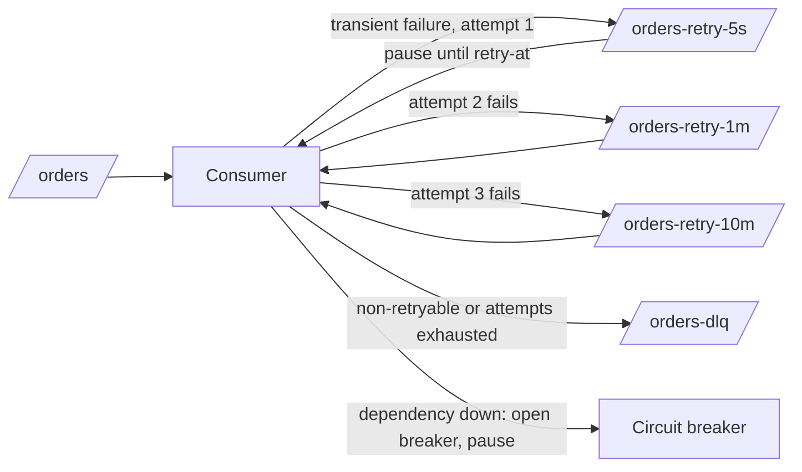

# Retry Strategies

> [!abstract] In one sentence
> Retrying is how a consumer survives transient failures without losing work, but every retry costs ordering, capacity or both — so a strategy classifies errors, bounds attempts and time, spaces them with jittered backoff, parks delayed messages somewhere that does not block the healthy ones, and ends in a dead-letter queue rather than forever.

> [!tip] Deeper treatment in your system-design vault
> `system-design/12 Resilience/Timeouts Retries and Exponential Backoff.md` — read it *after* you have written your own explanation below.

**Map:** [[Messaging & Event-Driven Systems MOC]] → [[HLD MOC]]

## Definition

A **retry strategy** for message processing is the policy that answers five questions for a failed attempt: **should** it be retried (error classification), **when** (immediate versus delayed, with what backoff), **where** the message waits (in place, blocking its partition; in a retry queue or topic; invisible in the broker), **how many** attempts and how much total time are allowed, and **what then** (a [[Dead-Letter Queues|dead-letter queue]], a compensation, an alert). It is the consumer-side counterpart of [[Timeouts and Retries]] for synchronous calls, with the added dimension that a message can be re-queued and processed later by someone else.

## Problem solved

Failures in a consumer are mostly transient — a dependency timeout, a database deadlock, a 429 from a partner, a pod restarting under a rolling deploy — and would succeed a second later. Without retries every blip sends good work to a DLQ or loses it. With naive retries — immediately, forever, in place — a single bad message blocks its partition, a dependency outage turns every consumer into a tight loop hammering the thing that is already down ([[Retry Storms]]), and a permanently invalid message is retried until someone notices the lag. A strategy makes retries bounded, paced and non-blocking, so transient failures heal and permanent ones are quarantined.

## How it works

1. **Classify.** Retryable: timeouts, connection resets, 5xx, 429, serialization failures and deadlocks (`40001`, `40P01` in PostgreSQL), broker unavailability. Non-retryable: deserialization and schema errors, validation failures, business-rule rejections, 4xx other than 408/429. Non-retryable goes straight to the DLQ; retrying it only delays the inevitable and blocks others.
2. **Immediate, in-place retries.** Two or three quick attempts with short backoff inside the handler, for sub-second blips. Bounded by the consumer's lease: in Kafka the total must stay under `max.poll.interval.ms` or the member is evicted; in SQS under the visibility timeout; in Redis Streams under the reaper's idle threshold. In-place retries preserve [[Ordering Guarantees|order]] because the partition waits.
3. **Delayed retries.** Kafka has no native delay, so the standard pattern is **retry topics** with increasing delays (`orders-retry-5s`, `orders-retry-1m`, `orders-retry-10m`): the handler publishes the failed record with headers (`attempt`, `original-topic`, `last-error`, `retry-at`) and commits; a consumer on each retry topic pauses its partition until `retry-at`, then processes. Spring Kafka's `@RetryableTopic` and Uber's reprocessing design do exactly this. SQS delays natively: do *not* delete, and call `ChangeMessageVisibility` with the backoff computed from `ApproximateReceiveCount`; `maxReceiveCount` then routes to the DLQ. RabbitMQ uses a TTL queue dead-lettering back to the work queue (one per delay tier) or the delayed-message exchange plugin; quorum queues cap with `x-delivery-limit`. Redis Streams leaves the entry in the pending list and a reaper reclaims it with `XAUTOCLAIM` once idle longer than the backoff, using the PEL delivery count as the attempt number; BullMQ exposes the same as `attempts` plus `backoff`.
4. **Backoff with jitter.** Exponential (`base × 2^attempt`, capped) spreads load over time; **full jitter** (`random(0, min(cap, base × 2^attempt))`) spreads it across clients so a recovered dependency is not hit by a synchronised wave.
5. **Budgets.** Cap attempts *and* elapsed time, and cap the retry rate globally — a token bucket allowing retries to be at most a fraction (Google's SRE guidance uses 10%) of normal traffic. When a dependency is down, stop retrying individually and pause consumption via a [[Circuit Breakers|circuit breaker]]; retries are for blips, not outages.
6. **End state.** After the last attempt the message goes to the DLQ with its full history, and a metric increments. Everything retried must be processed by an [[Idempotency|idempotent]] handler, because a timeout on a successful attempt is indistinguishable from a failure.

```ts
// SQS: delayed retry by extending visibility, exponential with full jitter, then DLQ via maxReceiveCount
const attempt = Number(m.Attributes!.ApproximateReceiveCount);          // 1, 2, 3, ...
const cap = 900, base = 5;
const delay = Math.floor(Math.random() * Math.min(cap, base * 2 ** (attempt - 1)));
await sqs.changeMessageVisibility({ QueueUrl, ReceiptHandle: m.ReceiptHandle!, VisibilityTimeout: delay });
```

## Architecture



> [!example]- Excalidraw version — the same diagram as an editable canvas
> ![[Retry Strategies.excalidraw]]
> [[Retry Strategies.excalidraw|Open in Excalidraw]] — needs the Excalidraw plugin (see [[Plugins to Install]]).


## Use cases

- "The downstream is occasionally slow or rate-limited" — partner APIs, payment processors, email providers ([[Design a Webhook Delivery System]], [[Design a Notification System]]).
- "Deadlocks and serialization failures happen under load" — the database says retry; do it in place, quickly.
- "Jobs must eventually complete despite restarts" — schedulers and workflow steps with explicit retry policies ([[Design a Distributed Job Scheduler]], [[Design a Workflow Orchestrator]]).
- "A failed message must not hold up the rest of the partition" — retry topics or visibility-based delays.
- "We see DLQ floods during deploys" — the sign that immediate-only retries need a delayed tier.

## Limitations

- Delayed retries break per-key ordering: the retried message is processed after its successors; keep order only by blocking the key, which costs throughput ([[Ordering Guarantees]]).
- Retry topics multiply topics, partitions and consumers, and each tier is another thing to monitor.
- Retries cannot fix permanent failures and, misclassified, hide them for the whole retry horizon.
- Amplification stacks: client retries × service retries × consumer retries × producer retries can turn one failure into dozens of calls.
- Retries assume idempotent effects; without that, every retry of a timed-out success is a duplicate.

## Trade-offs

| You gain | You sacrifice |
|---|---|
| Recovery from transient failures without losing work | Ordering, unless retries block the key |
| Non-blocking partitions with retry topics or visibility delays | More topics, queues and consumers to run and watch |
| Bounded load on a recovering dependency via backoff and jitter | Latency: a message may complete minutes after it arrived |
| Clean quarantine of permanent failures via a cap | Engineering to classify errors correctly per dependency |

## Failure modes

- **Retry storm** — a dependency recovers and every consumer retries at once with no jitter; it falls over again; you notice as a sawtooth of errors with a period equal to the backoff; blast radius: the dependency and everything else that shares it ([[Retry Storms]]).
- **Non-retryable error retried** — a schema mismatch cycles through every retry tier for 15 minutes before the DLQ; the partition (in-place) or the retry tiers (topics) fill with doomed messages; notice via DLQ arrivals with identical errors after full retry horizons.
- **`max.poll.interval.ms` eviction** — in-place retries with backoff exceed five minutes, the consumer is kicked, partitions rebalance, the same records are retried by the next member; notice via rebalance rate plus the same error repeating across members ([[Consumer Groups]]).
- **No total time budget** — a 10-minute-tier retry of a time-sensitive message (a seat hold, a price quote) succeeds long after it stopped being valid; notice via business anomalies, not errors.
- **Retry tiers starving** — the retry-topic consumer pauses a partition until `retry-at` while new retries pile up behind it; notice as retry-topic lag; blast radius: every delayed message's delay grows.

## Performance

In-place retries add their backoff to the partition's latency and hold the consumer thread. Retry topics decouple: the main consumer's latency stays flat and the retry path carries the delay, at the cost of extra produce calls and an extra consumer per tier. SQS visibility-based retries cost one API call per attempt and no extra queues. Backoff caps bound worst-case delay; full jitter halves the average wait relative to the cap. At the dependency, a well-jittered retry population adds a small, flat overhead; an unjittered one adds periodic spikes equal to the backlog.

## Scalability

Retry traffic should stay a small fraction of normal traffic; if it is not, retries are masking capacity or availability problems rather than blips ([[Bottleneck Analysis]]). Retry-topic consumers scale like any consumer group, but their partition count must match the main topic's if you want per-key order on redelivery. At 10x, check the retry budget (is 10% of 10x more than the dependency can take?), the DLQ write rate, and whether in-place retries still fit the lease.

## Operational impact

Expose per-topic metrics: retry rate by tier, attempts histogram, DLQ arrivals by error class, retry-topic lag, breaker state. Retry headers (`attempt`, `original-topic`, `last-error`, first-failure timestamp) are what on-call reads first. Policy should be configuration, not code, per consumer and per dependency — Resilience4j, Spring Kafka's error handlers, BullMQ's job options and Temporal's retry policies all externalise it. Changing a tier's delay changes the system's worst-case latency; review it like capacity.

## Alternatives

- **Straight to DLQ, humans redrive** — wins for low-volume, high-stakes streams where every failure deserves a look.
- **Circuit breaker plus pause** — wins for dependency outages: stop consuming, resume on recovery, no per-message retry noise ([[Circuit Breakers]]).
- **Compensation** — wins when the effect cannot wait; undo and re-run the saga instead of retrying one step ([[Saga Pattern]]).
- **Durable workflow engine** (Temporal) — wins when retries span steps and days; retry policy per activity with `initialInterval`, `backoffCoefficient`, `maximumInterval`, `maximumAttempts` built in.

## Real-world examples

- Uber's engineering blog described its Kafka reprocessing design — tiered retry topics with increasing delays ending in a DLQ — which became the template most Kafka shops copy.
- The AWS SDKs ship "standard" and "adaptive" retry modes with a client-side token bucket, and AWS's architecture blog on exponential backoff and jitter is the canonical argument for full jitter.
- Stripe retries webhook deliveries with exponential backoff for up to three days and expects idempotent receivers — a retry strategy exposed as a product contract.
- In a stack like yours: Kafka consumers with two quick in-place attempts, then `orders-retry-*` tiers via Spring Kafka's `@RetryableTopic` or a NestJS equivalent, with attempt headers and a DLQ; SQS workers using `ChangeMessageVisibility` backoff with `maxReceiveCount` redrive; and, for the Redis Streams migration, a reaper that reclaims pending entries with `XAUTOCLAIM` at increasing idle thresholds and moves entries past N deliveries to a dead-letter stream. The policy — classify, bound, jitter, quarantine — is identical; only the parking mechanism changes.

## Practical exercise

1. Build a consumer that calls a mock HTTP dependency behind Toxiproxy; make 5% of calls time out and 1% return 400.
2. Implement naive in-place infinite retries; measure partition latency and watch the 400 block everything.
3. Add classification (400 → DLQ), three in-place attempts with 100 ms jittered backoff, then two retry topics (5 s, 1 m) and a DLQ; measure main-topic p99 and the time-to-DLQ for the 400s.
4. Cut the dependency entirely for 60 s with Toxiproxy; compare dependency request rate during recovery with and without jitter, and with a circuit breaker that pauses the consumer.
5. Repeat on SQS using visibility-based backoff and `maxReceiveCount=5`; compare operational complexity with the Kafka version.

## Related concepts

### Prerequisites
- [[Timeouts and Retries]] — the synchronous version and the retry-amplification arithmetic
- [[At-Least-Once Delivery]] — retries are how at-least-once is implemented
- [[Idempotency]] — the precondition for retrying safely

### Related
- [[Dead-Letter Queues]] — where the strategy ends
- [[Retry Storms]] — what unbounded, unjittered retries cause
- [[Ordering Guarantees]] — the cost of delayed retries
- [[Backpressure]] — retries as a load source on the system
- [[Circuit Breakers]] — stop retrying when the dependency is down
- [[Consumer Groups]] — leases and poll intervals bound in-place retries

### Builds on this
- [[Saga Pattern]] — step retries before compensation
- [[Graceful Degradation]] — retry budgets as a degradation mechanism
- [[Capacity Planning]] — retry traffic in the capacity model

### Design problems where it applies
- [[Design a Webhook Delivery System]]
- [[Design a Notification System]]
- [[Design a Distributed Job Scheduler]]
- [[Design a Payment System]]
- [[Design a Workflow Orchestrator]]

### Projects where it can be implemented
- [[Webhook Relay]] — a backoff schedule per endpoint ending in a DLQ
- [[Durable Job Scheduler]] — retry policy per job type with attempt caps
- [[Chaos Lab]] — inject failures and watch retry and jitter behaviour

### Resources
- [[AWS Architecture Blog - Exponential Backoff and Jitter]] — the jitter argument with simulations
- [[AWS Builders Library - Timeouts Retries and Backoff]] — retry budgets and amplification across layers
- [[BullMQ]] — attempts, backoff and delayed jobs as a concrete API
- [[Temporal Docs on Durable Execution]] — retry policies as first-class workflow configuration

## Personal understanding

> [!question] Explain it without the source
> Write your own explanation here, from memory. Then compare it with the sections above and note what you missed.

### Mastery checklist
- [ ] I can explain it without the original resource
- [ ] I can describe the problem it solves
- [ ] I can compare it with its alternatives
- [ ] I can name its limitations and failure modes
- [ ] I can recognise when it is appropriate in a real system
- [ ] I have applied it in a system design
- [ ] I have validated my assumptions with an experiment or implementation

## Open questions

- [ ] How should a retry-topic consumer implement "wait until retry-at" without exceeding `max.poll.interval.ms` — pause/resume per partition, or a timer-driven re-fetch?
- [ ] When per-key order must survive retries, is per-key blocking in the main consumer cheaper than a keyed retry topic with the same partition count?
- [ ] For Redis Streams, what idle threshold and delivery-count cap reproduce a 5 s / 1 m / 10 m tiered policy, and how do you avoid two reapers claiming the same entry?
