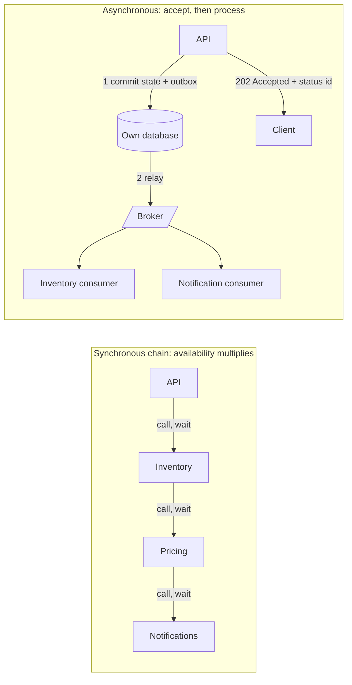

# Synchronous vs Asynchronous Communication

> [!abstract] In one sentence
> A synchronous call says "I need your answer before I can continue, so your downtime is my downtime"; an asynchronous message says "I have recorded what should happen, and it will happen when you are ready" — choose sync where the caller genuinely needs the result now, async everywhere the work can be completed later, and never confuse "async" with "reliable".

> [!tip] Deeper treatment in your system-design vault
> `system-design/09 Messaging and Event-Driven/Why Async Messaging Exists.md` — read it *after* you have written your own explanation below.

**Map:** [[Messaging & Event-Driven Systems MOC]] → [[HLD MOC]]

## Definition

**Synchronous communication** is request-response in which the caller waits for the callee's reply before proceeding — HTTP ([[REST]]), gRPC, a database query. Caller and callee are **temporally coupled**: both must be up, reachable and fast at the same moment. **Asynchronous communication** hands a message to an intermediary (a [[Message Queues|queue]], a [[Kafka|log]], an outbox) and continues; the work happens later, possibly elsewhere, and any result arrives through a callback, an event, or a status the caller polls. This is a property of the *interaction*, not the programming model: non-blocking I/O inside a service is still synchronous communication if the caller cannot proceed without the reply.

## Problem solved

A request that fans out into a chain of synchronous calls inherits every link's failures and delays. With five dependencies each at 99.9% availability, the chain's availability is `0.999^5 ≈ 99.5%` — from 43 minutes of downtime a month to about 3.6 hours — and its latency is the *sum* of the slowest path, with tail latencies compounding ([[The Tail at Scale]]). A slow callee ties up the caller's threads; a dead callee makes the caller return errors for work that did not need the callee *now*; a burst at the edge hits every service at once. Asynchronous messaging breaks the chain: the caller's success depends only on its own store and the broker, bursts are absorbed as backlog, and each consumer fails and recovers independently ([[Availability]]).

## How it works

1. **Classify the interaction.** Ask: does the caller need the callee's result to decide what to do or to answer a user? Is the callee's availability independent of the caller's? Can the work be completed minutes later without harm? A *query* ("what is the balance?") is synchronous by nature. A *command whose result the user must see* ("charge my card") is synchronous to the system of record and asynchronous beyond it. A *notification* ("an order was placed") is asynchronous by nature.
2. **Synchronous done well.** Every call needs a [[Timeouts and Retries|timeout]], idempotent retries with jitter, a circuit breaker per dependency, bounded concurrency (bulkheads) and a fallback or degraded answer. Budget latency along the critical path and refuse to add a hop without a reason.
3. **Asynchronous done well.** The caller commits its own state and the message atomically ([[Outbox Pattern]]), returns `202 Accepted` with a status resource or an id, and the consumer does the work with at-least-once delivery, [[Idempotency]], retries and a dead-letter queue. Completion is signalled by an event, a webhook, or a polled status. "Async" without an outbox and idempotent consumers is just a slower way to lose work.
4. **Request-reply over messaging** exists for callers that need an answer but want broker decoupling: a reply queue plus a correlation id (RabbitMQ's direct reply-to, SQS temporary queues, a Kafka reply topic). It is awkward on logs and reintroduces a timeout; use it when the callee is slow or batchy, not as a default.
5. **Hybrid flows.** Accept synchronously, process asynchronously, confirm asynchronously: the API validates and persists in milliseconds, a consumer talks to the payment processor, and the client learns the outcome by WebSocket, push, or polling. The user-facing contract changes from "done" to "accepted" — a product decision, not just a technical one.
6. **Make async debuggable.** Carry a correlation id and trace context in every message ([[Distributed Tracing]]); a failure becomes "late" rather than "error", so lag, DLQ depth and age-of-oldest replace HTTP status codes as the health signals.

| Chain depth at 99.9% per hop | Availability | Monthly downtime |
|---|---|---|
| 1 | 99.9% | ~43 min |
| 3 | ~99.7% | ~2.2 h |
| 5 | ~99.5% | ~3.6 h |
| 10 | ~99.0% | ~7.2 h |

## Architecture

> [!example]- Excalidraw version — the same diagram as an editable canvas
> ![[Synchronous vs Asynchronous Communication.excalidraw]]
> [[Synchronous vs Asynchronous Communication.excalidraw|Open in Excalidraw]] — needs the Excalidraw plugin (see [[Plugins to Install]]).

## Use cases

- "The user needs the answer on this screen" — synchronous read, with caching and timeouts.
- "The user needs confirmation that *we* recorded it, not that everything downstream finished" — synchronous write to the system of record, asynchronous side effects ([[Design a Payment System]]).
- "Downstream is slow, flaky, rate-limited or owned by someone else" — asynchronous with retries and a DLQ ([[Design a Webhook Delivery System]], [[Design a Notification System]]).
- "Many services react to one change" — events, never a fan-out of calls.
- "Bursty traffic, fixed-rate processing" — a queue between them is the simplest capacity tool (trip events in a ride-sharing backend, for instance).

## Limitations

- Asynchrony makes consistency eventual: the caller cannot promise the side effect happened, only that it will ([[Eventual Consistency]]); product copy and UI states must reflect that.
- Debugging moves from stack traces to correlation ids across logs, brokers and DLQs; the learning curve is real.
- Ordering, duplicates and schema evolution become the caller's problems to design for.
- Request-reply over queues is slower and more complex than a direct call and still has a timeout.
- Some interactions cannot be made asynchronous — authorisation checks, inventory checks before showing a price — and forcing them into events adds latency and staleness.

## Trade-offs

| You gain (async) | You sacrifice (async) |
|---|---|
| Availability independent of downstream services | An immediate, definitive answer |
| Burst absorption and independent scaling per consumer | Simplicity of reasoning and local debugging |
| Loose coupling: add consumers without touching the producer | Strong consistency across services |
| Failures become retries, not user-facing errors | Visibility: failures look like lag until someone looks |

## Failure modes

- **Cascading synchronous failure** — a slow dependency exhausts the caller's thread pool, the caller becomes slow for *all* requests, its callers follow; you notice via rising latency across unrelated endpoints and saturated pools; blast radius: every service upstream of the slow one.
- **Retry amplification along the chain** — each hop retries three times, so one failure at the bottom becomes 27 calls at the top; notice via request rate spikes at the bottom during incidents ([[Retry Storms]]).
- **Async without an outbox** — the process dies between the database commit and `send()`; the order exists, nothing downstream ever hears of it; notice when a customer asks; blast radius: silent, per crash.
- **Backlog hides an outage** — a consumer is down for hours, the API is green, the queue grows; notice only via lag or age alerts, which must exist.
- **Synchronous call inside a consumer** — the "async" pipeline now depends on a third service's availability and latency on the hot path; notice via consumer lag correlated with that service's incidents.

## Performance

Synchronous latency is additive along the critical path plus tail effects: a request touching ten services each with a 1% chance of a 1 s stall has a 10% chance of stalling. Asynchronous acceptance latency is one local commit plus an enqueue — milliseconds — and completion latency is enqueue-to-consume plus processing, typically tens of milliseconds when the consumer keeps up and arbitrarily long when it does not. Throughput of an async pipeline is bounded by the slowest consumer's rate, but the API's throughput is not.

## Scalability

Asynchronous boundaries let each consumer scale on its own signal (lag) and fail on its own terms; synchronous chains must be scaled together because the slowest link throttles the caller. At 10x traffic, synchronous fan-out multiplies load on every dependency at once; asynchronous fan-out multiplies broker writes but lets consumers catch up at their pace ([[Fan-Out]]). Organisationally, async boundaries let teams deploy independently, which is often the real reason to introduce them ([[Microservices]]).

## Operational impact

Synchronous systems are easier to debug and harder to keep up; asynchronous ones are the reverse. Async needs: outbox relays, lag and age alerts per consumer, DLQ ownership, correlation ids in every log line, replay and redrive runbooks, and product-level handling of "accepted but not done". Sync needs timeout and breaker configuration per dependency, pool sizing, and load tests of the full chain. Most incidents in mixed systems come from the boundary — a sync call hidden in a consumer, or an async path assumed to be immediate.

## Alternatives

- **Synchronous with resilience patterns** — wins for queries and short, user-facing commands where an immediate answer is the product; breakers, bulkheads and timeouts are the price.
- **Orchestrated workflows** ([[Saga Pattern]], Temporal) — win when a multi-step process needs both decoupling and a coordinator that knows the overall state.
- **Request-reply over a broker** — wins when the callee is slow or batch-oriented and the caller can wait seconds, not milliseconds.
- **Batch processing** — wins when nothing needs to happen within minutes; cheapest and simplest of all.

## Real-world examples

- Amazon's 2002 "API mandate" made every team's capability a service; the follow-on lesson, visible in SQS and SNS being among AWS's earliest products, was that synchronous service meshes need asynchronous seams to stay available.
- Netflix's Hystrix (and its successor Resilience4j) exist because synchronous fan-out across hundreds of services needs breakers and bulkheads to avoid cascading failure.
- Stripe's API responds synchronously for the charge but delivers everything downstream — webhooks, reports — asynchronously with retries over days.
- In a stack like yours: an IAM check or a balance read is synchronous (and cached); a transfer is a synchronous write to the ledger's database with the payment-processor call, notification and analytics fanned out asynchronously via an outbox to MSK or SQS; and the RabbitMQ → Kafka → SQS → Redis Streams history is really a history of *where the async seam lives*, which matters less than making sure every seam has an outbox on one side and idempotent consumers on the other.

## Practical exercise

1. Build three small services (NestJS or Spring Boot): `orders` calls `inventory` which calls `notifications`, all synchronous. Load-test with k6 at 200 rps while Toxiproxy adds 2 s latency to `notifications` for 30 s; record `orders` p99 and error rate.
2. Make `notifications` asynchronous: `orders` writes an outbox row, a relay publishes to Kafka or SQS, a consumer sends notifications. Repeat the latency injection; compare `orders` p99 and errors.
3. Kill `inventory` for one minute in both designs; measure how many orders were accepted and how many were lost or errored.
4. Add a correlation id end to end and open one order's path in Jaeger across the broker hop.
5. Implement request-reply over the queue for a stock check with a 500 ms timeout; measure the latency overhead versus the direct call and decide when you would use it.

## Related concepts

### Prerequisites
- [[Availability]] — the arithmetic of chained dependencies
- [[Latency]] — additive critical paths and tail amplification
- [[REST]] — the default synchronous transport
- [[Timeouts and Retries]] — what every synchronous call needs

### Related
- [[Message Queues]] — the intermediary that makes async possible
- [[Event-Driven Architecture]] — async as an architectural style
- [[Circuit Breakers]] — containing synchronous failure
- [[Eventual Consistency]] — what async implies for data
- [[gRPC]] — synchronous RPC with streaming options
- [[Distributed Tracing]] — following a request across the seam

### Builds on this
- [[Outbox Pattern]] — the mechanism that makes async reliable
- [[Saga Pattern]] — multi-step processes over async steps
- [[Pub-Sub]] — one event, many asynchronous reactions
- [[CQRS]] — asynchronous read-model updates
- [[Microservices]] — service boundaries are communication decisions

### Design problems where it applies
- [[Design a Payment System]]
- [[Design a Notification System]]
- [[Design a Ticket Booking System]]
- [[Design a Ride-Sharing Service]]
- [[Design a Webhook Delivery System]]

### Projects where it can be implemented
- [[Webhook Relay]] — accept synchronously, deliver asynchronously
- [[Chaos Lab]] — measure a synchronous chain against an asynchronous seam under injected failures
- [[Double-Entry Ledger Service]] — synchronous posting, asynchronous side effects

### Resources
- [[Designing Data-Intensive Applications]] — chapter 4 on dataflow through services versus message passing
- [[Building Microservices]] — the chapter on inter-service communication styles
- [[Release It!]] — integration points as the primary source of cascading failure
- [[Martin Fowler - Microservices]] — smart endpoints, dumb pipes, and the case for messaging

## Personal understanding

> [!question] Explain it without the source
> Write your own explanation here, from memory. Then compare it with the sections above and note what you missed.

### Mastery checklist
- [ ] I can explain it without the original resource
- [ ] I can describe the problem it solves
- [ ] I can compare it with its alternatives
- [ ] I can name its limitations and failure modes
- [ ] I can recognise when it is appropriate in a real system
- [ ] I have applied it in a system design
- [ ] I have validated my assumptions with an experiment or implementation

## Open questions

- [ ] For a card payment where the processor call takes 2–5 s, is it better to hold the HTTP request (sync) or return `202` and push the result over WebSocket — and what does each do to the idempotency contract with the client?
- [ ] How should an async pipeline expose an SLO — age of oldest message, p99 completion time, or both — and what does "available" mean for it?
- [ ] When a consumer must call a third-party API synchronously, is a request-reply queue, a breaker-wrapped direct call, or a separate consumer per third party the better isolation?
