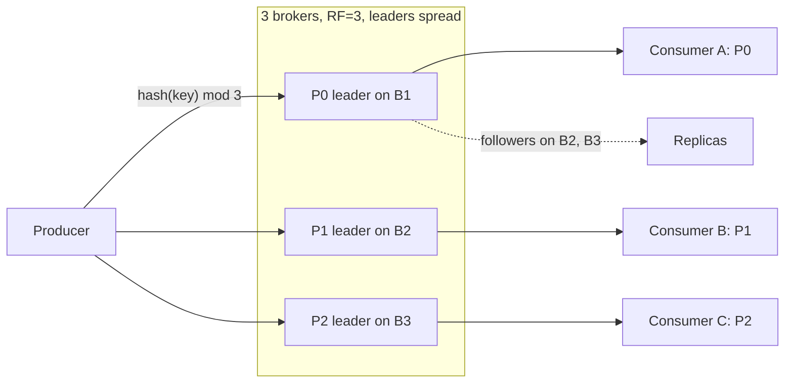

# Topic Partitions

> [!abstract] In one sentence
> A topic is split into partitions — independent, ordered, replicated sub-logs — so that writes, storage and consumers scale across brokers while every record with the same key still lands in one ordered sequence; choosing the key and the count is the most consequential and least reversible decision in a Kafka design.

> [!tip] Deeper treatment in your system-design vault
> `system-design/09 Messaging and Event-Driven/Kafka Architecture.md` — read it *after* you have written your own explanation below.

**Map:** [[Messaging & Event-Driven Systems MOC]] → [[HLD MOC]]

## Definition

A **partition** is one append-only, totally ordered log within a topic, stored as segment files on a single leader broker and replicated to followers. A topic with N partitions is N independent logs with no ordering between them. The **partition key** is the record attribute hashed to choose a partition; records with the same key always go to the same partition, so "ordered per key" is really "ordered per partition" ([[Ordering Guarantees]]). The partition count is the maximum number of consumers in one [[Consumer Groups|consumer group]] that can do useful work. The same idea appears as Kinesis shards, SQS FIFO message groups (an ordering unit without separate storage) and, in [[Redis]] Streams, as separate stream keys you shard across yourself.

## Problem solved

A single ordered log lives on one machine, is written by one leader and read sequentially: its throughput is one disk and one network card, and its only consumer is one process. Global order and horizontal scale are fundamentally in tension — you cannot have both. Partitioning resolves it by weakening the promise to the one most applications actually need: order *per entity* (account, order, device), not across the system. Each entity's records go to one partition, partitions spread across brokers and consumers, and the system scales linearly while every entity's history stays sequential ([[Partitioning]], [[Sharding]]).

## How it works

1. **Routing.** The producer's partitioner picks the partition. With a key: `hash(key) % partitions` — the Java client uses murmur2; librdkafka defaults to CRC32 (`consistent_random`) unless configured as `murmur2_random`, so mixed-language producers can split one key across partitions. With no key: the sticky partitioner fills a batch for one partition then moves on, maximising batch size.
2. **Placement.** Each partition has a leader replica and followers; replicas are spread rack- or AZ-aware (`broker.rack`; MSK uses availability zones). Leaders are balanced across brokers so no single broker serves all traffic; `auto.leader.rebalance.enable` moves leadership back to preferred replicas after failovers ([[Replication]]).
3. **Storage.** Each partition is a directory of segment files (`log.segment.bytes`, 1 GiB) with sparse offset and timestamp indexes; retention and compaction operate per partition.
4. **Consumption.** One consumer per partition per group; fetches are per partition (`max.partition.fetch.bytes`, 1 MiB default), so a consumer owning many partitions pipelines them.
5. **Choosing the count.** The practical rule from Confluent's guidance: `partitions ≥ max(target throughput / per-partition producer throughput, target throughput / per-partition consumer throughput)`, then round up for growth, because you can only add. Costs of too many: producer memory (`batch.size` per partition), more open files and replication fetchers per broker, longer leader elections after a broker failure (per-partition), longer rebalances, and worse batching for low-volume topics.
6. **Changing the count.** Partitions can be added but never removed. Adding changes `hash % N` for every key, so new records for a key land in a different partition than its old ones — per-key order across the boundary is gone, and compacted topics end up with the same key in two partitions. The standard path is a new topic plus consumer migration ([[Event Schema Evolution]] has the same shape).

```java
// composite key: per-tenant order kept, but a huge tenant spread over 8 sub-keys
String key = tenantId + ":" + (accountId.hashCode() & 7);
producer.send(new ProducerRecord<>("payments", key, event));
```

## Architecture



> [!example]- Excalidraw version — the same diagram as an editable canvas
> ![[Topic Partitions.excalidraw]]
> [[Topic Partitions.excalidraw|Open in Excalidraw]] — needs the Excalidraw plugin (see [[Plugins to Install]]).


## Use cases

- "Events for one account must be processed in order, but we have millions of accounts" — key by account id, partitions by throughput.
- "We need N parallel consumers" — N partitions at minimum, usually more for headroom.
- "Stateful stream processing keyed by X" — Kafka Streams co-partitions topics by key so joins are local.
- "Isolate a noisy tenant" — a dedicated partition or topic per large tenant is partitioning used as a [[Bulkheads|bulkhead]].
- "Our Redis Streams backlog needs more than one core" — shard into `stream:{0..N}` keys and assign them to workers; you have just reinvented partitions.

## Limitations

- Order is only within a partition; anything that needs cross-key order (a global sequence number, "all events before 12:00") needs one partition or external reordering.
- Count is effectively immutable in both directions for keyed topics.
- Hot keys become hot partitions: one tenant with 40% of traffic pins 40% of load on one broker and one consumer, and no assignor can help ([[Hot Keys]]).
- Many small topics × many partitions multiply per-partition overhead; thousands of partitions per broker was the old ZooKeeper-era comfort limit.
- A partition is also the unit of head-of-line blocking: one slow record stalls every key behind it.

## Trade-offs

| You gain | You sacrifice |
|---|---|
| Linear write and read scaling across brokers and consumers | Global ordering; only per-key order survives |
| Per-key ordering with zero coordination at runtime | Freedom to change the key or the count later |
| Natural data locality for stateful processing | Even load: skewed keys mean skewed partitions |
| Independent failure domains per partition | Cross-partition atomicity (only Kafka transactions give it) |

## Failure modes

- **Hot partition** — a power-law key (big merchant, popular chat room) saturates one broker's disk and one consumer; you notice via per-partition bytes-in and per-partition lag diverging from the mean; blast radius: every key that shares the partition is delayed too.
- **Key mismatch across producers** — two services write the same entity with different key formats or different hash functions, so its events interleave across partitions and consumers see them out of order; notice through "impossible" state transitions in consumers; blast radius: silent data corruption in read models.
- **Partition increase on a keyed topic** — ordering breaks at the boundary and compacted topics keep stale values for keys that moved; notice much later, when a rebuild from the compacted topic produces wrong state.
- **Leader concentration** after a broker outage — all leaders migrate to the survivors and stay there, overloading them; notice via uneven `LeaderCount` and request latency per broker.
- **Under-provisioned count** — consumers max out at the partition count while lag grows; the fix (more partitions) triggers the key-mapping break above, so teams end up migrating topics under pressure.

## Performance

Per-partition throughput is bounded by one leader's sequential write path — tens of MB/s per partition is a safe planning figure on ordinary disks, much more on NVMe — and by one consumer's processing speed. More partitions raise aggregate throughput until brokers saturate, but each extra partition costs the producer a batch buffer and the broker an open file and a replica fetcher. For low-volume topics, more partitions *hurt* latency: batches fill slower and `linger.ms` expires with tiny batches. Leader failover latency grows with the number of partitions a failed broker led, because each needs an election and metadata propagation.

## Scalability

Partitioning is why the log scales at all: add brokers, reassign partitions (`kafka-reassign-partitions`, Cruise Control) and the cluster grows without changing producers. At 10x the question is key distribution, not count — a topic sized for 10x traffic still has a hot partition if 10x traffic comes from one key. Plan partition counts for the largest consumer group you expect in two years; the cost of over-provisioning is small, the cost of under-provisioning is a topic migration. In Redis Streams the equivalent of adding partitions is adding stream keys, with the same key-mapping break and no tooling.

## Operational impact

Decide, document and enforce the key for every topic — this is schema governance as much as capacity planning ([[Event Schemas]]). Monitor per-partition lag and bytes-in skew, leader balance per broker and under-replicated partitions. Partition reassignment is a bandwidth-heavy, hours-long operation that must be throttled on a busy cluster. Topic migration (new partition count) needs a runbook: create, dual-write or mirror, move consumers group by group, retire. On MSK the hosts are managed, the partition decisions are not.

## Alternatives

- **One partition** — wins when global order matters more than throughput and a single consumer keeps up (configuration changes, small audit streams).
- **SQS FIFO message groups** — win when you want per-key order without choosing a count; the broker serialises per group and workers scale freely, at FIFO throughput limits.
- **[[Consistent Hashing]] over consumers in application code** — wins when the broker has no partitions (Redis Streams, RabbitMQ) and you need stable key-to-worker mapping; you own rebalancing.
- **Pulsar or Kinesis** — win when you want shard splitting/merging with per-shard throughput limits built in (Kinesis: 1 MB/s in, 2 MB/s out per shard) and accept their ecosystems.

## Real-world examples

- Confluent's long-standing guidance article on choosing partition counts (Jun Rao) is the source of the throughput-ratio rule and the "more partitions means more end-to-end latency and longer unavailability on failure" warnings.
- Kafka Streams and ksqlDB require co-partitioned inputs for joins, which is why repartition topics exist: the engine re-keys data into a topic with matching partition count before joining.
- Discord's message storage keys by `(channel_id, bucket)` for exactly the hot-partition reason — a single huge channel must not pin one shard ([[Discord - How Discord Stores Trillions of Messages]]).
- In a stack like yours: payments keyed by `accountId` so a ledger projector sees one account's debits and credits in order; a large merchant handled with a composite key only if per-merchant order is not required; topics created with a partition count sized for the biggest consumer group plus headroom; and, for Redis Streams, explicit sharding by `accountId % N` across stream keys with a documented N that cannot change without a migration.

## Practical exercise

1. Create `payments` with 3 partitions; produce 10,000 keyed records with a Zipf-distributed key (one key gets 40%); print records per partition and the per-partition consumer lag over time with 3 consumers.
2. Increase to 6 partitions with `kafka-topics --alter`; keep producing the same keys and show that a key's records now appear in two partitions; have a consumer detect out-of-order sequence numbers per key.
3. Produce the same key from the Java client and from a librdkafka-based client with default partitioners; observe whether they agree.
4. Benchmark one topic with 1, 6 and 60 partitions at a fixed 1,000 records/s with `linger.ms=20`: measure p99 end-to-end latency and batch sizes.
5. On Redis, shard a stream into 4 keys by `account % 4`, read each with one consumer, then "add a shard" and reason about what happens to in-flight accounts.

## Related concepts

### Prerequisites
- [[Kafka]] — the log that partitions divide
- [[Partitioning]] — the general technique of splitting data by key
- [[Throughput]] — what the count is sized against

### Related
- [[Consumer Groups]] — one owner per partition
- [[Ordering Guarantees]] — order holds inside a partition only
- [[Hot Keys]] — skewed keys become skewed partitions
- [[Sharding]] — the database twin of this decision
- [[Replication]] — leaders, followers and placement
- [[Consistent Hashing]] — the alternative mapping when the broker has no partitions

### Builds on this
- [[Exactly-Once Semantics]] — idempotent producer sequence numbers are per partition
- [[Fan-Out]] — many groups read the same partitions
- [[Backpressure]] — lag is measured per partition
- [[Capacity Planning]] — count and key are the capacity model

### Design problems where it applies
- [[Design a Message Queue]]
- [[Design a Real-Time Fraud Detection Pipeline]]
- [[Design a Chat System]]
- [[Design a Logging System]]
- [[Design a Metrics and Monitoring System]]

### Projects where it can be implemented
- [[Streaming Fraud Rules Engine]] — key by account so windowed features stay local
- [[Live Ops Dashboard]] — key by tenant or view for ordered updates
- [[Load Test and Latency Lab]] — measure throughput and latency against partition count

### Resources
- [[Kafka Design Documentation]] — partitions, replication and the ISR
- [[Designing Data-Intensive Applications]] — chapter 6 on partitioning and chapter 11 on partitioned logs
- [[Discord - How Discord Stores Trillions of Messages]] — the hot-partition problem in a storage system

## Personal understanding

> [!question] Explain it without the source
> Write your own explanation here, from memory. Then compare it with the sections above and note what you missed.

### Mastery checklist
- [ ] I can explain it without the original resource
- [ ] I can describe the problem it solves
- [ ] I can compare it with its alternatives
- [ ] I can name its limitations and failure modes
- [ ] I can recognise when it is appropriate in a real system
- [ ] I have applied it in a system design
- [ ] I have validated my assumptions with an experiment or implementation

## Open questions

- [ ] Is there a safe procedure to double a keyed topic's partitions without a new topic — e.g. draining producers, waiting for consumers to catch up, then altering — and what does it cost in downtime?
- [ ] How does KRaft change the practical partition-per-broker and per-cluster limits, and what is the new bottleneck?
- [ ] For a Redis Streams deployment, is there any advantage to sharding across Redis Cluster slots versus running N independent Redis instances, given one stream is always one key?
