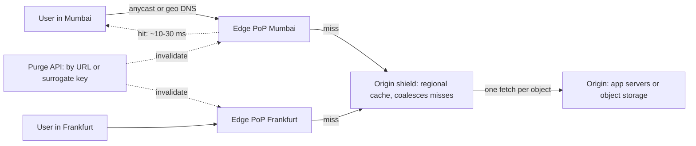

# CDNs

> [!abstract] In one sentence
> A content delivery network puts caching [[Reverse Proxies|reverse proxies]] in hundreds of locations close to users so that a request for a cacheable object is answered in a few milliseconds from the nearest edge instead of crossing an ocean to your origin — buying lower [[Latency]], an origin that sees a fraction of the traffic, and a first line of defence against floods.

> [!tip] Deeper treatment in your system-design vault
> `system-design/03 Traffic Management/CDN.md` — read it *after* you have written your own explanation below.

**Map:** [[Networking MOC]] → [[HLD MOC]]

## Definition

A CDN is a network of **points of presence (PoPs)** — clusters of edge servers in many cities and peering locations — that sit between users and an **origin** (your servers or an [[Object Storage|object store]]). Users are steered to a nearby PoP by anycast routing or [[DNS]]; the edge serves a cached copy of the requested object if it has one and is fresh, and otherwise fetches it from the origin (or from a larger intermediate cache called a **shield**), stores it, and returns it. Modern CDNs also terminate [[TLS]] at the edge, absorb DDoS traffic, run edge logic (rewrites, auth checks, small functions) and proxy dynamic, uncacheable requests over optimised backbone connections.

## Problem solved

Speed of light and origin capacity. A user in Mumbai fetching a 2 MB bundle from a single origin in Virginia pays roughly 200 ms of round-trip time per connection setup and every TCP window ramp, so a page with dozens of assets takes seconds no matter how fast the origin is. Meanwhile the origin serves the same bytes to a million users, paying bandwidth and CPU for each, and a traffic spike or a volumetric attack hits it directly. A CDN solves both halves: a nearby edge answers in ~10–30 ms with warm TCP and TLS state already in place, and the origin is asked once per object per edge (or once per object per shield) instead of once per user. The same mechanism makes a video launch, a flash sale or a viral post survivable: cacheable traffic scales with the CDN's capacity, not yours.

## How it works

1. **Steering.** `assets.example.com` is a CNAME to the CDN. Either the CDN's authoritative DNS returns the IP of a PoP chosen by the resolver's location and PoP health, or every PoP announces the same IP range with **anycast** and BGP routes each user to the topologically nearest one. Anycast gives faster failover and DDoS dispersion; DNS steering gives finer control.
2. **Cache key.** The edge computes a key from the request — by default scheme, host and path, optionally selected query parameters and headers named in `Vary`. Everything not in the key is ignored, which is why cookies and `Authorization` must either be stripped or put in the key, and why query-string ordering can silently fragment your cache.
3. **Lookup and freshness.** A hit is served if the object's age is below its [[TTL]], derived from `Cache-Control: max-age` / `s-maxage` (the latter is for shared caches) or an edge-side override. A stale hit can still be served while the edge revalidates in the background (`stale-while-revalidate`) or when the origin is down (`stale-if-error`) — two of the most valuable headers in the spec ([[Graceful Degradation]]).
4. **Miss path and shielding.** On a miss the edge requests the object from the origin — or, with **origin shielding** enabled, from one designated regional cache that aggregates misses from many edges. Shielding plus **request coalescing** (one origin fetch while N edge requests wait) is what prevents a thousand edges from stampeding the origin for a newly published object ([[Cache Stampedes]]).
5. **Conditional revalidation.** When an object expires the edge sends `If-None-Match: "etag"`; a `304 Not Modified` refreshes the TTL without transferring the body.
6. **Invalidation.** Purge by exact URL, by surrogate key / cache tag (the origin labels responses, e.g. `Surrogate-Key: product-42`, and you purge the tag), or purge everything. Purges propagate in seconds on modern CDNs but are a request to forget, not a guarantee of consistency ([[Cache Invalidation]]). The robust pattern is **content-addressed URLs**: `app.3f9a1c.js` with a one-year TTL, so a deploy changes the URL instead of needing a purge.
7. **Push vs pull.** Pull (described above) populates on demand. Push pre-uploads objects to the CDN's storage so the first user never misses — used for large media releases and predictable catalogues; pull is the default for everything else.
8. **Dynamic acceleration.** For uncacheable requests the edge still terminates TLS near the user and forwards over a persistent, tuned connection to the origin, saving the handshake RTTs; edge functions can run authentication, A/B assignment or personalisation before the cache lookup.

```http
# Origin response that caches well at the edge and in browsers
HTTP/1.1 200 OK
Cache-Control: public, max-age=60, s-maxage=600, stale-while-revalidate=120, stale-if-error=3600
ETag: "a1b2c3"
Vary: Accept-Encoding
Surrogate-Key: product-42 catalogue
```

## Architecture



## Use cases

- "Users on several continents", "page load time matters", "mobile users on poor networks" — latency and TCP warm-up are the dominant cost and the edge removes them.
- "Static assets, images, video segments, downloads, app bundles" — the classic cacheable payload; pair with content-addressed URLs and long TTLs ([[Design a Video Streaming Service]]).
- "Public, read-heavy API responses that can be a few seconds stale" (catalogues, prices, feature config, public profiles) — `s-maxage` plus surrogate keys turns the CDN into a shared cache for your API ([[REST]]).
- "Survive traffic spikes or DDoS without scaling the origin" — the edge absorbs volume and shields the origin.
- "Terminate TLS near the user and speed up dynamic requests" — even uncacheable traffic benefits from the edge's connection pool to the origin.

## Limitations

- Only helps traffic that is cacheable or latency-bound by handshakes; personalised, write-heavy or strongly consistent reads gain little beyond TLS termination.
- Consistency is bounded by TTL and purge propagation; "the user still sees the old price" is a design issue you accept, not a bug you fix.
- Cache-key mistakes cut both ways: too broad leaks one user's response to another, too narrow fragments the cache into useless uniqueness.
- Egress-based pricing and per-request fees can make a CDN *more* expensive than the origin for large, low-hit-rate objects; cold regions with low traffic have low hit rates.
- Debugging is indirect: you see the CDN's logs and cache status headers, not your own server's, and behaviour differs by PoP.

## Trade-offs

| You gain | You sacrifice |
|---|---|
| Tens of milliseconds instead of hundreds for cacheable content worldwide | Control: a third party's configuration, PoP behaviour and purge latency |
| Origin load reduced to one fetch per object per shield | Freshness bounded by TTLs and the purge pipeline |
| Absorption of spikes and volumetric attacks at the edge | Per-GB and per-request cost that scales with your traffic shape |
| TLS termination and connection reuse close to users | Direct visibility: logs and metrics come from the CDN, with delay |

## Failure modes

- **Private data cached publicly**: a `GET /me` response without `Cache-Control: private` (or with cookies ignored by the cache key) is served to the next user at that edge. Noticed as "I saw someone else's account"; blast radius is a data breach. Default to `private`/`no-store` for anything authenticated and audit the key.
- **Thundering herd on expiry**: a popular object's TTL ends at the same instant on many edges and they all miss to the origin together; origin p99 spikes every TTL period. Fix with shielding, coalescing and `stale-while-revalidate`.
- **Purge did not reach everywhere** or a stale object has a year-long TTL under a fixed URL: users see old JavaScript against a new API and the site breaks for a subset. Fix with content-addressed asset URLs; purge is for content, not code.
- **Origin outage amplified**: with no `stale-if-error`, the moment the origin fails every cache miss becomes a user-facing error; with it, the CDN keeps serving stale content for hours. Noticed by comparing edge `5xx` rate with origin health.
- **Cache fragmentation by query string or headers**: hit rate collapses after a client starts appending a tracking parameter; noticed as origin load rising with no traffic change. Normalise the key.

## Performance

Edge hits typically return in the low tens of milliseconds end-to-end for a nearby user, dominated by the last-mile RTT, versus hundreds of milliseconds to a distant origin — and the gap widens for multi-round-trip fetches because TCP congestion windows ramp on short paths. Cache hit ratio is the metric: a static-asset site should sit above 95%; a shielded origin sees miss traffic reduced by roughly the number of edges that share the shield. Throughput at the edge is effectively unlimited for your purposes; what you tune is TTLs (longer is cheaper and faster), compression (brotli for text), image variants, and keeping objects below any per-object size limits for the cache tier.

## Scalability

The CDN scales for you; the question is whether your *origin* scales with miss traffic. Hit rate per edge falls as you add edges with the same total traffic (each edge sees fewer repeats), which is exactly why shields exist. At 10x users, cacheable traffic costs you only egress fees, while uncacheable traffic still arrives at the origin — so the architectural move is to make more responses cacheable: split personalised fragments from shared ones, serve shared data with `s-maxage` and surrogate keys, and push personalisation to the client or an edge function.

## Operational impact

Low once set up, but the setup decisions are sharp: cache-key rules, header policies, TTL defaults, purge integration in the deploy pipeline, and certificate management for custom domains. Monitor hit ratio, origin request rate, edge `5xx` versus origin `5xx`, and purge latency; log sampling from the CDN feeds your [[Logging|logging]] pipeline with a delay. Incidents involve a vendor status page and support ticket rather than a kubectl session — a different on-call shape. Multi-CDN setups add resilience and negotiating power at the cost of maintaining two configurations ([[Build vs Buy Decisions]]).

## Alternatives

- **A caching [[Reverse Proxies|reverse proxy]] you run** (nginx, Varnish) in one or a few regions — wins when users are regional and you want full control and logs; loses on global reach and DDoS absorption.
- **[[Object Storage]] served directly** — fine for low-traffic or regional downloads; most object stores pair with a CDN for anything public.
- **Application-level caching** ([[Redis]], [[Cache-Aside]]) — cuts origin *compute* but not network latency to the user; the two are complementary.
- **Client-side caching alone** (`Cache-Control` in the browser) — zero cost, but only helps repeat visits by the same client.

## Real-world examples

- Netflix's Open Connect places its own caching appliances inside ISPs; video bytes are pushed to appliances off-peak and served on-net, the clearest example of a push model at scale.
- Cloudflare's anycast network serves a large share of the web through a single IP range announced from every PoP; Fastly popularised surrogate keys and instant purge for cacheable APIs.
- Amazon CloudFront fronts S3 for most AWS-hosted static sites and media; origin shield is an explicit, per-region option.
- In a stack like yours: web and mobile bundles, KYC document previews and marketing content on CloudFront in front of S3 with content-addressed names, public price or config endpoints served with `s-maxage` and purged by surrogate key from the deploy pipeline, and authenticated API traffic passing through the edge for TLS termination but marked `no-store`.

## Practical exercise

1. Run nginx with `proxy_cache` (or Varnish) in Docker as a stand-in edge in front of a small API, with a second nginx as a "shield" between it and the origin.
2. Serve `GET /products/42` with `Cache-Control: s-maxage=10`; hit it with k6 at 500 rps and record origin request rate and the `X-Cache` hit ratio; then remove the shield and compare origin fetches when running two edge instances.
3. Append a random `?utm=` parameter per request and watch the hit ratio collapse; add query-string normalisation and repeat.
4. Add `stale-while-revalidate=30` and `stale-if-error=300`, kill the origin, and measure how long clients keep receiving `200`s.
5. Implement surrogate-key purge: tag responses with `product-42`, change the product, purge the tag (nginx `proxy_cache_purge` or Varnish `ban`), and measure time-to-fresh.

## Related concepts

### Prerequisites
- [[HTTP and HTTPS]] — `Cache-Control`, `ETag` and `Vary` are the CDN's control surface
- [[Reverse Proxies]] — an edge node is one, with a cache
- [[DNS]] — CNAMEs and geo steering put users on the right PoP

### Related
- [[TTL]] — freshness is the central tuning knob
- [[Cache Invalidation]] — purges, surrogate keys and content-addressed URLs
- [[Cache Stampedes]] — expiry herds and request coalescing
- [[Object Storage]] — the usual origin for static content
- [[Multi-Level Caching]] — browser, edge, shield and origin caches form a hierarchy
- [[Latency]] — the physics the CDN works around

### Builds on this
- [[Graceful Degradation]] — `stale-if-error` keeps a site up during origin failure
- [[Rate Limiting]] — edge-enforced limits and bot rules
- [[Monitoring User-Facing Performance]] — edge hit ratio and TTFB are the user-facing numbers

### Design problems where it applies
- [[Design a Video Streaming Service]]
- [[Design a URL Shortener]]
- [[Design File Storage]]
- [[Design a Social Feed]]

### Projects where it can be implemented
- [[Load Test and Latency Lab]]
- [[Live Ops Dashboard]]

### Resources
- [[System Design Primer (GitHub)]] — push versus pull CDN overview
- [[AWS Builders Library - Caching Challenges]] — cache keys, TTLs and stampedes from the operator's side
- [[Latency Numbers Every Programmer Should Know]] — the round-trip numbers that justify the edge

## Personal understanding

> [!question] Explain it without the source
> Write your own explanation here, from memory. Then compare it with the sections above and note what you missed.

### Mastery checklist
- [ ] I can explain it without the original resource
- [ ] I can describe the problem it solves
- [ ] I can compare it with its alternatives
- [ ] I can name its limitations and failure modes
- [ ] I can recognise when it is appropriate in a real system
- [ ] I have applied it in a system design
- [ ] I have validated my assumptions with an experiment or implementation

## Open questions

- [ ] Which of our authenticated, read-heavy endpoints could become cacheable at the edge by splitting the shared part from the per-user part?
- [ ] How would a surrogate-key purge integrate with our deploy and admin pipelines so that price or config changes propagate in seconds rather than at TTL expiry?
- [ ] At our traffic shape, is CloudFront's per-request and egress pricing cheaper than serving regional traffic from an ingress with a local cache?
