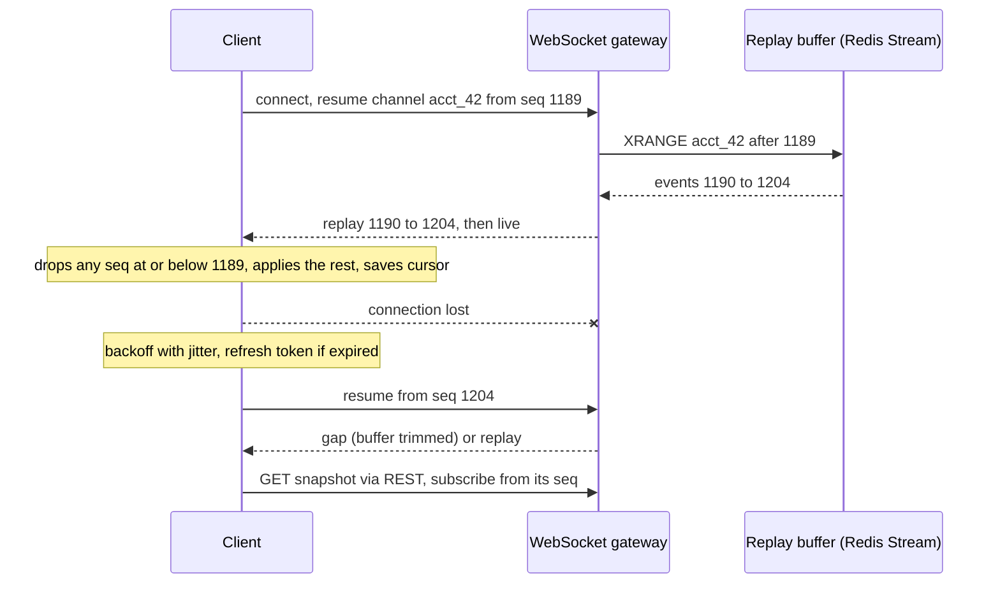

# Client State and Reconnection

> [!abstract] In one sentence
> A push-based client must assume the connection will drop, so it keeps a cursor of the last event it applied, reconnects with backoff, asks the server to replay from that cursor, and reconciles — which turns an unreliable [[WebSockets|WebSocket]] into a stream that never silently loses or double-applies an update.

> [!tip] Deeper treatment in your system-design vault
> `system-design/02 Networking/WebSockets Server-Sent Events and Long Polling.md` — read it *after* you have written your own explanation below.

**Map:** [[Networking MOC]] → [[HLD MOC]]

## Definition

Client state and reconnection is the protocol-level design that lets a client of a persistent stream (WebSocket, SSE, gRPC stream, a message consumer) lose its connection and come back without losing, duplicating or reordering updates. Its parts are: a **monotonic sequence number or cursor** on every server-sent event (per stream or per channel), a **resume token** the client sends on reconnect (the last cursor it applied, plus a session or subscription identifier), a **server-side replay buffer** bounded in size or time, **duplicate suppression** on the client keyed by the sequence, a **reconnect policy** (exponential backoff with jitter, capped), and a **reconciliation path** — a full snapshot fetch — for when the gap cannot be replayed. Pending client-sent messages need the same treatment in reverse: client-generated ids and acknowledgements.

## Problem solved

Persistent connections drop constantly for reasons neither side controls: mobile networks switching cells, laptops sleeping, load balancers rotating connections, pods being redeployed, idle NAT entries expiring. A naive client that just reconnects and resubscribes has two silent bugs. First, every event sent during the gap is lost — a chat message, a balance update, a fraud alert, a dashboard tick — and the user sees a stale screen that looks current. Second, if the client also retries its own unacknowledged sends, the server receives duplicates — a message posted twice, an order placed twice. At scale a third problem appears: when a gateway pod restarts, tens of thousands of clients reconnect *at the same instant*, each asking for a full state reload, and the thundering herd takes down the service that just came back ([[Retry Storms]], [[Cache Stampedes]]). The design in this note makes disconnection a normal, cheap, invisible event rather than a correctness bug and an outage amplifier.

## How it works

1. **Sequence every event.** The server assigns each event on a stream a strictly increasing number — per channel (conversation id, account id, dashboard topic), not global, so a client can resume each subscription independently. Where the stream is backed by a log, use the log's offset or stream id ([[Kafka]] offsets, Redis Streams ids like `1697040000000-0`) as the cursor for free.
2. **Client applies and records.** The client processes an event, then persists `lastSeq` for that channel (memory for a tab, local storage or SQLite for a mobile app so an app restart can also resume). Apply-then-record order matters: recording first and then crashing loses the event; applying twice is prevented by step 5.
3. **Detect the drop quickly.** Heartbeats (ping/pong) at an interval below any intermediary's idle timeout let both sides notice a dead connection within seconds rather than minutes; the client treats a missed pong as a disconnect.
4. **Reconnect with jittered backoff.** `delay = min(cap, base × 2^attempt)`, randomised, with a cap of tens of seconds; reset on success. The jitter is what spreads a mass reconnect over a window instead of a spike. Do not reconnect from an unauthenticated state: refresh the [[JWT]] first if it has expired, otherwise every reconnect fails after a round trip.
5. **Resume.** On the new connection the client sends `{ "resume": { "channel": "acct_42", "lastSeq": 1189, "session": "s_7f" } }`. The server looks up its replay buffer for that channel — a ring buffer in memory, a Redis Stream read with `XRANGE (1189 +`, or a Kafka consumer seek — and replays `1190…now`. Events with `seq ≤ lastSeq` are dropped by the client, which is the **duplicate suppression**; the server may also send them if its buffer boundaries are coarse.
6. **Fall back to a snapshot.** If `lastSeq` is older than the buffer (the client was offline for an hour, or the buffer holds the last 1,000 events), the server replies `{ "resume": "gap" }` and the client fetches the current full state over [[REST]] (`GET /accounts/42/state`), which returns the state *and* the sequence number it corresponds to; the client then subscribes from that sequence. Snapshot plus log is the same shape as [[Event Sourcing]] projections.
7. **Client-to-server sends.** Each outgoing message carries a client-generated id (UUID or `clientId:counter`); the server acknowledges with the id and the assigned server sequence, and stores the id for a window to make a retried send idempotent ([[Idempotency]]). Unacknowledged sends are kept in a local outbox and resent after resume — in order.
8. **Reconcile presence and derived state.** Presence, typing indicators and ephemeral state should not be replayed; they are re-derived (the client re-announces itself) after reconnect.

```ts
// Client side (browser or RN): resume protocol sketch
let lastSeq = loadCursor("acct_42") ?? 0, attempt = 0;
function connect() {
  const ws = new WebSocket(url);
  ws.onopen = () => { attempt = 0; ws.send(JSON.stringify({ resume: { channel: "acct_42", lastSeq } })); };
  ws.onmessage = (m) => {
    const ev = JSON.parse(m.data);
    if (ev.type === "gap") return reloadSnapshotThenResume();
    if (ev.seq <= lastSeq) return;              // duplicate from replay overlap
    apply(ev); lastSeq = ev.seq; saveCursor("acct_42", lastSeq);
  };
  ws.onclose = () => setTimeout(connect, Math.random() * Math.min(30_000, 500 * 2 ** attempt++));
}
```

## Architecture



## Use cases

- "Real-time updates that must not be missed" (balances, order status, fraud alerts, live ops dashboards) — any time a stale screen is a correctness problem ([[Live Ops Dashboard]]).
- "Chat and collaboration" — messages must arrive exactly once in order per conversation across flaky mobile networks ([[Design a Chat System]]).
- "Clients on mobile networks or laptops that sleep" — disconnects are the norm, not the exception.
- "A gateway restart must not cause a reload storm" — resume from cursor is far cheaper than snapshot for every client.
- "Multiple devices for one user that must converge" — cursors per device over one per-user log ([[Presence and Chat Service]]).

## Limitations

- Replay requires a server-side buffer: memory or [[Redis]] per channel, with retention policy and the operational cost of a log.
- Per-channel sequencing assumes a single writer or a serialising point per channel; multi-region or multi-leader fan-out needs a merge rule ([[Ordering Guarantees]]).
- Snapshot fallback must be consistent with the sequence it reports, which requires the state store and the log to be coordinated (read the snapshot and its sequence atomically, or from the log itself).
- Persisting cursors and outboxes on the client adds complexity to every platform (web, iOS, Android, backend consumers).
- It does not solve semantic conflicts: two devices editing the same object offline need a merge strategy beyond sequence numbers ([[Design a Collaborative Document Editor]]).

## Trade-offs

| You gain | You sacrifice |
|---|---|
| No silent loss or duplication across disconnects | A replay buffer per channel and a cursor on every event |
| Cheap reconnects that replay a few events instead of reloading state | Client-side persistence and a more complex protocol |
| Reconnect storms spread by jitter and absorbed by replay | Simplicity of "just resubscribe" |
| Idempotent client sends with ordered delivery | Server-side dedup storage for client message ids |

## Failure modes

- **Replay buffer too short for real gaps**: most reconnects fall into the snapshot path, which is the expensive one, so a gateway restart still causes a herd of snapshot fetches. Noticed as snapshot endpoint traffic spiking with reconnects; size the buffer from observed disconnect durations.
- **Cursor saved before apply**: a crash between save and apply loses an event forever, and nothing reports it. Noticed only through user reports of missing items; order the operations correctly or make apply idempotent and save after.
- **Clients retry sends without ids**: duplicate messages or orders appear after every network blip; noticed in support tickets and reconciliation ([[Duplicate Message Processing]]).
- **Synchronised reconnects**: a fixed 1 s reconnect delay turns a 2 s gateway restart into a connection flood that exceeds the balancer's or gateway's accept rate; noticed as a second outage immediately after recovery ([[Retry Storms]]).
- **Expired auth on resume**: every reconnect fails with `401` and the backoff climbs to the cap; the user is offline for 30 s at a time. Noticed as `401` spikes on the WebSocket handshake endpoint; refresh tokens before reconnecting.

## Performance

A resume costs one round trip plus the replayed events — typically a handful of messages, microseconds of server work and a single Redis `XRANGE` — against a snapshot that may be hundreds of kilobytes and a database read. Heartbeat intervals of 15–30 s detect dead connections within a minute at negligible cost; shorter intervals improve detection but multiply idle traffic across all connections. Reconnect backoff caps of 30–60 s bound both the user-visible outage after a transient blip and the reconnect rate during an incident. Cursor persistence on the client is one small write per event or per batch; batch it on mobile to avoid wear and battery cost.

## Scalability

With N connected clients, the reconnect rate after a gateway failure is N spread over the jitter window; the gateway tier must accept connections at that rate and the replay store must serve N `XRANGE`-style reads — both scale horizontally by channel [[Partitioning|partitioning]] ([[Fan-Out]]). Replay buffer memory scales with channels × retention; trimming by count or time (`XTRIM MAXLEN ~ 1000`, or Kafka retention) keeps it bounded. At 10x clients, the snapshot path is the one that fails first, which is why buffer sizing and resume success rate are the scaling metrics to watch.

## Operational impact

Moderate: you own a protocol (versioned, documented, implemented on every client platform), a replay store with retention, and metrics for resume success rate versus gap rate, reconnect rate, replay sizes and duplicate-suppressed counts. Debugging a "missing update" report means correlating the client's cursor with the server log, so logging cursor values on both sides is essential. The protocol must be [[Backward Compatibility|backward compatible]] across client versions because mobile apps update slowly. Load tests must include disconnect–reconnect scenarios, not just steady-state fan-out.

## Alternatives

- **Stateless resubscribe plus full reload** — wins for small state and few clients; fails as a herd at scale and loses ordering guarantees.
- **Polling with a cursor** (`GET /events?since=1189`) — the same resume semantics over plain HTTP; wins for low-frequency updates and simplicity; loses latency and costs requests ([[WebSockets]] covers long polling versus push).
- **A client-side message broker** (MQTT with persistent sessions and QoS 1, or a hosted real-time service) — wins when you do not want to build the protocol; the broker owns buffers and resumption.
- **CRDT-based sync** — wins when multiple clients edit shared state offline; sequence-and-replay only handles a single logical writer per channel.

## Real-world examples

- Discord's gateway protocol has explicit `RESUME` with a session id and last sequence number, a server-side replay window, and `INVALID_SESSION` forcing a fresh `IDENTIFY` when the gap is too old — the shape described here, documented publicly.
- Slack's real-time API and later Socket Mode use reconnect-with-backoff and reconciliation through the web API when the socket drops.
- Kafka consumer groups and Redis Streams consumer groups are the same idea on the backend: committed offsets or pending entry lists are the cursor, and replay from the committed position is the resume.
- In a stack like yours: a NestJS WebSocket gateway on EKS pushing balance and transaction updates, with per-account sequences stored in a Redis Stream (also the planned Redis Streams migration target for backend messaging), resume handled at the gateway, snapshot via the existing REST endpoints, and client message ids deduplicated with a short-TTL Redis set.

## Practical exercise

1. Build a small NestJS (or Spring) WebSocket server that publishes a counter event per second per channel into a Redis Stream and fans it out to subscribers with the stream id as the sequence.
2. Write a browser or Node client implementing resume, duplicate suppression and jittered backoff as in the sketch above, persisting the cursor to local storage.
3. With Toxiproxy between client and server, cut the connection for 5 s, 60 s and 10 min; verify no gaps or duplicates in the applied counter for the first two and a clean snapshot fallback for the third (`XTRIM` the stream to 100 entries).
4. Start 2,000 client connections (k6 WebSocket scenario), restart the server, and compare the reconnect curve and server CPU with fixed 1 s reconnect versus full-jitter backoff.
5. Add client-sent messages with client ids; retry them blindly after reconnect and count duplicates before and after server-side dedup.

## Related concepts

### Prerequisites
- [[WebSockets]] — the transport whose drops this design survives
- [[Ordering Guarantees]] — per-channel sequencing is the foundation
- [[Timeouts and Retries]] — backoff and jitter for reconnects

### Related
- [[Idempotency]] and [[Duplicate Message Processing]] — client message ids and suppression
- [[Keep-Alive Connections]] — heartbeats and why idle connections die
- [[Redis]] — Streams as a cheap replay buffer
- [[Consumer Groups]] — the backend equivalent of a resume cursor
- [[Retry Storms]] — what synchronised reconnects become

### Builds on this
- [[Real-Time Systems]] — any user-facing push system needs this layer
- [[Fan-Out]] — per-channel logs are what get fanned out
- [[Event Sourcing]] — snapshot plus log replay is the same mechanism

### Design problems where it applies
- [[Design a Chat System]]
- [[Design a Collaborative Document Editor]]
- [[Design a Notification System]]
- [[Design a Social Feed]]

### Projects where it can be implemented
- [[Live Ops Dashboard]]
- [[Presence and Chat Service]]

### Resources
- [[Redis Streams Docs]] — `XADD`, `XRANGE`, consumer groups and trimming as a replay buffer
- [[Designing Data-Intensive Applications]] — logs, offsets and replay in chapter 11
- [[AWS Architecture Blog - Exponential Backoff and Jitter]] — the reconnect schedule

## Personal understanding

> [!question] Explain it without the source
> Write your own explanation here, from memory. Then compare it with the sections above and note what you missed.

### Mastery checklist
- [ ] I can explain it without the original resource
- [ ] I can describe the problem it solves
- [ ] I can compare it with its alternatives
- [ ] I can name its limitations and failure modes
- [ ] I can recognise when it is appropriate in a real system
- [ ] I have applied it in a system design
- [ ] I have validated my assumptions with an experiment or implementation

## Open questions

- [ ] What is the distribution of disconnect durations for our mobile clients, and what replay retention would cover the 99th percentile?
- [ ] Should the snapshot endpoint return its sequence number from the stream itself, or can the database state and stream position drift?
- [ ] How do we version the resume protocol so a six-month-old mobile build keeps working after a gateway change?
