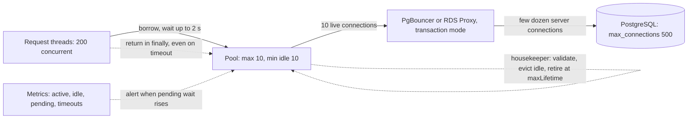

# Connection Pooling

> [!abstract] In one sentence
> A connection pool pre-opens a small, fixed number of connections and hands them out per operation, so each call skips the TCP, [[TLS]] and authentication handshakes and the dependency sees a bounded, predictable number of clients — which makes it both a performance tool and the most common [[Bulkheads|bulkhead]] you will ever configure.

> [!tip] Deeper treatment in your system-design vault
> `system-design/05 Relational Databases/Connection Pooling.md` — read it *after* you have written your own explanation below.

**Map:** [[Networking MOC]] → [[HLD MOC]]

## Definition

A connection pool is an in-process (or sidecar/external) cache of open connections to a remote resource. A caller *borrows* a connection, uses it for one unit of work (a query, a transaction, an HTTP request), and *returns* it; if none is free the caller waits up to a **connection timeout** and then fails. The pool enforces a **maximum size**, keeps a **minimum idle** set warm, validates connections before lending them, and retires connections after a **max lifetime** or **idle timeout**. Pools exist for relational databases (HikariCP in Java, `pg.Pool` in Node, PgBouncer and RDS Proxy as external poolers), for [[Redis]] clients (Lettuce, ioredis), for HTTP clients (Apache HttpClient, `undici`, OkHttp) and for message brokers.

## Problem solved

Establishing a connection is expensive in two ways. In time: a TCP handshake (one RTT), a TLS handshake (one or two more), then protocol authentication — for PostgreSQL that is also a **forked backend process** and session setup, commonly costing several milliseconds and a measurable amount of server memory per connection. Doing that per query turns a 1 ms query into a 10 ms one and burns the database's CPU on handshakes. In capacity: without a pool, concurrency on the client side (every incoming request opens its own connection) maps directly onto concurrency at the dependency; a traffic spike of 2,000 concurrent requests becomes 2,000 database connections, which exceeds `max_connections`, thrashes the database's CPU and memory, and collapses throughput for everyone. The pool fixes both: connections are reused, and the pool size is a hard ceiling on load you can place on the dependency — the knob that turns an unbounded failure into a bounded, visible one.

## How it works

1. **Warm-up.** At start the pool opens `minimumIdle` connections (or lazily on first use); each is authenticated and ready.
2. **Borrow.** A caller asks for a connection. If an idle one exists it is handed over immediately (HikariCP's fast path is a lock-free bag). If not and `size < maximumPoolSize`, a new one is opened. Otherwise the caller queues up to `connectionTimeout` (HikariCP default 30 s — almost always too long for a request path; 1–3 s is more typical) and then receives an exception.
3. **Use.** The caller runs its work on the connection. State matters: a transaction left open, a `SET` session variable, a `search_path` change or an unconsumed result set would leak into the next borrower, so pools reset state on return (PostgreSQL `DISCARD ALL` is the heavy version; Hikari resets autocommit, isolation and read-only flags it changed).
4. **Return.** The connection goes back to the idle set. Returning on *every* path — including exceptions and timeouts — is the single most important thing the application must get right; a leak (`try` without `finally`, a missing `release()` in Node) shrinks the effective pool until it is empty. Hikari's `leakDetectionThreshold` logs a stack trace for connections borrowed longer than N ms.
5. **Maintenance.** A housekeeper evicts idle connections above `minimumIdle` after `idleTimeout`, retires connections older than `maxLifetime` (slightly below the server's or any intermediary's idle cutoff, so the client closes first — see [[Keep-Alive Connections]]), and validates connections (`isValid()` / `SELECT 1`) if they have been idle beyond a threshold so a dead socket is not lent out.
6. **Sizing.** The counter-intuitive rule: small pools win. A database is bounded by cores and disk; beyond roughly `cores × 2 + effective spindles` active connections (the PostgreSQL community heuristic popularised by the HikariCP wiki), extra connections only add context switching and lock contention, so a pool of 10 often outperforms a pool of 100 for the same workload. Size for *active* work, and remember to multiply by the number of pods: 40 pods × 20 connections = 800, which must fit under `max_connections` with headroom for migrations, admin sessions and replicas' needs.
7. **External poolers.** PgBouncer or RDS Proxy sit between many application pods and the database, multiplexing thousands of client connections onto a few dozen server connections. In **transaction pooling** mode a server connection is assigned per transaction, which breaks session-level features (prepared statements by name, `SET` without `LOCAL`, advisory locks, `LISTEN`); **session pooling** keeps compatibility but multiplexes less.
8. **HTTP and Redis pools.** HTTP clients pool keep-alive connections per host with a per-route maximum (defaults are often tiny — Apache HttpClient's historical 2 per route — and must be raised); HTTP/2 multiplexes streams over one connection, so the pool becomes a stream limit. Redis clients usually hold one multiplexed connection (Lettuce, ioredis) and only need a pool for blocking commands or transactions.

```yaml
# Spring Boot, HikariCP, per pod — 30 pods means 300 database connections
spring:
  datasource:
    hikari:
      maximum-pool-size: 10
      minimum-idle: 10
      connection-timeout: 2000      # ms to wait for a free connection, then fail fast
      max-lifetime: 1500000         # 25 min, below any 30 min server or proxy idle cutoff
      idle-timeout: 600000
      leak-detection-threshold: 5000
      validation-timeout: 1000
```

## Architecture



> [!example]- Excalidraw version — the same diagram as an editable canvas
> ![[Connection Pooling.excalidraw]]
> [[Connection Pooling.excalidraw|Open in Excalidraw]] — needs the Excalidraw plugin (see [[Plugins to Install]]).


## Use cases

- "Any service that talks to a relational database" — non-negotiable; the only question is the size.
- "Thousands of pods or serverless functions against one database" — an external pooler is the signal word here, because per-process pools multiply.
- "Protect a dependency from our own traffic spikes" — the pool as a [[Bulkheads|bulkhead]]: callers queue or fail fast instead of flooding the backend.
- "HTTP client to a partner or internal service at high rate" — pooled keep-alive connections remove handshake cost and let you cap concurrency per host.
- "p99 is dominated by connection setup" in traces — look for `connect` and `handshake` spans before every call.

## Limitations

- A pool caps concurrency, which is the point, but it also means a slow dependency converts into *pool wait time* for every caller — the shape of most "the whole service is slow" incidents.
- Per-process pools do not coordinate: 100 pods each with 20 connections is 2,000 connections regardless of what any one pod sees.
- Transaction-mode external poolers break session features; prepared statements, advisory locks and `SET` need care.
- Pooled connections carry hidden state and can go stale (server restart, failover, NAT timeout) without the client noticing until the next use.
- Sizing is workload-dependent and must be revisited when query latency or pod count changes; the HikariCP formula is a starting point, not a law.

## Trade-offs

| You gain | You sacrifice |
|---|---|
| Connection setup paid once per connection, not per operation | Memory and server resources held permanently by idle connections |
| A hard, visible ceiling on load placed on the dependency | Queueing and fail-fast errors when the ceiling is hit, which you must handle |
| Fewer, warmer connections, which usually means higher throughput | Session-level features when using transaction-mode external poolers |
| A clean place for timeouts, validation and metrics | Another set of parameters that must agree with server and proxy timeouts |

## Failure modes

- **Pool exhaustion from a slow dependency**: one slow query type (missing index, lock wait) holds connections longer, the pool fills with those, every unrelated endpoint queues and times out with `Connection is not available, request timed out after 2000ms`. You notice as a step change in latency across *all* endpoints plus pool `pending` metrics rising; blast radius is the whole service. Fix the slow query, set statement timeouts, and consider separate pools per criticality ([[Bulkheads]]).
- **Connection leak**: a code path borrows and never returns; the pool drains over hours and the service dies at 3 a.m. Noticed via `active` creeping up without traffic and leak-detection stack traces. Blast radius: that pod, then all pods on the same release.
- **Stale connections after a database failover**: the pool still holds sockets to the old primary; the first borrow after failover fails or, worse, hangs until the TCP timeout. Mitigate with validation on borrow, short `maxLifetime`, and TCP keepalive; RDS Proxy exists partly for this.
- **Fleet-wide `max_connections` breach** after a scale-out: new pods fail at startup with `too many connections`, and existing pods' housekeepers cannot open replacements. Noticed as crash-looping pods during an autoscale event; the fix is arithmetic plus an external pooler.
- **Thread-per-connection on the server exhausted by idle pools**: 200 pods × `minimumIdle: 10` keeps 2,000 mostly idle backends on PostgreSQL, costing memory and slowing checkpoints. Lower `minimumIdle` or pool externally.

## Performance

Borrowing from a warm pool costs microseconds; opening a new PostgreSQL connection costs milliseconds of latency plus a process fork and tens of megabytes of server-side memory once caches warm, and a TLS handshake adds one to two RTTs on top ([[Latency]]). Throughput against a database typically *peaks* at a small number of active connections and *declines* beyond it as contention grows — which is why the right pool size is found by measurement (throughput versus pool size under a realistic mix), not by raising the number until timeouts stop. Pool wait time should be a first-class [[Metrics|metric]]: p99 of "time to acquire" tells you about saturation earlier than query latency does.

## Scalability

Pools scale with pods, which is the problem: total connections = pods × pool size, and the database's `max_connections` is a hard limit with a per-connection memory cost. At 10x pods the answer is an external pooler (PgBouncer per node or as a service, RDS Proxy), smaller per-pod pools, or [[Read Replicas]] with their own pools for read traffic. For HTTP dependencies, pools scale per host; HTTP/2 lets one connection carry many streams, changing the question from "how many connections" to "how many concurrent streams per host". For sharded databases, one pool per shard multiplies again — keep pools small and lazy ([[Sharding]]).

## Operational impact

Moderate: a pool is a few lines of configuration that must stay consistent with server limits, proxy idle timeouts and pod counts, and that must be re-derived when any of those change. Dashboards need `active`, `idle`, `pending` and `acquire timeout` per pool; alert on pending wait time rather than on the pool being full (a full pool with zero wait is healthy). On-call will meet pool exhaustion as the symptom of many unrelated root causes, so the runbook should start with "what is holding the connections" (`pg_stat_activity`, leak traces) rather than "raise the pool size". External poolers add a component with its own failover story and version lag behind PostgreSQL features.

## Alternatives

- **No pool, connection per request** — wins only for very low traffic or a platform where the proxy pools for you (serverless with RDS Proxy); otherwise it is the failure mode, not an alternative.
- **External pooler only** (PgBouncer, RDS Proxy) — wins when there are many short-lived processes or functions; still pair it with a small in-process pool for latency.
- **Multiplexed single connection** (Redis clients, HTTP/2, [[gRPC]] channels) — wins where the protocol supports pipelining or streams; the "pool" becomes a concurrency limit instead.
- **Serverless or proxy-managed databases** (Aurora Serverless with Data API, Neon's pooled endpoint) — wins for bursty, low-ops workloads; costs latency and feature compatibility.

## Real-world examples

- HikariCP's documentation ("About Pool Sizing") demonstrates a benchmark where a pool of ~10 outperformed a pool of thousands on a typical server, and it is the default pool in Spring Boot for that reason.
- PgBouncer is run by nearly every large PostgreSQL deployment (GitLab, Instagram in its early write-ups) to multiplex application connections onto a bounded set of server backends.
- AWS built RDS Proxy specifically for Lambda and large fleets, where per-process pools made `max_connections` and failover handling untenable.
- In a stack like yours: Spring Boot services with HikariCP sized per pod and multiplied by replica count against RDS/Aurora, NestJS services with `pg.Pool` or TypeORM pools and the same arithmetic, Lettuce or ioredis holding a single multiplexed connection to Redis, and an HTTP client pool per partner host with a per-route cap so one slow payment partner cannot hold every outbound connection.

## Practical exercise

1. Start PostgreSQL with `max_connections=50` in Docker and a Spring Boot or NestJS service with a pool of 10 and `connection-timeout: 2000`.
2. With k6, run 200 concurrent users against a fast endpoint; record throughput and p99 at pool sizes 5, 10, 20, 50 and find the knee where more connections stop helping.
3. Add an endpoint that runs `SELECT pg_sleep(3)`; send 10 concurrent calls to it and watch every *other* endpoint time out with pool-acquire errors; then give that endpoint its own pool and repeat.
4. Introduce a leak (borrow without return on an error path), enable `leakDetectionThreshold`, and watch `active` climb until the pool is empty.
5. Put PgBouncer in transaction mode in front, run 30 pods' worth of pools (300 connections) against `max_connections=50`, and confirm it works; then try a named prepared statement and observe the failure.

## Related concepts

### Prerequisites
- [[TCP and UDP]] — the handshake cost being amortised
- [[TLS]] — the second handshake being amortised
- [[Relational Database Internals]] — why a PostgreSQL connection is a process with memory

### Related
- [[Keep-Alive Connections]] — the HTTP form of connection reuse and the idle-timeout race
- [[Timeouts and Retries]] — acquire timeouts, statement timeouts and what to retry
- [[Bulkheads]] — pools per dependency or per criticality isolate failures
- [[Bottleneck Analysis]] — pool wait time is the earliest saturation signal
- [[Redis]] — multiplexed clients versus pooled ones
- [[Read Replicas]] — separate pools for read and write paths

### Builds on this
- [[Database Scaling]] — connection limits shape the whole scaling path
- [[Circuit Breakers]] — fail fast when the pool is exhausted instead of queueing forever
- [[Graceful Degradation]] — shed low-priority work when acquire time climbs

### Design problems where it applies
- [[Design a Payment System]]
- [[Design a Rate Limiter]]
- [[Design a Digital Wallet and Ledger]]
- [[Design a Ticket Booking System]]

### Projects where it can be implemented
- [[Load Test and Latency Lab]]
- [[Double-Entry Ledger Service]]
- [[Chaos Lab]]

### Resources
- [[Release It!]] — connection pools as a stability pattern and as a failure mode
- [[Database Internals]] — what a server-side connection costs
- [[Designing Data-Intensive Applications]] — context on database load and contention

## Personal understanding

> [!question] Explain it without the source
> Write your own explanation here, from memory. Then compare it with the sections above and note what you missed.

### Mastery checklist
- [ ] I can explain it without the original resource
- [ ] I can describe the problem it solves
- [ ] I can compare it with its alternatives
- [ ] I can name its limitations and failure modes
- [ ] I can recognise when it is appropriate in a real system
- [ ] I have applied it in a system design
- [ ] I have validated my assumptions with an experiment or implementation

## Open questions

- [ ] What is our current total connection count against each RDS instance (pods × pool size × services), and how much headroom is left under `max_connections` during a scale-out?
- [ ] Which of our endpoints should have their own pool so a slow ledger query cannot take down health checks and token validation?
- [ ] Would RDS Proxy's failover handling be worth its latency and cost for our payment services, or is a short `maxLifetime` plus validation enough?
