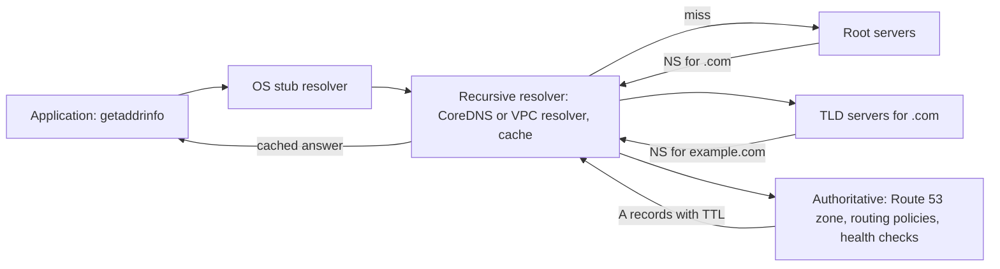

# DNS

> [!abstract] In one sentence
> DNS is a hierarchical, cached, eventually consistent key-value store for names that every connection in your system consults first — which makes its TTLs your coarsest traffic-steering and failover knob, and its outages the ones that look like everything failed simultaneously.

> [!tip] Deeper treatment in your system-design vault
> `system-design/02 Networking/How DNS Works.md` — read it *after* you have written your own explanation below.

**Map:** [[Networking MOC]] → [[HLD MOC]]

## Definition

The Domain Name System maps names (`api.example.com`) to records: `A`/`AAAA` (IPv4/IPv6 addresses), `CNAME` (alias to another name), `MX` (mail), `TXT` (arbitrary text, used for verification and SPF), `SRV` (service host and port), `NS` (which servers are authoritative for a zone) and `SOA` (zone metadata). Authority is delegated hierarchically from the root through top-level domains to the zone's authoritative servers; everyone else caches answers for the record's **TTL**. It is, structurally, a replicated and cached read-mostly database with eventual consistency and no transactions.

## Problem solved

Addresses change, machines are replaced, and nobody can remember 32-bit numbers. Before DNS there was a single `HOSTS.TXT` file copied around, which could not keep up with growth. DNS adds **indirection** (a stable name over changing addresses) and **distributed ownership** (each organisation runs its own zone) with **aggressive caching** so that the root servers answer a tiny fraction of the world's queries. For a system designer the indirection is the point: a name can resolve to different addresses per region, rotate through several backends, or move to a standby site — all without clients changing configuration. The trap is that this indirection is only as fresh as the caches allow.

## How it works

1. **Stub resolver.** Your process calls `getaddrinfo()` (Java's `InetAddress`, Node's `dns.lookup`), which asks the OS stub resolver, which asks the configured recursive resolver (on Kubernetes, CoreDNS; on EC2, the VPC resolver at `169.254.169.253` or the `.2` address; on a laptop, your ISP or 1.1.1.1/8.8.8.8).
2. **Recursive resolution.** If the recursive resolver has no cached answer, it walks the hierarchy: a root server returns the `.com` NS records, a `.com` server returns `example.com`'s NS records, and the authoritative server returns the `A` record. Each hop's answer is cached with its own TTL, so the next lookup for anything under `example.com` skips straight to the authoritative server.
3. **Transport.** Queries are UDP on port 53, retried on timeout; answers over 512 bytes (or 4,096 with EDNS0) fall back to TCP. DNS-over-HTTPS/TLS encrypts the client-to-resolver hop ([[TCP and UDP]]).
4. **TTL and caching.** Every record carries a TTL in seconds. Resolvers, OS caches, JVMs and application pools all cache; a lookup after a change returns the old answer until *every* cache in the chain expires. "Propagation" is not a push — it is caches expiring at different times. Negative answers (`NXDOMAIN`) are cached too, for the zone's SOA minimum.
5. **Steering.** Authoritative servers can answer differently per query: round-robin over several `A` records, weighted or latency-based routing (Route 53 policies), geo-based answers that point users at the nearest [[CDNs|CDN]] PoP, and health-checked failover that drops an unhealthy address from the answer set.
6. **Inside a cluster.** Kubernetes publishes `svc.namespace.svc.cluster.local` records via CoreDNS, with a short TTL (typically 5–30 s); pods resolve through it on every new connection, which makes CoreDNS a hidden dependency of every service call that is not using a pooled connection ([[Service Discovery]]).

```bash
dig +trace api.example.com A      # walk root -> TLD -> authoritative
dig @10.96.0.10 payments.prod.svc.cluster.local +short   # ask CoreDNS directly
# JVM: positive cache TTL in seconds (default 30 unless a security manager is set)
-Dnetworkaddress.cache.ttl=30 -Dnetworkaddress.cache.negative.ttl=10
```

## Architecture



> [!example]- Excalidraw version — the same diagram as an editable canvas
> ![[DNS.excalidraw]]
> [[DNS.excalidraw|Open in Excalidraw]] — needs the Excalidraw plugin (see [[Plugins to Install]]).


## Use cases

- "Clients must not need reconfiguring when we move or scale the backend" — put a name in front of it, not an address.
- "Route users to the nearest region" or "fail over to the DR region within minutes" — latency/geo/failover routing policies with short TTLs are the standard first layer ([[Disaster Recovery]]).
- "Services need to find each other inside the cluster" — DNS-based [[Service Discovery]] (CoreDNS, Consul, Route 53 private zones) is the lowest-friction option.
- "Prove you own this domain" or "which mail servers accept for us" — `TXT`, `MX` and `CAA` records are control-plane data, not just lookups.
- Canary or blue/green cutovers at the domain level, when a [[Load Balancers|load balancer]] switch is not possible (different providers or regions).

## Limitations

- Failover speed is bounded by the *longest* cache in the chain, not your TTL; browsers, JVMs and resolvers all round up or pin.
- It cannot see per-request load or session state, so DNS "load balancing" is coarse: clients pick one address and stick to it for the TTL.
- Short TTLs raise query volume and make the authoritative servers a hotter dependency; a 5 s TTL on a busy name is thousands of queries per second.
- No atomic multi-record updates and no transactions; a change is a race across caches.
- Not a health check: unless the provider integrates health checks, a name happily resolves to a dead host.

## Trade-offs

| You gain | You sacrifice |
|---|---|
| Stable names over changing infrastructure, understood by every client ever written | Freshness: changes take a TTL (and sometimes much longer) to be seen everywhere |
| Global scale through caching at every layer | Debuggability: the answer a client got depends on which cache it asked and when |
| Geo, latency and failover steering with no client changes | Coarseness: decisions are per client-resolver, not per request |
| One hidden dependency that already exists everywhere | One hidden dependency that already exists everywhere — and fails like a power cut |

## Failure modes

- **Resolver down or overloaded** (CoreDNS pods evicted, VPC resolver throttled): every *new* connection in the cluster fails with `UnknownHostException`/`ENOTFOUND` while existing pooled connections keep working — the signature of a DNS incident is "only new connections fail, everywhere". Blast radius: the whole cluster.
- **Stale cached answer after a cutover**: a subset of clients keeps hitting the old region for minutes or hours; you notice as traffic to the decommissioned endpoint refusing to drop. Mitigate by lowering TTL *before* the change and keeping the old endpoint alive for a grace period.
- **Negative caching of a name that did not exist yet**: a service deployed before its record was created gets `NXDOMAIN` cached for the negative TTL; retries fail for that window even though the record now exists.
- **JVM caching forever** (when a security manager is active, `networkaddress.cache.ttl` defaults to -1): a Java client pins an IP across a database failover and never recovers without a restart. Set the TTL explicitly.
- **`ndots` and search-path amplification** on Kubernetes: an external name like `api.stripe.com` with `ndots:5` is first tried as `api.stripe.com.prod.svc.cluster.local` and three more suffixes — five queries per lookup, which under load turns CoreDNS into a bottleneck and shows up as slow p99 for *external* calls. Use a trailing dot or lower `ndots`.

## Performance

A cached lookup is sub-millisecond; an uncached recursive walk is tens to hundreds of milliseconds (several round trips to servers that may be far away). Because every new TCP connection may trigger a lookup, DNS latency is paid wherever connections are not reused — one more reason for pooling ([[Connection Pooling]], [[Keep-Alive Connections]]). Authoritative providers answer from anycast edges, so query latency to Route 53 or Cloudflare is typically a handful of milliseconds. Query volume scales inversely with TTL: a name resolved by 1,000 pods every 5 s is 200 qps on the resolver for that single name.

## Scalability

The hierarchy plus caching is why DNS scales to the whole internet: the root sees a trickle. Inside your system the scaling concern is the recursive resolver you run — CoreDNS replicas sized to the cluster's connection churn, NodeLocal DNSCache to absorb repeated lookups per node — and the TTL you choose. At 10x services and pods, lookups grow with connection creation rate, not with request rate, so the lever is connection reuse rather than more DNS capacity.

## Operational impact

Low day-to-day, high during incidents. Zone changes should go through infrastructure-as-code with the TTL lowered ahead of planned cutovers. Monitor resolver error rate and latency as first-class signals ([[Monitoring]]); alert on `SERVFAIL`/timeouts cluster-wide. Keep a runbook for "DNS looks down": check CoreDNS pods and conntrack on nodes, check the upstream resolver, and remember that restarting application pods clears their caches but also drops their pooled connections. Rotate health-check configurations and record ownership when services move.

## Alternatives

- **Static IPs or Elastic IPs** — win for a tiny number of well-known endpoints (NAT gateways, partner allow-lists); lose the moment anything needs to move.
- **Client-side [[Service Discovery]] via a registry (Consul, Eureka, Kubernetes API)** — wins when you need per-instance health and metadata faster than TTLs allow; costs a client library and a registry to run.
- **Anycast + global [[Load Balancers|load balancer]] (Global Accelerator, Cloudflare)** — wins for failover in seconds without cache dependence, because the IP does not change; costs money and a provider dependency.
- **Service mesh (Envoy/Istio xDS)** — pushes endpoints to sidecars instantly; wins for intra-cluster routing precision, costs a control plane and a sidecar per pod.

## Real-world examples

- The 2021 Facebook outage withdrew the BGP routes to its authoritative DNS servers; with names unresolvable, every property — and internal tools — appeared dead at once, the archetypal "DNS failure looks like total failure".
- Route 53 health-checked failover records are the documented primary mechanism for cross-region DR on AWS, with the caveat that client caches bound the recovery time.
- Kubernetes service discovery is DNS (CoreDNS), and the `ndots:5` default has caused enough latency incidents that NodeLocal DNSCache became a standard add-on.
- In a stack like yours: services on EKS resolving each other through CoreDNS and reaching RDS, [[Redis|ElastiCache]] and MSK through DNS names that change on failover — so JVM DNS TTL settings, `ndots`, and pooled-connection refresh after an endpoint flips are the three things worth checking before the next failover drill.

## Practical exercise

1. Create a local zone with a Docker `coredns` or `dnsmasq` container serving `app.test` with a 30 s TTL; point a second container's `/etc/resolv.conf` at it.
2. From a small Java or Node program, resolve `app.test` in a loop every second and print the answer and elapsed time; change the record and measure how long until the program sees it.
3. Repeat with the JVM's `networkaddress.cache.ttl` set to 300, then to -1, and observe the pinning.
4. Add `options ndots:5` and a search list with four suffixes; resolve an external name and count queries with `tcpdump -i any port 53`.
5. Stop the DNS container while a keep-alive HTTP client is running; note that pooled connections keep working and only new ones fail.

## Related concepts

### Prerequisites
- [[TCP and UDP]] — queries over UDP with TCP fallback

### Related
- [[Load Balancers]] — DNS steering is the layer above them
- [[CDNs]] — geo-DNS points users at the nearest edge
- [[Service Discovery]] — DNS is the simplest registry
- [[TTL]] — the same caching idea, applied to names
- [[Availability]] — a shared dependency that bounds everything's availability
- [[Disaster Recovery]] — DNS failover is the usual cross-region switch

### Builds on this
- [[Service Discovery]] — cluster DNS is its default implementation
- [[CDNs]] — depend on DNS to steer clients to edges
- [[Load Balancers]] — are reached through names and health-checked records
- [[Disaster Recovery]] — region failover runbooks are built on DNS changes

### Design problems where it applies
- [[Design a URL Shortener]]
- [[Design an API Gateway]]
- [[Design a Video Streaming Service]]

### Projects where it can be implemented
- [[Chaos Lab]]

### Resources
- [[System Design Primer (GitHub)]] — the DNS section and its linked primers
- [[Release It!]] — on hidden shared dependencies and failover reality

## Personal understanding

> [!question] Explain it without the source
> Write your own explanation here, from memory. Then compare it with the sections above and note what you missed.

### Mastery checklist
- [ ] I can explain it without the original resource
- [ ] I can describe the problem it solves
- [ ] I can compare it with its alternatives
- [ ] I can name its limitations and failure modes
- [ ] I can recognise when it is appropriate in a real system
- [ ] I have applied it in a system design
- [ ] I have validated my assumptions with an experiment or implementation

## Open questions

- [ ] What is the effective end-to-end recovery time if our RDS endpoint flips to a standby, given the JVM cache TTL, the HikariCP max-lifetime and the CoreDNS cache?
- [ ] How many DNS queries per second does one of our busiest pods generate, and what fraction are `ndots` search-path misses?
- [ ] For a cross-region failover of the public API, is DNS failover acceptable against our RTO, or do we need an anycast front door?
