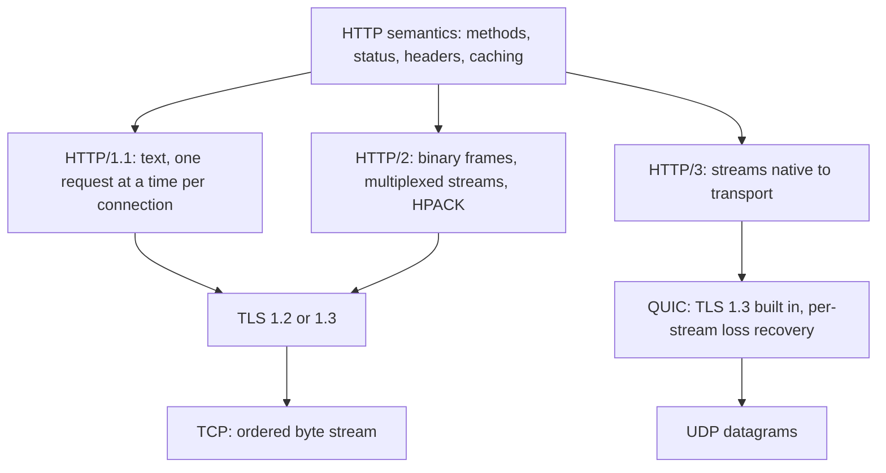

# HTTP and HTTPS

> [!abstract] In one sentence
> HTTP is a stateless request-response protocol whose *semantics* (methods, status codes, headers, cacheability) are what you design APIs against, while its *versions* (1.1 text over one TCP stream per request, 2 multiplexed binary frames over one TCP connection, 3 over QUIC/UDP) decide how much latency and head-of-line blocking you pay — and HTTPS is the same thing wrapped in [[TLS]].

> [!tip] Deeper treatment in your system-design vault
> `system-design/02 Networking/HTTP 1.1 vs HTTP 2 vs HTTP 3.md` — read it *after* you have written your own explanation below.

**Map:** [[Networking MOC]] → [[HLD MOC]]

## Definition

HTTP (Hypertext Transfer Protocol) is an application-layer protocol in which a client sends a **request** (method, target, headers, optional body) and a server returns a **response** (status code, headers, optional body). The protocol is **stateless**: each request carries everything the server needs, and any memory of earlier requests lives in cookies, tokens or server-side stores, not in the protocol. The semantics are defined once (RFC 9110) and carried by three wire formats: HTTP/1.1 (RFC 9112), HTTP/2 (RFC 9113) and HTTP/3 (RFC 9114, over QUIC). HTTPS is HTTP sent through a [[TLS]] session, which gives confidentiality, integrity and server authentication without changing a single HTTP semantic.

## Problem solved

Before HTTP there was no universal, intermediary-friendly way to ask a remote machine for a representation of something. HTTP's design choices each remove a concrete pain:

- **Uniform semantics** let a cache, a proxy, a [[CDNs|CDN]] or a [[Load Balancers|load balancer]] reason about a request it has never seen: `GET` is safe and cacheable, `PUT` is idempotent, `503` means "retry later". Without that, every intermediary would need application knowledge.
- **Statelessness** means any server replica can answer any request, which is what makes [[Horizontal vs Vertical Scaling|horizontal scaling]] behind a balancer trivial.
- **HTTP/2 and HTTP/3** exist because HTTP/1.1's one-request-at-a-time-per-connection model made page loads and chatty APIs latency-bound: browsers opened ~6 parallel connections per host and still queued, and one slow response blocked everything behind it on that connection (head-of-line blocking).

## How it works

1. **Request line and headers.** `GET /payments/42 HTTP/1.1` plus headers such as `Host`, `Accept`, `Authorization`, `If-None-Match`. Headers are the protocol's extension mechanism; the body is opaque bytes described by `Content-Type`.
2. **Methods carry contracts.** *Safe* methods (`GET`, `HEAD`, `OPTIONS`) must not change state. *Idempotent* methods (safe ones plus `PUT`, `DELETE`) can be repeated without a different outcome — this is what lets a client or proxy retry them blindly ([[Timeouts and Retries]]). `POST` and `PATCH` are neither, so retrying them needs an [[Idempotency|idempotency key]].
3. **Status codes are the response contract.** 2xx success (`201 Created`, `202 Accepted`, `204 No Content`), 3xx redirects (`301` cacheable permanent, `302`/`307` temporary, `304 Not Modified`), 4xx client fault (`400`, `401` unauthenticated, `403` unauthorised, `404`, `409` conflict, `412` precondition failed, `429` too many requests), 5xx server fault (`500`, `502`, `503`, `504`). Intermediaries and SDKs branch on these, so misusing them (returning 200 with `{"error":…}`) breaks retries, caching and alerting.
4. **Caching is built in.** `Cache-Control: max-age=60, public`, `ETag` + `If-None-Match`, `Last-Modified` + `If-Modified-Since`, and `Vary` tell every cache between client and origin what it may store and for how long ([[TTL]], [[Cache Invalidation]]).
5. **Connections.** HTTP/1.1 defaults to persistent connections ([[Keep-Alive Connections]]) but serialises requests on each one; pipelining was never reliably deployed. HTTP/2 frames requests into **streams** multiplexed over one TCP connection with HPACK header compression and stream prioritisation, so a single connection carries hundreds of concurrent requests — but a lost TCP segment stalls *all* streams, because [[TCP and UDP|TCP]] delivers bytes in order. HTTP/3 moves to **QUIC** (RFC 9000) over UDP: streams are independent at the transport layer, TLS 1.3 is built into the handshake (1 RTT, or 0-RTT on resumption), and the connection survives a client IP change (mobile hand-off) via connection IDs.
6. **HTTPS.** The client opens TCP, runs the TLS handshake, then speaks HTTP inside the encrypted channel; ALPN negotiates `h2` or `http/1.1` during the handshake, and `h3` is advertised with the `Alt-Svc` header.

```http
POST /transfers HTTP/1.1
Host: ledger.internal
Content-Type: application/json
Idempotency-Key: 7c9e6679-7425-40de-944b-e07fc1f90ae7
Authorization: Bearer eyJ…

{"from":"acc_1","to":"acc_2","amount_minor":1999,"currency":"INR"}

HTTP/1.1 201 Created
Location: /transfers/tr_8f3a
Cache-Control: no-store
```

## Architecture



## Use cases

- Any public or partner-facing API: the moment a requirement says "third parties integrate with us", HTTP semantics (not a custom RPC) are the lingua franca ([[REST]]).
- Browser-driven products: anything a browser must call directly is HTTP, and HTTP/2 or 3 is what makes many small resources cheap.
- Requests that benefit from caches you do not own: public catalogue data, images, static config — HTTP's cache model lets a CDN serve them without application logic.
- Mobile clients on lossy networks: HTTP/3's independent streams and connection migration directly reduce tail latency on the move.
- Internal service calls where you want curl-able debuggability and off-the-shelf tooling (gateways, tracing, mocks) more than the last few percent of throughput.

## Limitations

- Request-response only: server push (HTTP/2 PUSH) was effectively abandoned; for server-initiated data you need [[WebSockets]], SSE or polling.
- Text headers (HTTP/1.1) and JSON bodies are verbose; for high-fanout internal RPC, [[gRPC]] over HTTP/2 with protobuf is markedly cheaper in CPU and bytes.
- HTTP/2's multiplexing interacts badly with naive load balancing: one long-lived connection pins a client to one backend ([[Load Balancers]]).
- HTTP/3 needs UDP open end-to-end; some corporate networks and older load balancers block or do not terminate it, so you always keep an HTTP/2 fallback.
- Statelessness pushes session state elsewhere (tokens, [[Redis]]), which is a feature until a request needs context the client cannot be trusted to carry.

## Trade-offs

| You gain | You sacrifice |
|---|---|
| Universal interoperability: every language, proxy, cache and tool understands it | Verbosity and parsing cost compared with binary RPC |
| Built-in caching, retry and redirect semantics that intermediaries honour | You must respect those semantics (idempotent methods, honest status codes) or the ecosystem works against you |
| HTTP/2 and 3 remove most connection-count and HOL-blocking latency | More complex connection state, harder-to-balance long-lived connections, UDP dependency for HTTP/3 |
| HTTPS gives confidentiality and server identity with no API changes | Handshake latency and CPU on every new connection, certificate operations to run |

## Failure modes

- **Wrong status codes** (200 for errors, 500 for validation failures): clients retry non-retryable calls, dashboards show a healthy service that is failing; blast radius is every consumer's error handling.
- **Non-idempotent POST retried by a proxy or SDK after a timeout**: duplicate transfers or orders; you notice as duplicate rows keyed on the same client request. Fix with idempotency keys ([[Idempotency]]).
- **HTTP/2 connection pinning**: all requests from one client pod land on one backend; you see one hot backend while the rest idle ([[Hot Keys]] at the connection level). Fix with L7 balancing or client-side connection rotation.
- **Over-caching**: a `Cache-Control: public` response that contained user-specific data is served to the wrong user by a CDN — a privacy incident with a radius of every cache in the path. `Vary: Authorization` or `private` is the guard.
- **Head-of-line blocking under packet loss** on HTTP/2: p99 latency of *all* streams rises with loss on one path; visible as correlated tail latency across unrelated endpoints on lossy client networks.

## Performance

A new HTTPS connection costs one TCP round trip plus one (TLS 1.3) or two (TLS 1.2) TLS round trips before the first byte of HTTP — on a 50 ms RTT that is 100–150 ms of pure waiting, which is why connection reuse and pooling matter more than almost any server optimisation ([[Keep-Alive Connections]], [[Connection Pooling]]). HTTP/2 typically cuts page-level latency by removing connection limits and compressing headers (HPACK routinely shrinks repeated headers by an order of magnitude); HTTP/3 helps mostly at the tail on lossy links. Per-request server cost for JSON-over-HTTP is dominated by serialisation and TLS, not by the protocol framing.

## Scalability

Statelessness is the scaling property: any replica can serve any request, so capacity is added by adding pods behind a balancer. At 10x traffic the questions become connection management (how many long-lived HTTP/2 connections per balancer node), TLS termination CPU (terminate at the edge, re-encrypt internally if required), and cache hit ratio (every cacheable response served from a CDN is a request the origin never sees). HTTP itself never becomes the bottleneck; your handlers and your downstream calls do ([[Bottleneck Analysis]]).

## Operational impact

Low to moderate. You get free observability — status code and latency histograms per route are the universal [[Metrics]] — and curl-level debuggability. The recurring chores are certificate renewal and rotation, deciding where TLS terminates (ingress vs sidecar vs pod), keeping protocol versions consistent across balancer, ingress and services, and auditing caching headers on anything that touches personal data. HTTP/3 adds UDP firewall rules and a newer balancer requirement.

## Alternatives

- **[[gRPC]]** — wins for internal service-to-service calls where contract-first schemas, streaming and low CPU per call matter more than browser or partner reach.
- **[[WebSockets]] or SSE** — win when the server must push: chat, live dashboards, streaming LLM tokens.
- **Message queues ([[Message Queues]], [[Kafka]])** — win when the caller does not need a synchronous answer and you want buffering and retries built into the transport ([[Synchronous vs Asynchronous Communication]]).
- **GraphQL over HTTP** — same transport, different query model; wins for client-shaped reads across many resources, costs caching simplicity and server-side complexity.

## Real-world examples

- Google deployed SPDY, then HTTP/2, and later QUIC/HTTP/3 across its properties; a large share of Chrome's traffic to Google services runs over HTTP/3 today, and Cloudflare serves HTTP/3 to any site with one toggle.
- Stripe's public API is plain HTTPS/1.1 with idempotency keys and precise status codes, demonstrating that correct semantics matter more than protocol version for a money-moving API.
- The AWS SDKs and S3 are HTTP APIs end to end; S3's request-rate limits are stated per prefix in HTTP requests per second.
- In a stack like yours: an ALB or NGINX ingress terminating TLS and HTTP/2 from clients, Spring Boot and NestJS services behind it speaking HTTP/1.1 or HTTP/2, and `Idempotency-Key` headers on every money-moving `POST` so that gateway and SDK retries stay safe.

## Practical exercise

1. Run an NGINX container with a self-signed cert serving a page that loads 50 small images; enable `http2` in one server block and leave another on HTTP/1.1.
2. With `curl --http1.1 -w "%{time_connect} %{time_appconnect} %{time_starttransfer}\n"` and `--http2`, measure connect, TLS and first-byte times for a single request; note the TLS cost.
3. Load the page in a browser DevTools network panel with both protocols and compare total load time and the number of connections opened.
4. Add 2% packet loss on the container's interface with `tc qdisc add dev eth0 root netem loss 2%` and repeat; observe HTTP/2's correlated stalls.
5. Stretch: enable HTTP/3 (NGINX ≥ 1.25 with `listen 443 quic`) and repeat the lossy test; measure p95 of the 50 image fetches.

## Related concepts

### Prerequisites
- [[TCP and UDP]] — HTTP/1.1 and 2 ride on TCP; HTTP/3 on UDP via QUIC
- [[TLS]] — HTTPS is HTTP inside a TLS session

### Related
- [[REST]] — the API style built on HTTP's uniform interface
- [[Keep-Alive Connections]] — why connection reuse dominates latency
- [[gRPC]] — the binary RPC alternative on HTTP/2
- [[CDNs]] — HTTP caching semantics at the edge
- [[Load Balancers]] — L7 balancers parse HTTP and struggle with HTTP/2 pinning
- [[Idempotency]] — what makes retrying a request safe

### Builds on this
- [[REST]] — resource semantics over HTTP methods and status codes
- [[gRPC]] — reuses HTTP/2 streams and framing
- [[WebSockets]] — upgraded from an HTTP/1.1 request
- [[API Gateways]] — an HTTP reverse proxy with policy
- [[Designing APIs and Contracts]] — contracts are expressed in HTTP terms

### Design problems where it applies
- [[Design an API Gateway]]
- [[Design a URL Shortener]]
- [[Design a Video Streaming Service]]
- [[Design a Webhook Delivery System]]

### Projects where it can be implemented
- [[LLM Gateway]]
- [[Webhook Relay]]

### Resources
- [[gRPC Core Concepts]] — the HTTP/2 mapping explains what HTTP/2 actually provides
- [[System Design Primer (GitHub)]] — the networking primer and status-code cheat sheets
- [[Designing Data-Intensive Applications]] — chapter 4 on encoding and dataflow through services

## Personal understanding

> [!question] Explain it without the source
> Write your own explanation here, from memory. Then compare it with the sections above and note what you missed.

### Mastery checklist
- [ ] I can explain it without the original resource
- [ ] I can describe the problem it solves
- [ ] I can compare it with its alternatives
- [ ] I can name its limitations and failure modes
- [ ] I can recognise when it is appropriate in a real system
- [ ] I have applied it in a system design
- [ ] I have validated my assumptions with an experiment or implementation

## Open questions

- [ ] In the ingress → service hop on EKS, does enabling HTTP/2 between the ALB and pods change p99 under load, or does the balancer's per-connection pinning cancel the gain?
- [ ] Which of our `POST` endpoints are retried by SDK defaults today, and which of them lack an idempotency key?
- [ ] When would it be worth terminating HTTP/3 at the edge for a fintech app whose clients are mostly on mobile networks, and how would we measure the tail-latency benefit?
