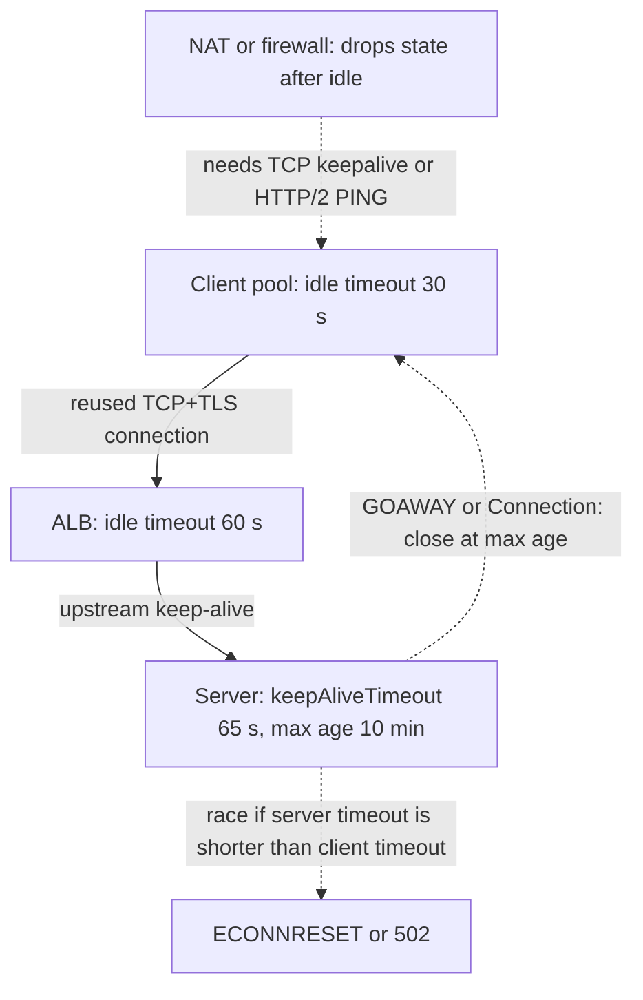

# Keep-Alive Connections

> [!abstract] In one sentence
> A keep-alive (persistent) connection stays open after a response so the next request skips the TCP and [[TLS]] handshakes — a few round trips saved on every call — at the cost of agreeing with every hop on how long an idle connection lives and who closes it first.

> [!tip] Deeper treatment in your system-design vault
> `system-design/02 Networking/HTTP 1.1 vs HTTP 2 vs HTTP 3.md` — read it *after* you have written your own explanation below.

**Map:** [[Networking MOC]] → [[HLD MOC]]

## Definition

In HTTP/1.0 each request opened a TCP connection that the server closed after the response. HTTP/1.1 made **persistent connections** the default: after a response, the connection stays open and the client may send the next request on it; either side may close it, signalled with `Connection: close`, and servers close idle connections after an **idle timeout** (nginx's `keepalive_timeout` defaults to 75 s, Node's `server.keepAliveTimeout` to 5 s). HTTP/2 goes further: one connection per origin carries many concurrent streams, so keep-alive is not optional but structural, and liveness is checked with `PING` frames. At the transport layer, **TCP keepalive** is a separate, older mechanism: the kernel sends empty probes on an idle socket (default after two hours on Linux, tunable) to detect dead peers and keep NAT mappings alive. The two share a name and a purpose but are different layers.

## Problem solved

A new connection costs one round trip for the TCP handshake and one or two more for TLS, plus slow-start: the first requests on a fresh connection are throttled by a small congestion window, so a 100 KB response takes several round trips to deliver. On a 50 ms path that is 100–150 ms of overhead *per request* before any application work, and on the server each new connection costs an accept, a TLS handshake's CPU and, for process-per-connection servers, a fork. Without keep-alive a page with 30 assets or a service making 1,000 calls per second to a neighbour pays this every time, and the server spends a large fraction of its CPU on handshakes while leaving thousands of sockets in `TIME_WAIT`. Keep-alive amortises all of it: the handshake is paid once, the congestion window stays open, and the server's connection count reflects concurrency rather than request rate ([[Latency]], [[Throughput]]).

## How it works

1. **Negotiation.** HTTP/1.1 connections are persistent unless a side sends `Connection: close`. HTTP/1.0 clients must send `Connection: keep-alive` explicitly. Servers may advertise limits (`Keep-Alive: timeout=5, max=1000`), though modern clients mostly ignore the header and apply their own idle policy.
2. **Reuse.** The client's HTTP library keeps a per-host pool of idle connections ([[Connection Pooling]]) and picks one for the next request. In HTTP/1.1 only one request is in flight per connection (pipelining exists but is effectively unused), so a client needing concurrency opens several — browsers cap at about six per host. In HTTP/2 one connection multiplexes up to a negotiated number of concurrent streams (commonly 100 by default).
3. **Idle timeouts.** Every participant has one: the client pool evicts idle connections after N seconds, each [[Reverse Proxies|proxy]] and [[Load Balancers|load balancer]] has its own (AWS ALB defaults to 60 s), and the server has one. When the server's is *shorter* than the client's, the client may pick an idle connection at the exact moment the server is closing it and send a request into a dying socket — the **server-closes-first race**. The symptom is sporadic `ECONNRESET`, `Connection reset by peer` or `502` from the proxy, concentrated at low traffic when connections sit idle. The rule: **the client (or upstream proxy) must give up before the downstream does** — set the server's idle timeout a few seconds longer than every client's and proxy's. Node's 5 s default behind an ALB's 60 s is the textbook mis-ordering; set `server.keepAliveTimeout` (and `server.headersTimeout`, which must be larger) above the proxy's timeout.
4. **Liveness and NATs.** Firewalls, NAT gateways and cloud load balancers drop connection state after an idle period (often 350 s for NAT gateways, 60 s for some balancers). A client that then sends on the socket waits for a TCP retransmission timeout before learning it is dead. Fixes: HTTP/2 `PING`, gRPC keepalive pings, or TCP keepalive with a short interval (`net.ipv4.tcp_keepalive_time`, or `SO_KEEPALIVE` with per-socket settings) so the dead connection is discovered before use.
5. **Connection age.** Long-lived connections pin a client to one backend, which defeats balancing after scale-out and keeps connections to pods that should be draining. Servers therefore set a **maximum connection age** (gRPC `MAX_CONNECTION_AGE`, nginx `keepalive_requests`, Envoy `max_requests_per_connection`) with graceful close (`GOAWAY` in HTTP/2), forcing periodic reconnection so the pool re-balances.
6. **Graceful shutdown.** On `SIGTERM` a server should stop accepting, send `Connection: close` (or `GOAWAY`) on the next response of each live connection, finish in-flight requests, then exit — not close sockets that have a request mid-flight. Kubernetes `preStop` sleeps exist to let proxies stop routing before this starts.

```js
// Node: outlive the ALB's 60 s idle timeout so the server never closes first
const server = http.createServer(app);
server.keepAliveTimeout = 65_000;   // ms, > proxy idle timeout
server.headersTimeout   = 66_000;   // must exceed keepAliveTimeout
server.listen(8080);

// Client side (undici): keep a pool, bounded, with its own shorter idle timeout
const agent = new undici.Agent({ keepAliveTimeout: 30_000, connections: 50 });
```

## Architecture



> [!example]- Excalidraw version — the same diagram as an editable canvas
> ![[Keep-Alive Connections.excalidraw]]
> [[Keep-Alive Connections.excalidraw|Open in Excalidraw]] — needs the Excalidraw plugin (see [[Plugins to Install]]).


## Use cases

- "Service-to-service calls at high rate" — connection reuse is where most of the per-call overhead goes; without it, handshakes dominate.
- "Clients on high-latency or mobile networks" — each avoided handshake is several hundred milliseconds saved.
- "The server's CPU profile shows TLS handshakes" or "`TIME_WAIT` sockets in the tens of thousands" — the signature of missing keep-alive.
- "Long-lived idle connections across NAT or a cloud balancer" — needs keepalive pings to detect silent drops.
- Any HTTP/2, [[gRPC]] or [[WebSockets]] deployment: persistence is inherent, so the timeout and age policies must be designed.

## Limitations

- Idle connections hold server memory and file descriptors; a server with thousands of idle keep-alive clients needs limits and eviction.
- Timeout coordination spans teams and vendors (client library, proxy, balancer, server); one change breaks the ordering silently.
- Connection pinning undermines load balancing and slows the effect of scale-out until connections rotate.
- HTTP/1.1 keep-alive still serialises requests per connection; concurrency requires multiple connections or HTTP/2.
- A silently dead connection (NAT drop, peer crash without FIN) is only discovered on the next use unless pings are configured.

## Trade-offs

| You gain | You sacrifice |
|---|---|
| Handshake latency and slow-start paid once per connection, not per request | Server resources held by idle connections |
| Far less CPU on TLS and far fewer `TIME_WAIT` sockets | A cross-component idle-timeout contract that must be kept ordered |
| Stable per-connection congestion state and higher throughput | Even load distribution unless connection age is capped |
| A foundation for multiplexing (HTTP/2) and streaming | Simple failure detection: dead idle connections look alive |

## Failure modes

- **Server-closes-first race**: sporadic `ECONNRESET`/`502` at low traffic, invisible under load. Noticed in proxy logs as upstream resets with no server error; blast radius is a small, steady, confusing error rate. Fix the timeout ordering and, for idempotent requests, retry once on a reset that occurs before any bytes are received.
- **Idle NAT drop**: the first request after a quiet period hangs for the TCP retransmit timeout (tens of seconds) then fails. Noticed as "the first call each morning is slow"; fix with keepalive pings below the NAT idle limit.
- **Pinned connections after scale-out**: new pods receive no traffic; old ones stay hot. Noticed via per-pod request-rate skew; fix with max connection age and `GOAWAY`.
- **Connection exhaustion at the server** from many clients each holding idle connections: `accept` backlog overflow or file-descriptor errors with low request rate. Fix with server-side idle eviction and client pool limits.
- **Non-graceful shutdown**: pods close live connections on `SIGTERM`, truncating in-flight responses during every deploy. Noticed as error bursts aligned with rollouts.

## Performance

A reused connection skips one RTT for TCP and one to two for TLS (zero with TLS 1.3 session resumption but still the TCP RTT), so on an intra-region path of about 1 ms the saving is small in absolute terms but large as a share of a 2 ms call; on a 100 ms path it is the difference between a 100 ms and a 400 ms request. The congestion window on a warm connection lets large responses move at full bandwidth immediately instead of ramping. Server-side, CPU spent on TLS handshakes drops from a dominant cost to a rounding error at high request rates. The ceiling becomes idle-connection memory (tens of kilobytes per connection) and per-connection stream limits in HTTP/2.

## Scalability

Keep-alive is what makes high request rates affordable, but it changes what scales: the server's *connection* count now tracks the number of clients × their pool sizes rather than the request rate, which is why a [[Reverse Proxies|proxy]] that collapses thousands of client connections into a small upstream pool is so effective. At 10x clients, the idle-connection budget and the max-age policy matter more than the handshake cost; at 10x request rate on fixed clients, HTTP/2 multiplexing avoids opening ever more HTTP/1.1 connections.

## Operational impact

Low once the timeout contract is written down: a table of idle timeouts and max ages per hop (client pool, mesh sidecar, ingress, balancer, server) and a rule that downstream > upstream. Dashboards should include connection reset counts and new-connections-per-second (a spike means reuse broke). The classic on-call puzzle — "intermittent 502s, nothing wrong with the backend" — is almost always this contract violated after a library upgrade changed a default.

## Alternatives

- **Connection per request** — only acceptable for rare calls or when a proxy in front pools for you; otherwise it is the problem.
- **HTTP/2 or HTTP/3** — keep-alive plus multiplexing on one connection; wins for chatty clients and removes the per-connection serialisation of HTTP/1.1 ([[HTTP and HTTPS]]).
- **Long-lived application protocols** ([[WebSockets]], [[gRPC]] streams) — when the traffic is a continuous conversation rather than discrete requests.
- **A sidecar or proxy that owns connection reuse** — wins when many language runtimes with different defaults must behave consistently.

## Real-world examples

- The well-documented Node.js-behind-ALB `502` problem (Node's 5 s `keepAliveTimeout` versus the ALB's 60 s idle timeout) is the canonical server-closes-first race; the fix is in every AWS and Node troubleshooting guide.
- gRPC's keepalive design (client pings, server `MAX_CONNECTION_AGE` with `GOAWAY`) exists because long-lived HTTP/2 connections broke both NAT traversal and load balancing at Google scale.
- nginx's `upstream keepalive` directive, off by default in older configurations, is the single most common fix for a proxy that opens a new upstream connection per request.
- In a stack like yours: NestJS services behind an ALB or ingress-nginx need `keepAliveTimeout` above the proxy's idle timeout; Spring services with Tomcat have the same knob (`server.tomcat.keep-alive-timeout`); HTTP clients to partners should reuse connections with a bounded pool; and gRPC or WebSocket services should cap connection age so pods balance after scale-out.

## Practical exercise

1. Run a NestJS service behind nginx in Docker Compose with nginx `keepalive_timeout 60s` and upstream keep-alive, and Node's default `keepAliveTimeout`.
2. Send one request every 6–7 seconds for a few minutes and count `502`s in nginx logs; then set Node's timeout to 65 s and repeat.
3. With k6 at 500 rps, compare CPU, p50 and `TIME_WAIT` socket counts (`ss -s`) with keep-alive disabled (`Connection: close`) versus enabled.
4. Put Toxiproxy between client and server, enable a "drop silently after 30 s idle" behaviour (timeout toxic), and observe the first request after idling hang; then enable TCP keepalive on the client socket and re-measure.
5. Scale the service from one to three replicas under a constant client with a single pooled connection; observe traffic pinning, then set a max connection age and watch it rebalance.

## Related concepts

### Prerequisites
- [[TCP and UDP]] — handshakes, `TIME_WAIT` and slow start are what reuse avoids
- [[HTTP and HTTPS]] — persistent connections and HTTP/2 multiplexing

### Related
- [[Connection Pooling]] — the client-side structure that holds reusable connections
- [[Reverse Proxies]] — upstream keep-alive and the idle-timeout chain
- [[Load Balancers]] — connection pinning and idle timeouts at the balancer
- [[TLS]] — the handshake being amortised, and session resumption
- [[Timeouts and Retries]] — retrying safely on a reset before any bytes were sent

### Builds on this
- [[gRPC]] — keepalive pings and max connection age are first-class settings
- [[WebSockets]] — a permanently kept-alive connection with heartbeats
- [[Client State and Reconnection]] — what happens when the persistent connection drops

### Design problems where it applies
- [[Design an API Gateway]]
- [[Design a Chat System]]
- [[Design a Webhook Delivery System]]

### Projects where it can be implemented
- [[Chaos Lab]]
- [[Load Test and Latency Lab]]

### Resources
- [[Release It!]] — integration-point failures, including connection hangs
- [[System Design Primer (GitHub)]] — networking fundamentals overview

## Personal understanding

> [!question] Explain it without the source
> Write your own explanation here, from memory. Then compare it with the sections above and note what you missed.

### Mastery checklist
- [ ] I can explain it without the original resource
- [ ] I can describe the problem it solves
- [ ] I can compare it with its alternatives
- [ ] I can name its limitations and failure modes
- [ ] I can recognise when it is appropriate in a real system
- [ ] I have applied it in a system design
- [ ] I have validated my assumptions with an experiment or implementation

## Open questions

- [ ] What are the idle timeouts at each hop in our ingress chain (client pool, ingress, ALB, Node/Tomcat), and are they ordered correctly?
- [ ] Do our outbound HTTP clients to payment partners reuse connections, and what does the partner's idle timeout look like from our side?
- [ ] Which of our services would benefit from a max connection age so autoscaled pods receive traffic promptly?
