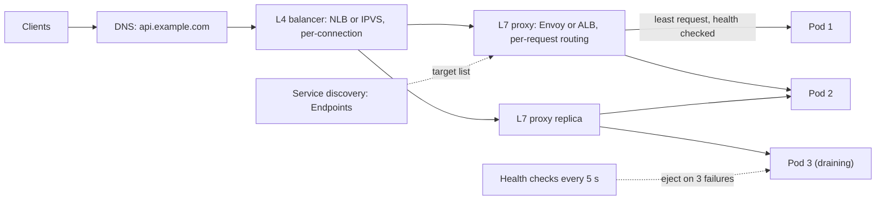

# Load Balancers

> [!abstract] In one sentence
> A load balancer is the component that turns N replicas into one addressable service — distributing traffic by an algorithm, removing instances that fail [[Health Checks|health checks]], and absorbing deploys and crashes — which is what makes [[Horizontal vs Vertical Scaling|horizontal scaling]] and high [[Availability]] possible at all.

> [!tip] Deeper treatment in your system-design vault
> `system-design/03 Traffic Management/Load Balancers.md` — read it *after* you have written your own explanation below.

**Map:** [[Networking MOC]] → [[HLD MOC]]

## Definition

A load balancer accepts traffic for a virtual address and forwards it to one of several backend instances according to a policy. A **layer 4 (L4)** balancer works on TCP/UDP: it picks a backend per *connection* (or per packet for UDP) from the 5-tuple and forwards bytes without parsing them. A **layer 7 (L7)** balancer terminates the protocol — usually [[HTTP and HTTPS|HTTP]] — and picks a backend per *request*, which lets it route on path, headers or cookies, retry, and balance multiplexed protocols like [[gRPC]]. Balancers sit at the edge (internet-facing), inside the cluster (service to service) or inside the client itself (client-side balancing with a list of endpoints from [[Service Discovery]]).

## Problem solved

One server has a ceiling in CPU, connections and failure. Once you run two, three things need an answer: how clients find them, how traffic is split so neither drowns, and what happens when one dies or is being deployed. Early answers — [[DNS]] round robin, clients hard-coding a list — fail badly: DNS caches ignore TTLs and keep sending to dead hosts, clients cannot know which backend is overloaded, and every client must reimplement failover. A load balancer centralises the decision: one stable address, active health checking that removes bad instances within seconds, an algorithm that accounts for load, and connection draining so a deploy does not drop in-flight requests. It is the single most important piece of infrastructure behind the sentence "we added more pods and it got faster".

## How it works

1. **Virtual address.** Clients connect to a VIP or a DNS name that resolves to the balancer(s). Behind it is a **target pool** populated statically or from service discovery (Kubernetes Endpoints, Consul, cloud target groups).
2. **Health checking.** The balancer probes each target on an interval (TCP connect, HTTP `GET /healthz` expecting `200`, or gRPC health protocol). A target is ejected after N consecutive failures and readmitted after M successes; outlier detection additionally ejects targets returning bursts of `5xx` or timing out (passive health). Probe depth matters: a shallow check keeps a half-broken instance in rotation; a deep check that touches the database can eject *everything* during a database blip ([[Health Checks]]).
3. **Selection algorithm.**
   - *Round robin* and *weighted round robin* — simple, fair for homogeneous backends with uniform requests.
   - *Least connections* / *least outstanding requests* — adapts to slow backends; the default choice for L7 with heterogeneous request cost.
   - *Random with two choices* (power of two choices) — pick two at random, send to the less loaded one; avoids the herd effect of "least loaded" when many balancers share a pool.
   - *Hash-based* — hash a key (client IP, a header, a URL) to a backend for affinity; implemented with [[Consistent Hashing]] (ring hash, Maglev) so that adding a backend remaps only ~1/N of keys. Used for cache locality and sticky sessions.
   - *Latency-aware* or *EWMA* — weight by observed response time; good for mixed hardware, risky when fast errors look like fast responses.
4. **L4 forwarding.** NAT (rewrite destination IP, backend replies through the balancer) or direct server return (backend replies straight to the client, used by Google's Maglev and LVS/IPVS). Per-packet work is tiny, so a single L4 instance handles millions of packets per second; it cannot see requests, so a long-lived connection is pinned to one backend for life.
5. **L7 processing.** Terminate [[TLS]] (or re-encrypt to backends), parse the request, apply routing rules (`/api/v2/*` → pool B, `Host` header, canary by header or weight), choose a backend per request, forward over a pooled backend connection, optionally retry idempotent requests on connection failure, and emit per-route metrics. Because it is a full [[Reverse Proxies|reverse proxy]], it can also compress, rewrite headers, enforce [[Rate Limiting]] and inject tracing headers.
6. **Stickiness.** When a backend holds client state (a session, a [[WebSockets]] connection, an in-memory cache), the balancer pins a client with a cookie or hash. Stickiness defeats balancing: one hot client, one hot backend, and a backend death drops all its sessions. Prefer stateless backends with shared state in [[Redis]], and reserve stickiness for protocols that are inherently connection-oriented.
7. **Draining.** On deploy or scale-in the target is marked draining: no new connections, existing ones allowed to finish for a grace period (ALB's deregistration delay, Kubernetes `preStop` plus `terminationGracePeriodSeconds`). Without it every deploy produces a burst of `502`s.
8. **The balancer itself must not be a single point of failure.** Cloud balancers are multi-AZ by construction; self-hosted ones run as active–passive pairs with VRRP/keepalived or as anycast/ECMP groups where routers spread flows across several balancer instances.

```yaml
# Envoy-style cluster: least-request with outlier ejection (shape, not exact config)
clusters:
- name: ledger
  lb_policy: LEAST_REQUEST
  health_checks:
  - interval: 5s
    unhealthy_threshold: 3
    healthy_threshold: 2
    http_health_check: { path: /healthz }
  outlier_detection:
    consecutive_5xx: 5
    base_ejection_time: 30s
```

## Architecture



## Use cases

- "Run more than one instance of anything" — the baseline; every stateless service needs one in front.
- "Zero-downtime deploys", "survive an instance crash" — draining plus health checks is the mechanism.
- "Route by path or version", "canary 5% of traffic", "route gRPC streams across pods" — L7 features.
- "Keep requests for key K on the same instance" (in-process caches, session affinity, sharded workers) — hash-based or consistent-hash balancing.
- "Protect backends from overload" — a balancer is the natural choke point for connection limits, queues and [[Rate Limiting]].

## Limitations

- An L4 balancer cannot balance a multiplexed or long-lived protocol: one [[gRPC]] channel or WebSocket pins to one backend; new pods get no traffic until clients reconnect.
- Balancing is only as good as its signal: round robin ignores load, least-connections ignores request cost, latency-based schemes reward fast failures.
- Health checks have a detection lag (interval × threshold); for that window a dead backend still receives its share.
- An L7 balancer is a full proxy: it adds a hop, terminates TLS, and must itself be sized, patched and scaled; it becomes a tempting place to put logic that then becomes a monolith ([[API Gateways]]).
- Stickiness and connection-based balancing reintroduce hot spots and make scale-in lossy.

## Trade-offs

| You gain | You sacrifice |
|---|---|
| One address for N instances; capacity adds up and failures are hidden | An extra hop of latency and another component to run and secure |
| Health-check-driven failover in seconds, graceful deploys | Detection lag; a bad health check can eject the whole fleet |
| L7 routing, retries, TLS termination and per-route observability | CPU per request on the balancer; it needs its own scaling |
| Affinity when you need it (hash-based, sticky) | Even distribution, and clean failover for pinned clients |

## Failure modes

- **Health check too deep** (`/healthz` calls the database): a database hiccup makes every instance fail the check, the balancer ejects all targets and returns `503` for everything — or, with "fail open" semantics, routes to all of them anyway. Noticed as a cliff-edge outage coinciding with a dependency blip; blast radius is the whole service. Keep liveness shallow, readiness honest.
- **Uneven load from connection pinning**: one pod at 90% CPU while others idle, especially after scale-out, because clients keep their existing HTTP/2 or WebSocket connections. Noticed via per-pod CPU skew; fix with `max connection age` on servers or L7 balancing per request.
- **Deploy-time `502`s**: pods terminate before the balancer stops sending to them. Noticed as error spikes aligned with rollouts; fix with readiness gates, `preStop` sleep and a deregistration delay longer than the longest request.
- **Retry amplification at the balancer**: L7 retries on `503` multiply load on an already overloaded pool, turning a brown-out into a black-out ([[Retry Storms]]). Cap retries and apply retry budgets.
- **Balancer capacity exhaustion**: source-port exhaustion on NAT balancers (about 64k ports per source IP per backend), file-descriptor limits, or an L7 proxy at 100% CPU. Noticed as connection resets under load with healthy backends.

## Performance

L4 forwarding adds microseconds and handles millions of packets per second per instance; L7 adds roughly a millisecond or less of processing plus TLS cost, with throughput bounded by CPU (tens of thousands of requests per second per core is a typical order of magnitude for Envoy or nginx with keep-alive, far less without connection reuse to backends — see [[Keep-Alive Connections]]). TLS termination is the dominant L7 cost; session resumption and keep-alive to backends make most of it go away. Algorithm choice changes tail latency more than average: least-request or two-choices cut p99 markedly against round robin when backends are heterogeneous ([[The Tail at Scale]]).

## Scalability

Backends scale horizontally by adding targets; the balancer tier scales by anycast/ECMP across balancer instances (L4) and by horizontal L7 proxy replicas behind an L4 tier — the two-tier shape in the diagram is how clouds and large sites do it. At 10x: health-check traffic itself becomes noticeable (N balancers × M targets × 1/interval), target list churn from autoscaling must propagate quickly (service discovery lag), and per-client connection pinning dominates the balance quality, which is when client-side balancing or a service mesh (Envoy sidecars doing L7 balancing per request) wins for internal traffic.

## Operational impact

Moderate and front-loaded. You must define health checks carefully, set drain timeouts to match request durations, decide TLS termination points, and keep the balancer's own metrics (per-target health, `5xx` by target, active connections, request latency by route) on the dashboard — they are often the best view of a service's health you have. Managed balancers (ALB/NLB, GCP LB) remove patching and HA concerns but have quotas, warm-up behaviour and limited algorithms; self-hosted (Envoy, HAProxy, nginx) give control and cost ownership. Debugging "which pod served this request" needs a backend identifier in response headers or logs.

## Alternatives

- **[[DNS]] round robin or weighted DNS** — wins for coarse geographic or cluster-level steering; loses for instance-level balancing because of caching and no health feedback.
- **Client-side balancing** (gRPC `round_robin`, Ribbon-style libraries, Kubernetes headless services) — wins for internal multiplexed protocols; costs per-language logic and discovery integration.
- **Service mesh sidecars** (Istio/Envoy, Linkerd) — L7 balancing, mTLS and retries per pod without application changes; costs resources per pod and operational complexity.
- **Anycast at the network layer** — wins for global edge entry points ([[CDNs]]); not a replacement for instance-level balancing.

## Real-world examples

- Google's Maglev is a software L4 balancer using consistent hashing and ECMP so that any Maglev instance can handle any packet and connections survive balancer failures.
- AWS ALB (L7) and NLB (L4) embody the split: NLB for raw TCP/UDP at scale with static IPs, ALB for path and header routing, WebSockets and gRPC.
- Envoy, created at Lyft, became the data plane of most service meshes precisely because L7 balancing of gRPC across pods needed a sidecar that understands streams.
- In a stack like yours: an ALB or ingress-nginx at the edge terminating TLS and routing by host and path to Spring and NestJS services on EKS, Kubernetes Services doing L4 inside the cluster, and gRPC or long-lived connections needing headless services or a mesh to balance properly.

## Practical exercise

1. With Docker Compose, run three replicas of a small HTTP service that reports its instance id and sleeps for a random 10–500 ms, behind nginx (round robin) and then Envoy (least request).
2. Drive 200 concurrent users with k6 and record per-instance request counts and p99 under each algorithm; make one replica slow (sleep 2 s) and compare how each algorithm reacts.
3. Kill one replica with `docker kill` and measure how many requests fail before the health check ejects it; shorten interval and threshold and repeat.
4. Switch the client to HTTP/2 (or gRPC) and observe all traffic pinning to one replica through an L4 proxy; then route through Envoy and watch it spread per request.
5. Add a `preStop` sleep and drain timeout, redeploy under load, and count `502`s before and after.

## Related concepts

### Prerequisites
- [[TCP and UDP]] — what L4 sees and forwards
- [[HTTP and HTTPS]] — what L7 parses and routes
- [[Horizontal vs Vertical Scaling]] — the reason a balancer exists

### Related
- [[Reverse Proxies]] — an L7 balancer is one; the features overlap heavily
- [[Health Checks]] — the signal that drives ejection and readmission
- [[Consistent Hashing]] — affinity with minimal remapping
- [[Service Discovery]] — where the target list comes from
- [[Keep-Alive Connections]] — connection reuse between balancer and backends
- [[DNS]] — the coarse layer above the balancer

### Builds on this
- [[API Gateways]] — an L7 balancer with policy on top
- [[Availability]] — instance-level failover is the first availability tool
- [[Rate Limiting]] — often enforced at the balancing tier
- [[CDNs]] — global anycast plus regional balancing

### Design problems where it applies
- [[Design an API Gateway]]
- [[Design a Chat System]]
- [[Design a Rate Limiter]]
- [[Design a Ticket Booking System]]

### Projects where it can be implemented
- [[Chaos Lab]]
- [[Load Test and Latency Lab]]

### Resources
- [[System Design Primer (GitHub)]] — the standard overview of L4 vs L7 and algorithms
- [[The Tail at Scale]] — why selection algorithm and hedging matter for p99
- [[Release It!]] — stability patterns that sit at the balancer: draining, back-off, shed load

## Personal understanding

> [!question] Explain it without the source
> Write your own explanation here, from memory. Then compare it with the sections above and note what you missed.

### Mastery checklist
- [ ] I can explain it without the original resource
- [ ] I can describe the problem it solves
- [ ] I can compare it with its alternatives
- [ ] I can name its limitations and failure modes
- [ ] I can recognise when it is appropriate in a real system
- [ ] I have applied it in a system design
- [ ] I have validated my assumptions with an experiment or implementation

## Open questions

- [ ] For our Kubernetes Services (iptables/IPVS L4), how skewed is per-pod load for long-lived client connections today, and would a mesh or client-side balancing fix it?
- [ ] What should the readiness probe of a payments service check so that a database blip degrades rather than ejects the whole fleet?
- [ ] At what request rate does the ALB's per-request cost outweigh running Envoy ourselves, and who carries the on-call for that?
