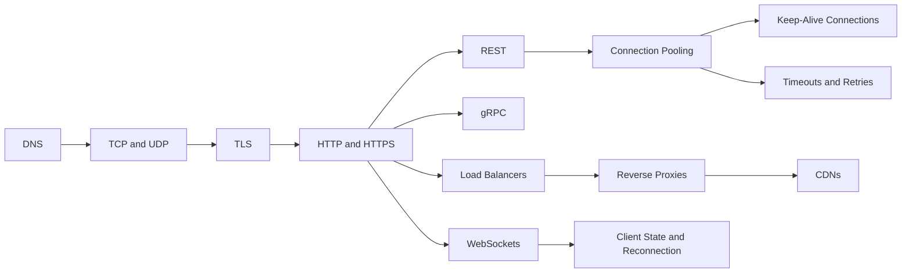

# Networking

> [!abstract] The layer under every request, and where most mysterious failures live.
> How a request physically travels (DNS, TCP, TLS, HTTP), the API styles on top (REST, gRPC, WebSockets), and the infrastructure in the path (load balancers, proxies, CDNs). The two notes that pay off most at work are Connection Pooling and Timeouts and Retries.

**Map:** [[HLD MOC]] → this · [[Start Here]] for the reading plan · [[Engineering Dashboard]] for progress

## Start with these

[[HTTP and HTTPS]] → [[REST]] → [[Load Balancers]] → [[Connection Pooling]] → [[Timeouts and Retries]] → [[WebSockets]]

## How the ideas connect

*Every node is a link — click to open the note. Arrows mean "read this first".*



> [!example]+ Excalidraw canvas — the same map as rooms, with a reading order and one concrete example per room
> ![[Networking Concept Map.excalidraw]]
> [[Networking Concept Map.excalidraw|Open in Excalidraw]] — every box links to its note (Ctrl/Cmd-click). Needs the Excalidraw plugin (see [[Plugins to Install]]).


## Concepts

### Core — know these cold for SDE-2

- [[HTTP and HTTPS]] — HTTP is the request-response protocol every API, browser, proxy and CDN speaks
- [[WebSockets]] — WebSockets upgrade an HTTP connection into a persistent full-duplex channel so the server can push
- [[REST]] — REST models an API as resources addressed by URLs and manipulated through HTTP's uniform, mostly idempotent methods and status codes
- [[Load Balancers]] — A load balancer spreads incoming connections or requests across a pool of healthy backends, at layer 4 by packet forwarding or at layer 7 by understanding the protocol
- [[Connection Pooling]] — A connection pool keeps a bounded set of pre-established connections to a database, cache or HTTP service and lends them to callers, amortising the expensive setup cost…
- [[Timeouts and Retries]] — Every network call needs a deadline that bounds how long you will wait and a retry policy that says which failures to try again, how many times

### Important — read once, revisit when a design needs it

- [[TCP and UDP]] — TCP gives you a reliable, ordered byte stream with flow and congestion control at the cost of handshakes and head-of-line blocking
- [[DNS]] — DNS is the globally distributed, heavily cached lookup service that turns names into records
- [[TLS]] — TLS authenticates the server (and optionally the client) with certificates and then encrypts the byte stream
- [[gRPC]] — gRPC is contract-first RPC over HTTP/2 with Protocol Buffers
- [[Reverse Proxies]] — A reverse proxy is a server that accepts requests on behalf of one or more backends and forwards them
- [[CDNs]] — A CDN is a globally distributed fleet of caching reverse proxies that serves content from a point of presence near the user, cutting latency by removing round trips to…
- [[Client State and Reconnection]] — A real-time client survives disconnects by tracking the last sequence number or cursor it has applied, reconnecting with jittered backoff, presenting a resume token…

### Vocabulary — skim, link, move on

- [[Keep-Alive Connections]] — Keep-alive reuses one TCP (and TLS) connection for many requests instead of opening a new one per request, removing handshake latency and churn

## Where it shows up

**Design problems that lean on this category:** [[Design an API Gateway]], [[Design a Chat System]], [[Design a Video Streaming Service]], [[Design a Webhook Delivery System]], [[Design a URL Shortener]], [[Design a Social Feed]], [[Design a Payment System]], [[Design an IAM Service]]

**Projects that exercise it:** [[Chaos Lab]], [[LLM Gateway]], [[Webhook Relay]], [[Live Ops Dashboard]], [[Load Test and Latency Lab]], [[Presence and Chat Service]]

## Progress in this category

Status and confidence come from each note's properties — update them in the note, the table updates itself (native Bases, no plugin).

```base
filters:
  and:
    - file.hasTag("concept")
    - category == "Networking"
formulas:
  rank: 'if(priority == "high", 1, if(priority == "medium", 2, 3))'
properties:
  file.name:
    displayName: Concept
  formula.rank:
    displayName: "#"
views:
  - type: table
    name: Tracker
    order:
      - file.name
      - priority
      - status
      - confidence
      - last_reviewed
      - next_review
    sort:
      - property: formula.rank
        direction: ASC
      - property: file.name
        direction: ASC
    summaries:
      confidence: Average
```
