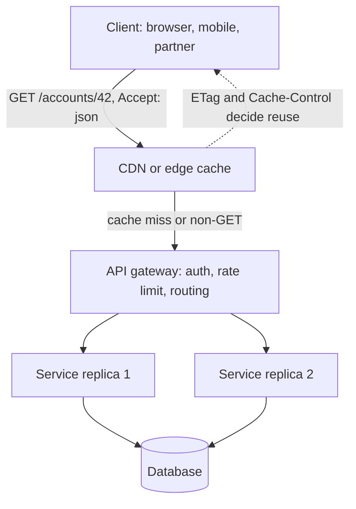

# REST

> [!abstract] In one sentence
> REST is the discipline of exposing your system as **resources** with stable identifiers, manipulated through [[HTTP and HTTPS|HTTP]]'s small, well-defined set of methods and status codes over stateless requests — which buys you cacheability, intermediaries that understand your traffic, and APIs that any client on earth can call without a generated stub.

> [!tip] Deeper treatment in your system-design vault
> `system-design/02 Networking/REST vs gRPC vs GraphQL.md` — read it *after* you have written your own explanation below.

**Map:** [[Networking MOC]] → [[HLD MOC]]

## Definition

REST (Representational State Transfer) is an architectural style, described in Roy Fielding's 2000 dissertation, whose constraints are: client–server, **stateless** requests, explicit **cacheability**, a **layered** system, and a **uniform interface** built on resource identification (URLs), manipulation through representations (JSON, XML), self-descriptive messages (methods, headers, media types) and, in its strict form, hypermedia links that drive the client (HATEOAS). In industry, "a REST API" almost always means the pragmatic subset: nouns in URLs, HTTP methods for verbs, JSON bodies, meaningful status codes, and no server-side session. That subset is what this note treats, while being honest about where it diverges from the original.

## Problem solved

Before REST became the default, remote APIs were mostly RPC over whatever transport was handy: SOAP envelopes tunnelled through `POST`, bespoke binary protocols, or action-shaped URLs like `/doTransfer?from=1&to=2`. Each API had its own verbs, its own error vocabulary and its own notion of retry safety, so nothing generic could sit between client and server: caches could not cache, proxies could not route, and a client library had to be hand-written per API. REST's bet is that if everyone uses HTTP *as designed* — `GET` is safe and cacheable, `PUT` and `DELETE` are idempotent, `404` means the same thing everywhere — then an entire ecosystem of [[Reverse Proxies|proxies]], [[CDNs]], [[API Gateways]], browsers and `curl` can work with any API without knowing what it does. For a team that is a huge win: interoperability for free, and a shared vocabulary for designing contracts ([[Designing APIs and Contracts]]).

## How it works

1. **Resources and identifiers.** Every thing the API exposes has a URL: `/accounts/42`, `/accounts/42/transactions`. Collections are plural nouns; an item is collection plus id. The URL identifies, it does not describe actions.
2. **Methods carry the verb.** `GET` reads (safe: no side effects; cacheable). `PUT` replaces a whole representation (idempotent: repeat it and the end state is the same). `PATCH` applies a partial change (not idempotent by definition, though a well-designed PATCH often is). `POST` creates or triggers (neither safe nor idempotent unless you add an [[Idempotency|idempotency key]]). `DELETE` removes (idempotent: deleting twice yields the same absence, even if the second call returns `404`). This classification is what tells a [[Timeouts and Retries|retry policy]] which requests it may replay blindly.
3. **Representations and negotiation.** The body is a representation, not the resource itself; `Content-Type` says which one, `Accept` lets the client ask for another. Versioning the representation (media type or URL prefix) is how you evolve without breaking clients ([[Backward Compatibility]], [[Versioning and Migrations]]).
4. **Status codes classify the outcome.** `2xx` success (`200`, `201 Created` with a `Location` header, `202 Accepted` for asynchronous work, `204 No Content`), `3xx` redirection, `4xx` the client's fault (`400`, `401` unauthenticated, `403` unauthorised, `404`, `409 Conflict` for version or state clashes, `422` for validation, `429 Too Many Requests` with `Retry-After`), `5xx` the server's fault (`500`, `502`/`503`/`504` from intermediaries). Clients and proxies branch on the class before they ever read the body.
5. **Statelessness.** Every request carries everything needed to process it — typically a bearer token ([[JWT]]) and the resource id. No server-side session means any replica can serve any request, which is the property [[Load Balancers]] and [[Horizontal vs Vertical Scaling|horizontal scaling]] depend on.
6. **Caching.** `Cache-Control`, `ETag`/`If-None-Match` and `Last-Modified`/`If-Modified-Since` let `GET` responses be stored by browsers, CDNs and gateways, and let clients revalidate cheaply with a `304`. ETags double as optimistic-concurrency tokens: `If-Match: "v7"` on a `PUT` fails with `412` if someone else changed the resource ([[Optimistic and Pessimistic Locking]]).
7. **Pagination and filtering.** Collections are paged (`?cursor=…&limit=50` beats `?offset=5000`, which degrades as the offset grows and skips or repeats rows under concurrent writes) and filtered through query parameters; the response carries the next cursor. Cursor pagination is one of the few places where "stateless" and "consistent" pull against each other.
8. **HATEOAS, honestly.** Strict REST says responses include links (`"next"`, `"cancel"`) so the client discovers what it can do next. Almost no production API does this beyond pagination links; clients are written against documentation (OpenAPI) instead. Know the term, do not pretend your API does it.

```http
POST /transfers HTTP/1.1
Idempotency-Key: 7c9e6679-7425-40de-944b-e07fc1f90ae7
Content-Type: application/json
Authorization: Bearer eyJ...

{"from":"acc_42","to":"acc_77","amount_minor":1999,"currency":"INR"}

HTTP/1.1 201 Created
Location: /transfers/tr_8f1
ETag: "1"
```

## Architecture



> [!example]- Excalidraw version — the same diagram as an editable canvas
> ![[REST.excalidraw]]
> [[REST.excalidraw|Open in Excalidraw]] — needs the Excalidraw plugin (see [[Plugins to Install]]).


## Use cases

- "Public or partner-facing API", "mobile apps and web clients" — the universal reach of HTTP plus JSON is the whole point; nothing else is as easy for third parties to call.
- "Read-heavy, cacheable data" (catalogues, profiles, configuration) — `GET` plus ETags lets [[CDNs]] and gateways absorb the load.
- "Resource-shaped domain" with clear nouns and lifecycle (orders, accounts, invoices) — CRUD maps cleanly onto methods and status codes.
- "Must be debuggable from any machine" — `curl`, browser dev tools and HTTP logs read it without tooling.
- "Multiple teams and languages" where a generated stub per language is more coordination than you want ([[gRPC]] is the alternative when you do want it).

## Limitations

- **Chatty for client-shaped reads.** A screen that needs an account, its last ten transactions and the owner's profile makes three round trips or forces a bespoke aggregate endpoint; GraphQL and BFF patterns exist because of this.
- **Weak fit for actions and workflows.** "Approve this loan", "retry this job" are not CRUD; you end up with `POST /loans/42/approve` or a state-change `PATCH`, which is fine, but the uniform interface stops helping.
- **Streaming and server push are not in the model.** Use [[WebSockets]], SSE or [[gRPC]] streaming for those.
- **JSON over HTTP/1.1 is comparatively expensive** per call (text parsing, header bytes, one request per connection without HTTP/2); at tens of thousands of internal calls per second this is measurable CPU.
- **No enforced contract.** Without OpenAPI plus validation, clients and servers drift silently; the discipline is on you.

## Trade-offs

| You gain | You sacrifice |
|---|---|
| Universal reach: any HTTP client, browser, proxy, cache and gateway understands your API | Per-call efficiency; binary RPC is smaller and cheaper to parse |
| A shared vocabulary of methods and status codes that intermediaries and retry logic can rely on | A natural home for actions, batches and client-shaped aggregates |
| Statelessness, which makes horizontal scaling and failover trivial | Server-side convenience; every request must carry its own context |
| Built-in caching and conditional requests | Streaming and bidirectional communication |

## Failure modes

- **A non-idempotent `POST` is retried** by a client, gateway or SDK after a timeout → duplicate transfer, duplicate order. You notice through reconciliation differences or customer complaints; blast radius is money or inventory. Fix with idempotency keys and `409`/replayed responses ([[Duplicate Message Processing]]).
- **Wrong status class** (`200` with `{"error": …}` in the body, or `500` for a validation error) → gateways stop short-circuiting correctly, retry policies retry things that will never succeed, [[Alerting|alerts]] fire on client mistakes. Noticed as noisy dashboards and retry amplification.
- **Offset pagination over a hot table** → p99 climbs with page number and clients see skipped or duplicated rows during writes; noticed as slow "last page" requests in the database's slow-query log.
- **Sensitive data in `GET` query strings** (tokens, account numbers) ends up in proxy logs, browser history and CDN cache keys. Noticed, usually, during an audit.
- **Cacheable responses that should not be** (`GET /me` cached at a shared proxy without `Vary: Authorization` or `Cache-Control: private`) → one user sees another's data. Small frequency, catastrophic blast radius.

## Performance

Latency per call is dominated by network RTT plus TLS and connection setup unless connections are reused ([[Keep-Alive Connections]], [[Connection Pooling]]); over HTTP/2 the per-request cost falls to header compression and framing. JSON encoding and decoding is typically tens of microseconds for small payloads but grows with size and nesting, and uncompressed JSON is several times larger than protobuf for numeric data — enable gzip or brotli at the edge. The biggest performance lever is caching: a correctly cached `GET` costs the origin nothing, and a `304` costs one tiny response. Measure p99 per endpoint, not an API-wide average ([[Latency]]).

## Scalability

Statelessness means read and write capacity scale by adding replicas behind a [[Load Balancers|load balancer]]; the database, not the API tier, is normally the first bottleneck ([[Bottleneck Analysis]]). Reads scale further through [[CDNs]] and [[Cache-Aside|caches]]; writes scale through idempotent design that permits safe retries and through [[Rate Limiting]] at the gateway to protect the backend. At 10x traffic the shape stays the same; what changes is that pagination, N+1 call patterns and uncached personalised `GET`s become the dominant load, and that is when a BFF or aggregate endpoints appear.

## Operational impact

Low to moderate. Debugging is the easiest of any API style: every request is readable in logs and reproducible with `curl`. The ongoing costs are contract governance (an OpenAPI spec kept in sync, breaking-change checks in CI), versioning discipline, consistent error bodies across teams (RFC 7807 problem details is a good default), and dashboards keyed by route and status class rather than raw URL (ids in paths explode cardinality in [[Metrics]]). Rate limits, auth and request logging usually live in an [[API Gateways|API gateway]] so individual services stay thin.

## Alternatives

- **[[gRPC]]** — wins for internal service-to-service calls at high rate, for strict contracts with generated clients, and for streaming; loses browser reach and `curl`-level debuggability.
- **GraphQL** — wins when many client types need differently shaped reads over the same graph of data; costs caching simplicity, query cost control and a thicker server.
- **Asynchronous messaging** ([[Message Queues]], [[Kafka]]) — wins when the caller does not need a synchronous answer; the request becomes an event ([[Synchronous vs Asynchronous Communication]]).
- **RPC-style HTTP** (`POST /rpc/transfer`) — honest and simple for action-heavy internal APIs; you give up caching and intermediaries understanding the semantics, but you avoid contorting actions into resources.

## Real-world examples

- Stripe's API is the canonical pragmatic-REST design: resources, idempotency keys on `POST`, cursor pagination, dated API versions and consistent error objects.
- GitHub's REST API shows ETags and conditional requests used to make polling cheap (`304` responses do not count against the rate limit).
- AWS S3's API is REST over HTTP down to the use of `PUT` for uploads and `ETag`s for integrity ([[Object Storage]]).
- In a stack like yours: Spring Boot and NestJS services exposing JSON over HTTP behind an ingress or gateway, with [[JWT]] bearer tokens from the IAM service, idempotency keys on money-moving `POST`s, and cursor pagination on ledger and transaction listings.

## Practical exercise

1. Build a tiny `transfers` API in Spring Boot or NestJS: `POST /transfers` (with `Idempotency-Key` stored in PostgreSQL alongside the response), `GET /transfers/{id}` (with an `ETag`), `GET /transfers?cursor=` (keyset pagination over `(created_at, id)`).
2. With k6, send the same `POST` five times with one key and confirm exactly one row and five identical responses; remove the key handling and watch five rows appear.
3. Put nginx (or Caddy) in front as a caching proxy; verify `GET /transfers/{id}` is served from cache and that a `PUT` followed by `GET` returns fresh data via ETag revalidation.
4. Compare `?offset=100000` against a cursor on a 1M-row table: measure p99 for both in the slow-query log.
5. Return `200` with an error body for validation failures and observe what your gateway's retry and alerting rules do; then switch to `422` and compare.

## Related concepts

### Prerequisites
- [[HTTP and HTTPS]] — methods, headers, caching and status codes are the raw material
- [[Designing APIs and Contracts]] — the design discipline REST gives shape to

### Related
- [[gRPC]] — the main internal alternative and its trade-offs
- [[Idempotency]] — what makes `POST` safe to retry
- [[Timeouts and Retries]] — retry policies rely on method semantics
- [[Backward Compatibility]] and [[Versioning and Migrations]] — evolving representations without breaking clients
- [[CDNs]] — where cacheable `GET`s end up

### Builds on this
- [[API Gateways]] — centralise auth, rate limits and routing for REST services
- [[Rate Limiting]] — `429` and `Retry-After` are REST's contract for it
- [[Microservices]] — the default inter-service and public API style
- [[Reverse Proxies]] — caching and routing assume REST semantics

### Design problems where it applies
- [[Design a URL Shortener]]
- [[Design an API Gateway]]
- [[Design a Payment System]]
- [[Design a Webhook Delivery System]]
- [[Design a Feature Flag Service]]

### Projects where it can be implemented
- [[Webhook Relay]]
- [[Double-Entry Ledger Service]]
- [[LLM Gateway]]

### Resources
- [[AWS Builders Library - Idempotent APIs]] — making `POST` safe to retry
- [[Stripe - API Versioning]] — evolving a public REST API without breaking clients
- [[Stripe - Idempotency]] — the idempotency-key design most APIs copy
- [[gRPC Core Concepts]] — read it to see exactly what REST does not give you

## Personal understanding

> [!question] Explain it without the source
> Write your own explanation here, from memory. Then compare it with the sections above and note what you missed.

### Mastery checklist
- [ ] I can explain it without the original resource
- [ ] I can describe the problem it solves
- [ ] I can compare it with its alternatives
- [ ] I can name its limitations and failure modes
- [ ] I can recognise when it is appropriate in a real system
- [ ] I have applied it in a system design
- [ ] I have validated my assumptions with an experiment or implementation

## Open questions

- [ ] For a ledger API, should `POST /transfers` with a reused idempotency key but a different body return `409` or `422`, and what do Stripe and PayPal actually do?
- [ ] Where is the line between "action endpoints" (`/approve`) and a state-transition `PATCH`, and which is easier to audit and authorise?
- [ ] How much of our internal REST traffic is cacheable in principle but uncached in practice because responses lack `Cache-Control` and `ETag`?
