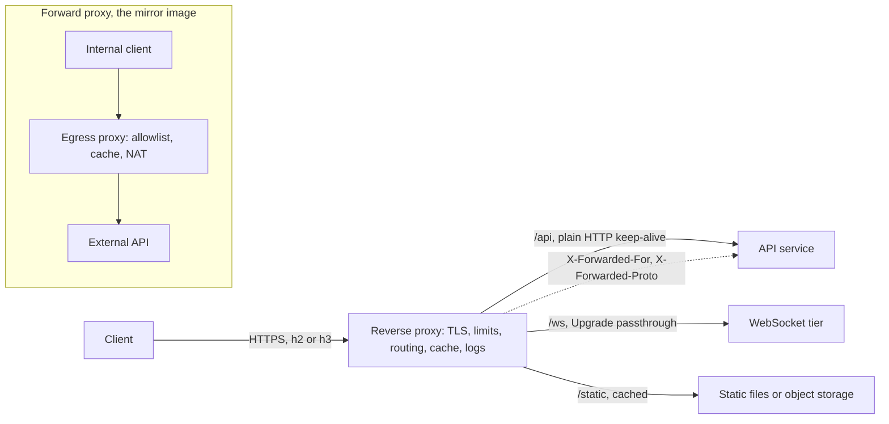

# Reverse Proxies

> [!abstract] In one sentence
> A reverse proxy stands in for your servers — clients talk to it, it talks to the backends — so that cross-cutting concerns like [[TLS]] termination, routing, caching, compression and request policing live in one well-understood component instead of in every service.

> [!tip] Deeper treatment in your system-design vault
> `system-design/03 Traffic Management/Reverse Proxy vs Forward Proxy.md` — read it *after* you have written your own explanation below.

**Map:** [[Networking MOC]] → [[HLD MOC]]

## Definition

A **reverse proxy** is an intermediary deployed on the server side: clients send requests to it believing it is the origin, and it forwards them to one or more backend servers, returning the responses. It represents the server. A **forward proxy** is the mirror image, deployed on the client side: clients explicitly send their outbound requests through it (corporate egress, caching proxies, NAT gateways), and the origin sees the proxy rather than the client. It represents the client. Load balancers at layer 7, [[API Gateways]], ingress controllers, [[CDNs|CDN]] edge nodes and service-mesh sidecars are all specialised reverse proxies; nginx, HAProxy, Envoy, Caddy and Traefik are the general-purpose ones.

## Problem solved

Every HTTP service needs the same dozen things that have nothing to do with its business logic: TLS certificates and handshakes, HTTP/2 or HTTP/3 support, compression, static file serving, request size limits, slow-client protection, path-based routing to several processes, header normalisation, access logging and basic abuse control. Implementing those in each Java, Go and Node process means every runtime's rough edges become your problem (a Node process handling slowloris clients, a JVM terminating TLS with its own cipher configuration), and every change to a certificate or a route means a redeploy of application code. A reverse proxy concentrates all of that in one hardened, highly optimised process written in C or C++, placed in front, so the application behind it can assume clean, decrypted, well-formed HTTP from a trusted neighbour. It also hides the backend topology: clients see one host, and you can move, split or scale backends without anyone noticing.

## How it works

1. **Listen and terminate.** The proxy owns the public socket and the TLS certificate. It completes the handshake ([[TLS]] termination), negotiates HTTP/1.1, HTTP/2 or HTTP/3 via ALPN, and decodes the request.
2. **Normalise.** It enforces limits (header size, body size, request timeout, slow-read protection), rejects malformed requests, strips hop-by-hop headers, and adds forwarding headers so the backend still knows who called: `X-Forwarded-For` (client IP chain), `X-Forwarded-Proto` (`https`), `X-Forwarded-Host`, or the standardised `Forwarded` header. Backends must only trust these from the proxy's address — a client can send its own `X-Forwarded-For`.
3. **Route.** A rule table maps `Host`, path prefix, method or headers to an **upstream** (a pool of backend addresses): `/api/` to the API service, `/static/` to disk or [[Object Storage]], `/ws` to the WebSocket tier with `Upgrade` passthrough. Rewrites can change the path the backend sees.
4. **Forward over pooled connections.** The proxy keeps [[Keep-Alive Connections|keep-alive]] connections to each upstream and multiplexes many client requests over them, which is why a proxy in front of a backend often *reduces* the backend's connection count. It applies [[Load Balancers|balancing]] across the upstream's members and retries idempotent requests on connection failure.
5. **Cache and compress on the way back.** Responses with `Cache-Control` can be stored and served to later clients without touching the backend (micro-caching even for a few seconds absorbs stampedes); bodies are gzip/brotli compressed per `Accept-Encoding`; response headers are rewritten (security headers added, server banners removed).
6. **Buffer.** The proxy usually reads the whole request before forwarding and buffers the response before sending, so a slow mobile client ties up the proxy's cheap event-loop memory rather than an expensive backend thread. For streaming responses (SSE, large downloads) buffering must be disabled explicitly.
7. **Observe and police.** One access log in one format for all services, per-route [[Metrics]], trace-header injection ([[Distributed Tracing]]), [[Rate Limiting]] by IP or token, and IP allow/deny lists.

```nginx
server {
    listen 443 ssl http2;
    server_name api.example.com;
    ssl_certificate     /etc/tls/fullchain.pem;
    ssl_certificate_key /etc/tls/privkey.pem;
    client_max_body_size 2m;

    location /api/ {
        proxy_pass http://api_upstream;          # keep-alive pool to backends
        proxy_set_header Host $host;
        proxy_set_header X-Forwarded-For $proxy_add_x_forwarded_for;
        proxy_set_header X-Forwarded-Proto https;
        proxy_read_timeout 10s;
    }
    location /ws {
        proxy_pass http://ws_upstream;
        proxy_http_version 1.1;
        proxy_set_header Upgrade $http_upgrade;  # WebSocket passthrough
        proxy_set_header Connection "upgrade";
        proxy_read_timeout 3600s;
    }
}
```

## Architecture



## Use cases

- "Several services behind one domain", "route `/v2` to the new service" — routing and rewrites without touching clients ([[Strangler Pattern]]).
- "Terminate TLS once", "rotate certificates without redeploying apps" — centralised TLS.
- "Protect a Node or JVM service from slow clients and oversized requests" — buffering and limits in front.
- "Add caching, compression, security headers or an access log uniformly" — cross-cutting concerns in one place.
- "Control outbound traffic from the cluster" (allowlist, auditing, caching package downloads) — that is a *forward* proxy requirement.

## Limitations

- It is an extra hop and an extra process to run; misconfiguration (timeouts, buffer sizes, header handling) is a frequent root cause in incidents.
- Terminating TLS at the proxy means the hop to the backend is plaintext unless you re-encrypt; inside a cluster that is often acceptable, across trust boundaries it is not ([[Encryption at Rest and in Transit]]).
- Buffering breaks streaming and inflates latency for large bodies unless disabled per route; proxies and [[WebSockets]] need explicit configuration and long idle timeouts.
- The proxy's capacity becomes the ceiling; it must be scaled and made highly available itself.
- Every feature you add turns it a little more into an [[API Gateways|API gateway]] and eventually a monolith of routing rules nobody owns.

## Trade-offs

| You gain | You sacrifice |
|---|---|
| One hardened place for TLS, limits, logging and routing | An extra network hop and a component with its own failure modes |
| Backends that see clean HTTP and fewer connections | Visibility of the real client unless forwarding headers are set and trusted correctly |
| Caching and compression without touching application code | Streaming and WebSocket paths need explicit, careful configuration |
| Topology hiding: move and split backends freely | Config sprawl as routing rules accumulate |

## Failure modes

- **Trusting `X-Forwarded-For` from anyone**: a client spoofs an internal IP and bypasses IP allowlists or rate limits keyed on client IP. Noticed only in audits or when rate limits fail to bite; blast radius is whatever that header gates. Trust it only from known proxy addresses.
- **Timeout mismatch**: proxy `proxy_read_timeout` shorter than the backend's work → the client gets `504` while the backend finishes the (possibly non-idempotent) operation and the client retries it. Noticed as `504`s with successful backend logs ([[Timeouts and Retries]]).
- **Buffering a streaming response**: SSE or chunked responses arrive all at once after the backend finishes; noticed as "streaming works locally but not in production".
- **Idle-timeout race on keep-alive to the backend**: the proxy reuses a connection the backend just closed → sporadic `502` under low traffic. Set the backend's idle timeout longer than the proxy's ([[Keep-Alive Connections]]).
- **Proxy saturation**: worker connections or file descriptors exhausted, or CPU pinned by TLS, so healthy backends sit idle while clients see resets. Watch the proxy's own active-connection and `5xx` metrics.

## Performance

A well-configured proxy adds well under a millisecond of processing per request plus one local network hop; the noticeable costs are TLS handshakes (mitigated by session resumption and HTTP/2 connection reuse) and body compression (CPU proportional to bytes; precompress static assets). Because the proxy multiplexes many client connections onto a small pool of backend keep-alive connections, backends see lower connection churn and often lower latency than if clients hit them directly. Micro-caching popular `GET`s for one or two seconds can reduce origin load by orders of magnitude during spikes ([[Cache Stampedes]]). Event-driven proxies handle tens of thousands of concurrent connections per core; measure with your own payload mix.

## Scalability

Reverse proxies scale horizontally behind an L4 [[Load Balancers|balancer]] or DNS, and they are stateless unless they cache (then cache hit rate drops as you add replicas, which is where a shared cache tier or an origin shield comes in — see [[CDNs]]). At 10x, the limits that appear are file descriptors, ephemeral ports towards backends (reuse connections, add backend IPs), TLS CPU (offload to the edge or use session tickets) and the size and comprehensibility of the routing configuration, which is the moment to split edge proxy from per-service ingress.

## Operational impact

Low per unit, but ubiquitous: a proxy sits in every request path, so its configuration is reviewed like code, its reloads must be graceful (nginx and Envoy support hot reloads; a crash loop is a total outage), and its logs are usually the first thing you read in an incident. In Kubernetes the ingress controller is this proxy, configured through resources rather than files; a sidecar mesh puts a proxy next to every pod, which multiplies the resource footprint and the version surface. Certificate renewal is the recurring chore to automate ([[Secrets Management]]).

## Alternatives

- **[[Load Balancers]] (L7 managed, e.g. ALB)** — wins when you want the proxy's job without running the proxy; loses on fine-grained configuration and cost at high request rates.
- **[[API Gateways]]** — wins when the cross-cutting concerns are API-level (auth, quotas, transformation) rather than HTTP-level.
- **Service mesh sidecars** — the reverse proxy per pod; wins for mTLS and uniform observability inside the cluster at the cost of resources and complexity.
- **No proxy, direct exposure** — only reasonable for a single service on a platform that already fronts it (a PaaS or serverless runtime), where the platform *is* the proxy.

## Real-world examples

- nginx began as a reverse proxy and web server for Rambler and remains the most deployed one; Cloudflare, CDNs and most Kubernetes ingress controllers are reverse proxies at heart.
- Envoy at Lyft, and later as the Istio data plane, generalised the reverse proxy into a programmable L7 layer with xDS configuration.
- Netflix's Zuul is a reverse proxy that grew into an API gateway, a trajectory worth remembering when adding features to yours.
- In a stack like yours: an ingress controller (nginx or ALB ingress) on EKS terminating TLS, routing by host and path to Spring and NestJS services, forwarding `X-Forwarded-*`, with `Upgrade` passthrough for the WebSocket service and buffering disabled for streaming endpoints; outbound calls to payment partners going through an egress forward proxy for allowlisting and audit.

## Practical exercise

1. In Docker Compose, put nginx in front of a NestJS or Spring service; configure TLS with a self-signed certificate, `client_max_body_size`, `proxy_read_timeout 5s` and keep-alive to the upstream.
2. Make an endpoint sleep 8 s; call it through the proxy and watch the `504` while the backend log shows completion — then align timeouts.
3. Add an SSE endpoint; observe it arrive in one burst, then set `proxy_buffering off` (or `X-Accel-Buffering: no`) and watch it stream.
4. Send a request with a forged `X-Forwarded-For: 10.0.0.1` and print what the backend sees before and after restricting trusted proxies.
5. Enable `proxy_cache` with a 2 s micro-cache for a hot `GET` and measure backend request rate under k6 before and after.

## Related concepts

### Prerequisites
- [[HTTP and HTTPS]] — headers, methods and caching semantics the proxy manipulates
- [[TLS]] — termination is the proxy's most common job

### Related
- [[Load Balancers]] — an L7 balancer is a reverse proxy with a target pool
- [[Keep-Alive Connections]] — upstream connection reuse and the idle-timeout race
- [[CDNs]] — a globally distributed caching reverse proxy
- [[Timeouts and Retries]] — proxy timeouts must agree with backend budgets
- [[Rate Limiting]] — often enforced at the proxy
- [[WebSockets]] — need `Upgrade` passthrough and long idle timeouts

### Builds on this
- [[API Gateways]] — a reverse proxy with API-level policy
- [[Service Discovery]] — fills the proxy's upstream lists dynamically
- [[Strangler Pattern]] — route-by-route migration lives in the proxy's rules

### Design problems where it applies
- [[Design an API Gateway]]
- [[Design a Video Streaming Service]]
- [[Design a Chat System]]

### Projects where it can be implemented
- [[LLM Gateway]]
- [[Chaos Lab]]

### Resources
- [[System Design Primer (GitHub)]] — reverse proxy versus load balancer section
- [[Release It!]] — timeouts and limits at the boundary

## Personal understanding

> [!question] Explain it without the source
> Write your own explanation here, from memory. Then compare it with the sections above and note what you missed.

### Mastery checklist
- [ ] I can explain it without the original resource
- [ ] I can describe the problem it solves
- [ ] I can compare it with its alternatives
- [ ] I can name its limitations and failure modes
- [ ] I can recognise when it is appropriate in a real system
- [ ] I have applied it in a system design
- [ ] I have validated my assumptions with an experiment or implementation

## Open questions

- [ ] Which of our ingress timeouts are shorter than the slowest legitimate backend operation, and which of those operations are non-idempotent?
- [ ] Should service-to-service traffic inside the cluster be re-encrypted after ingress termination, and what does that cost in CPU and operational effort?
- [ ] Where do we currently trust `X-Forwarded-For`, and from which addresses?
